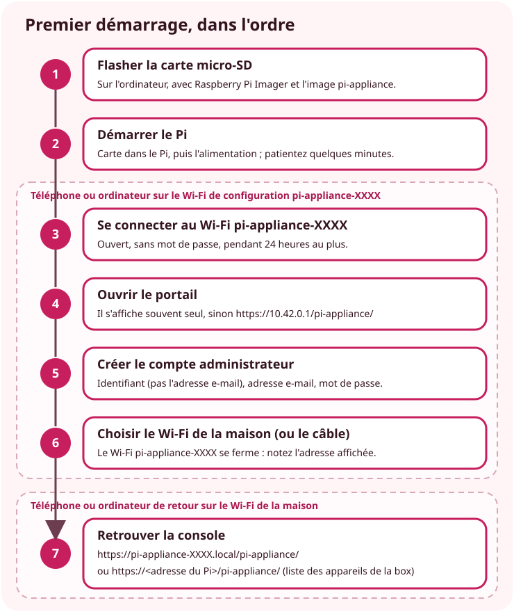

# Guide de pi-appliance

pi-appliance, ce sont trois parties qui portent le même nom :

- **l'image pi-appliance**, à copier sur la carte SD : le système du Pi, prêt à l'emploi ;
- **le socle pi-appliance**, toujours installé sur le Pi : sa **console**, la page web d'où l'on règle le Pi et installe ses services, et ses outils, dont la commande **`pia`** pour ceux qui passent par la ligne de commande ([voir plus bas](#ligne-de-commande)) ;
- **l'application mobile**, [app.pi-appliance.com](https://app.pi-appliance.com) (ou son adresse provisoire, [gmoulard.github.io/pi-appliance-pwa](https://gmoulard.github.io/pi-appliance-pwa/)) : ce guide lisible sans réseau, et un raccourci vers vos Pi.

> **État du projet : expérimental.** L'image système est validée sur Raspberry Pi 3 B+ et Raspberry Pi 4 ; le Pi 5 et le Pi Zero 2 W restent à essayer. Ce n'est pas encore une version stable : gardez une copie de vos données importantes ailleurs.

**Dans ce guide**

1. [Ce que contient cette version](#contenu)
2. [Ce qui n'est pas encore disponible](#pas-encore-disponible)
3. [Télécharger et installer l'image](#telecharger-limage-experimentale)
   - [Ce qui se passe au premier démarrage](#premier-demarrage)
   - [Retrouver la console sur le réseau de la maison](#retrouver-la-console)
   - [Retrouver son Pi sur son téléphone : l'application mobile](#application-mobile)
4. [Envoi des e-mails et double authentification](#envoi-des-e-mails)
   - [Régler l'envoi des e-mails](#envoi-des-e-mails)
   - [Protéger son compte : la double authentification](#double-authentification)
5. [Administrer le Pi depuis internet](#console-sur-internet)
6. [Ligne de commande du Pi (SSH)](#ligne-de-commande)
7. [Mot de passe oublié : le lien par e-mail](#mot-de-passe-oublie), ou [le fichier reset](#fichier-reset)
8. [Remettre le Pi à zéro](#remise-a-zero)
9. [Diagnostic du Pi sans écran](#diagnostic)
10. [Faire dépanner son Pi par Claude](#depannage-par-claude)
11. [Domaine personnel chez OVH](#domaine-personnel-chez-ovh) (pas encore disponible)
12. [Lancer la console depuis les sources](#depuis-les-sources)
13. [Pour aller plus loin](#pour-aller-plus-loin)

## Ce que contient cette version {#contenu}

- Une console en français avec création du compte administrateur, connexion et assistant de première mise en route (réseau, test du Wi-Fi, redémarrage).
- La configuration du réseau filaire ou du Wi-Fi depuis la console, ainsi qu'un point d'accès Wi-Fi de configuration au premier démarrage de l'image.
- Un tableau de bord avec l'état du Pi, des graphiques et des alertes de mémoire et de stockage.
- Une marketplace avec les applications installables du catalogue.
- L'installation de plusieurs instances, les commandes de démarrage et d'arrêt, la mise à jour des applications avec retour arrière, et le choix de conserver ou supprimer leurs données à la désinstallation.
- La gestion d'un disque USB pour les données des services.
- Les sauvegardes chiffrées sur un second disque USB, chaque nuit et à la demande, et la restauration d'un service à une date choisie (écran « Sauvegardes » dans « Mon Pi »), pas encore essayées sur un vrai Pi.
- Un code à scanner avec l'[application mobile](#application-mobile), dans « Mon Pi », pour retrouver le Pi et ses services sur le téléphone.
- L'[envoi des e-mails](#envoi-des-e-mails) par votre propre boîte e-mail (Gmail, OVH, Free, Orange…), et la [double authentification](#double-authentification) par un code reçu par e-mail ou par une application du téléphone, proposée à chaque nouveau compte ; pas encore essayés sur un vrai Pi.

Ces fonctions sont présentes dans le code, mais restent à valider sur du matériel réel. La liste des essais restants est dans la page [Avancement](TODO.html).

## Ce qui n'est pas encore disponible {#pas-encore-disponible}

- Une version stable de l'image, et des essais sur Pi 5 et Pi Zero 2 W.
- La réservation d'une adresse `*.pi-appliance.com`. Les services s'ouvrent déjà depuis internet sous l'adresse du Pi (voir [Ouvrir ses services depuis internet](#services-sur-internet)), pas encore essayé sur un vrai Pi.
- Les sauvegardes en ligne ou sur un autre pi-appliance et la restauration de l'appliance entière ou d'un seul fichier.

## Télécharger et installer l'image {#telecharger-limage-experimentale}

L'image est publiée avec chaque version de pi-appliance, sur la page [dernière version](https://github.com/gmoulard/pi-appliance/releases/latest) : le fichier **`pi-appliance-vX.Y.Z.img.xz`** (environ 720 Mio compressé, 3,3 Gio une fois décompressé) et son fichier de somme de contrôle **`pi-appliance-vX.Y.Z.img.xz.sha256`**, où `X.Y.Z` est le numéro de version (par exemple `0.1.6`). Elle est validée sur Raspberry Pi 3 B+ et Raspberry Pi 4. Un Pi déjà installé n'a pas besoin d'être reflashé : il se met à jour depuis la console (« Mon Pi », « Mises à jour »). Une version qui ne change que le socle est publiée sans image : sa page le dit et donne le lien de la dernière image ; flashez celle-ci, puis mettez le Pi à jour depuis la console.

L'image contient le socle pi-appliance et sa console : rien d'autre à installer. Seule la personne qui configure le Pi, avec le compte administrateur créé au premier démarrage, peut l'administrer. Chaque Pi a son propre nom, `pi-appliance-XXXX`, modifiable dans la console (section « Réseau de la maison », « Nom du Pi sur le réseau ») : un Pi nommé `salon` s'ouvre à `https://salon.local/pi-appliance/`.

L'image est destinée aux Raspberry Pi 5, 4, 3 B+ et Zero 2 W. Il faut une carte micro-SD de 16 Go ou plus, un ordinateur et [Raspberry Pi Imager](https://www.raspberrypi.com/software/). Le flashage efface entièrement la carte SD.

1. Sur la page de la [dernière version](https://github.com/gmoulard/pi-appliance/releases/latest), téléchargez dans le même dossier le fichier `.img.xz` et son fichier `.img.xz.sha256` (s'il n'y en a pas, suivez le lien de la dernière image donné sur cette page). L'archive `-arm64.tar.gz` sert aux mises à jour depuis la console : inutile de la télécharger.
2. **Vérifiez le téléchargement avant de flasher.** Sous Windows PowerShell, depuis le dossier décompressé :

   ```powershell
   $image = ".\pi-appliance-v0.1.6.img.xz"   # remplacez par le nom de votre fichier
   $expected = (Get-Content "$image.sha256").Split()[0]
   $actual = (Get-FileHash $image -Algorithm SHA256).Hash
   if ($actual -ne $expected) { throw "Somme SHA-256 invalide : ne flashez pas cette image." }
   ```

   Sous Linux ou macOS, dans ce même dossier :

   ```shell
   sha256sum -c pi-appliance-v*.img.xz.sha256
   ```

   Ne flashez pas l'image si la vérification échoue.
3. Décompressez le fichier `.img.xz` avec 7-Zip pour obtenir le fichier `.img`.
4. Téléchargez et ouvrez [Raspberry Pi Imager](https://www.raspberrypi.com/software/). Choisissez le modèle de Pi, puis **Choisir l'OS > Utiliser une image personnalisée** et sélectionnez le `.img`. Choisissez la carte SD, puis lancez l'écriture. Confirmez l'effacement demandé par Imager.
5. Insérez la carte dans le Raspberry Pi et démarrez-le. Au premier démarrage, le Pi ouvre un réseau Wi-Fi de configuration **`pi-appliance-XXXX`** (quatre caractères qui changent d'un Pi à l'autre), sans mot de passe, pour une durée maximale de 24 heures. Il ne donne accès ni à internet ni à votre réseau : seulement au portail. Connectez-y votre téléphone ou ordinateur, puis ouvrez `https://10.42.0.1/pi-appliance/` si le portail ne s'affiche pas automatiquement.
6. Dans l'assistant, créez le mot de passe administrateur et choisissez le Wi-Fi de la maison ou le réseau filaire. Le navigateur peut signaler le certificat local auto-signé : ne continuez que si vous êtes bien connecté au point d'accès de votre propre Pi. Une fois le réseau configuré, le Wi-Fi de configuration se ferme : reconnectez votre téléphone ou votre ordinateur au Wi-Fi de la maison, puis ouvrez `https://pi-appliance-XXXX.local/pi-appliance/`. Voir [Retrouver la console](#retrouver-la-console) si cette adresse ne s'ouvre pas.

7. De retour dans l'assistant, sur le réseau de la maison, cliquez sur **Tester le Wi-Fi** (ou **Tester le câble réseau**) : la console vérifie que le Pi est bien relié, que la box répond et qu'il se reconnectera tout seul. Si tout est en ordre, cliquez sur **Redémarrer le Pi** : la console affiche l'adresse où le retrouver et redémarre le Pi au bout de 10 secondes (bouton **Ne pas redémarrer** pour annuler). Une à deux minutes plus tard, la page revient d'elle-même sur l'écran de connexion.

8. L'assistant n'installe pas de service. Une fois connecté, faites défiler la page sous **Mes services** jusqu'à la rubrique **Marketplace**. Sélectionnez une application, choisissez son nom puis cliquez sur **Installer**. Une adresse locale comme `www-pi-appliance-XXXX.local` (le nom du service, un tiret, puis le nom du Pi) apparaît dans **Mes services** quand l'installation réussit ; elle s'ouvre depuis tous les appareils de la maison, ordinateurs Windows et téléphones Android compris. La première fois, le navigateur affiche pour cette adresse la même alerte que pour la console : vous pouvez continuer. Les services installés avec une version précédente, à une adresse comme `www.pi-appliance-XXXX.local`, passent d'eux-mêmes à la nouvelle adresse après la mise à jour de pi-appliance, et suivent aussi le nouveau nom du Pi si vous le changez : mettez à jour vos favoris. Pour un site web, les fichiers se déposent par **Nextcloud** : installez aussi Nextcloud depuis la marketplace ; quelques minutes après, un dossier **Site <nom-du-site>** apparaît dans Nextcloud pour son compte administrateur. Les fichiers placés dans ce dossier sont servis directement par le site.

### Ce qui se passe au premier démarrage {#premier-demarrage}



1. **Flashage** : Raspberry Pi Imager écrit l'image sur la carte micro-SD, depuis votre ordinateur.
2. **Démarrage** : au premier démarrage, le Pi agrandit sa partition, se donne son nom `pi-appliance-XXXX` et crée ses clés ; comptez quelques minutes.
3. **Wi-Fi de configuration** : le Pi ouvre le Wi-Fi `pi-appliance-XXXX`, sans mot de passe, pendant 24 heures au plus. Il ne sert qu'à configurer le Pi : il ne donne accès ni à internet ni à votre réseau.
4. **Portail** : une fois connecté à ce Wi-Fi, le téléphone ouvre souvent le portail tout seul ; sinon, ouvrez `https://10.42.0.1/pi-appliance/`. Le navigateur affiche une alerte sur le certificat : vous pouvez continuer.
5. **Compte** : choisissez un identifiant (un nom court, par exemple `marie` : ce n'est pas l'adresse e-mail), votre adresse e-mail et un mot de passe d'au moins 12 caractères. L'assistant « Mise en route » s'ouvre ensuite ; il revient à chaque connexion tant qu'il n'est pas terminé. Au-dessus, la carte « Protégez votre compte » propose la [double authentification](#double-authentification) : sans internet, choisissez l'application du téléphone ou **Plus tard** ; le code par e-mail viendra une fois l'[envoi des e-mails](#envoi-des-e-mails) réglé.
6. **Wi-Fi de la maison** : choisissez le pays, puis votre Wi-Fi et son mot de passe (le bouton **Afficher** montre ce que vous tapez), ou le câble réseau s'il est branché sur la box. Avant de couper le Wi-Fi de configuration, la console affiche l'adresse où la retrouver ; avec le câble, elle donne aussi l'adresse IP du Pi.
7. **Retrouver la console** : reconnectez votre téléphone ou votre ordinateur au Wi-Fi de la maison et ouvrez l'adresse indiquée (ci-dessous), puis reconnectez-vous : l'assistant reprend.
8. **Vérification et redémarrage** : **Tester le Wi-Fi** vérifie la connexion sans rien couper ; si tout est en ordre, **Redémarrer le Pi** rappelle l'adresse du Pi, compte 10 secondes et redémarre le Pi, qui doit retrouver votre réseau tout seul. La mise en route est alors terminée ; vos services se choisissent ensuite dans la marketplace.

### Retrouver la console sur le réseau de la maison {#retrouver-la-console}

- Ouvrez `https://pi-appliance-XXXX.local/pi-appliance/`, où `pi-appliance-XXXX` est le nom du Wi-Fi de configuration de votre Pi (ou le nom que vous lui avez donné dans « Mon Pi »).
- Si un autre appareil de la maison porte déjà ce nom, le Pi en prend un autre en arrivant sur votre réseau (`pi-appliance-XXXX-2`, par exemple). Avec le câble, la console vous donne le nouveau nom avant la bascule ; avec le Wi-Fi, cherchez le Pi dans la liste des appareils de votre box.
- Si cette adresse ne s'ouvre pas (certains téléphones Android et ordinateurs Windows ne trouvent pas les adresses en `.local`), utilisez l'adresse IP du Pi : la console la donne avant la bascule si le Pi est relié par câble ; sinon, cherchez l'appareil `pi-appliance-XXXX` dans la liste des appareils connectés de votre box (son interface d'administration, souvent `http://192.168.1.1`). Ouvrez alors `https://<adresse du Pi>/pi-appliance/`, par exemple `https://192.168.1.127/pi-appliance/`. **N'oubliez pas `/pi-appliance/` à la fin.**
- Le navigateur affiche une alerte (« La connexion n'est pas privée », « Avertissement : risque probable de sécurité ») : le Pi protège la connexion avec son propre certificat, que le navigateur ne connaît pas encore. Choisissez « Paramètres avancés », puis « Continuer ».
- En haut de la console, une barre choisit ce qui est affiché : touchez « Mon Pi », « Mes services » ou « Marketplace », puis, si vous voulez, un thème ou une étiquette (« Entretien », « Fichiers »…). « Mon Pi », « Mes services » et « Marketplace » s'affichent un seul à la fois ; vous pouvez en revanche toucher plusieurs thèmes ou étiquettes. Touchez de nouveau votre choix pour tout revoir. La console se souvient de votre choix sur cet appareil. Un service ajouté avec « Docker Compose libre » reçoit ses étiquettes dans sa fiche (« Étiquettes »).
- En bas de chaque page : la version de pi-appliance, la référence du code (commit) et sa date, la licence et le lien vers le code source. Donnez-les si vous signalez un problème.

La partition, le premier démarrage, le Wi-Fi de configuration et la mise à jour depuis la console sont validés sur Raspberry Pi 3 B+ et Raspberry Pi 4 ; l'ouverture automatique du portail sur téléphone reste à essayer. L'accès aux applications depuis internet n'est pas encore disponible.

### Retrouver son Pi sur son téléphone : l'application mobile {#application-mobile}

L'[application mobile](https://app.pi-appliance.com) garde la liste de vos Pi et de leurs services sur le téléphone, avec ce guide lisible sans réseau.

1. Sur le téléphone, ouvrez `https://app.pi-appliance.com` et ajoutez l'application à l'écran d'accueil. Tant que cette adresse ne répond pas, utilisez l'adresse provisoire `https://gmoulard.github.io/pi-appliance-pwa/`. Les deux adresses ne partagent pas leurs données : une liste de Pi faite sur l'une n'apparaît pas sur l'autre.
2. Dans la console, ouvrez « Mon Pi » : la carte « Application mobile » montre un code à scanner (seulement pour l'administrateur).
3. Dans l'application, touchez « Scanner le code » et visez ce code. Vous pouvez aussi copier le lien de la carte et l'ouvrir sur le téléphone, par exemple en vous l'envoyant par message. Sans la console sous la main, « Ajouter un Pi » accepte aussi la seule adresse du Pi sur internet (par exemple `salon.pi-appliance.com`) : l'application demande au Pi son nom et ses services (pi-appliance v0.1.10 ou plus récent depuis l'adresse provisoire).

Scanner le code depuis l'application **appaire** aussi le téléphone à votre compte : ensuite, l'application ouvre la console sans mot de passe, à la maison. Le code change toutes les quelques minutes et ne sert qu'une fois : ne le montrez qu'à vos propres téléphones. Le lien à copier, lui, n'appaire pas le téléphone. Les téléphones appairés sont listés dans « Mon compte », rubrique « Appareils » : retirez-y un téléphone perdu ou que vous n'utilisez plus. Depuis le téléphone lui-même, « Désappairer » dans l'application fait la même chose.

Le code et le lien ne contiennent aucun mot de passe : seulement le nom du Pi, ses adresses et celles de ses services (et, pour le code, le code d'appairage de quelques minutes). Pour lire l'état du Pi, l'application demande au Pi son nom, sa version et la liste de ses services ; n'importe qui qui connaît l'adresse du Pi peut lire ces informations, rien d'autre.

## Régler l'envoi des e-mails {#envoi-des-e-mails}

Le Pi envoie lui-même ses e-mails (invitations des nouveaux comptes, liens « mot de passe oublié », codes de connexion), avec une boîte e-mail que vous avez déjà. Administrateur : dans la console, carte **Envoi des e-mails**, entrez les réglages d'envoi de votre boîte, touchez **Enregistrer**, puis **Envoyer un e-mail d'essai** : il arrive à votre adresse. S'il n'arrive pas, la console dit quoi vérifier ; regardez aussi dans les courriers indésirables.

| Boîte e-mail | Serveur d'envoi | Sécurité et port | Identifiant et mot de passe |
| --- | --- | --- | --- |
| Gmail | `smtp.gmail.com` | STARTTLS, 587 | votre adresse Gmail et un **mot de passe d'application** (voir ci-dessous) |
| OVH (adresse de votre domaine) | `ssl0.ovh.net` | TLS, 465 | l'adresse e-mail complète et son mot de passe |
| Free | `smtp.free.fr` | TLS, 465 | votre adresse Free (sans `@free.fr` si elle est refusée) et le mot de passe de la boîte |
| Orange | `smtp.orange.fr` | TLS, 465 | votre adresse Orange complète et le mot de passe de la boîte |

**Gmail** refuse votre mot de passe habituel : dans votre compte Google, activez la validation en deux étapes, puis ouvrez **Sécurité**, **Mots de passe des applications**, créez-en un (par exemple « pi-appliance ») et collez dans la console les 16 lettres affichées. Vous pourrez le retirer à tout moment, sans changer votre mot de passe Google.

Le mot de passe reste sur le Pi : la console ne le réaffiche jamais (laissez le champ vide pour le garder) et il n'est écrit dans aucun journal. Le mieux est une boîte e-mail réservée au Pi, ou un mot de passe d'application. Ce réglage se change seulement depuis la maison. **Ne plus envoyer d'e-mails** efface le réglage ; les comptes qui recevaient leur code de connexion par e-mail devront alors utiliser leur application ou un code de secours.

## Protéger son compte : la double authentification {#double-authentification}

Avec la double authentification, quelqu'un qui apprend votre mot de passe ne peut pas se connecter : à chaque connexion, la console demande en plus un code à 6 chiffres. Elle est facultative, mais proposée à chaque nouveau compte (carte « Protégez votre compte », dans « Mon Pi ») ; l'administrateur peut l'exiger pour un compte, qui ne peut alors rien ouvrir d'autre que « Mon compte » avant de l'avoir activée. Deux façons de recevoir le code, dans « Mon compte », seules ou ensemble :

- **Code par e-mail** (le plus simple, quand l'envoi des e-mails est réglé) : **Vérifier mon adresse e-mail**, puis tapez le code reçu. Votre adresse est alors vérifiée, et à chaque connexion la console vous envoie un code, valable 10 minutes et une seule fois. Pas reçu ? **Renvoyer le code** après une minute.
- **Application d'authentification** (Aegis, Google Authenticator, Microsoft Authenticator…) : **Activer la double authentification**, photographiez le QR code, puis tapez le code affiché. Elle marche même sans e-mail, et protège aussi si quelqu'un prend votre boîte e-mail.

Si les deux sont actives, la console demande le code de l'application et propose **Recevoir un code par e-mail**. À la première activation, la console affiche **10 codes de secours** : notez-les et gardez-les en lieu sûr ; chacun permet une connexion sans téléphone ni e-mail. Téléphone ou boîte e-mail perdus, et codes de secours égarés : un administrateur touche **Retirer la double authentification** sur votre compte (ou `pia user 2fa-off <compte>`), puis vous la réactivez.

## Administrer le Pi depuis internet {#console-sur-internet}

La console est fermée sur internet tant que vous ne l'ouvrez pas. Pour l'ouvrir :

1. Conseillé : à la maison, dans « Mon compte », activez la [double authentification](#double-authentification) (code par e-mail ou application). Ce n'est pas obligatoire, mais depuis internet n'importe qui peut essayer de deviner votre mot de passe ; avec elle, il faut aussi un code.
2. Donnez une adresse internet au Pi, dans « Adresse sur internet » : DuckDNS, puis votre adresse pi-appliance.com. Si vous avez votre propre nom de domaine, vous pouvez aussi, chez votre fournisseur, faire pointer un de ses noms vers votre box (par exemple `maison.exemple.fr`), puis le taper dans la carte « Console sur internet », champ « Votre adresse personnelle », et toucher **Enregistrer l'adresse**. La carte affiche l'entrée à créer chez votre fournisseur : de préférence un alias (**CNAME**) vers votre nom DuckDNS ou votre adresse pi-appliance.com, par exemple `maison.exemple.fr. CNAME monpi.duckdns.org.`, qui suit l'adresse de votre box sans mot de passe de votre fournisseur sur le Pi. Choisissez un sous-domaine (`maison.exemple.fr`) plutôt que le domaine seul (`exemple.fr`), où un alias ne peut pas être créé. La console refuse un nom qui n'existe pas encore sur internet : attendez quelques minutes après le changement chez le fournisseur.
3. Dans votre box, faites suivre les ports **80** et **443** vers le Pi : c'est ce qui permet d'obtenir le certificat de sécurité de l'adresse.
4. Dans « Adresse sur internet », carte « Console sur internet », touchez **Ouvrir la console sur internet**. La carte donne l'adresse à utiliser, par exemple `https://monpi.pi-appliance.com/pi-appliance/`, ou `https://maison.exemple.fr/pi-appliance/` avec votre adresse personnelle.

Depuis internet, la console demande votre mot de passe, puis le code reçu par e-mail ou celui de votre application si vous avez activé la double authentification. Certaines actions restent possibles seulement à la maison : remettre le Pi à zéro, réinitialiser le mot de passe par le fichier `reset`, appairer un téléphone. Vous pouvez refermer la console à tout moment, même depuis internet.

**Cockpit depuis internet, et pour les utilisateurs** : Cockpit (l'administration du système du Pi, dans la Marketplace) n'est ouvert qu'aux administrateurs, à la maison. Sur sa carte, une fois installé, un administrateur peut cocher, à la maison, **Ouvrir aussi depuis internet** (il faut que la console y soit ouverte ; il s'ouvre alors à `https://<adresse>/cockpit/`) et **Ouvrir aussi aux utilisateurs de la console** (pas aux invités ; ils le trouvent dans « Mes services »). Attention : toute personne qui y entre a **tous les droits sur le Pi**, même depuis internet, et la double authentification n'est pas exigée : un mot de passe volé suffit. Décochez pour refermer, même depuis internet.

## Ouvrir ses services depuis internet {#services-sur-internet}

Un service s'ouvre depuis internet à l'adresse internet du Pi suivie de son nom : par exemple `https://maison.exemple.fr/hugo/` pour le service `hugo`, ou `https://monpi.pi-appliance.com/hugo/`. Il n'y a **rien à créer** chez votre fournisseur de nom de domaine : c'est la même adresse que la console, qui doit déjà exister (voir [Administrer le Pi depuis internet](#console-sur-internet), étapes 2 et 3).

- **« Tout le monde, sur internet »** : le service s'ouvre depuis internet dès que le Pi a une adresse internet, même console fermée.
- **« Les personnes qui ont un compte sur ce Pi »** : seulement quand la console est ouverte sur internet, car la connexion passe par elle.
- **« La maison seulement »** : jamais depuis internet.

Sur la fiche du service (« Mes services »), la ligne « Depuis internet » donne son adresse. Quand vous ouvrez la console depuis internet, le bouton **Ouvrir** mène à cette adresse ; il est grisé, avec une phrase qui explique pourquoi, si le service ne s'ouvre pas depuis internet. Certaines applications ne marchent pas sous une adresse partagée avec la console (Nextcloud, WordPress, n8n, Etherpad, DokuWiki, Astro, Next.js, Docker Compose libre) : elles restent à la maison, la fiche le dit. Pour un site Hugo ou Jekyll installé avant cette version, touchez **Mettre à jour** : il est alors construit aussi pour son adresse sur internet. FileBrowser Quantum s'ouvre aussi depuis internet, à l'adresse du Pi suivie de son nom (par exemple `https://vdl.moulard.org/fichiers/`) ; s'il a été installé avant cette version, touchez **Mettre à jour** sur sa fiche (vos fichiers sont gardés). Son adresse de la maison ne change pas : elle mène toute seule à la page de FileBrowser. Un « Site web » simple marche sous cette adresse si ses liens sont relatifs (`page.html`, pas `/page.html`). MkDocs et WordPress vers Markdown y marchent tels quels.

**À savoir :** sous internet, le service partage l'adresse de la console. Une page de ce service pourrait donc agir dans la console au nom d'une personne connectée. N'ouvrez sur internet que des services de confiance, dont vous connaissez le contenu.

## Ligne de commande du Pi (SSH) {#ligne-de-commande}

Pour les personnes à l'aise avec SSH, le Pi a une commande `pia` (nom long : `pi-appliance`). Tout ce qu'elle fait se fait aussi dans la console. Connectez-vous au Pi (`ssh <compte>@<nom-du-pi>.local`), puis :

```sh
pia aide                             # toutes les commandes
pia version                          # version du socle : pi-appliance, système, Docker, Traefik
pia update                           # installer la dernière version de pi-appliance
pia update list                      # versions publiées, celle du Pi signalée
pia update v0.1.6                    # installer cette version (plus récente ou plus ancienne)
pia etat                             # la console répond-elle, état des services
pia catalogue                        # applications installables
pia catalogue nextcloud              # détail et paramètres d'une application
pia installer nextcloud              # installer (--nom, --acces, --param nom=valeur)
pia services                         # services installés
pia redemarrer cloud                 # demarrer, arreter, redemarrer
pia desinstaller cloud               # données gardées ; --effacer-donnees pour les effacer
pia user list                        # comptes de la console
pia user show paul                   # détail, téléphones appairés, liens de partage
pia user add paul paul@exemple.fr    # nouveau compte : un lien pour choisir son mot de passe
pia user add ines ines@exemple.fr --role guest --until 2026-12-31
pia user edit paul --role admin      # aussi --until, --require-2fa yes|no
pia user reset paul                  # nouveau lien de mot de passe (oublié, invitation expirée)
pia user 2fa-off paul                # retirer la double authentification (téléphone ou boîte e-mail perdus)
pia user delete paul
pia ssh                              # SSH : en marche ? mots de passe ? clés ?
pia ssh cle ajouter "ssh-ed25519 AAAA… moi@portable"
pia ssh mot-de-passe desactiver      # clé SSH seulement (refusé tant qu'il n'y a pas de clé)
```

Pour ne pas avoir à répondre aux questions de confirmation (par exemple dans un script), ajoutez `-force` n'importe où sur la ligne : `pia -force desinstaller cloud --effacer-donnees`. La réponse est alors toujours oui : vérifiez bien la commande avant de la lancer.

Inutile de taper `sudo` : quand une commande a besoin des droits d'administrateur du Pi (toutes sauf `aide` et `version`), `pia` les demande lui-même, avec le mot de passe de votre compte si le Pi le réclame. Après avoir coupé les mots de passe, gardez votre session ouverte et vérifiez dans un autre terminal que votre clé marche.

## Mot de passe oublié : le lien par e-mail {#mot-de-passe-oublie}

Sur l'écran de connexion, touchez **Mot de passe oublié ?**, tapez votre identifiant ou l'adresse e-mail de votre compte, puis **Recevoir le lien par e-mail**. Ouvrez le lien reçu dans l'heure et choisissez un nouveau mot de passe ; le lien ne sert qu'une fois. Votre ancien mot de passe reste valable tant que vous n'en avez pas choisi un nouveau, et si la double authentification est activée, le code (par e-mail ou de l'application) vous est toujours demandé. Rien reçu après quelques minutes ? Regardez dans les courriers indésirables. Sans e-mail (Pi sans internet, adresse perdue), utilisez le fichier `reset` ci-dessous pour le compte administrateur ; pour un autre compte, l'administrateur donne un nouveau lien.

## Mot de passe administrateur oublié : le fichier reset {#fichier-reset}

Si la console répond « identifiant ou mot de passe incorrect », vérifiez d'abord l'identifiant : c'est le nom choisi à la création du compte (par exemple `marie`), **pas l'adresse e-mail**. Si le mot de passe administrateur est vraiment perdu, le fichier `reset` permet d'en choisir un nouveau sans rien perdre : les services installés, leurs données et les autres comptes sont conservés.

1. Éteignez le Pi en débranchant son alimentation, puis retirez la carte micro-SD et insérez-la dans un ordinateur.
2. Ouvrez la partition de démarrage de la carte, qui apparaît comme un disque nommé **`bootfs`**. Si l'ordinateur propose de formater la carte ou de réparer d'autres partitions, refusez : seule `bootfs` est lisible sous Windows, et c'est la bonne.
3. Créez à la racine de `bootfs` un fichier vide nommé exactement **`reset`**, sans extension. Sous Windows, affichez d'abord les extensions (Explorateur de fichiers, **Affichage > Afficher > Extensions de noms de fichiers**) : un « nouveau document texte » renommé `reset` s'appelle en réalité `reset.txt` et ne marche pas. Sous macOS ou Linux, dans un terminal : `touch /Volumes/bootfs/reset` (macOS) ou `touch /media/$USER/bootfs/reset` (Linux).
4. Éjectez proprement la carte, remettez-la dans le Pi et rebranchez son alimentation.
5. Ouvrez la console : elle affiche « Le fichier reset a été trouvé sur la carte SD ». Choisissez le nouveau mot de passe du premier compte administrateur (12 caractères au moins), puis connectez-vous avec votre identifiant et ce mot de passe. Toutes les sessions ouvertes auparavant sont fermées. Si la double authentification était activée, le code vous est encore demandé.

Le Pi efface le fichier `reset` dès qu'il l'a lu, mais garde la demande jusqu'au choix du nouveau mot de passe : un redémarrage entre-temps ne la perd pas (images construites après le 20 novembre 2026 ; avec les précédentes, il faut redéposer le fichier).

## Remettre le Pi à zéro {#remise-a-zero}

Pour repartir de la mise en route, comme au premier démarrage (par exemple avant de donner le Pi à quelqu'un d'autre), ouvrez `https://<adresse du Pi>/pi-appliance/reset-to-factory`, connecté avec un compte administrateur. La page dit ce qui sera effacé (tous les comptes, la mise en route, le choix des statistiques anonymes (fonction désactivée pour l'instant), le réglage DuckDNS) et ce qui est gardé (le réseau de la maison, le nom du Pi, les sauvegardes, l'adresse pi-appliance.com). Les services installés et leurs données sont gardés, sauf si vous cochez « Effacer aussi les services installés et toutes leurs données ». Il faut redonner votre mot de passe (et le code de vérification si la double authentification est activée), puis cocher « J'ai compris ce qui sera effacé ».

Mot de passe perdu : déposez d'abord le fichier `reset` (ci-dessus) ; tant que le nouveau mot de passe n'est pas choisi, la page de remise à zéro s'ouvre aussi sans mot de passe.

## Diagnostic du Pi sans écran {#diagnostic}

Si un service ou la console se comporte mal, ouvrez `https://<adresse du Pi>/pi-appliance/diagnostic` (lien « Diagnostic du Pi » dans « Mon Pi »), connecté avec un compte administrateur. La page dit si chaque programme du Pi est en marche, si l'alimentation a été trop faible, la place sur la carte SD et les dernières erreurs. **Télécharger les journaux** crée un fichier texte à envoyer à la personne qui vous aide : les mots de passe et les adresses e-mail y sont masqués.

Sans compte administrateur (mot de passe perdu, compte pas encore créé) : déposez sur la partition `bootfs` de la carte SD un fichier vide nommé exactement **`diagnostic`**, comme le fichier `reset` (voir ci-dessus), puis remettez la carte et rebranchez le Pi. La page s'ouvre alors sans compte, depuis la maison, pendant 24 heures ; le bouton « Fermer l'accès sans compte » la referme plus tôt.

Si la console ne s'ouvre plus du tout (programme Traefik en panne), essayez `https://<nom du Pi>.local:8443/pi-appliance/diagnostic` : le Pi ouvre cette console de secours, qui ne montre que le diagnostic, quand Traefik ne répond plus depuis une minute et demie. Si rien ne répond, débranchez puis rebranchez l'alimentation du Pi.

Si vous avez choisi un compte et activé SSH dans les réglages de Raspberry Pi Imager, ils sont gardés : une personne à l'aise avec l'informatique peut aussi se connecter au Pi par SSH. Le Wi-Fi réglé dans Imager, lui, est ignoré : le Wi-Fi de la maison se choisit dans le portail.

## Transformer un site WordPress en fichiers Markdown {#wordpress-vers-markdown}

L'application **WordPress vers Markdown** de la marketplace transforme les articles et les pages d'un site WordPress en fichiers texte Markdown, avec leurs images : pour garder une copie de son blog, ou pour le passer dans un générateur de site comme Hugo, MkDocs ou Jekyll. Pas encore essayé sur un vrai Pi.

1. Dans votre WordPress (celui du Pi ou un autre), ouvrez **Outils → Exporter**, choisissez **Tout le contenu**, puis **Télécharger le fichier d'export** : vous obtenez un fichier `.xml`.
2. Dans la **Marketplace** de la console, installez **WordPress vers Markdown**, puis ouvrez le service (bouton **Ouvrir**). Par défaut, seules les personnes qui ont un compte sur le Pi peuvent l'ouvrir.
3. Choisissez le fichier `.xml` (40 Mo au plus), cochez les réglages voulus (télécharger les images, ranger les articles par année et par mois, mettre la date au début du nom de chaque article), puis touchez **Convertir**.
4. La page montre l'avancement. À la fin, touchez **Télécharger le fichier .zip** : chaque article y a son dossier, avec son texte (`index.md`) et ses images.

Les images sont prises sur le site WordPress d'origine, qui doit être en ligne ; celles qui n'ont pas pu être téléchargées sont listées dans le fichier `images-manquantes.txt` du `.zip`. Votre fichier reste sur le Pi : rien n'est envoyé ailleurs que les demandes d'images à votre site. Il est effacé du Pi peu après le téléchargement, et au plus tard une heure après la conversion. Une seule conversion à la fois sur le Pi. La première fois, le Pi doit avoir internet pour télécharger l'outil de conversion (quelques minutes).

## Faire dépanner son Pi par Claude {#depannage-par-claude}

Pour les personnes à l'aise avec l'informatique : l'application **Claude Code** de la marketplace laisse Claude, l'assistant d'Anthropic, dépanner le Pi depuis l'application Claude de votre téléphone (ou depuis [claude.ai/code](https://claude.ai/code)), sans brancher d'ordinateur ni ouvrir de port sur la box. Pas encore essayé sur un vrai Pi.

- **Il faut un abonnement Claude** (Pro ou Max).
- **Claude aura tous les droits sur votre Pi** : il peut tout lire, tout modifier, tout effacer. Chaque action passe par votre application Claude, où vous l'acceptez ou la refusez. Seuls les administrateurs l'installent et l'ouvrent, depuis la maison.

1. Dans la **Marketplace**, installez **Claude Code** et confirmez l'avertissement.
2. Ouvrez le service (bouton **Ouvrir**) : une page noire, un terminal, s'affiche. La première fois, Claude Code y est téléchargé chez Anthropic (quelques minutes).
3. Touchez **Entrée**, choisissez votre abonnement Claude, ouvrez le lien affiché, connectez-vous à Claude, puis collez le code donné dans la page et touchez **Entrée**.
4. Claude Code pose deux questions la première fois (faire confiance au dossier, activer Remote Control) : répondez **y** (oui) aux deux.
5. Ouvrez l'application Claude : une session « Raspberry Pi <nom du Pi> » apparaît. Décrivez votre problème, Claude regarde le Pi et propose ses commandes.

Vous pouvez fermer la page du service : Claude reste en marche, et repart seul après un redémarrage du Pi. Quand vous n'en avez plus besoin, touchez **Arrêter** sur sa fiche (« Mes services ») : la connexion avec Anthropic se coupe. La connexion à votre compte Claude reste sur le Pi : elle n'est **jamais copiée dans les sauvegardes** ; sur un autre Pi, il faudra vous reconnecter.

## Domaine personnel chez OVH {#domaine-personnel-chez-ovh}

> Un nom de votre domaine peut servir d'adresse sur internet à la console et aux services : voir [Administrer le Pi depuis internet](#console-sur-internet) (une seule entrée, un alias CNAME vers la cible affichée par la console) et [Ouvrir ses services depuis internet](#services-sur-internet) (les services s'ouvrent sous cette adresse, `https://maison.exemple.fr/<service>/`, sans autre entrée). La suite de cette section décrit l'ancien projet d'une adresse par service, abandonné le 2026-11-22.

Quand cette option sera disponible, la configuration se fera en deux endroits :

### Chez OVH

1. Choisissez un sous-domaine de votre domaine, par exemple `ma-maison.exemple.fr`. C'est préférable au domaine seul (`exemple.fr`) : un alias DNS classique ne peut pas toujours être créé à la racine d'un domaine.
2. Dans l'espace client OVH, ouvrez la zone DNS de votre domaine et ajoutez une entrée de type **CNAME** pour ce sous-domaine. La cible sera le nom complet fourni par la console, de la forme `<nom>.pi-appliance.com`.
3. Ne remplacez pas les serveurs DNS du domaine et ne modifiez pas ses autres entrées, notamment celles utilisées pour le site web ou les e-mails. N'utilisez pas la fonction de redirection web d'OVH à la place de l'entrée DNS.
4. Si la console demande d'autres entrées pour les adresses des services, suivez les valeurs qu'elle affiche ; ne les devinez pas.

### Dans la console pi-appliance

La console devra permettre de saisir le sous-domaine choisi, d'afficher la cible à recopier chez OVH, puis de vérifier la configuration avant d'activer le domaine. Ces réglages et cette vérification ne sont pas encore présents.

**Prérequis :** l'appliance doit d'abord pouvoir obtenir et tenir à jour son adresse pi-appliance (`TODO-3.2` et `TODO-3.5`). La prise en charge du domaine dans la console, notamment pour l'utiliser avec les services et leurs certificats, reste aussi à réaliser. L'accès depuis internet n'est pas encore disponible non plus.

## Lancer la console depuis les sources {#depuis-les-sources}

Cette procédure est destinée aux contributeurs, pas à l'installation d'une appliance. Elle nécessite Go 1.24 ou plus. Docker et Docker Compose sont nécessaires pour installer des services depuis la console.

À la racine du dépôt :

```shell
go test ./...
go run ./cmd/pi-appliance -data ./tmp
```

Ouvrir ensuite **http://localhost:8080/pi-appliance/** dans le navigateur et créer le compte administrateur. Les données de cette instance de développement sont écrites dans `./tmp`.

Pour construire l'image système, utiliser le workflow [Image](https://github.com/gmoulard/pi-appliance/actions/workflows/image.yml). Il est réservé aux essais et à la contribution tant que les tests sur un vrai Pi ne sont pas terminés.

## Pour aller plus loin {#pour-aller-plus-loin}

- [Installer le socle sans l'image](installation.html) : Docker, Traefik, console et services systemd sur un Raspberry Pi OS existant.
- [Essais avec plusieurs Pi](essais-plusieurs-pi.html) : procédure technique pour essayer plusieurs Pi dans une maison, et des Pi dans d'autres maisons joints depuis internet.
- [Marketplace](marketplace.html) : catalogue actuel, applications envisagées et guide de contribution.
- [Spécification](specification.html) : fonctionnement visé par le projet.
- [Avancement](TODO.html) : fonctions réalisées et essais restants.
- [Code source](https://github.com/gmoulard/pi-appliance) : dépôt et workflows.
