# Logo pi-appliance — pistes

Sept pistes de logo. **Piste retenue : 5, « La maison », en framboise**, fichiers définitifs dans [`framboise/`](framboise/), voir la [charte graphique](../charte-graphique.md). La console et le site utilisent ce même logo ; l'ancien logo photo (PNG), dans [`photo/`](photo/), n'est plus utilisé. Les pistes ci-dessous restent pour mémoire.

| Piste | Idée | Couleurs |
|-------|------|----------|
| `1-boitier` | Un boîtier arrondi avec un π et une LED : l'appareil prêt à l'emploi | Bleu nuit, vert |
| `2-circuit` | Un π tracé comme les pistes d'une carte électronique | Bleu nuit, vert |
| `3-prise` | Un π dont les jambes sont les broches d'une prise : on branche, ça marche | Bleu nuit, vert |
| `4-doigts` | Une main avec une framboise au bout de chaque doigt | Bleu nuit, framboise |
| `5-maison` | Une maison avec un π à l'intérieur : vos services, chez vous | Couleurs de la console |
| `6-brouillard` | Un π dans des bandes de brouillard : le Fog Computing | Couleurs de la console |
| `7-repere` | Un repère de carte avec un π : votre adresse, accessible de partout | Couleurs de la console |

## Aperçu

| Piste | Fond clair | Fond sombre | Icône d'app | Favicon |
|-------|-----------|-------------|-------------|---------|
| 1 — Le boîtier | 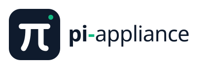 | 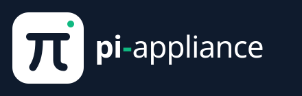 | 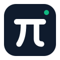 | 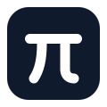 |
| 2 — Le circuit | 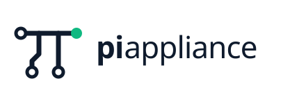 | 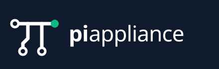 |  | 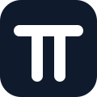 |
| 3 — La prise | 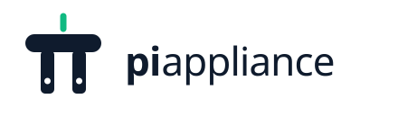 | 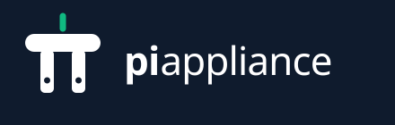 |  |  |
| 4 — Au bout des doigts | 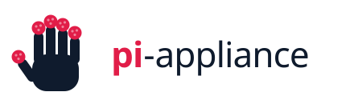 | 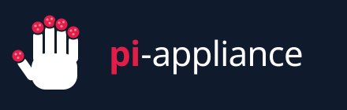 |  |  |
| 5 — La maison | 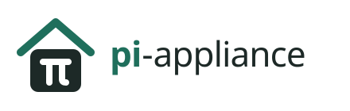 | 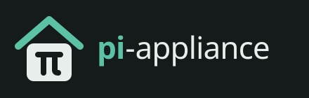 | 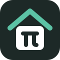 | 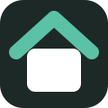 |
| 6 — Le brouillard | 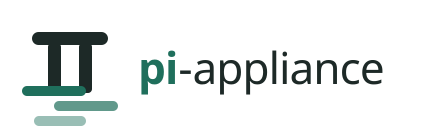 | 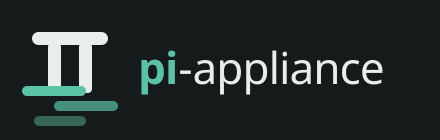 | 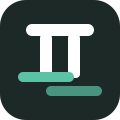 |  |
| 7 — Le repère | 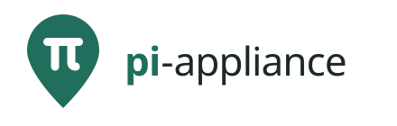 | 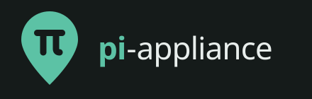 | 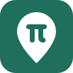 | 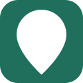 |

Les pistes 5 à 7 reprennent les couleurs de la console (`internal/console/web/styles.css`) : `#1F6F5C` et `#1D2927` en clair, `#5CC2A5` et `#E8EEEC` sur `#151B1A` en sombre.

## Fichiers de chaque piste

| Fichier | Usage |
|---------|-------|
| `logo.svg` | Logo complet (symbole + nom), fond clair |
| `logo-sombre.svg` | Logo complet sur fond sombre |
| `symbole.svg`, `symbole-sombre.svg` | Symbole seul, fond clair ou sombre |
| `icone-app.svg` | Icône d'application (carré arrondi) |
| `icone-moyenne.svg` | Icône simplifiée, vers 40 px |
| `favicon.svg` | Icône très simplifiée, pour 16 à 32 px |

Le nom est écrit en Space Grotesk (Google Fonts, licence OFL), avec un repli sans-serif si la police n'est pas installée. Pour un logo figé, convertir le texte en tracés avant impression.
