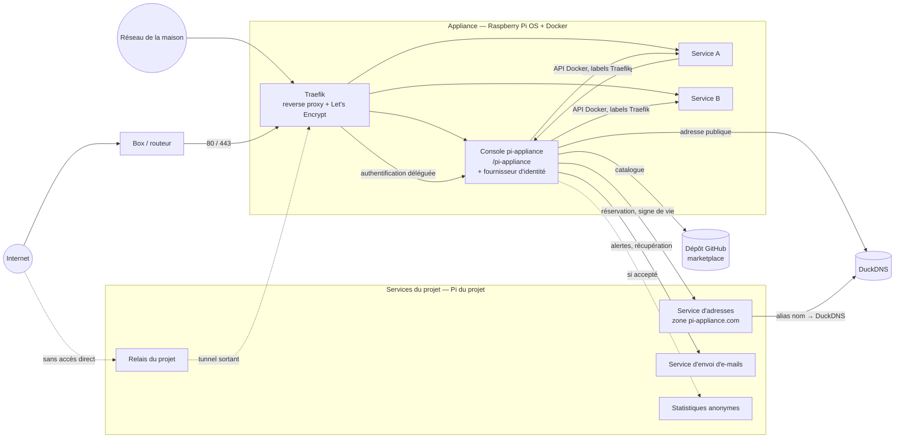

# Spécification de pi-appliance

> **Statut : cible.** Ce document décrit le produit visé. Presque rien n'est encore implémenté : l'état réel et l'avancement sont dans [TODO.md](TODO.md). Une section ne passe de « cible » à « réalisé » que lorsque le code correspondant existe.

## 1. Objet

pi-appliance transforme un Raspberry Pi en **appliance** : un boîtier personnel, posé à la maison, sur lequel on déploie des services. C'est un nœud de **Fog Computing** : les services tournent chez l'utilisateur, au plus près de ses données et de ses objets, et restent accessibles depuis internet.

On flashe une image système prête à l'emploi sur la carte SD, et le Pi fonctionne aussitôt, sans installation manuelle.

L'image repose sur trois couches :

| Couche | Contenu |
|--------|---------|
| Système | Image standard de Raspberry Pi OS (ex-Raspbian), Lite, 64 bits |
| Conteneurs | Docker Engine et Docker Compose |
| Produit | La couche pi-appliance : console d'administration, marketplace, reverse proxy Traefik, exposition sur internet |

### 1.1 Public visé

pi-appliance s'adresse au **grand public** : des personnes sans connaissances techniques, qui ne savent ni ce qu'est Docker ni ce qu'est un DNS. En découle, pour toute la suite :

- tout se fait depuis la console, dans un navigateur : jamais de ligne de commande, de connexion SSH ni de fichier de configuration à modifier ;
- chaque choix a une valeur par défaut raisonnable ; l'utilisateur peut tout accepter sans comprendre ;
- l'interface parle de « services », d'« adresse », de « sauvegarde », pas de conteneurs, de ports ni de certificats ; les termes techniques restent dans les écrans avancés ;
- une erreur dit ce qui ne va pas et quoi faire, en langage courant ;
- une étape qui sort de la console (réglage de la box) est guidée pas à pas.

### 1.2 Licence

pi-appliance est un logiciel libre sous licence **GNU Affero General Public License version 3** (AGPL-3.0), fichier [`LICENSE`](../LICENSE). Toute personne qui modifie pi-appliance et le met à disposition d'autres utilisateurs, y compris à travers le réseau, doit publier ses modifications sous la même licence. Les applications de la marketplace gardent leur propre licence.

### 1.3 Objectif de la première version

Une personne sans connaissances techniques, avec un Raspberry Pi neuf, ouvre son Nextcloud **depuis internet en moins de 15 minutes** après avoir flashé la carte SD, **sans aide** (hors temps de flashage et de téléchargement des images Docker).

## 2. Vocabulaire

| Terme | Sens |
|-------|------|
| **Appliance** | Le Raspberry Pi équipé de l'image pi-appliance. |
| **Console** | L'interface web d'administration de l'appliance, servie sous `/pi-appliance`. |
| **Administrateur** | Compte qui gère l'appliance ; le premier est créé au premier démarrage. |
| **Utilisateur** | Compte qui accède aux services autorisés. |
| **Invité** | Compte à durée limitée, pour un partage ponctuel. |
| **Service** | Une application installée depuis la marketplace : un ou plusieurs conteneurs Docker. |
| **Marketplace** | Le catalogue des applications installables. |
| **Manifeste** | La description d'une application de la marketplace (images, volumes, sous-domaine, paramètres, besoins). |
| **Adresse de l'appliance** | Le nom sous lequel l'appliance est joignable depuis internet : `<nom>.pi-appliance.com` par défaut, ou un domaine personnel. |
| **Relais** | Serveur du projet qui rend l'appliance joignable quand la box ne le permet pas (section 7.3). |

## 3. Parcours type

1. J'achète un Raspberry Pi.
2. Sur www.pi-appliance.com, je télécharge l'image et je la flashe sur une carte SD en suivant le guide.
3. Je démarre le Pi.
4. Le Pi crée un Wi-Fi « pi-appliance ». Je m'y connecte avec mon téléphone : une page s'ouvre, je choisis le Wi-Fi de la maison (ou le câble Ethernet s'il est branché) et je saisis son mot de passe. Le Pi rejoint mon réseau.
5. J'ouvre la console :
   - depuis un appareil de la maison : `https://pi-appliance.local/pi-appliance` ;
   - depuis le Pi lui-même (écran et clavier branchés) : `https://localhost/pi-appliance`.
6. Je me connecte avec l'identifiant et le mot de passe initiaux, je choisis aussitôt mon propre mot de passe et je donne mon adresse e-mail, que je confirme avec le code reçu.
7. Je choisis mon adresse : un nom libre `<nom>.pi-appliance.com`, ou mon propre domaine.
8. Je crée mes utilisateurs.
9. Dans la marketplace, je coche les services que je veux et, pour chacun, qui peut y accéder.
10. pi-appliance télécharge les images Docker, configure Traefik et les certificats, et ouvre chaque service :
    - à la maison, sur le réseau local ;
    - sur internet, à l'adresse `https://<service>.<nom>.pi-appliance.com`.

## 4. Image système et matériel

- Construite à partir de l'image officielle Raspberry Pi OS Lite 64 bits, sans modification du système de base au-delà du nécessaire.
- Contient Docker, Docker Compose, la console pi-appliance et Traefik, démarrés au premier boot.
- Premier démarrage : extension de la partition, nom d'hôte `pi-appliance`, annonce mDNS (`pi-appliance.local`), génération des secrets propres au boîtier (certificat local auto-signé, clés de session). Aucun secret n'est commun à deux images.
- **Modèles pris en charge** : Raspberry Pi 5, Pi 4, Pi 3 B+ et Pi Zero 2 W, avec une seule image 64 bits. Sur les petits modèles (Pi 3 B+ : 1 Go, Zero 2 W : 512 Mo), une application dont la mémoire minimale dépasse celle du Pi s'installe quand même, après un avertissement sur les performances.
- **Réseau au premier démarrage** : le Pi ouvre **toujours** un point d'accès Wi-Fi « pi-appliance » avec un portail de configuration, même si un câble Ethernet est branché, pour que le parcours soit le même pour tous. Le portail propose les Wi-Fi visibles et, si un câble est branché, le réseau filaire. Le point d'accès se referme une fois le Pi connecté, et se rouvre s'il perd durablement le réseau. Le Pi Zero 2 W n'a pas de prise Ethernet.
- **Stockage** : tout fonctionne sur la carte SD. Quand un disque USB est branché, la console propose d'y placer les données des services ; elle prévient quand la carte SD se remplit.
- L'image est publiée sur www.pi-appliance.com avec sa somme de contrôle.

## 5. Console d'administration

Servie par l'appliance sous `/pi-appliance`, en HTTPS seulement.

### 5.1 Premier démarrage (assistant)

1. Connexion avec l'identifiant initial ; changement de mot de passe obligatoire.
2. Adresse e-mail de l'administrateur, **obligatoire**, vérifiée par un code envoyé par e-mail (récupération et alertes, sections 8.5 et 8.6).
3. Langue de l'interface.
4. Adresse de l'appliance : `<nom>.pi-appliance.com` (vérification que le nom est libre) ou domaine personnel (section 7.1).
5. Test d'accès depuis internet ; guide de la box ou bascule sur le relais si besoin (section 7).
6. Création des utilisateurs.
7. Statistiques anonymes : proposées, désactivées par défaut (section 8.4).
8. Choix des premiers services dans la marketplace.

### 5.2 Fonctions courantes

- État de l'appliance : charge, mémoire, température, espace disque, adresse publique, état des certificats, mode d'accès (direct ou relais).
- **Graphiques** sur 30 jours : processeur, mémoire, réseau, température, espace disque.
- Services installés : état vert/orange/rouge, démarrer, arrêter, redémarrer, mettre à jour, désinstaller, journaux téléchargeables, qui peut y accéder.
- Utilisateurs : inviter, modifier, supprimer, réinitialiser un mot de passe, rôle, date d'expiration des invités, exiger la double authentification.
- Adresse et accès depuis internet : modifier, tester.
- Sauvegarde et restauration (section 9).
- Mises à jour disponibles (section 9.2), canal stable ou bêta (section 5.4).
- Seuls les administrateurs accèdent à ces fonctions ; un utilisateur ne voit que son profil (mot de passe, double authentification) et la liste des services auxquels il a accès.

Une appliance se gère depuis sa propre console : pas de tableau de bord commun à plusieurs appliances.

### 5.3 Langues

L'interface est traduite dans les 12 langues de Wikipedia2Book : français, anglais, espagnol, portugais, italien, allemand, néerlandais, turc, chinois, japonais, arabe et persan (ces deux dernières de droite à gauche). Langue détectée d'après le navigateur, modifiable à tout moment. Le français fait foi.

### 5.4 Versions

Versions numérotées `x.y.z`. Deux canaux : **stable** (par défaut) et **bêta**, au choix de l'administrateur dans la console. La version et le canal sont affichés en bas de chaque page.

## 6. Marketplace

### 6.1 Catalogue

- Maintenu dans un dépôt GitHub du projet, lu en ligne par l'appliance et mis à jour sans nouvelle version de pi-appliance.
- Tout le monde peut proposer une application par pull request ; le projet la vérifie avant de l'accepter.
- Chaque application est décrite par un **manifeste** : nom, description, icône, catégorie, images Docker (multi-architecture, `arm64` obligatoire), volumes de données, ports internes, sous-domaine proposé, paramètres demandés à l'installation, mémoire et disque minimaux, mode de connexion (section 8.1), accès par défaut (section 8.2), licence.

### 6.2 Installer et désinstaller

- Seuls les **administrateurs** installent, mettent à jour et désinstallent.
- Installer : télécharger les images, créer les volumes, poser les labels Traefik (routeur, certificat, protection), démarrer les conteneurs, afficher l'adresse du service.
- **Plusieurs instances** d'une même application sont possibles (deux sites web, deux wikis…) : chacune a son nom, son sous-domaine (`blog.`, `asso.`…) et ses données.
- Mettre à jour : sauvegarde du service juste avant ; si le service ne redémarre pas, **retour automatique** à la version précédente et alerte par e-mail.
- Désinstaller : la console **demande à chaque fois** s'il faut garder ou supprimer les données du service ; la suppression demande une confirmation. Les données gardées sont réutilisées si on réinstalle le service.

### 6.3 Applications de la première version

| Application | Logiciel | Remarques |
|-------------|----------|-----------|
| Fichiers, agenda, contacts | Nextcloud | Prototype dans `docker-nextcloud/` |
| Partage de fichiers à la maison | Samba | Réseau de la maison seulement ; prototype dans `docker-samba/` |
| Site web | Apache + PHP | Prototype dans `docker-apache/` |
| Wiki | DokuWiki | Sans base de données, tourne sur tous les modèles |
| Édition de texte à plusieurs | Etherpad | |
| VPN | WireGuard | Accès au réseau de la maison depuis l'extérieur ; configuration du téléphone par QR code affiché dans la console. Le trafic internet du téléphone ne passe pas par la maison. |

Règles propres à ces applications :

- **Samba** : un dossier **commun** à tous les comptes et un dossier **personnel** par utilisateur, avec les comptes de l'appliance (LDAP, section 8.1).
- **Nextcloud et Samba voient les mêmes fichiers** : le dossier commun et les dossiers personnels de Samba apparaissent dans Nextcloud (stockage externe), et inversement.
- **Site web** : les fichiers du site se déposent, au choix, dans un dossier visible dans Nextcloud, dans un dossier du partage Samba, ou en envoyant un fichier ZIP dans la console. Une instance = un dossier.
- **Etherpad** : les utilisateurs connectés créent des documents ; un lien de partage permet à une personne sans compte d'éditer un document précis.

Plus tard : caméra (Motion, timelapse : prototypes dans `pi-motion/` et `pi-timelaps/`).

### 6.4 Hors marketplace

- **Réglages avancés** : un écran masqué par défaut permet à un administrateur de modifier les variables, ports et volumes d'un service installé.
- **Docker Compose libre** : un administrateur peut installer n'importe quel fichier Docker Compose, hors marketplace. La console prévient que ce service n'est ni vérifié ni pris en charge par le projet, lui applique les mêmes règles d'accès (section 8.2) et le sauvegarde comme les autres.

### 6.5 Format des manifestes

Un manifeste est un fichier `marketplace/<identifiant>/compose.yaml` : un fichier Docker Compose ordinaire, avec une section `x-pi-appliance` que Docker Compose ignore :

| Clé | Sens |
|-----|------|
| `name`, `description`, `category`, `license` | Présentation dans la marketplace |
| `subdomain` | Nom proposé pour le service, donc son sous-domaine |
| `service`, `port` | Service Compose publié par Traefik et son port interne |
| `memory_mb`, `disk_mb` | Mémoire et disque minimaux |
| `login` | `application` (comptes propres au logiciel) ou `console` (connexion unique, section 8.1) |
| `access` | Accès par défaut : `public`, `users` ou `home` (section 8.2) |
| `parameters` | Variables demandées à l'installation : `name` (majuscules), `label`, `default`, ou `generate: true` pour un secret tiré au hasard |

Le fichier Compose peut utiliser ces variables, plus `PI_INSTANCE` (nom du service) et `PI_HOST` (son adresse complète). Les volumes sont des volumes Docker nommés, propres à chaque instance. Le manifeste est refusé (identifiant, sous-domaine, service publié absent, service sans image, port, valeurs inconnues, paramètre invalide ou en double, préfixe `PI_` réservé).

**Réalisé** (première version, paquets `marketplace` et `internal/services`) :

- Catalogue **intégré au binaire** pour l'instant, avec Nextcloud (et MariaDB) ; la lecture en ligne du dépôt (6.1) reste à faire.
- Installation : pour chaque instance, un dossier `<données>/services/<nom>/` (option `-data`, `/var/lib/pi-appliance` par défaut) avec le manifeste, un fichier `.env` (droits 600) et `pi-appliance.override.json`, qui ajoute les labels Traefik (routeur `Host(<nom>.<adresse>)`, entrée `websecure`, TLS) et le réseau Docker commun `pi-appliance`, créé s'il manque ; puis `docker compose up --detach --wait`. En cas d'échec, le service est arrêté et l'erreur de Docker affichée. Les secrets générés qui ont un libellé (mot de passe administrateur de Nextcloud) sont affichés une seule fois.
- Plusieurs instances d'une même application, sous des noms différents ; avertissement quand la mémoire du Pi est inférieure à `memory_mb`.
- Désinstallation : la console demande s'il faut garder les données ; gardées, elles (volumes et secrets) sont réutilisées à la réinstallation sous le même nom ; supprimées, après une seconde confirmation.
- API de la console : `GET api/catalog`, `GET api/services`, `POST api/services` (`{"app", "name", "parameters"}`, JSON seulement), `DELETE api/services/<nom>?data=keep|delete`. Tant que l'authentification (8.1) n'existe pas, l'installation et la désinstallation ne sont acceptées que depuis le Pi lui-même (adresse de bouclage).
- Pas encore : lecture en ligne du catalogue, démarrer/arrêter, mise à jour avec retour arrière, adresse affichée réellement joignable (Traefik n'est pas encore installé), traductions.

## 7. Accès depuis internet

Objectif : chaque service est joignable à `https://<service>.<adresse de l'appliance>`, depuis la maison comme depuis internet, avec un certificat valide.

- **Reverse proxy** : Traefik, seul point d'entrée sur les ports 80 et 443, routage par nom d'hôte vers les conteneurs.
- **Certificats** : Let's Encrypt, obtenus et renouvelés automatiquement par Traefik.
- **À la maison** : le même nom résout vers le Pi (NAT loopback de la box ou DNS local), sinon accès par `pi-appliance.local`.

### 7.1 Adresse de l'appliance

- **Par défaut : `<nom>.pi-appliance.com`**. Ce nom (et `*.<nom>.pi-appliance.com` pour les services) est un **alias** (CNAME) vers un nom **DuckDNS** (`<identifiant>.duckdns.org`, gratuit), que l'appliance tient à jour avec l'adresse publique de la box. Le projet ne gère que les alias de la zone `pi-appliance.com`, jamais l'adresse IP des utilisateurs.
- **Réservation** : depuis la console ou depuis le site, auprès du service d'adresses du projet (section 10.2). Le nom est **lié à l'appliance** par une clé propre au Pi, créée au premier démarrage : une seule adresse par appliance ; seule l'appliance qui détient la clé peut la modifier. Une adresse est libérée après **90 jours** sans signe de vie de son appliance. Une liste de noms interdits (marques, termes injurieux, noms réservés au projet comme `www`, `relais`, `mail`) est refusée.
- **En option : un domaine personnel**, que l'utilisateur fait pointer (alias) vers son adresse `<nom>.pi-appliance.com`, guidé pas à pas pour les principaux bureaux d'enregistrement (OVH d'abord). Prototype de mise à jour OVH dans `linux-tool/dynHost/`.

### 7.2 Accès direct

Par défaut, la box redirige les ports 80 et 443 vers le Pi. L'appliance tente de l'obtenir par UPnP ; sinon, la console guide l'utilisateur pas à pas pour sa box, puis vérifie l'accès depuis internet.

### 7.3 Relais

Quand l'accès direct est impossible (CGNAT, 4G, box verrouillée), l'appliance ouvre un tunnel sortant vers un **relais du projet**, qui fait suivre le trafic ; l'adresse de l'appliance pointe alors vers le relais. Bascule automatique, signalée dans la console. Prototype : tunnel autossh dans `all-pi/autossh.sh`.

Offre :

- **gratuite**, limitée à **5 Mbit/s** et **20 Go par mois** par appliance ;
- **payante** au-delà, par abonnement ; prix et moyen de paiement fixés à l'étape Internet (section 15) ;
- dans les deux cas **sans garantie** (*best effort*) : le relais peut être lent ou indisponible, la console le dit clairement.

## 8. Utilisateurs, accès et sécurité

### 8.1 Connexion unique

- Un seul identifiant et mot de passe pour la console et pour tous les services qui acceptent une connexion standard (OpenID Connect).
- Le **fournisseur d'identité est intégré à la console** : elle est fournisseur OpenID Connect pour les services et point d'authentification déléguée (*forward auth*) pour Traefik. Pas de logiciel d'identité séparé, pour tenir sur un Pi Zero 2 W.
- Un service sans connexion standard est protégé en amont par Traefik (authentification déléguée à la console) et garde, si besoin, ses propres comptes internes.
- **LDAP** : la console sert aussi un annuaire LDAP, **activé seulement quand Samba est installé** (Samba ne connaît pas OpenID Connect), désactivé à sa désinstallation.
- **Nouveau compte** : l'administrateur saisit un nom et une adresse e-mail ; la personne reçoit une **invitation par e-mail** et choisit elle-même son mot de passe.
- **Mots de passe** : **8 caractères au moins** ; pas d'expiration.
- **Double authentification** (TOTP) : obligatoire pour ouvrir la console sur internet (section 8.3), **facultative** pour les autres comptes, que l'administrateur peut l'exiger.
- **Nombre de comptes** : pas de limite fixée ; seul le matériel limite.
- Rôles : **administrateur** (gère l'appliance), **utilisateur** (accède aux services autorisés), **invité** (comme un utilisateur, avec une date d'expiration).

### 8.2 Qui accède à un service

À l'installation, pour chaque service : **public sur internet**, **utilisateurs connectés** ou **maison seulement**. La valeur par défaut vient du manifeste (Samba : maison seulement ; site web : public ; Nextcloud : utilisateurs connectés). Modifiable ensuite dans la console.

### 8.3 Console

- Fermée sur internet par défaut : accessible depuis la maison ou par le VPN.
- Un administrateur peut l'ouvrir sur internet, **à condition d'activer la double authentification** (code à usage unique, TOTP).

### 8.4 Règles

- HTTPS partout ; HTTP redirigé vers HTTPS.
- Aucun mot de passe par défaut ne survit au premier démarrage.
- Mots de passe stockés hachés ; limitation des tentatives de connexion.
- Chaque service tourne dans ses conteneurs, avec ses propres volumes ; rien n'est monté du système hôte sans que le manifeste le déclare.
- Aucun secret (mot de passe Wi-Fi, clé SSH, jeton DNS) n'est versionné dans ce dépôt.
- **Statistiques anonymes** : désactivées par défaut, proposées au premier démarrage. Si l'utilisateur accepte : version, modèle de Pi, services installés, rapports de plantage ; jamais d'adresse IP, de nom, d'adresse de l'appliance ni de contenu.

### 8.5 Récupération de l'accès

- **Par e-mail** : « mot de passe oublié » envoie un lien de réinitialisation à l'adresse e-mail du compte, par le service d'envoi du projet (section 10.2). Le lien est à usage unique et expire après une heure. Pour un administrateur, la réinitialisation désactive aussi la double authentification, à réactiver ensuite.
- **En dernier recours** (e-mail perdu, appliance sans internet) : déposer un fichier `reset` sur la partition de démarrage de la carte SD (lisible depuis n'importe quel ordinateur) puis redémarrer le Pi rouvre l'assistant de mot de passe administrateur, sans toucher aux données ni aux services. Le fichier est supprimé aussitôt lu.

### 8.6 Alertes par e-mail

L'appliance prévient les administrateurs, par le service d'envoi du projet :

- sauvegarde échouée ;
- mises à jour en attente, en insistant pour les correctifs de sécurité (section 9.2) ;
- carte SD ou disque USB presque plein ;
- service arrêté, certificat qui expire, appliance injoignable depuis internet ;
- compte créé ou supprimé ;
- mot de passe changé (l'utilisateur concerné est aussi prévenu) ;
- connexion inhabituelle : nouvel appareil, nombreuses tentatives échouées.

Chaque type d'alerte peut être désactivé dans la console.

## 9. Sauvegarde et mises à jour

### 9.1 Sauvegarde

- Sauvegarde de la configuration de l'appliance et des données des services, vers une ou plusieurs destinations :
  - un **disque USB** (autre que le disque de données) ;
  - un **stockage en ligne** compatible S3 ou OVH Swift ;
  - **un autre pi-appliance**, par exemple chez un proche (sauvegarde croisée).
- Par défaut : **une sauvegarde chaque nuit** ; on garde **7 quotidiennes, 4 hebdomadaires et 6 mensuelles**. Modifiable dans la console ; sauvegarde manuelle possible à tout moment.
- Les sauvegardes qui quittent la maison sont chiffrées sur l'appliance. **La clé de chiffrement est protégée par le mot de passe administrateur** : l'appliance garde la clé, et chaque sauvegarde en contient une copie chiffrée par ce mot de passe. Changer ou réinitialiser le mot de passe rechiffre la copie de la clé, sans perdre l'accès aux sauvegardes existantes. Pour restaurer sur une nouvelle carte SD, il faut le mot de passe administrateur **en vigueur au moment de la sauvegarde** : la console le rappelle à chaque changement de mot de passe.
- **Sauvegarde croisée** : une appliance affiche un code, l'autre le saisit ; chacune réserve à l'autre un espace limité, fixé par son administrateur, et ne peut pas lire ce qu'elle stocke.
- **Disque USB** : un disque déjà en ext4 est utilisé tel quel ; sinon la console propose de le formater en ext4, après avertissement que son contenu sera effacé.
- **Restauration**, au choix :
  - l'**appliance entière**, sur une nouvelle carte SD, depuis l'assistant de premier démarrage ;
  - **un service**, à une date choisie ;
  - **un fichier**, en parcourant une sauvegarde.
- Restauration sur une nouvelle carte SD à partir d'une sauvegarde.
- Prototypes : `all-pi/bkp.sh`, `linux-tool/bkp.sh`, `linux-tool/mountSwift.sh`.

### 9.2 Mises à jour

Les mises à jour de pi-appliance, des services et du système sont **proposées** : la console les signale, l'utilisateur clique pour les appliquer. Rien n'est mis à jour sans son accord, **y compris les correctifs de sécurité** de Raspberry Pi OS : ceux-ci sont signalés en évidence dans la console et rappelés par e-mail (section 8.6) tant qu'ils ne sont pas appliqués. Une mise à jour de service ratée revient automatiquement à la version précédente (section 6.2).

## 10. Architecture

### 10.1 Choix techniques

| Partie | Choix |
|--------|-------|
| Console (API, Docker, utilisateurs, DNS dynamique) | **Go**, bibliothèque standard `net/http` : un seul binaire statique, peu de mémoire, même langage que Docker, Compose et Traefik |
| Interface web | HTML, CSS et JavaScript sans framework, intégrés au binaire (`embed`) |
| Configuration de Traefik | Labels Docker posés sur les conteneurs des services |
| Manifestes de la marketplace | YAML au format Docker Compose, avec des métadonnées en plus |
| Fabrication de l'image | Shell et `pi-gen` |
| Fournisseur d'identité | Intégré à la console Go (OpenID Connect, *forward auth* Traefik, TOTP) |
| DNS dynamique | DuckDNS |

**Réalisé** : squelette de la console (`cmd/pi-appliance`, `internal/console`). Le binaire sert la page d'accueil de la console sous `/pi-appliance/` (`/pi-appliance` redirige vers `/pi-appliance/`) et `GET /pi-appliance/api/health`, qui renvoie `{"status": "ok", "version": "…"}`. Il écoute en HTTP sur `:8080` (option `-addr`) : HTTPS sera assuré par Traefik devant lui. La version est fixée à la compilation (`-ldflags "-X main.version=…"`, `dev` sinon). Le workflow « Go » (`.github/workflows/go.yml`) lance `go vet` et `go test` et construit le binaire `arm64` à chaque push.

### 10.2 Services du projet

Quatre services centraux, hébergés par le projet **sur un Raspberry Pi du propriétaire du projet** :

| Service | Rôle | Sans lui |
|---------|------|----------|
| Adresses | Réservation des noms `<nom>.pi-appliance.com`, alias vers DuckDNS, signes de vie, libération après 90 jours | Pas de nouvelle adresse ; les adresses existantes continuent de marcher |
| Relais | Tunnel pour les appliances sans accès direct (section 7.3) | Ces appliances sont injoignables depuis internet ; l'accès direct n'est pas touché |
| Envoi d'e-mails | Codes de vérification, récupération, alertes (sections 8.5, 8.6) | Ni récupération par e-mail ni alertes ; le fichier `reset` reste possible |
| Statistiques | Réception des statistiques anonymes acceptées | Rien de visible pour l'utilisateur |

Une appliance continue de fonctionner, à la maison comme en accès direct, quand ces services sont arrêtés. Ces services sont eux aussi sous AGPL-3.0, publiés dans ce dépôt.

- **Envoi d'e-mails** : par le relais SMTP de l'offre e-mail d'OVH liée au domaine `pi-appliance.com` (SPF, DKIM et DMARC configurés), jamais directement depuis le Pi, dont l'adresse résidentielle serait bloquée.
- **Panne** : sauvegarde quotidienne du Pi du projet hors de la maison, et un **Pi de secours** prêt à prendre le relais, mis en service à la main.
- **Données personnelles** (RGPD) : le projet ne garde que le **minimum** : l'adresse e-mail de l'administrateur et le nom réservé, liés à la clé de l'appliance. Rien d'autre (pas d'adresse IP conservée, pas de contenu des e-mails envoyés). Les statistiques anonymes ne sont reliées à aucune de ces données.

## 11. Exigences non fonctionnelles

- Objectif de la section 1.3 : 15 minutes jusqu'au premier service sur internet.
- Fonctionne sur carte SD : limiter les écritures (journaux en mémoire ou rotation stricte ; mesures des graphiques agrégées avant d'être écrites, sur le disque USB s'il y en a un).
- Fonctionne sur Pi Zero 2 W (512 Mo) : la couche pi-appliance seule (console, Traefik, fournisseur d'identité) doit y laisser de la place pour au moins un service léger.
- Démarrage de la console en moins de deux minutes après la mise sous tension.
- Fournisseur d'identité intégré : code de sécurité critique, à couvrir par des tests et à faire relire (bibliothèques OpenID Connect éprouvées plutôt que du code écrit à la main).
- Interface utilisable sur téléphone.

## 12. Arborescence du dépôt

| Chemin | Contenu |
|--------|---------|
| `README.md` | Présentation du projet |
| `LICENSE` | Texte de la licence AGPL-3.0 |
| `CLAUDE.md` | Instructions pour les agents et paramètres des skills |
| `.claude/skills/` | Sous-module : skills partagés [gmoulard/claude_skills](https://github.com/gmoulard/claude_skills) |
| `docs/` | Spécification, TODO, notes |
| `go.mod` | Module Go `github.com/gmoulard/pi-appliance` |
| `cmd/pi-appliance/` | Programme principal de la console |
| `internal/console/` | Serveur web de la console ; `web/` : interface intégrée au binaire |
| `internal/services/` | Installation et désinstallation des services (Docker Compose) |
| `marketplace/` | Catalogue : un manifeste `<application>/compose.yaml` par application (6.5) |
| `.github/workflows/go.yml` | Tests et construction du binaire `arm64` |
| `all-pi/` | Prototype : configuration commune des Pi (alias, crontab, autossh, sauvegarde) |
| `linux-tool/` | Prototype : outils système (DNS dynamique OVH, sauvegarde, montage Swift) |
| `docker-apache/`, `docker-nextcloud/`, `docker-samba/` | Prototypes de services Docker, futures entrées de la marketplace |
| `pi-motion/`, `pi-timelaps/` | Prototypes caméra : vidéosurveillance et timelapse |
| `RaspController/` | Prototype : GPIO et capteur DHT |
| `pypy/` | Divers |
| `CNAME` | Domaine du site GitHub Pages (`www.pi-appliance.com`) |

## 13. Site www.pi-appliance.com

- **Présentation** : ce qu'est pi-appliance, pour qui, captures d'écran.
- **Téléchargement** : l'image, sa somme de contrôle et le guide de flashage.
- **Documentation** : guide utilisateur pas à pas, FAQ, catalogue des applications.
- **Inscription** : réservation d'une adresse `<nom>.pi-appliance.com`.

Dans les mêmes langues que la console (section 5.3).

## 14. Hors périmètre

- Grappe de plusieurs Pi (orchestration Kubernetes, k3s) : pas dans la première version.
- Hébergement d'un service pour des tiers à grande échelle.
- Faire passer tout le trafic internet du téléphone par la maison (le VPN donne seulement accès au réseau de la maison).
- Tableau de bord commun à plusieurs appliances.

## 15. Questions ouvertes

- Relais : prix et moyen de paiement de l'offre payante.
- Relais sur un Pi à la maison : le débit montant de la connexion du projet est partagé par toutes les appliances relayées (10.2).
- Sauvegardes hors de la maison chiffrées avec une clé protégée par un mot de passe de 8 caractères seulement : faut-il exiger plus long pour l'administrateur ?
- Docker Compose libre (6.4) : un fichier piégé peut prendre la main sur tout le Pi (conteneur privilégié, montage du système). Faut-il refuser ces options, ou seulement prévenir ?

## 16. Ordre de construction

1. **Local** : image, console, marketplace et services sur le réseau de la maison.
2. **Internet** : adresse `<nom>.pi-appliance.com`, accès direct, relais.
3. **Le reste** : connexion unique, sauvegardes, VPN, site d'inscription.
