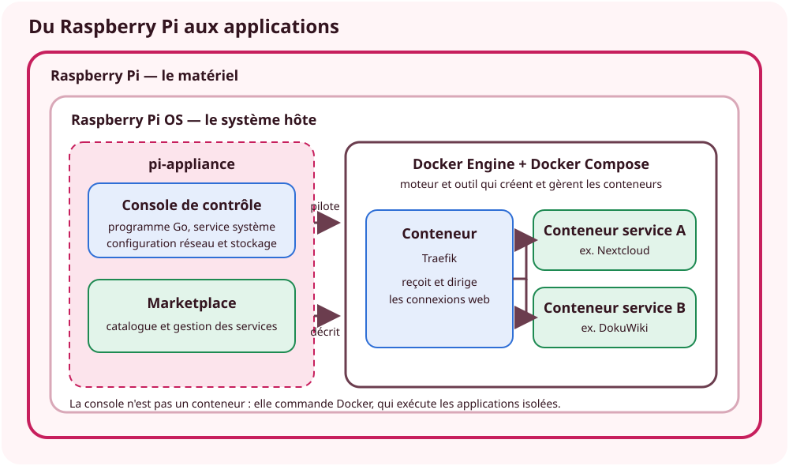
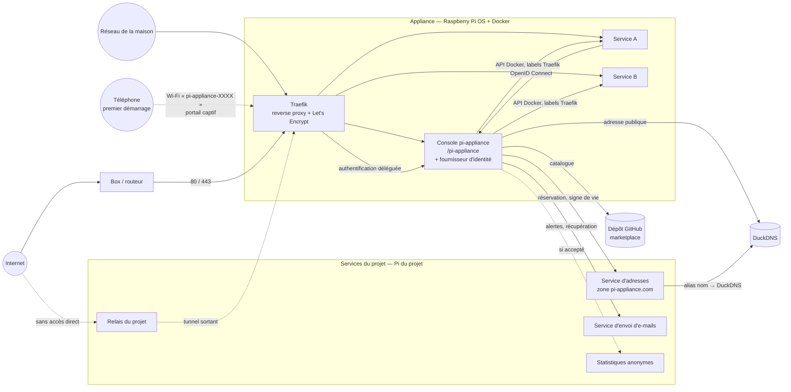

# Spécification de pi-appliance

> **Statut : cible.** Ce document décrit le produit visé. Presque rien n'est encore implémenté : l'état réel et l'avancement sont dans [TODO.md](TODO.md). Une section ne passe de « cible » à « réalisé » que lorsque le code correspondant existe.

## 1. Objet

pi-appliance transforme un Raspberry Pi en **appliance** : un boîtier personnel, posé à la maison, sur lequel on déploie des services. C'est un nœud de **Fog Computing** : les services tournent chez l'utilisateur, au plus près de ses données et de ses objets, et restent accessibles depuis internet.

On flashe une image système prête à l'emploi sur la carte SD, et le Pi fonctionne aussitôt, sans installation manuelle.

L'image repose sur trois couches :

| Couche | Contenu |
|--------|---------|
| Système | Image standard de Raspberry Pi OS (ex-Raspbian), Lite, 64 bits |
| Conteneurs | Docker Engine et Docker Compose |
| Produit | La couche pi-appliance : console d'administration, marketplace, reverse proxy Traefik, exposition sur internet |

*La console pi-appliance tourne comme un service du système hôte ; elle utilise Docker Compose pour piloter Docker Engine. Traefik et les applications de la marketplace tournent dans des conteneurs distincts.*

### 1.1 Public visé

pi-appliance s'adresse au **grand public** : des personnes sans connaissances techniques, qui ne savent ni ce qu'est Docker ni ce qu'est un DNS. En découle, pour toute la suite :

- tout se fait depuis la console, dans un navigateur : jamais de ligne de commande, de connexion SSH ni de fichier de configuration à modifier ;
- chaque choix a une valeur par défaut raisonnable ; l'utilisateur peut tout accepter sans comprendre ;
- l'interface parle de « services », d'« adresse », de « sauvegarde », pas de conteneurs, de ports ni de certificats ; les termes techniques restent dans les écrans avancés ;
- une erreur dit ce qui ne va pas et quoi faire, en langage courant ;
- une étape qui sort de la console (réglage de la box) est guidée pas à pas.

### 1.2 Licence

pi-appliance est un logiciel libre sous licence **GNU Affero General Public License version 3** (AGPL-3.0), fichier [`LICENSE`](../LICENSE). Toute personne qui modifie pi-appliance et le met à disposition d'autres utilisateurs, y compris à travers le réseau, doit publier ses modifications sous la même licence. Les applications de la marketplace gardent leur propre licence.

### 1.3 Objectif de la première version

Une personne sans connaissances techniques, avec un Raspberry Pi neuf, ouvre son Nextcloud **depuis internet en moins de 15 minutes** après avoir flashé la carte SD, **sans aide** (hors temps de flashage et de téléchargement des images Docker).

## 2. Vocabulaire

| Terme | Sens |
|-------|------|
| **Appliance** | Le Raspberry Pi équipé de l'image pi-appliance. |
| **Console** | L'interface web d'administration de l'appliance, servie sous `/pi-appliance`. |
| **controlTower** | Le Raspberry Pi pi-appliance dédié au concepteur du projet. Il dispose de sa propre console d'administration ; il ne pilote pas les autres Pi du domicile. |
| **Administrateur** | Compte qui gère l'appliance ; le premier est créé au premier démarrage. |
| **Utilisateur** | Compte qui accède aux services autorisés. |
| **Invité** | Compte à durée limitée, pour un partage ponctuel. |
| **Service** | Une application installée depuis la marketplace : un ou plusieurs conteneurs Docker. |
| **Marketplace** | Le catalogue des applications installables. |
| **Manifeste** | La description d'une application de la marketplace (images, volumes, sous-domaine, paramètres, besoins). |
| **Adresse de l'appliance** | Le nom sous lequel l'appliance est joignable depuis internet : `<nom>.pi-appliance.com` par défaut, ou un domaine personnel. |
| **Relais** | Serveur du projet qui rend l'appliance joignable quand la box ne le permet pas (section 7.3). |

## 3. Parcours type

1. J'achète un Raspberry Pi.
2. Sur www.pi-appliance.com, je télécharge l'image et je la flashe sur une carte SD en suivant le guide.
3. Je démarre le Pi.
4. Le Pi crée un Wi-Fi à son nom, « pi-appliance-XXXX » (XXXX : quatre caractères propres à ce Pi, section 4). Je m'y connecte avec mon téléphone : une page s'ouvre, je choisis le Wi-Fi de la maison (ou le câble Ethernet s'il est branché) et je saisis son mot de passe. Le Pi rejoint mon réseau.
5. J'ouvre la console :
   - depuis un appareil de la maison : `https://pi-appliance-XXXX.local/pi-appliance`, ou sous le nom choisi ensuite dans la console ;
   - depuis le Pi lui-même (écran et clavier branchés) : `https://localhost/pi-appliance`.
6. Je me connecte avec l'identifiant et le mot de passe initiaux, je choisis aussitôt mon propre mot de passe et je donne mon adresse e-mail, que je confirme avec le code reçu.
7. Je choisis mon adresse : un nom libre `<nom>.pi-appliance.com`, ou mon propre domaine.
8. Je crée mes utilisateurs.
9. Dans la marketplace, je coche les services que je veux et, pour chacun, qui peut y accéder.
10. pi-appliance télécharge les images Docker, configure Traefik et les certificats, et ouvre chaque service :
    - à la maison, sur le réseau local ;
    - sur internet, à l'adresse `https://<service>.<nom>.pi-appliance.com`.

## 4. Image système et matériel

- Construite à partir de l'image officielle Raspberry Pi OS Lite 64 bits, sans modification du système de base au-delà du nécessaire.
- Contient Docker, Docker Compose, la console pi-appliance et Traefik, démarrés au premier boot.
- Premier démarrage : extension de la partition, nom du Pi propre à chaque boîtier, `pi-appliance-XXXX` (modifiable dans la console, par exemple `controltower`), annonce mDNS (`<nom>.local`), génération des secrets propres au boîtier (certificat local auto-signé, clés de session). Aucun secret n'est commun à deux images.
- **Modèles pris en charge** : Raspberry Pi 5, Pi 4, Pi 3 B+ et Pi Zero 2 W, avec une seule image 64 bits. Sur les petits modèles (Pi 3 B+ : 1 Go, Zero 2 W : 512 Mo), une application dont la mémoire minimale dépasse celle du Pi s'installe quand même, après un avertissement sur les performances.
- **Plusieurs Pi dans un domicile** : plusieurs appliances indépendantes peuvent fonctionner sur le même réseau local, dont un Pi dédié au concepteur du projet et nommé controlTower. Chaque Pi conserve sa propre console, ses comptes, ses services et ses données ; controlTower ne fournit pas de tableau de bord commun et ne pilote pas les autres Pi. Chaque appareil doit avoir un nom réseau unique pour éviter les conflits et permettre d'ouvrir la bonne console. La cohabitation et la procédure de configuration restent à valider (TODO-2.48) ; la procédure d'essai, dans une maison et dans plusieurs, est décrite dans [Essais avec plusieurs Pi](essais-plusieurs-pi.md).

*Schéma cible : tous les Pi, y compris controlTower, sont sur le réseau interne derrière la box. L'accès depuis Internet reste à mettre en place ; controlTower n'administre pas les autres Pi.*

- **Réseau au premier démarrage** : le Pi ouvre **toujours** un point d'accès Wi-Fi à son nom (« pi-appliance-XXXX ») avec un portail de configuration, même si un câble Ethernet est branché, pour que le parcours soit le même pour tous. Le portail propose les Wi-Fi visibles et, si un câble est branché, le réseau filaire. Le point d'accès est **ouvert** (sans mot de passe) mais **limité à 24 heures** : il se referme une fois le Pi connecté, ou au bout de 24 heures ; redémarrer le Pi le rouvre pour 24 heures, et il se rouvre de même si le Pi perd durablement le réseau. Rien de sensible n'y transite avant la création du compte administrateur. Le Pi Zero 2 W n'a pas de prise Ethernet.
- **Stockage** : tout fonctionne sur la carte SD. Quand un disque USB est branché, la console propose d'y placer les données des services ; elle prévient quand la carte SD se remplit.
- L'image est publiée sur www.pi-appliance.com avec sa somme de contrôle.

**Réalisé** (code écrit, pas encore essayé sur un vrai Pi ; dossiers `image/` et `system/`) :

- **Construction** : `image/build.sh` part de pi-gen (Raspberry Pi OS Lite 64 bits, Trixie, version de pi-gen fixée) et ajoute une étape `image/stage-pi-appliance/`, qui lance `system/install.sh` dans l'image : Docker et Docker Compose (dépôt officiel de Docker, clé vérifiée), la console (`/usr/local/bin/pi-appliance`), Traefik (image Docker embarquée, pour que le portail marche sans internet), NetworkManager, avahi. Une vérification refuse l'image si un secret s'y trouve (clé du Pi, certificat, comptes, clés SSH) ou si la console n'est pas un binaire `arm64`. Le même `system/install.sh` installe tout sur un Raspberry Pi OS déjà en place. Réglages de l'image : nom d'hôte `pi-appliance`, pas de SSH, aucun mot de passe (le compte système `pi` est verrouillé ; Raspberry Pi OS ne propose d'en créer un qu'avec un écran branché au Pi), langue et clavier français, pays du Wi-Fi : France.
- **Publication** : le workflow « Image » (`.github/workflows/image.yml`) construit l'image à la demande ou pour une étiquette `v…`, et la publie alors comme version GitHub : `pi-appliance-<version>.img.xz` et sa somme de contrôle `.sha256`. Pas encore sur www.pi-appliance.com.
- **Premier démarrage** : extension de la partition par Raspberry Pi OS lui-même (`rpi-resize`) ; `pi-appliance.local` annoncé par avahi, sur les seules interfaces du Pi (pas celles de Docker), avec la console annoncée en `_https._tcp`. `pi-appliance-secrets.service` crée, à chaque démarrage s'ils manquent, la **clé du Pi** (Ed25519, `/var/lib/pi-appliance/system/device.key`, section 7.1) et le **certificat local auto-signé** (`/var/lib/pi-appliance/system/tls/`, valable 825 jours, refait 30 jours avant la fin) pour `pi-appliance.local`, `*.pi-appliance.local`, `localhost`, `127.0.0.1` et `10.42.0.1`.
- **Démarrage** : services systemd `pi-appliance-secrets`, `pi-appliance-traefik`, `pi-appliance-ap` et `pi-appliance` (console), activés dans l'image.
- **Point d'accès** : connexion NetworkManager `pi-appliance-ap` (ouverte, 2,4 GHz, canal 6, adresse du Pi `10.42.0.1`), ouverte et fermée par `pi-appliance-ap.service` selon la règle des 24 heures : ouverte au démarrage tant qu'aucun réseau n'a été choisi dans le portail, même avec un câble ; fermée dès que le réseau choisi est actif, ou au bout de 24 heures ; rouverte pour 24 heures si ce réseau manque plus de 10 minutes (2 minutes juste après un redémarrage). La puce Wi-Fi ne peut pas à la fois servir le point d'accès et chercher les Wi-Fi : la liste est faite juste avant l'ouverture, et le Wi-Fi de la maison est retenté toutes les 10 minutes quand personne n'est connecté au point d'accès. **Portail captif** : sur le point d'accès, tous les noms mènent au Pi et toute page demandée en HTTP renvoie vers `https://10.42.0.1/pi-appliance/` ; les téléphones ouvrent alors d'eux-mêmes la page de connexion au réseau.
- **Nom propre à chaque Pi** (`/usr/local/lib/pi-appliance/name.sh`, lancé avant le réseau par `pi-appliance-secrets.service`) : au premier démarrage, le Pi prend le nom `pi-appliance-XXXX`, où XXXX sont les quatre derniers chiffres de l'adresse matérielle de son Wi-Fi (ou de son câble), donc stable d'un démarrage à l'autre et différent d'un Pi à l'autre ; il est gardé dans `/var/lib/pi-appliance/system/name`. Ce nom est le nom d'hôte (`/etc/hostname`, `/etc/hosts`), l'adresse `<nom>.local` annoncée par avahi et le nom du Wi-Fi de configuration. Plusieurs appliances peuvent ainsi vivre dans la même maison sans se gêner (deux Wi-Fi ouverts du même nom, `pi-appliance-2.local` choisi au hasard par avahi). L'administrateur peut le changer dans la section « Réseau de la maison » de la console (`POST api/network/name` → `network.sh name`), par exemple en `controltower` : le Wi-Fi de configuration repart sous le nouveau nom s'il est ouvert, le certificat local est refait pour lui (`secrets.sh` le refait dès que le nom du Pi n'y figure pas), avahi et Traefik redémarrent quelques secondes après la réponse ; la console s'ouvre ensuite à `https://<nom>.local/pi-appliance`. Le nom suit les règles d'un nom d'hôte : 1 à 32 caractères, minuscules, chiffres et tirets. Les phrases de la console qui nomment le Wi-Fi ou l'adresse utilisent le nom réel du Pi, dans toutes les langues. La console prend `<nom>.local` comme adresse par défaut des services (`-domain`) et suit le changement de nom sans redémarrer : les services installés ensuite ont l'adresse `<service>.<nom>.local` (`services.Manager.Renamed`) ; une adresse donnée par `-domain` ne change pas. Les services déjà installés gardent l'ancienne adresse. Test sans Pi : `system/tests/name-test.sh`. À vérifier sur un vrai Pi.
- **Wi-Fi de configuration sans accès à internet** : le point d'accès est ouvert et NetworkManager (`ipv4.method=shared`) partage la connexion du Pi avec ses clients. Le pare-feu `/etc/pi-appliance/ap-firewall.nft`, chargé avant le réseau par `pi-appliance-firewall.service` (dont dépend `pi-appliance-ap.service`), empêche tout transfert depuis ou vers le réseau du point d'accès (10.42.0.0/24) : ses clients joignent le portail et la console du Pi, rien d'autre. Correction de l'incident du 2026-11-19 (deux Pi allumés, réseau de la maison saturé, alertes de Google). Test sans Pi : `system/tests/ap-firewall-test.sh`, qui reproduit le partage de connexion de NetworkManager dans des espaces réseau dédiés.
- **Disque USB** (`/usr/local/lib/pi-appliance/storage.sh`, paquet `internal/storage`, API `api/storage` réservée à l'administrateur) : la section « Mon Pi » liste les disques USB branchés (`lsblk`, la carte SD n'y figure jamais) et propose d'y placer les données des services. Un disque déjà en ext4 est utilisé tel quel ; sinon la console propose de l'effacer (deux confirmations), d'y créer une seule partition ext4 (`sfdisk`, `mkfs.ext4`), puis de l'utiliser. Le déplacement copie tout le dossier de Docker (volumes des services et images) sur le disque, monté en `/mnt/pi-appliance-data` (ligne `nofail` dans `/etc/fstab`, par l'UUID du disque), règle `data-root` dans `/etc/docker/daemon.json` (gardé par `install.sh` lors d'une réinstallation), redémarre Docker et Traefik, puis libère la carte SD ; il vérifie d'abord la place libre (ce que prend Docker, plus 10 %). Il dure plusieurs minutes et arrête les services et l'accès à la console : le script se relance hors du service de la console (`systemd-run`, unité `pi-appliance-storage`) et répond tout de suite ; la page suit l'avancement (`GET api/storage`, champ `move`) et le dit en langage courant. En cas d'échec, retour à la carte SD et à l'ancienne configuration de Docker ; une copie interrompue (Pi éteint) est signalée. Ensuite, Docker ne démarre pas sans le disque (`RequiresMountsFor`), pour ne pas repartir à vide sur la carte SD : la console dit de le laisser branché. Revenir sur la carte SD, changer de disque : pas encore. À vérifier sur un vrai Pi.
- **Pour la console** : `/usr/local/lib/pi-appliance/network.sh` donne en JSON l'état du réseau, la liste des Wi-Fi visibles, la connexion à un Wi-Fi (mot de passe par l'entrée standard, jamais dans une ligne de commande) et le choix du câble, le pays du Wi-Fi (`raspi-config`, gardé après un redémarrage). **Réalisé** : la console l'appelle par `internal/network` (API `api/network`, réservée à l'administrateur connecté) et le portail propose le pays du Wi-Fi, la liste des Wi-Fi, le mot de passe, un Wi-Fi caché, le câble, le temps restant avant la fermeture du point d'accès et l'explication de l'alerte du certificat. La demande de connexion reçoit sa réponse avant que le point d'accès se ferme ; le résultat se lit ensuite dans l'état (`lastError`). À vérifier sur un vrai Pi.

## 5. Console d'administration

Servie par l'appliance sous `/pi-appliance`, en HTTPS seulement.

### 5.1 Premier démarrage (assistant)

1. Création du compte administrateur, directement dans le portail de configuration : il n'y a **pas d'identifiant initial** ; la première personne connectée au point d'accès crée le compte (mot de passe de 12 caractères au moins, section 8.1).
2. Adresse e-mail de l'administrateur, **obligatoire**, vérifiée par un code envoyé par e-mail (récupération et alertes, sections 8.5 et 8.6). Si le service d'envoi d'e-mails du projet n'est pas joignable (appliance sans internet, ou avant l'étape Internet de la section 16), l'adresse est enregistrée et vérifiée dès qu'il le devient ; la console le rappelle tant que ce n'est pas fait.
3. Langue de l'interface.
4. Adresse de l'appliance : `<nom>.pi-appliance.com` (vérification que le nom est libre) ou domaine personnel (section 7.1).
5. Test d'accès depuis internet ; guide de la box ou bascule sur le relais si besoin (section 7).
6. Création des utilisateurs.
7. Statistiques anonymes : proposées, désactivées par défaut (section 8.4).
8. Choix des premiers services dans la marketplace.

**Réalisé** (première version) : après la création du compte, la console ouvre l'assistant « Mise en route » pour l'administrateur. Il montre les étapes et la place de chacune : compte administrateur, réseau de la maison (pays du Wi-Fi, puis Wi-Fi ou câble, section 4), premiers services (marketplace avec ses jauges, section 6.2). L'étape du réseau avance d'elle-même dès que le réseau est choisi, même si la page a perdu la connexion entre-temps ; elle peut être passée, le point d'accès restant alors ouvert. « Terminer la mise en route » l'enregistre (`/var/lib/pi-appliance/wizard-done`) ; d'ici là, l'assistant reprend à la connexion suivante. Les étapes langue, adresse, test d'accès, utilisateurs et statistiques viendront avec leurs fonctions ; le réglage des statistiques existe déjà dans la console (section 8.4).

### 5.2 Fonctions courantes

- État de l'appliance : charge, mémoire, température, espace disque, adresse publique, état des certificats, mode d'accès (direct ou relais).
- **Graphiques** sur 30 jours : processeur, mémoire, réseau, température, espace disque.
- Services installés : état vert/orange/rouge, démarrer, arrêter, redémarrer, mettre à jour, désinstaller, journaux téléchargeables, qui peut y accéder.
- Utilisateurs : inviter, modifier, supprimer, réinitialiser un mot de passe, rôle, date d'expiration des invités, exiger la double authentification.
- Adresse et accès depuis internet : modifier, tester.
- Sauvegarde et restauration (section 9).
- Mises à jour disponibles (section 9.2), canal stable ou bêta (section 5.4).
- Seuls les administrateurs accèdent à ces fonctions ; un utilisateur ne voit que son profil (mot de passe, double authentification) et la liste des services auxquels il a accès.

Une appliance se gère depuis sa propre console : pas de tableau de bord commun à plusieurs appliances.

**Réalisé** (tableau de bord, section « Mon Pi » de la console, administrateurs ; à vérifier sur un vrai Pi) :

- **En ce moment** : charge du processeur (part du temps où il a travaillé, d'après `/proc/stat`, tous cœurs confondus ; orange à 90 %), température de la puce (`/sys/class/thermal/thermal_zone0/temp` ; orange à 70 °C, rouge à 80 °C, avec un conseil en langage courant), jauges de la mémoire et du disque (section 6.2), et l'état des services en une phrase (« 2 services en marche, 1 service arrêté »), avec la pastille de la couleur la plus grave. `GET api/system` donne `memory`, `disk`, `cpu_percent`, `temperature_c` (`null` quand la valeur est inconnue). La page se met à jour chaque minute.
- **Graphiques** sur 24 heures ou 30 jours : processeur, mémoire, température (la plus haute de chaque heure), disque et réseau (Mo reçus et envoyés par heure, sur le câble et le Wi-Fi, sans le bouclage ni les réseaux internes de Docker). Une courbe par mesure, chacune avec son échelle ; une heure sans mesure (Pi éteint) coupe la courbe ; la valeur d'une heure s'affiche sous le doigt ou la souris. `GET api/system/history` : `{"step_seconds": 3600, "points": [{"time", "cpu_percent", "memory_percent", "temperature_c", "disk_percent", "received_mb", "sent_mb"}]}`.
- **Historique** (paquet `internal/metrics`) : une mesure par minute, agrégée par heure en mémoire ; le fichier `<données>/history.json` n'est écrit qu'une fois par heure (section 11), et à l'arrêt de la console, heure en cours comprise, reprise au redémarrage. 30 jours gardés, soit 720 points (environ 100 Ko).
- Pas encore : adresse publique, état des certificats et mode d'accès (étape Internet, section 7).

### 5.3 Langues

L'interface est traduite dans les 12 langues de Wikipedia2Book : français, anglais, espagnol, portugais, italien, allemand, néerlandais, turc, chinois, japonais, arabe et persan (ces deux dernières de droite à gauche). Langue détectée d'après le navigateur, modifiable à tout moment. Le français fait foi.

**Réalisé** (interface web de la console, `internal/console/web/` ; traductions à faire relire par des locuteurs natifs) :

- `i18n.js`, chargé avant `app.js`, choisit la langue : celle de l'adresse (`?lang=`), sinon celle choisie dans la console (gardée par le navigateur), sinon la première langue du navigateur parmi les 12, sinon le français. Un sélecteur « Langue », en bas de chaque page, liste les langues sous leur propre nom et recharge la page.
- La clé d'une traduction est la phrase française elle-même (`t("Il reste {0} de mémoire.", taille)`) : une phrase sans traduction s'affiche en français. Chaque langue est un fichier `i18n/<code>.js`, chargé seulement pour cette langue ; les textes fixes de la page sont traduits au chargement. Nombres et dates suivent la langue (`toLocaleString`), les noms de pays du réglage Wi-Fi viennent du navigateur (`Intl.DisplayNames`).
- Arabe et persan : page en `dir="rtl"`, styles en propriétés logiques (`margin-inline-start`…) ; les graphiques gardent le temps de gauche à droite.
- Un test Go vérifie que chaque langue traduit toutes les phrases de `app.js` et de `index.html`, sans phrase inconnue, en gardant les `{0}`, `{1}`… et les retours à la ligne.
- Pas encore traduits : les messages qui viennent du serveur (erreurs, état des services, avertissements d'installation), les noms et descriptions des applications du catalogue, l'assistant de premier démarrage n'a pas encore son étape « Langue » (le sélecteur du bas de page en tient lieu).

### 5.4 Versions

Versions numérotées `x.y.z`. Deux canaux : **stable** (par défaut) et **bêta**, au choix de l'administrateur dans la console. La version et le canal sont affichés en bas de chaque page.

## 6. Marketplace

### 6.1 Catalogue

- Maintenu dans un dépôt GitHub du projet, lu en ligne par l'appliance et mis à jour sans nouvelle version de pi-appliance.
- Tout le monde peut proposer une application par pull request ; le projet la vérifie avant de l'accepter.
- Chaque application est décrite par un **manifeste** : nom, description, icône, catégorie, images Docker (multi-architecture, `arm64` obligatoire), volumes de données, ports internes, sous-domaine proposé, paramètres demandés à l'installation, mémoire et disque minimaux, mode de connexion (section 8.1), accès par défaut (section 8.2), licence.

### 6.2 Installer et désinstaller

- Seuls les **administrateurs** installent, mettent à jour et désinstallent.
- Installer : télécharger les images, créer les volumes, poser les labels Traefik (routeur, certificat, protection), démarrer les conteneurs, afficher l'adresse du service.
- **Mémoire et disque en image** : avant d'installer, la console montre deux jauges, une pour la mémoire et une pour le disque du Pi. Chaque jauge montre ce que le Pi a en tout, ce qu'utilisent déjà le système et les services installés, la part que prendrait le nouveau service (d'après `memory_mb` et `disk_mb` de son manifeste, section 6.5) et **ce qui resterait** après l'installation, en Mo ou Go, avec des mots simples (« Il resterait 120 Mo de mémoire »). La jauge passe à l'orange quand il resterait peu de place, au rouge quand le service ne tient pas ; dans ce cas, la console explique que le service risque d'être lent (mémoire) ou de ne pas s'installer (disque), et propose d'arrêter un autre service ou de brancher un disque USB. Les mêmes jauges, sans la part du nouveau service, figurent dans le tableau de bord (section 5.2) et sur la fiche de chaque application de la marketplace.
  **Réalisé** : `GET api/system` (administrateur) donne la mémoire (`MemAvailable` de `/proc/meminfo`) et le disque du dossier des données ; la jauge passe à l'orange sous 15 % de libre après l'installation, au rouge quand le service ne tient pas. Les jauges figurent sur chaque fiche de la marketplace et, sans la part d'un service, dans la section « Mon Pi » de la console, en attendant le tableau de bord. La jauge du disque est celle de la carte SD, ou celle du disque USB quand les données des services y sont (`usb_disk` dans `GET api/system`, la carte SD restant affichée à côté). Quand le service ne tient pas, la console conseille de brancher un disque USB (s'il n'y en a pas encore) ou de désinstaller un service. Dans « Mon Pi », une jauge du disque à l'orange dit que la carte SD (ou le disque USB) se remplit et, sans disque USB, propose d'en brancher un (section 4). L'alerte par e-mail viendra avec le service d'envoi d'e-mails (section 8.6).
- **Plusieurs instances** d'une même application sont possibles (deux sites web, deux wikis…) : chacune a son nom, son sous-domaine (`blog.`, `asso.`…) et ses données.
- Mettre à jour : sauvegarde du service juste avant ; si le service ne redémarre pas, **retour automatique** à la version précédente et alerte par e-mail.
- Désinstaller : la console **demande à chaque fois** s'il faut garder ou supprimer les données du service ; la suppression demande une confirmation. Les données gardées sont réutilisées si on réinstalle le service.

### 6.3 Applications de la première version

| Application | Logiciel | Remarques |
|-------------|----------|-----------|
| Fichiers, agenda, contacts | Nextcloud | Ancien prototype (section 12) : `docker-nextcloud/` |
| Site web | Apache + PHP | Ancien prototype (section 12) : `docker-apache/` |
| Wiki | DokuWiki | Sans base de données, tourne sur tous les modèles |
| Édition de texte à plusieurs | Etherpad | |
| VPN | WireGuard | Accès au réseau de la maison depuis l'extérieur ; configuration du téléphone par QR code affiché dans la console. Le trafic internet du téléphone ne passe pas par la maison. |

Règles propres à ces applications :

- **Site web** : les fichiers du site se déposent, au choix, dans un dossier visible dans Nextcloud ou en envoyant un fichier ZIP dans la console. Une instance = un dossier.
- **Etherpad** : les utilisateurs connectés créent des documents ; un lien de partage permet à une personne sans compte d'éditer un document précis.

**Réalisé** (manifestes de la marketplace, section 6.5) :

| Application | Manifeste | Image | Accès par défaut | Mémoire, disque |
|-------------|-----------|-------|------------------|-----------------|
| Nextcloud | `marketplace/nextcloud/` | `nextcloud:30-apache` et `mariadb:11.4` | public | 1 024 Mo, 2 048 Mo |
| Site web | `marketplace/site-web/` | `php:8.4-apache` (image officielle PHP avec Apache) | public | 128 Mo, 1 024 Mo |
| DokuWiki | `marketplace/dokuwiki/` | `dokuwiki/dokuwiki:2026-07-14c` (image officielle ; DokuWiki numérote ses versions par date) | utilisateurs connectés | 128 Mo, 1 024 Mo |
| Etherpad | `marketplace/etherpad/` | `etherpad/etherpad:3` (image officielle) | utilisateurs connectés | 384 Mo, 1 024 Mo |
| PostgreSQL | `marketplace/postgresql/` | `postgres:18-alpine` et `adminer:5` (images officielles) | maison seulement | 256 Mo, 1 024 Mo |
| VPN WireGuard | `marketplace/wireguard/` | `linuxserver/wireguard:1.0.20260223` (linuxserver.io, GPL-3.0, `arm64`) | sans objet (pas de page web ; port UDP 51820 ouvert, protégé par les clés) | 64 Mo, 256 Mo |
| Site Hugo | `marketplace/hugo/` | `hugomods/hugo:std-0.165.0` (Hugo étendu avec Git ; l'image officielle est sur ghcr.io) et `nginx:1.30-alpine` | public | 256 Mo, 1 024 Mo |
| Documentation MkDocs | `marketplace/mkdocs/` | `squidfunk/mkdocs-material:9.8.2` (MkDocs et le thème Material) et `nginx:1.30-alpine` | public | 256 Mo, 1 024 Mo |
| Blog Jekyll | `marketplace/jekyll/` | `jekyll/jekyll:4.4.1` (image officielle, Debian, avec de quoi compiler les gems) et `nginx:1.30-alpine` | public | 512 Mo, 3 072 Mo |
| Site Astro | `marketplace/astro/` | `node:24-alpine` et `nginx:1.30-alpine` | public | 1 024 Mo, 2 048 Mo |
| Site Next.js | `marketplace/nextjs/` | `node:24-alpine` et `nginx:1.30-alpine` | public | 1 536 Mo, 2 048 Mo |

- **Site web** : les fichiers du site sont dans le dossier `<données>/services/<nom>/www`, monté dans Apache et dans le service FTP (clé `files`) ; tant qu'il est vide, une page « Site en construction » s'affiche. Dépôt par ZIP, Nextcloud ou FTP (TODO-2.39) ; l'image FTP du manifeste est à remplacer (TODO-2.46).
- **DokuWiki** : au premier démarrage, le compte `admin` est créé avec un mot de passe tiré au hasard, affiché une seule fois ; l'assistant d'installation de DokuWiki est donc fermé (sinon le premier visiteur choisirait le compte administrateur). Tout le monde lit, les comptes du wiki écrivent ; pas d'inscription libre ; wiki en français.
- **Etherpad** : documents gardés dans une base SQLite du volume ; mot de passe de l'administrateur (`/admin`) tiré au hasard et affiché une seule fois ; les secrets internes de connexion d'Etherpad sont aussi tirés au hasard ; sa propre vérification des mises à jour est coupée (elles passeront par la console, section 9.2). Etherpad demande environ 350 Mo de mémoire : sur un Pi Zero 2 W, la console prévient qu'il risque d'être lent. Les liens de partage pour une personne sans compte restent à faire : ils demandent que l'accès « utilisateurs connectés » (section 8.2) laisse passer l'adresse d'un document précis.
- **Générateurs de sites statiques** (TODO-2.46 : Hugo, MkDocs, Jekyll, Astro, Next.js) : on dépose les **fichiers source** du site (ZIP dans la console ou dossier Nextcloud, comme pour le site web) et le site se construit tout seul. Chaque manifeste a deux services : `builder`, l'image du générateur, qui reçoit les sources en `/src` (clé `files`, section 6.5), et `web`, un nginx publié par Traefik qui sert le dernier site construit sans erreur. Toutes les 10 secondes, `builder` compare les fichiers source (noms, tailles, dates) ; à chaque changement, il copie les sources dans un volume de travail (les `node_modules` y restent d'une construction à l'autre), construit dans un dossier neuf et ne le met en ligne que si la construction réussit et produit un `index.html` : **en cas d'échec, le site précédent reste en ligne**. L'état (`.pi-appliance-build` : `building`, `ok` ou `failed`, puis la date) et le journal (`.pi-appliance-build.log`) sont écrits dans le dossier des sources ; la console les lit (`build` dans `GET api/services`) et dit en langage courant si le site est construit, en construction ou si la construction a échoué, avec le nom du journal. Sans sources, une page « Site en construction » s'affiche. Les liens absolus prennent l'adresse du service (`PI_HOST`) : `--baseURL` pour Hugo, `url` pour Jekyll, `--site` pour Astro. Particularités :
  - **Hugo** : thèmes inclus dans les sources (dossier `themes/`) ; les modules Hugo, qui demandent Go, ne sont pas pris en charge.
  - **MkDocs** : `mkdocs.yml` à la racine ; seuls les extensions et greffons inclus dans l'image Material sont disponibles.
  - **Jekyll** : sans `Gemfile`, Jekyll 4.4 de l'image ; avec un `Gemfile`, `bundle install` (gems gardées dans un volume de cache, il faut internet à la première construction). L'image fait environ 2 Go sur le disque.
  - **Astro** et **Next.js** : `npm install` à chaque construction (internet nécessaire la première fois), puis `astro build` (dossier `dist`) ou `next build` ; Next.js doit être en export statique (`output: 'export'` dans `next.config`), sinon le journal le dit. La construction demande beaucoup de mémoire : la console prévient sur les petits Pi (`memory_mb`).
  - Pas de FTP pour ces sites. Essayés sous Docker (amd64) le 2026-11-20 : site d'essai construit puis servi par chacun des cinq, adresse réécrite, échec gardant le site précédent, `Gemfile` avec greffon pour Jekyll, Next.js sans `output: 'export'` ; installation complète par la console pour Hugo (dépôt d'un ZIP, puis d'un second). À vérifier sur un vrai Pi (durée et mémoire des constructions, surtout Astro et Next.js).
- **Bases de données** (TODO-2.47 : MSSQL, PostgreSQL, SQLite, MongoDB, Redis) : une base seule n'a pas de page web, or le format des manifestes (section 6.5) publie un service web par Traefik. Une base n'est donc retenue que si une **interface web officielle** peut être publiée à sa place. Résultat, vérifié le 2026-11-19 sur Docker Hub et le registre de Microsoft :
  - **PostgreSQL**, retenu : images officielles `arm64` pour PostgreSQL et pour **Adminer**, une interface web légère (PHP, environ 20 Mo de mémoire) ; c'est elle que Traefik publie, la base elle-même n'est joignable que par Adminer, à l'intérieur du service. On s'y connecte en choisissant « PostgreSQL », serveur `db`, utilisateur `postgres` et le mot de passe tiré au hasard, affiché une seule fois. Accès par défaut : **maison seulement**, parce qu'Adminer laisse aussi essayer d'autres serveurs. Version majeure fixée (18) : passer à la suivante demandera une migration des données (`pg_upgrade`), pas un simple changement d'image. Essayé sous Docker (amd64) le 2026-11-19 : base saine, page de connexion d'Adminer servie, environ 60 Mo de mémoire au repos ; à vérifier sur un vrai Pi. Pour qu'un programme du réseau de la maison parle directement à la base, un administrateur peut ouvrir le port 5432 dans les réglages avancés (section 6.4).
  - **MSSQL** (SQL Server), écarté : Microsoft ne publie son image (`mcr.microsoft.com/mssql/server`, version 2025 comprise) que pour `amd64` ; Azure SQL Edge, qui existait pour `arm64`, est arrêté depuis septembre 2025. Il faut au moins 2 Go de mémoire, plus qu'un Pi 4 de 2 Go ou un Pi 3 B+.
  - **SQLite**, écarté : ce n'est pas un serveur mais un fichier, rangé dans les données de l'application qui s'en sert (Etherpad l'utilise déjà). Il n'y a rien à installer à part.
  - **MongoDB**, écarté pour l'instant : l'image officielle `mongo` existe pour `arm64`, mais MongoDB 5 et suivants exigent un processeur ARMv8.2-A, c'est-à-dire un **Pi 5** ; sur un Pi 4, un Pi 3 B+ ou un Pi Zero 2 W (ARMv8.0) le serveur s'arrête au démarrage (« instruction illégale »). La dernière version qui y tourne, 4.4, n'est plus suivie depuis février 2024. Son interface web `mongo-express` n'a pas changé depuis mai 2024. Le manifeste ne sait pas encore dire « Pi 5 seulement » (section 15).
  - **Redis**, écarté comme application : image officielle `arm64` légère, mais pas d'interface web officielle légère (Redis Insight, l'interface de Redis, est une application Node.js bien plus lourde que la base elle-même) et, seul, Redis ne sert à rien à la maison : c'est un cache pour d'autres applications. Il sera ajouté comme service interne dans le manifeste d'une application qui en a besoin (par exemple Nextcloud, pour aller plus vite).
  - Une base ouverte directement sur le réseau de la maison, sans interface web (port 5432, 27017, 6379…), demande, comme Samba, un format de manifeste pour un service qui n'est pas un site web : il n'est pas contourné ici.
- **VPN WireGuard** (TODO-4.6, à vérifier sur un vrai Pi) : premier service **sans page web** (clé `host_ports` des manifestes, section 6.5) ; rien n'est publié par Traefik, la console ouvre le port **UDP 51820** du Pi. Une seule installation par Pi (le port ne sert qu'une fois). L'image linuxserver.io tourne en « mode client » : elle démarre le fichier `wg0.conf` que la console écrit dans `<données>/services/<nom>/wireguard/` (monté sur `/config/wg_confs`), avec le droit `NET_ADMIN` et le routage IPv4 du conteneur. Le module WireGuard du noyau de Raspberry Pi OS est utilisé.
  - **Clés tirées sur le Pi** par la console (Curve25519, `crypto/ecdh` de Go, comme `wg genkey` et `wg pubkey`) : celle du Pi à l'installation, gardée avec les données ; pour chaque appareil, une clé privée, une clé partagée (`PresharedKey`) et une adresse `10.13.13.x` du réseau du VPN (le Pi est `10.13.13.1`).
  - **Écran « Appareils »** (administrateurs) sur la carte du service : liste des appareils, ajout par un nom (« Téléphone de Camille »), retrait. À l'ajout, la console montre la configuration de l'appareil **en QR code** (bibliothèque Go `github.com/skip2/go-qrcode`, MIT), à scanner dans l'application WireGuard du téléphone, et en texte ; elle ne s'affiche qu'**une seule fois** : la clé privée de l'appareil n'est pas gardée sur le Pi. Ajouter ou retirer un appareil réécrit `wg0.conf` et redémarre le VPN (quelques secondes de coupure) ; en cas d'échec, la liste d'avant est remise.
  - **Le trafic internet du téléphone ne passe pas par la maison** : les `AllowedIPs` de l'appareil se limitent au réseau de la maison (réseaux IPv4 privés des interfaces du Pi, sans Docker ni le Wi-Fi de configuration `10.42.0.0/24`) et au Pi dans le VPN ; pas de `0.0.0.0/0`, pas de DNS imposé. Côté Pi, le pare-feu du conteneur ne laisse passer vers la maison que ces réseaux et refuse le reste. Un réseau de la maison qui contiendrait celui du VPN (un `10.0.0.0/8`) est ignoré : cas rare, à traiter s'il se présente.
  - **Adresse** : l'appareil se connecte à l'adresse de l'appliance (section 7.1), port 51820. Tant qu'elle n'est pas une adresse internet (`pi-appliance.local`), l'écran le dit. **Redirection de port** : comme pour 80 et 443 (accès direct, section 7.2, TODO-3.8), il faut rediriger sur la box le port UDP 51820 vers le Pi ; la console le rappelle à l'installation et sur l'écran « Appareils ». Pas encore d'UPnP ni de test depuis internet ; le relais (section 7.3) ne transporte pas le VPN.
  - API (administrateurs) : `GET api/services/<nom>/wireguard` (`endpoint`, `port`, `home_networks`, `endpoint_local`, `devices`), `POST api/services/<nom>/wireguard/devices` (`{"name"}`, réponse `device`, `config` et `qr_code`, image PNG en `data:`), `DELETE api/services/<nom>/wireguard/devices/<id>`.
  - Essayé sous Docker (amd64, noyau WSL2) le 2026-11-20 : l'image démarre le `wg0.conf` écrit comme le fait la console (« Client mode selected », interface `wg0` sur le port 51820, règles du pare-feu posées). Reste à vérifier sur un vrai Pi, avec un téléphone hors de la maison.

Plus tard :

- **Samba**, partage de fichiers en lecteur réseau à la maison (Explorateur Windows, Finder, téléviseurs, scanners, Time Machine), avec un dossier commun et un dossier personnel par compte. Sorti de la première version : Nextcloud couvre déjà les fichiers, et Samba demande un format de manifeste pour un service qui n'est pas un site web (port SMB 445 du Pi, une seule instance possible, accès « maison seulement » appliqué sans Traefik) et un annuaire LDAP servi par la console (section 8.1). Nextcloud verra alors ses dossiers par son stockage externe (client Samba). Ancien prototype (section 12) : `docker-samba/`.
- Caméra (Motion, timelapse : anciens prototypes `pi-motion/` et `pi-timelaps/`, section 12).

### 6.4 Hors marketplace

- **Réglages avancés** : un écran masqué par défaut permet à un administrateur de modifier les variables, ports et volumes d'un service installé.
- **Docker Compose libre** : un administrateur peut installer n'importe quel fichier Docker Compose, hors marketplace. La console prévient que ce service n'est ni vérifié ni pris en charge par le projet. Elle repère les options qui donnent la main sur tout le Pi (conteneur privilégié, montage du système hôte, réseau de l'hôte, accès à Docker) et les signale par un avertissement clair, que l'administrateur doit confirmer ; elles ne sont pas bloquées. Elle lui applique les mêmes règles d'accès (section 8.2) et le sauvegarde comme les autres.

**Réalisé** (paquets `internal/services` et `internal/console`, administrateurs ; à vérifier sur un vrai Pi) :

- **Réglages avancés** : bouton « Réglages avancés » sur chaque service, écran replié par défaut. On choisit un conteneur du service et on lui donne des variables (`NOM=valeur`), des ports ouverts directement sur le Pi, sans Traefik (`port du Pi:port du conteneur`, `tcp` ou `udp` ; 80, 443 et 8080 sont réservés), et des volumes (un volume nommé ou un dossier du Pi en chemin absolu, en lecture seule au besoin). Ils sont enregistrés dans `<données>/services/<nom>/advanced.json` et appliqués par un troisième fichier Compose, `pi-appliance.advanced.json`, lu après le manifeste et les labels Traefik ; le service redémarre. S'il ne démarre pas, les réglages d'avant sont remis et la console le dit. API : `GET` et `PUT api/services/<nom>/advanced` (`{"settings": {"service", "environment", "ports": [{"host", "container", "protocol"}], "volumes": [{"source", "target", "read_only"}]}, "confirm_risks"}`).
- **Docker Compose libre** : carte « Docker Compose libre » à la fin de la marketplace, repliée par défaut. On colle un fichier `compose.yaml`, on nomme le service et on dit quel conteneur ouvrir à son adresse, sur quel port. Il s'installe comme les autres (labels Traefik, réseau `pi-appliance`, adresse `<nom>.<adresse>`, désinstallation avec la question des données), avec l'avertissement qu'il n'est ni vérifié ni pris en charge par le projet. Les images doivent être prêtes (`build` refusé). Pas de mise à jour depuis la marketplace : on change le fichier et on réinstalle. API : `POST api/compose` (`{"name", "compose", "service", "port", "confirm_risks"}`).
- **Options dangereuses**, signalées dans les deux cas : conteneur privilégié, réseau de l'hôte (`network_mode: host`), `pid`, `ipc` ou `userns_mode` de l'hôte, accès à Docker (`docker.sock`), dossier du Pi monté (dossier système, tout le système, ou autre dossier ; lecture seule dite), matériel (`devices`), droits ajoutés (`cap_add`), protections coupées (`security_opt` *unconfined*). La console répond `409` avec la liste (`risks`) ; l'écran les montre en langage courant et redemande avec `confirm_risks` une fois l'administrateur d'accord. Rien n'est bloqué.
- Pas encore : règles d'accès (section 8.2) et sauvegardes (section 9.1), qui viendront pour tous les services.

### 6.5 Format des manifestes

Un manifeste est un fichier `marketplace/<identifiant>/compose.yaml` : un fichier Docker Compose ordinaire, avec une section `x-pi-appliance` que Docker Compose ignore :

| Clé | Sens |
|-----|------|
| `name`, `description`, `category`, `license` | Présentation dans la marketplace |
| `icon` | Icône : tracé SVG (attribut `d`) sur 24 × 24, dessiné en trait blanc sur la couleur de l'application (charte graphique) |
| `subdomain` | Nom proposé pour le service, donc son sous-domaine |
| `service`, `port` | Service Compose publié par Traefik et son port interne |
| `memory_mb`, `disk_mb` | Mémoire et disque minimaux |
| `login` | `application` (comptes propres au logiciel) ou `console` (connexion unique, section 8.1) |
| `access` | Accès par défaut : `public`, `users` ou `home` (section 8.2) |
| `parameters` | Variables demandées à l'installation : `name` (majuscules), `label`, `default`, ou `generate: true` pour un secret tiré au hasard |
| `files` | Dossier des fichiers du site (dépôt par ZIP, dossier Nextcloud, FTP) monté dans un ou plusieurs services : liste de `service` et `path` (chemin absolu dans le conteneur). Site web : Apache et FTP en `/var/www/html` ; générateurs de sites statiques : le constructeur en `/src` |
| `host_ports` | Ports ouverts directement sur le Pi, sans Traefik, pour un service qui n'est pas un site web : liste de `port` et `protocol` (`tcp` ou `udp`), même numéro sur le Pi et dans le conteneur `service`. Sans `port`, le service n'a pas de page web (VPN WireGuard) |

Le fichier Compose peut utiliser ces variables, plus `PI_INSTANCE` (nom du service) et `PI_HOST` (son adresse complète). Les volumes sont des volumes Docker nommés, propres à chaque instance. Le manifeste est refusé (identifiant, icône, sous-domaine, service publié absent, service sans image, port, valeurs inconnues, paramètre invalide ou en double, préfixe `PI_` réservé, port du Pi invalide, en double ou réservé : 80, 443 et 8080, `files` vers un service absent ou un chemin qui n'est pas absolu).

**Réalisé** (`files`, TODO-2.46) : `pi-appliance.override.json` monte `<données>/services/<nom>/www` dans chaque service de `files` ; le dépôt d'un ZIP (`POST api/services/<nom>/files`) est accepté pour tout service dont le manifeste installé a `files` (`site_files` dans `GET api/services` et `GET api/catalog`). Le dépôt remplace le **contenu** du dossier, pas le dossier : un conteneur déjà démarré le monte et ne verrait pas un nouveau dossier mis à sa place (défaut corrigé le 2026-11-20 : le site web ne voyait pas un ZIP déposé après son démarrage).

**Réalisé** (`host_ports`, TODO-4.6) : pour un service sans page web, `pi-appliance.override.json` publie les `host_ports` (`51820:51820/udp`) au lieu des labels Traefik ; l'instance est marquée `no_web_page` dans `GET api/services` et la console affiche le port du Pi à la place du bouton « Ouvrir ». L'installation est refusée quand un autre service a déjà le même port ; elle rappelle la redirection du port à faire sur la box (section 7.2). L'accès « maison seulement » sans Traefik (Samba, TODO-4.8) reste à faire : un port de `host_ports` est ouvert à tous ceux qui joignent le Pi.

**Réalisé** (première version, paquets `marketplace` et `internal/services`) :

- Catalogue **intégré au binaire** pour l'instant, avec Nextcloud (et MariaDB), Site web, DokuWiki, Etherpad, PostgreSQL (et Adminer), le VPN WireGuard et les générateurs de sites statiques Hugo, MkDocs, Jekyll, Astro et Next.js (section 6.3) ; la lecture en ligne du dépôt (6.1) reste à faire. Un test vérifie que chaque manifeste livré se lit, fixe la version de ses images et n'utilise que des variables déclarées.
- Installation : pour chaque instance, un dossier `<données>/services/<nom>/` (option `-data`, `/var/lib/pi-appliance` par défaut) avec le manifeste, un fichier `.env` (droits 600) et `pi-appliance.override.json`, qui ajoute les labels Traefik (routeur `Host(<nom>.<adresse>)`, entrée `websecure`, TLS) et le réseau Docker commun `pi-appliance`, créé s'il manque ; puis `docker compose up --detach --wait`. En cas d'échec, le service est arrêté et l'erreur de Docker affichée. Les secrets générés qui ont un libellé (mot de passe administrateur de Nextcloud) sont affichés une seule fois.
- Plusieurs instances d'une même application, sous des noms différents ; avertissement quand la mémoire du Pi est inférieure à `memory_mb`.
- Désinstallation : la console demande s'il faut garder les données ; gardées, elles (volumes et secrets) sont réutilisées à la réinstallation sous le même nom ; supprimées, après une seconde confirmation.
- API de la console : `GET api/catalog`, `GET api/services`, `POST api/services` (`{"app", "name", "parameters"}`, JSON seulement), `DELETE api/services/<nom>?data=keep|delete`. Il faut être connecté pour lire le catalogue et les services, et administrateur pour installer ou désinstaller (section 8.1).
- Démarrer, arrêter, redémarrer (`POST api/services/<nom>/start|stop|restart`, administrateurs) : `docker compose up --detach --wait`, `stop`, `restart`. État de chaque service dans `GET api/services`, d'après `docker compose ps` : **vert** si tous ses conteneurs marchent, **orange** s'ils démarrent, sont en difficulté (contrôle de santé raté), en partie arrêtés ou si Docker ne répond pas, **rouge** si tout est arrêté ; avec une phrase en langage courant.
- Mise à jour (`POST api/services/<nom>/update`, administrateurs, après confirmation) : la console signale « Nouvelle version disponible » quand le manifeste du catalogue diffère de celui du service. Elle garde les images actuelles sous une étiquette `pi-rollback-<nom>-<étiquette>` et l'ancien manifeste, installe le nouveau manifeste (les secrets existants sont réutilisés, les nouveaux paramètres générés), puis `docker compose pull` et `up --detach --wait --remove-orphans`. **En cas d'échec, retour automatique** à l'ancien manifeste, à l'ancien `.env` et aux anciennes images, puis redémarrage ; la console dit que la mise à jour n'a pas marché et que le service est revenu à sa version précédente. Si ce retour échoue aussi, les images et le manifeste de secours sont gardés. **Données copiées avant la mise à jour** : la nouvelle version est d'abord téléchargée, service en marche ; puis le service est arrêté et chaque volume Docker du service (`docker volume ls --filter label=com.docker.compose.project=pi-<nom>`) est copié (`cp -a`, droits et propriétaires gardés) dans un volume de secours `pi-rollback-<volume>`, sur le même disque (carte SD ou disque USB) ; la nouvelle version démarre ensuite. En cas d'échec, le retour arrière arrête la nouvelle version (`down`, volumes gardés), remet les données copiées, puis redémarre l'ancienne : une nouvelle version qui modifie les données avant d'échouer ne les laisse pas illisibles. Les volumes de secours sont supprimés après une mise à jour réussie ou un retour arrière réussi, gardés si le retour arrière échoue. Avant de rien toucher, la console vérifie que le disque a la place de la copie (taille des données plus 10 %) ; sinon elle refuse la mise à jour et dit combien de place il faut, en proposant de désinstaller un service ou de brancher un disque USB. Le service est donc arrêté pendant la copie. À vérifier sur un vrai Pi (Nextcloud et sa base MariaDB).
- Pas encore : lecture en ligne du catalogue, journaux téléchargeables, adresse affichée réellement joignable (Traefik n'est pas encore installé), traductions.

## 7. Accès depuis internet

Objectif : chaque service est joignable à `https://<service>.<adresse de l'appliance>`, depuis la maison comme depuis internet, avec un certificat valide.

- **Reverse proxy** : Traefik, seul point d'entrée sur les ports 80 et 443, routage par nom d'hôte vers les conteneurs.
- **Certificats** : Let's Encrypt, obtenus et renouvelés automatiquement par Traefik.
- **À la maison** : le même nom résout vers le Pi (NAT loopback de la box ou DNS local), sinon accès par `<nom du Pi>.local`.

### 7.1 Adresse de l'appliance

- **Par défaut : `<nom>.pi-appliance.com`**. Ce nom (et `*.<nom>.pi-appliance.com` pour les services) est un **alias** (CNAME) vers un nom **DuckDNS** (`<identifiant>.duckdns.org`, gratuit), que l'appliance tient à jour avec l'adresse publique de la box. Le projet ne gère que les alias de la zone `pi-appliance.com`, jamais l'adresse IP des utilisateurs.
  **Réalisé** (paquet `internal/ddns`) : la console lit l'adresse publique de la box toutes les 5 minutes (`https://api.ipify.org`) et la transmet à DuckDNS (`https://www.duckdns.org/update?domains=…&token=…&ip=…`, réponse `OK` ou `KO`) seulement quand elle change, au moins une fois par jour, et tout de suite après un changement de réglages ; après un échec, le délai double d'une minute jusqu'à une heure. L'identifiant DuckDNS et son jeton sont gardés sur le Pi dans `<données>/duckdns.json` (droits 600), jamais renvoyés par la console ni écrits dans le journal. L'administrateur peut saisir ou effacer ces réglages dans l'écran « Adresse sur internet » de la console et y voir l'état de la dernière mise à jour. API réservée à l'administrateur : `GET /pi-appliance/api/duckdns` (état de la dernière mise à jour : nom, adresse envoyée, dates, erreur, prochain essai), `PUT` (identifiant et jeton), `DELETE` (oublier les réglages). Reste à faire : le lien avec le service d'adresses du projet. À vérifier sur un vrai Pi.
- **Réservation** : depuis la console ou depuis le site, auprès du service d'adresses du projet (section 10.2). Le nom est **lié à l'appliance** par une clé propre au Pi, créée au premier démarrage : une seule adresse par appliance ; seule l'appliance qui détient la clé peut la modifier. Une adresse est libérée après **90 jours** sans signe de vie de son appliance. Une liste de noms interdits (marques, termes injurieux, noms réservés au projet comme `www`, `relais`, `mail`) est refusée.
- **En option : un domaine personnel**, que l'utilisateur fait pointer (alias) vers son adresse `<nom>.pi-appliance.com`, guidé pas à pas pour les principaux bureaux d'enregistrement (OVH d'abord). Ancien prototype de mise à jour OVH : `linux-tool/dynHost/` (section 12).

### 7.2 Accès direct

Par défaut, la box redirige les ports 80 et 443 vers le Pi, et le port UDP 51820 si le VPN WireGuard est installé (section 6.3). L'appliance tente de l'obtenir par UPnP ; sinon, la console guide l'utilisateur pas à pas pour sa box, puis vérifie l'accès depuis internet.

### 7.3 Relais

Quand l'accès direct est impossible (CGNAT, 4G, box verrouillée), l'appliance ouvre un tunnel sortant vers un **relais du projet**, qui fait suivre le trafic ; l'adresse de l'appliance pointe alors vers le relais. Bascule automatique, signalée dans la console. Ancien prototype : tunnel autossh `all-pi/autossh.sh` (section 12).

Offre :

- **gratuite**, limitée à **5 Mbit/s** et **20 Go par mois** par appliance ;
- **payante** au-delà, par abonnement ; prix et moyen de paiement fixés à l'étape Internet (section 15) ;
- **nombre d'appliances relayées limité** : le relais tourne sur le Pi du projet (section 10.2), dont le débit montant est partagé ; au-delà du maximum, les nouvelles appliances attendent une place sur une liste d'attente, la console le leur dit ; le maximum est fixé à l'étape Internet ;
- dans les deux cas **sans garantie** (*best effort*) : le relais peut être lent ou indisponible, la console le dit clairement.

## 8. Utilisateurs, accès et sécurité

### 8.1 Connexion unique

- Un seul identifiant et mot de passe pour la console et pour tous les services qui acceptent une connexion standard (OpenID Connect).
- Le **fournisseur d'identité est intégré à la console** : elle est fournisseur OpenID Connect pour les services et point d'authentification déléguée (*forward auth*) pour Traefik. Pas de logiciel d'identité séparé, pour tenir sur un Pi Zero 2 W.
- Un service sans connexion standard est protégé en amont par Traefik (authentification déléguée à la console) et garde, si besoin, ses propres comptes internes.
- **LDAP** : pas dans la première version. Il viendra avec Samba (section 6.3, plus tard), qui ne connaît pas OpenID Connect : la console servira un annuaire LDAP activé seulement quand Samba est installé.
- **Nouveau compte** : l'administrateur saisit un nom et une adresse e-mail ; la personne reçoit une **invitation par e-mail** et choisit elle-même son mot de passe.
- **Mots de passe** : **8 caractères au moins**, **12 pour un administrateur** (son mot de passe protège aussi la clé des sauvegardes, section 9.1) ; la console suggère une phrase de passe ; pas d'expiration.
- **Double authentification** (TOTP) : obligatoire pour ouvrir la console sur internet (section 8.3), **facultative** pour les autres comptes, que l'administrateur peut l'exiger.
- **Nombre de comptes** : pas de limite fixée ; seul le matériel limite.
- Rôles : **administrateur** (gère l'appliance), **utilisateur** (accède aux services autorisés), **invité** (comme un utilisateur, avec une date d'expiration).

**Réalisé** (première étape du fournisseur d'identité, paquet `internal/auth`, écrans « Comptes » et « Mon compte » de la console ; à faire relire, section 11) :

- **Comptes** : l'administrateur crée un compte (identifiant, adresse e-mail, rôle administrateur, utilisateur ou invité ; dernier jour d'accès pour un invité), peut exiger la double authentification, prolonger un invité d'une semaine, supprimer un compte (sauf le sien) et fermer ainsi ses sessions. Le dernier administrateur ayant un mot de passe ne peut être ni supprimé ni rétrogradé. Un invité dont la date est passée ne peut plus se connecter, ni à la console ni aux services ; le compte reste, l'administrateur peut le prolonger. API : `GET`/`POST api/accounts`, `PUT`/`DELETE api/accounts/{nom}` (administrateur).
- **Invitations** : le compte est créé sans mot de passe avec un lien d'invitation, valable 7 jours et à usage unique (`https://<adresse>/pi-appliance/#invite=<jeton>` : le jeton, après `#`, ne part ni dans les journaux ni dans l'en-tête `Referer` ; seul son SHA-256 est enregistré). La personne choisit son mot de passe (8 caractères, 12 pour un administrateur) et se retrouve connectée. Tant que l'appliance ne sait pas envoyer d'e-mail (TODO-3.6), la console montre le lien à l'administrateur, qui le transmet lui-même ; l'interface `auth.Mailer` (champ `Mailer` de la configuration de la console) l'enverra. Un nouveau lien (`POST api/accounts/{nom}/invitation`) sert aussi de « mot de passe oublié » géré par l'administrateur : l'ancien mot de passe reste valable jusqu'au choix du nouveau, puis les sessions du compte sont fermées.
- **Double authentification** (TOTP, RFC 6238, codes à 6 chiffres toutes les 30 secondes, bibliothèque `github.com/pquerna/otp`) : facultative, activée dans « Mon compte » en photographiant un QR code (ou en recopiant la clé) puis en saisissant un premier code ; 10 **codes de secours** à usage unique sont alors affichés une seule fois (seuls leurs SHA-256 sont gardés). À la connexion, après un mot de passe juste, la console demande le code ou un code de secours. Le pas précédent et le suivant sont acceptés (horloge du téléphone décalée), un code déjà utilisé est refusé. Les mauvais codes comptent dans la limitation des tentatives (section 8.4). Désactivation par la personne avec son mot de passe, sauf si l'administrateur l'exige ; l'administrateur peut la retirer d'un compte dont le téléphone et les codes sont perdus. Quand elle est exigée et pas encore activée, le compte ne voit que « Mon compte » et n'ouvre aucun service.
- **Authentification déléguée** (*forward auth*) : middleware Traefik `pi-appliance-auth@file` (`system/etc/pi-appliance/traefik/dynamic/console.yml`), qui interroge `GET /pi-appliance/api/auth/forward` (accepté seulement depuis Traefik : bouclage ou réseau Docker). Avec une session déléguée valide : 200 et les en-têtes `Remote-User`, `Remote-Email`, `Remote-Groups` (rôle), transmis au service. Sinon, pour une page (`GET`, `HEAD`) : redirection vers la console à l'adresse parente (`cloud.maison.example.org` → `https://maison.example.org/pi-appliance/?return=<adresse du service>`) ; autrement 401. Une fois connectée, la console pose le cookie délégué `pi_forward` (`POST api/auth/return`) sur son adresse et ses sous-domaines (`Domain`, `SameSite=Lax`, `HttpOnly`, `Secure` en HTTPS) et renvoie vers le service, seulement si c'est l'adresse de la console ou un de ses sous-domaines. Ce cookie est vu par les services : il porte un jeton distinct de celui de la console et n'ouvre pas la console ; la déconnexion ferme les deux.
- Pas encore : **OpenID Connect** (la console fournisseur pour les services qui le connaissent, étape suivante de TODO-4.1) ; branchement du middleware sur les services « utilisateurs connectés » (TODO-3.10) ; liste des services autorisés par compte (aujourd'hui, toute session valide ouvre tous les services protégés) ; envoi des invitations par e-mail (TODO-3.6) ; double authentification obligatoire pour la console sur internet (TODO-3.12) ; messages d'erreur du serveur encore en français seulement. Un service compromis voit le cookie délégué et pourrait s'en servir pour ouvrir les autres services protégés au nom de la personne (pas la console) : OpenID Connect, qui ne partage pas de cookie, supprimera ce risque pour les services qui le connaissent.

### 8.2 Qui accède à un service

À l'installation, pour chaque service : **public sur internet**, **utilisateurs connectés** ou **maison seulement**. La valeur par défaut vient du manifeste (site web : public ; Nextcloud, DokuWiki, Etherpad : utilisateurs connectés). Modifiable ensuite dans la console.

### 8.3 Console

- Fermée sur internet par défaut : accessible depuis la maison ou par le VPN.
- Un administrateur peut l'ouvrir sur internet, **à condition d'activer la double authentification** (code à usage unique, TOTP).

**Réalisé en partie** (couche système) : le routeur Traefik de `/pi-appliance` n'accepte que les adresses IPv4 privées (RFC 1918), la boucle locale IPv4/IPv6 et les plages locales IPv6 (ULA et link-local). Sa priorité est fixée à 1 afin que les routeurs des services restent prioritaires. Le test `system/tests/traefik-console-test.sh` valide sur Traefik le refus d'une source hors liste autorisée, l'accès depuis les trois plages IPv4 privées et la priorité des services.

**Limites à lever avant de considérer la console fermée par tous les chemins internet** : `ClientIP` se base sur l'adresse TCP vue par Traefik, et non sur l'adresse du visiteur relayée par un en-tête. Les plages exactes du VPN et du tunnel relais ne sont pas encore conçues ; si le pair du relais utilise une adresse privée autorisée, le trafic public relayé peut atteindre la console. Un réseau local IPv6 utilisant une adresse globale n'est pas autorisé non plus. Le TODO-3.11 reste ouvert jusqu'à la définition et à la validation de ces plages sur le vrai réseau.

### 8.4 Règles

- HTTPS partout ; HTTP redirigé vers HTTPS. Tant que l'appliance n'a pas d'adresse internet (et donc pas de certificat Let's Encrypt), elle utilise son certificat local auto-signé : le navigateur affiche une alerte, que le portail et le guide utilisateur expliquent en langage courant, pas à pas.
- Aucun mot de passe par défaut ne survit au premier démarrage.
- Mots de passe stockés hachés ; limitation des tentatives de connexion.
- Chaque service tourne dans ses conteneurs, avec ses propres volumes ; rien n'est monté du système hôte sans que le manifeste le déclare.
- Aucun secret (mot de passe Wi-Fi, clé SSH, jeton DNS) n'est versionné dans ce dépôt.
- **Statistiques anonymes** : désactivées par défaut, proposées au premier démarrage. Si l'utilisateur accepte : version, modèle de Pi, services installés, rapports de plantage ; jamais d'adresse IP, de nom, d'adresse de l'appliance ni de contenu.

**Réalisé** (statistiques anonymes, paquet `internal/stats`) :

- Désactivées par défaut. L'administrateur les accepte ou les refuse dans la console, section « Statistiques anonymes » (`GET` et `PUT api/stats`, `{"enabled": true|false}`), qui montre en langage courant **et tel quel** le message exact qui partirait. Le choix est gardé dans `<données>/stats.json` (droits 600), avec la date du dernier envoi et les plantages pas encore envoyés. L'étape de l'assistant viendra avec lui (section 5.1).
- Contenu de l'envoi (format 1, JSON) : version de la console, modèle du Pi (`/proc/device-tree/model`, jamais le numéro de série), identifiants des applications de la marketplace installées (`nextcloud`, sans le nom donné au service), **nombre** de services hors marketplace (rien de leur fichier Compose), plantages de la console depuis le dernier envoi : la fonction de pi-appliance où une requête a planté, ou « arrêt brutal » (console arrêtée sans passer par sa fin normale, repérée par le fichier `<données>/running`), avec leur nombre, jamais le message d'erreur. Les plantages d'avant l'accord ne partent pas.
- Rien qui relie les envois entre eux, à la clé du Pi ou à l'adresse e-mail (section 10.2) : pas d'identifiant, pas de signature, pas de cookie, un `User-Agent` identique pour toutes les appliances (`pi-appliance`), aucun autre en-tête.
- Un envoi réussi au plus par 24 heures, vers `https://stats.pi-appliance.com/api/report` (option `-stats-url`) ; vérification toutes les heures, la première après un délai tiré au hasard (5 à 65 minutes) pour ne pas suivre le démarrage ni les autres échanges avec le projet ; un échec est retenté l'heure suivante et affiché dans la console.

**Réalisé** (couche système, à vérifier sur un vrai Pi) : Traefik redirige tout HTTP vers HTTPS et présente le certificat local auto-signé propre au Pi (section 4) ; la console n'écoute que sur `127.0.0.1:8080`, joignable seulement par Traefik. Let's Encrypt est prêt à activer dans `system/etc/pi-appliance/traefik/traefik.yml` (étape Internet). L'explication de l'alerte du navigateur est dans le portail ; elle reste à écrire dans le guide.

**Réalisé** (première version, paquet `internal/auth`) :

- Compte administrateur créé dans la console tant qu'aucun compte n'existe (`POST api/setup`, `{"name", "email", "password"}`), puis session ouverte ; refusé dès qu'un compte existe. Identifiant de 1 à 32 caractères (minuscules, chiffres, `.`, `-`, `_`), e-mail enregistré mais pas encore vérifié : la console le rappelle.
- Comptes dans `<données>/accounts.json` (droits 600). Mots de passe hachés en PBKDF2-SHA256, 600 000 itérations, sel aléatoire (bibliothèque standard de Go) ; 12 caractères au moins pour un administrateur, 256 au plus.
- Connexion (`POST api/login`), déconnexion (`POST api/logout`), état (`GET api/session` : création à faire, réinitialisation en cours, compte connecté). Session dans un cookie `HttpOnly`, `SameSite=Strict`, `Secure` derrière Traefik en HTTPS ; valable 7 jours, prolongée à chaque usage, gardée en mémoire : un redémarrage de la console déconnecte tout le monde.
- Limitation des tentatives par client et par compte : après 5 échecs, attente d'une minute, doublée à chaque nouvel échec, 15 minutes au plus. Derrière Traefik (bouclage ou réseau Docker), le client est la dernière adresse de `X-Forwarded-For`.
- Fichier `reset` (section 8.5) : lu au démarrage (option `-reset-file`, `/boot/firmware/reset` par défaut), supprimé aussitôt ; la console propose alors un nouveau mot de passe pour le premier administrateur (`POST api/reset`), sans toucher aux services, et ferme toutes les sessions.
- Autres comptes, invitations, double authentification et authentification déléguée : section 8.1. Pas encore : OpenID Connect, vérification de l'e-mail, récupération par e-mail.

### 8.5 Récupération de l'accès

- **Par e-mail** : « mot de passe oublié » envoie un lien de réinitialisation à l'adresse e-mail du compte, par le service d'envoi du projet (section 10.2). Le lien est à usage unique et expire après une heure. Pour un administrateur, la réinitialisation désactive aussi la double authentification, à réactiver ensuite.
- **En dernier recours** (e-mail perdu, appliance sans internet) : déposer un fichier `reset` sur la partition de démarrage de la carte SD (lisible depuis n'importe quel ordinateur) puis redémarrer le Pi rouvre l'assistant de mot de passe administrateur, sans toucher aux données ni aux services. Le fichier est supprimé aussitôt lu.

### 8.6 Alertes par e-mail

L'appliance prévient les administrateurs, par le service d'envoi du projet :

- sauvegarde échouée ;
- mises à jour en attente, en insistant pour les correctifs de sécurité (section 9.2) ;
- carte SD ou disque USB presque plein ;
- service arrêté, certificat qui expire, appliance injoignable depuis internet ;
- compte créé ou supprimé ;
- mot de passe changé (l'utilisateur concerné est aussi prévenu) ;
- connexion inhabituelle : nouvel appareil, nombreuses tentatives échouées.

Chaque type d'alerte peut être désactivé dans la console.

## 9. Sauvegarde et mises à jour

### 9.1 Sauvegarde

- Sauvegarde de la configuration de l'appliance et des données des services, vers une ou plusieurs destinations :
  - un **disque USB** (autre que le disque de données) ;
  - un **stockage en ligne** compatible S3 ou OVH Swift ;
  - **un autre pi-appliance**, par exemple chez un proche (sauvegarde croisée).
- Par défaut : **une sauvegarde chaque nuit** ; on garde **7 quotidiennes, 4 hebdomadaires et 6 mensuelles**. Modifiable dans la console ; sauvegarde manuelle possible à tout moment.
- Les sauvegardes qui quittent la maison sont chiffrées sur l'appliance. **La clé de chiffrement est protégée par le mot de passe administrateur** : l'appliance garde la clé, et chaque sauvegarde en contient une copie chiffrée par ce mot de passe. Changer ou réinitialiser le mot de passe rechiffre la copie de la clé, sans perdre l'accès aux sauvegardes existantes. Pour restaurer sur une nouvelle carte SD, il faut le mot de passe administrateur **en vigueur au moment de la sauvegarde** : la console le rappelle à chaque changement de mot de passe.
- **Sauvegarde croisée** : une appliance affiche un code, l'autre le saisit ; chacune réserve à l'autre un espace limité, fixé par son administrateur, et ne peut pas lire ce qu'elle stocke.
- **Disque USB** : un disque déjà en ext4 est utilisé tel quel ; sinon la console propose de le formater en ext4, après avertissement que son contenu sera effacé.
- **Restauration**, au choix :
  - l'**appliance entière**, sur une nouvelle carte SD, depuis l'assistant de premier démarrage ;
  - **un service**, à une date choisie ;
  - **un fichier**, en parcourant une sauvegarde.
- Restauration sur une nouvelle carte SD à partir d'une sauvegarde.
- Anciens prototypes (section 12) : `all-pi/bkp.sh`, `linux-tool/bkp.sh`, `linux-tool/mountSwift.sh`.

**Réalisé** (première étape, `internal/backup`, `system/usr/local/lib/pi-appliance/backup-disk.sh` ; testé sans Docker ni disque, à vérifier sur un vrai Pi) :

- **Destination** : un disque USB autre que celui des données, monté sur `/mnt/pi-appliance-backup` (ligne `nofail` dans `/etc/fstab` : le Pi démarre sans lui). La console liste les disques USB sans celui des données ; un disque en ext4 est utilisé tel quel, un autre est formaté après deux avertissements. Les sauvegardes vont dans `pi-appliance-backups/<nom du Pi>/` ; sans disque monté, rien n'est écrit (la carte SD ne se remplit pas).
- **Contenu** : une sauvegarde est un dossier daté avec `manifest.json` (date, services, volumes, enveloppe de la clé), `config.enc` (dossier `/var/lib/pi-appliance` : comptes, réglages, réglages des services ; sans la clé des sauvegardes) et `services/<service>.enc` (volumes Docker du service). Chaque service est **arrêté le temps de copier ses volumes**, puis redémarré, même si la copie échoue ; un service en échec n'empêche pas les autres. La place est vérifiée avant de rien arrêter. La sauvegarde s'écrit dans `<date>.partial/`, renommé à la fin : une sauvegarde interrompue n'est jamais prise pour une vraie, et elle est effacée à la suivante.
- **Calendrier et rotation** : chaque nuit à 3 h (heure réglable dans la console), et à la demande (« Sauvegarder maintenant »). On garde la plus récente de chacun des 7 derniers jours, des 4 dernières semaines et des 6 derniers mois qui ont une sauvegarde (nombres réglables par l'API), et toujours la plus récente.
- **Chiffrement**, toutes destinations comprises, avec la bibliothèque standard de Go : AES-256-GCM par blocs de 64 Kio (construction STREAM, celle du format age), une clé par fichier dérivée par HKDF-SHA256 ; une archive modifiée, tronquée ou réordonnée est refusée. La clé des sauvegardes (`/var/lib/pi-appliance/backup/key`, droits 600) est chiffrée par le mot de passe administrateur (PBKDF2-SHA256, 600 000 itérations, comme le mot de passe) : à la création du compte, à la réinitialisation par le fichier `reset`, et à la première connexion d'un administrateur si ce n'est pas encore fait. Chaque sauvegarde garde l'enveloppe en vigueur à sa date.
- **Restauration d'un service à une date choisie** : réglages du service (son dossier, donc ses mots de passe, accordés à ses données) et volumes, service arrêté puis redémarré ; un service désinstallé depuis est réinstallé, ses volumes recréés. L'état actuel est d'abord sauvegardé (« avant restauration », gardé 7 jours) pour pouvoir revenir en arrière. Une sauvegarde faite avec une autre clé (autre carte SD) demande le mot de passe administrateur en vigueur à sa date.
- **API d'administration** (`/pi-appliance/api/backups`) : `GET` (réglages, disque, opération en cours, dernier résultat, sauvegardes), `POST` (sauvegarder maintenant), `PUT …/settings`, `POST …/<date>/restore`, `POST …/disk/use` et `…/disk/format`. Sauvegarde et restauration se poursuivent après la réponse. Écran « Sauvegardes » dans « Mon Pi ».
- **Pas encore** (TODO-4.10 à 4.14) : stockage en ligne S3 ou Swift et sauvegarde croisée entre appliances ; restauration de l'appliance entière depuis l'assistant ; restauration d'un fichier ; nombres de sauvegardes gardées et arrêt de la sauvegarde de la nuit dans l'écran ; noms des services en clair dans `manifest.json`, à chiffrer avant qu'une sauvegarde quitte la maison ; rappel du mot de passe des sauvegardes quand il change (il n'y a pas encore de changement de mot de passe dans la console).

### 9.2 Mises à jour

Les mises à jour de pi-appliance, des services et du système sont **proposées** : la console les signale, l'utilisateur clique pour les appliquer. Rien n'est mis à jour sans son accord, **y compris les correctifs de sécurité** de Raspberry Pi OS : ceux-ci sont signalés en évidence dans la console et rappelés par e-mail (section 8.6) tant qu'ils ne sont pas appliqués. Une mise à jour de service ratée revient automatiquement à la version précédente (section 6.2).

**Réalisé** (paquet `internal/updates`, API `api/updates` réservée à l'administrateur) : la section « Mon Pi » commence par un résumé « Mises à jour ». Il compte les correctifs de sécurité du système, en premier et en rouge (cadre rouge, « installez-les dès que possible »), les autres mises à jour du système, une nouvelle version de pi-appliance et les services qui ont une nouvelle version (bouton « Mettre à jour » de chaque service, section 6.2) ; sinon il dit que tout est à jour. Il affiche aussi la date de la dernière recherche.

- **Système** (`/usr/local/lib/pi-appliance/updates.sh`) : `status` liste les paquets à mettre à jour par une simulation d'`apt-get full-upgrade`, sans rien installer. Un paquet est marqué « sécurité » quand l'un de ses dépôts est un dépôt de sécurité (`Debian-Security`, `…-security`). `refresh` relit les listes des dépôts (`apt-get update`) peu après le démarrage de la console, puis chaque jour et à la demande (bouton « Chercher maintenant », `POST api/updates/check`). Le bouton « Installer les mises à jour du système » (`POST api/updates/system`, après confirmation) lance `apply`. Le script se relance alors hors du service de la console (`systemd-run`, unité `pi-appliance-updates`), car une mise à jour de Docker arrête les services quelques instants. Il répond tout de suite, et la page suit l'avancement en pourcentage (`APT::Status-Fd`, champ `apply` de `GET api/updates`). Les fichiers de configuration modifiés sont gardés (`--force-confold`). Une installation ratée ou interrompue est signalée. Un redémarrage nécessaire (`/run/reboot-required`) est rappelé, mais la console ne redémarre pas encore le Pi. `install.sh` masque `apt-daily-upgrade` : apt n'installe rien de lui-même.
- **pi-appliance** : la version en service (`-ldflags "-X main.version=…"`) est comparée à la dernière version publiée sur GitHub (`releases/latest` du dépôt, ni brouillon ni préversion ; option `-release-repo`, vide : pas de comparaison). Les versions `1.2.3` se comparent, préversions `-beta.N` comprises. Une console construite d'un commit est signalée dès qu'une version est publiée, une console `dev` jamais. La nouvelle version est signalée, avec un lien vers ses nouveautés, mais **pas installée** : la mise à jour de pi-appliance elle-même viendra avec les canaux stable et bêta (TODO-2.24).
- **Pas encore** : le rappel par e-mail des correctifs de sécurité non appliqués attend le service d'envoi d'e-mails (TODO-3.6, section 8.6). À vérifier sur un vrai Pi.

## 10. Architecture

### 10.1 Choix techniques

| Partie | Choix |
|--------|-------|
| Console (API, Docker, utilisateurs, DNS dynamique) | **Go**, bibliothèque standard `net/http` : un seul binaire statique, peu de mémoire, même langage que Docker, Compose et Traefik |
| Interface web | HTML, CSS et JavaScript sans framework, intégrés au binaire (`embed`) |
| Configuration de Traefik | Labels Docker posés sur les conteneurs des services |
| Manifestes de la marketplace | YAML au format Docker Compose, avec des métadonnées en plus |
| VPN | WireGuard (image linuxserver.io) ; clés et configuration écrites par la console ; QR code par `github.com/skip2/go-qrcode` |
| Fabrication de l'image | Shell et `pi-gen` |
| Fournisseur d'identité | Intégré à la console Go (OpenID Connect, *forward auth* Traefik, TOTP avec `github.com/pquerna/otp`) |
| DNS dynamique | DuckDNS |
| Traefik | Conteneur Docker en réseau hôte (ports 80 et 443 du Pi) ; configuration par fichiers (console, portail captif, certificat local) et par labels Docker (services) |
| Réseau du Pi | NetworkManager (point d'accès, Wi-Fi de la maison, câble), avahi (`<nom du Pi>.local`) |
| Services du système | systemd ; scripts POSIX `sh` vérifiés par `shellcheck` |
| Sauvegardes | Archives tar compressées (gzip rapide), chiffrées en AES-256-GCM par blocs (STREAM), clé protégée par PBKDF2-SHA256 : bibliothèque standard de Go seulement (9.1) |

**Réalisé** : squelette de la console (`cmd/pi-appliance`, `internal/console`). Le binaire sert la page d'accueil de la console sous `/pi-appliance/` (`/pi-appliance` redirige vers `/pi-appliance/`) et `GET /pi-appliance/api/health`, qui renvoie `{"status": "ok", "version": "…"}`. Il écoute en HTTP sur `:8080` (option `-addr`) : HTTPS sera assuré par Traefik devant lui. La version est fixée à la compilation (`-ldflags "-X main.version=…"`, `dev` sinon). Le workflow « Go » (`.github/workflows/go.yml`) lance `go vet` et `go test` et construit le binaire `arm64` à chaque push.

**Réalisé** (couche système, dossier `system/`, à vérifier sur un vrai Pi) : la console tourne en service systemd `pi-appliance.service` (relancée en cas d'échec, données dans `/var/lib/pi-appliance`, `-addr 127.0.0.1:8080`), en root parce qu'elle pilote Docker. Traefik (`pi-appliance-traefik.service`, `system/etc/pi-appliance/traefik/`) est le seul point d'entrée, sur les ports 80 et 443 : HTTP redirigé vers HTTPS, `/pi-appliance` vers la console pour les sources des plages privées/locales (priorité 1), `/` vers `/pi-appliance/`, et les services de la marketplace par leurs labels Docker sur le réseau `pi-appliance` ; leurs routeurs `Host(...)` restent prioritaires. Les en-têtes au nom trompeur (`X_Forwarded_For`) sont supprimés. Fichiers de configuration du Pi dans `/etc/pi-appliance/`, données propres au Pi dans `/var/lib/pi-appliance/system/` (à côté des données de la console), scripts dans `/usr/local/lib/pi-appliance/`. Le workflow « Système » (`.github/workflows/system.yml`) passe `shellcheck` sur tous les scripts, vérifie `set -eu` et l'en-tête de licence, `yamllint`, le test Traefik de la console (`system/tests/traefik-console-test.sh`), les règles du point d'accès (`system/tests/ap-rules-test.sh`), la lecture des disques USB (`system/tests/storage-test.sh`), le nom du Pi (`system/tests/name-test.sh`), le pare-feu du point d'accès (`system/tests/ap-firewall-test.sh`, en root), le choix du disque de sauvegarde (`system/tests/backup-disk-test.sh`), les correctifs du système (`system/tests/updates-test.sh`) et prépare pi-gen sans construire.

### 10.2 Services du projet

Quatre services centraux, hébergés par le projet **sur un Raspberry Pi du propriétaire du projet** :

| Service | Rôle | Sans lui |
|---------|------|----------|
| Adresses | Réservation des noms `<nom>.pi-appliance.com`, alias vers DuckDNS, signes de vie, libération après 90 jours | Pas de nouvelle adresse ; les adresses existantes continuent de marcher |
| Relais | Tunnel pour les appliances sans accès direct (section 7.3) | Ces appliances sont injoignables depuis internet ; l'accès direct n'est pas touché |
| Envoi d'e-mails | Codes de vérification, récupération, alertes (sections 8.5, 8.6) | Ni récupération par e-mail ni alertes ; le fichier `reset` reste possible |
| Statistiques | Réception des statistiques anonymes acceptées | Rien de visible pour l'utilisateur |

Une appliance continue de fonctionner, à la maison comme en accès direct, quand ces services sont arrêtés.

**Réalisé** (service des statistiques, `cmd/pi-appliance-stats`, paquet `internal/stats/reception`, pas encore installé sur le Pi du projet) : `POST /api/report` accepte un envoi de l'appliance (16 Kio au plus, champs vérifiés un à un, tout champ inconnu refusé) et l'ajoute, avec son seul jour de réception (UTC), au fichier du jour `AAAA-MM-JJ.jsonl` (droits 600, 64 Mio par jour au plus). Il ne lit ni n'enregistre l'adresse IP (ni `X-Forwarded-For`), l'heure exacte ou les en-têtes, et le serveur HTTP ne journalise pas ses erreurs, qui contiennent l'adresse du client. Le résumé d'un jour (nombre d'envois, versions, modèles, applications, plantages) est servi à part, `GET /api/summary?day=AAAA-MM-JJ` sur `127.0.0.1:8091`, à ne pas exposer. Écoute sur `127.0.0.1:8090` (option `-addr`), données dans `/var/lib/pi-appliance-stats` (option `-data`). Reste à l'installer sur le Pi du projet derrière son reverse proxy, journal des accès coupé, sous le nom `stats.pi-appliance.com` (TODO-4.4). Ces services sont eux aussi sous AGPL-3.0, publiés dans ce dépôt.

- **Envoi d'e-mails** : par le relais SMTP de l'offre e-mail d'OVH liée au domaine `pi-appliance.com` (SPF, DKIM et DMARC configurés), jamais directement depuis le Pi, dont l'adresse résidentielle serait bloquée.
- **Panne** : sauvegarde quotidienne du Pi du projet hors de la maison, et un **Pi de secours** prêt à prendre le relais, mis en service à la main.
- **Données personnelles** (RGPD) : le projet ne garde que le **minimum** : l'adresse e-mail de l'administrateur et le nom réservé, liés à la clé de l'appliance. Rien d'autre (pas d'adresse IP conservée, pas de contenu des e-mails envoyés). Les statistiques anonymes ne sont reliées à aucune de ces données.

## 11. Exigences non fonctionnelles

- Objectif de la section 1.3 : 15 minutes jusqu'au premier service sur internet.
- Fonctionne sur carte SD : limiter les écritures (journaux en mémoire ou rotation stricte ; mesures des graphiques agrégées avant d'être écrites, sur le disque USB s'il y en a un). Réalisé pour les graphiques : une écriture par heure (section 5.2).
- Fonctionne sur Pi Zero 2 W (512 Mo) : la couche pi-appliance seule (console, Traefik, fournisseur d'identité) doit y laisser de la place pour au moins un service léger.
- Démarrage de la console en moins de deux minutes après la mise sous tension.
- Fournisseur d'identité intégré : code de sécurité critique, à couvrir par des tests et à faire relire (bibliothèques OpenID Connect éprouvées plutôt que du code écrit à la main).
- Interface utilisable sur téléphone.

## 12. Arborescence du dépôt

| Chemin | Contenu |
|--------|---------|
| `README.md` | Présentation du projet |
| `LICENSE` | Texte de la licence AGPL-3.0 |
| `CLAUDE.md` | Instructions pour les agents et paramètres des skills |
| `.claude/skills/` | Sous-module : skills partagés [gmoulard/claude_skills](https://github.com/gmoulard/claude_skills) |
| `docs/` | Source du site GitHub Pages www.pi-appliance.com (`index.html`, `site.css`, `CNAME`, `_config.yml`, `_layouts/`) ; guide utilisateur (`guide-utilisateur.md`), spécification, TODO, notes ; environnement du projet : DNS, site, AWS CLI (`environnement.md`) ; charte graphique (`charte-graphique.md`) ; `logo/` : logo du site (`framboise/`), logo photo de la console (`photo/`, PNG) et pistes (SVG) |
| `go.mod` | Module Go `github.com/gmoulard/pi-appliance` |
| `cmd/pi-appliance/` | Programme principal de la console |
| `internal/console/` | Serveur web de la console ; `web/` : interface intégrée au binaire |
| `internal/auth/` | Fournisseur d'identité : comptes et invités, invitations, connexion, double authentification, sessions de la console et déléguées, fichier `reset` (8.1, 8.5) |
| `internal/services/` | Installation et désinstallation des services (Docker Compose) |
| `internal/ddns/` | Mise à jour du nom DuckDNS avec l'adresse publique de la box (7.1) |
| `internal/stats/` | Statistiques anonymes : construction de l'envoi, envoi quotidien, plantages (8.4) ; `reception/` : service du projet qui les reçoit (10.2) |
| `cmd/pi-appliance-stats/` | Programme du service des statistiques, sur le Pi du projet (10.2) |
| `internal/network/` | Réseau du Pi pour la console, par `network.sh` : état, Wi-Fi, connexion, câble, pays du Wi-Fi (4) |
| `internal/system/` | État du Pi : mémoire, disque, charge du processeur, température, trafic réseau (5.2, 6.2) |
| `internal/storage/` | Disque USB des données des services, par `storage.sh` : disques branchés, déplacement des données, formatage (4) |
| `internal/backup/` | Sauvegardes : chaque nuit et à la demande, rotation, chiffrement, restauration d'un service ; disque USB de sauvegarde par `backup-disk.sh` (9.1) |
| `internal/updates/` | Mises à jour proposées : correctifs du système par `updates.sh`, dernière version publiée de pi-appliance (9.2) |
| `internal/metrics/` | Historique horaire de l'état du Pi sur 30 jours, pour les graphiques (5.2, 11) |
| `marketplace/` | Catalogue : un manifeste `<application>/compose.yaml` par application (6.5), dont les générateurs de sites statiques `hugo/`, `mkdocs/`, `jekyll/`, `astro/`, `nextjs/` |
| `image/` | Construction de l'image avec pi-gen : `build.sh`, `config` (réglages de pi-gen), `stage-pi-appliance/` (étape ajoutée à Raspberry Pi OS Lite) (4) |
| `system/` | Couche système, aux mêmes chemins que sur le Pi (`etc/`, `usr/`) : services systemd, Traefik, point d'accès Wi-Fi, secrets du premier démarrage, disque USB des données, disque USB de sauvegarde, correctifs du système ; `install.sh` l'installe (image ou Pi déjà en place) ; `tests/` : tests sans Pi (4, 8.4, 10) |
| `.github/workflows/go.yml` | Tests et construction du binaire `arm64` |
| `.github/workflows/system.yml` | Vérification de `image/` et `system/` : `shellcheck`, `yamllint`, tests, préparation de pi-gen |
| `.github/workflows/image.yml` | Construction de l'image et publication avec sa somme de contrôle (étiquette `v…` ou à la demande) |
| `.yamllint.yml` | Règles `yamllint` des fichiers YAML du système |

Les prototypes cités dans ce document (`all-pi/`, `linux-tool/`, `docker-apache/`, `docker-nextcloud/`, `docker-samba/`, `pi-motion/`, `pi-timelaps/`, `RaspController/`) ont été retirés du dépôt ; ils restent dans l'historique git, [au commit `4ee13f9`](https://github.com/gmoulard/pi-appliance/tree/4ee13f9f0ef665e21388101aa5e06e20d3548c79). Ce qu'on peut en reprendre a été vérifié (TODO, section 0). `docker-apache/` est réutilisable sous AGPL-3.0, mais pas ses fichiers de site, qui citent des domaines personnels. `linux-tool/dynHost/ipcheck.py` est le programme ipcheck de Kal, sous GPL-2.0 seule, une licence incompatible avec l'AGPL-3.0 : il n'est pas à reprendre.

## 13. Site www.pi-appliance.com

- **Présentation** : ce qu'est pi-appliance, pour qui, captures d'écran.
- **Téléchargement** : l'image, sa somme de contrôle et le guide de flashage.
- **Documentation** : guide utilisateur pas à pas, FAQ, catalogue des applications.
- **Inscription** : réservation d'une adresse `<nom>.pi-appliance.com`.

Dans les mêmes langues que la console (section 5.3).

Site et console suivent la même [charte graphique](charte-graphique.md) : framboise, ludique et colorée, pensée d'abord pour le téléphone, polices du système seulement. Le site est publié par GitHub Pages depuis le dossier `docs/` (`docs/index.html`, `docs/CNAME`) ; les documents Markdown du dossier (guide, marketplace, spécification, TODO, charte, logos) y deviennent des pages à la même charte (`docs/_config.yml`, `docs/_layouts/default.html`). Réalisé : la page d'accueil, le [guide](guide-utilisateur.md), la [page marketplace](marketplace.md) avec le catalogue et les consignes de contribution, et les pages de documentation en français. L'image construite par GitHub Actions est proposée comme artefact temporaire expérimental avec son guide de flashage ; elle reste à tester sur un vrai Pi. L'accès depuis internet et la réservation d'adresses ne sont pas encore disponibles.

## 14. Hors périmètre

- Grappe de plusieurs Pi (orchestration Kubernetes, k3s) : pas dans la première version.
- Partage de fichiers Samba et annuaire LDAP : pas dans la première version (section 6.3).
- Hébergement d'un service pour des tiers à grande échelle.
- Faire passer tout le trafic internet du téléphone par la maison (le VPN donne seulement accès au réseau de la maison).
- Tableau de bord commun à plusieurs appliances.

## 15. Questions ouvertes

- Relais : prix et moyen de paiement de l'offre payante.
- Relais : nombre maximal d'appliances relayées (7.3).
- Marketplace : un champ du manifeste pour les modèles de Pi pris en charge (MongoDB 5 et suivants ne tournent que sur un Pi 5), et l'accès « maison seulement » d'un service sans page web, dont les ports sont ouverts sans Traefik (`host_ports` : Samba, base ouverte sur le réseau de la maison) (6.3, 6.5).

## 16. Ordre de construction

1. **Local** : image, console, marketplace et services sur le réseau de la maison.
2. **Internet** : adresse `<nom>.pi-appliance.com`, accès direct, relais.
3. **Le reste** : connexion unique, sauvegardes, VPN, site d'inscription.
