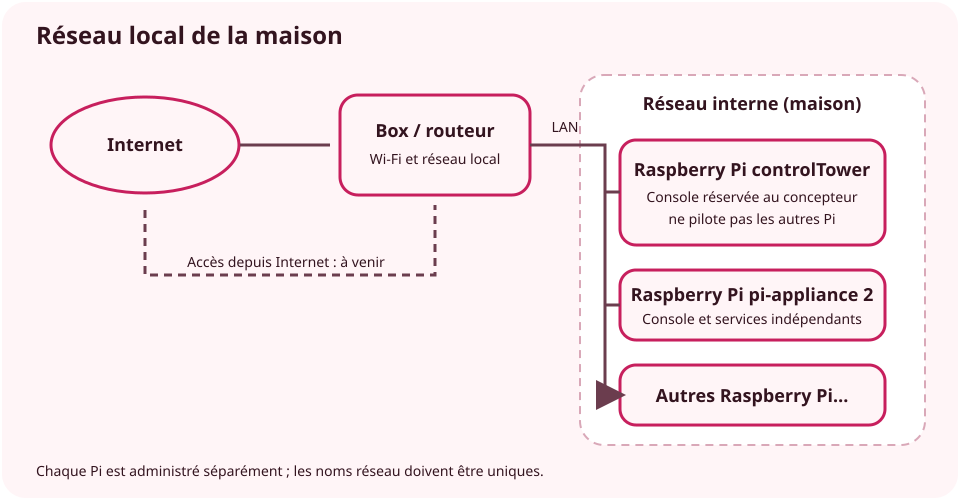
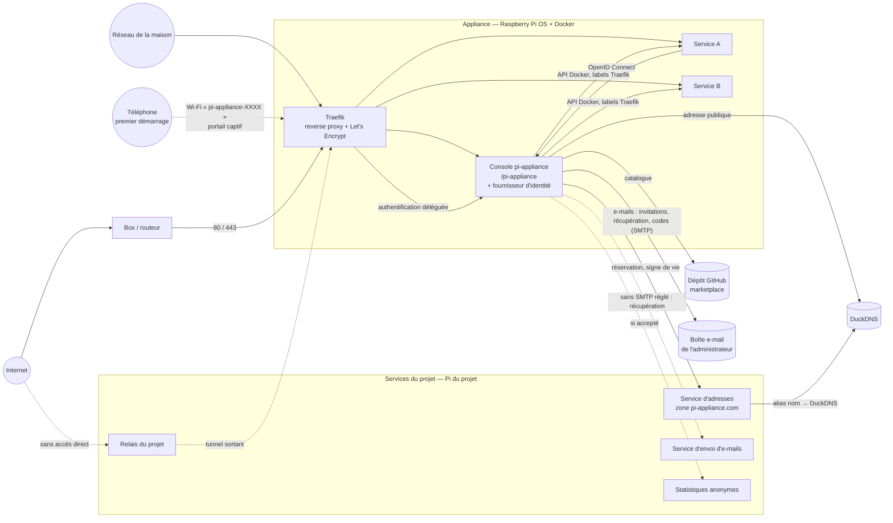

# Spécification de pi-appliance

> **Statut : cible.** Ce document décrit le produit visé. Presque rien n'est encore implémenté : l'état réel et l'avancement sont dans [TODO.md](TODO.md). Une section ne passe de « cible » à « réalisé » que lorsque le code correspondant existe.

## 1. Objet

pi-appliance transforme un Raspberry Pi en **appliance** : un boîtier personnel, posé à la maison, sur lequel on déploie des services. C'est un nœud de **Fog Computing** : les services tournent chez l'utilisateur, au plus près de ses données et de ses objets, et restent accessibles depuis internet.

On flashe une image système prête à l'emploi sur la carte SD, et le Pi fonctionne aussitôt, sans installation manuelle.

L'image repose sur trois couches :

| Couche | Contenu |
|--------|---------|
| Système | Image standard de Raspberry Pi OS (ex-Raspbian), Lite, 64 bits |
| Conteneurs | Docker Engine et Docker Compose |
| Produit | La couche pi-appliance : console d'administration, marketplace, reverse proxy Traefik, exposition sur internet |

*La console pi-appliance tourne comme un service du système hôte ; elle utilise Docker Compose pour piloter Docker Engine. Traefik et les applications de la marketplace tournent dans des conteneurs distincts.*

### 1.1 Public visé

pi-appliance s'adresse au **grand public** : des personnes sans connaissances techniques, qui ne savent ni ce qu'est Docker ni ce qu'est un DNS. En découle, pour toute la suite :

- tout se fait depuis la console, dans un navigateur : jamais de ligne de commande, de connexion SSH ni de fichier de configuration à modifier ;
- chaque choix a une valeur par défaut raisonnable ; l'utilisateur peut tout accepter sans comprendre ;
- l'interface parle de « services », d'« adresse », de « sauvegarde », pas de conteneurs, de ports ni de certificats ; les termes techniques restent dans les écrans avancés ;
- une erreur dit ce qui ne va pas et quoi faire, en langage courant ;
- une étape qui sort de la console (réglage de la box) est guidée pas à pas.

### 1.2 Licence

**Réalisé** (2026-11-25, choix de l'utilisateur, à partir de la branche du 2026-11-22) : le code de pi-appliance est public, mais ce n'est plus un logiciel libre. Il est sous licence **Creative Commons Attribution - Pas d'utilisation commerciale - Pas de modification 4.0** (CC BY-NC-ND 4.0), avec des permissions supplémentaires, fichier [`LICENSE`](../LICENSE) :

- chacun peut utiliser pi-appliance, le copier et le diffuser tel quel, et l'intégrer sans le modifier dans un autre projet non commercial (compilé ou empaqueté compris), en gardant les en-têtes et le fichier `LICENSE` et en citant le projet avec un lien et le nom de l'auteur ;
- les versions modifiées et les projets dérivés sont interdits ; une version modifiée ne peut être publiée que pour être proposée au dépôt officiel ; changer les réglages de son propre appareil n'est pas une modification ;
- tout usage commercial, y compris par une entreprise, demande une licence séparée de l'auteur (guillaume@moulard.org) ;
- tout le monde peut contribuer, selon [`CONTRIBUTING.md`](../CONTRIBUTING.md) : le contributeur garde ses droits d'auteur et accorde à l'auteur du projet le droit de diffuser sa contribution sous toute licence, commerciale comprise (accord de contribution) ;
- le code publié jusqu'à la version 0.2.1 (commit `7e1f519`) reste sous GNU AGPL-3.0 : cette licence ne se retire pas ;
- les applications de la marketplace et les autres composants tiers gardent leur propre licence.

Pieds de page de la console, des pages d'erreur et du site : « Code public, licence CC BY-NC-ND 4.0 », dans les 12 langues. Chaque fichier de code porte l'en-tête de licence donné dans `CLAUDE.md`. L'application mobile (dépôt `pi-appliance-pwa`) garde sa propre licence, AGPL-3.0.

### 1.3 Objectif de la première version

Une personne sans connaissances techniques, avec un Raspberry Pi neuf, ouvre son Nextcloud **depuis internet en moins de 15 minutes** après avoir flashé la carte SD, **sans aide** (hors temps de flashage et de téléchargement des images Docker).

## 2. Vocabulaire

| Terme | Sens |
|-------|------|
| **pi-appliance** | Le nom de tout le produit, et de ses trois parties : l'image, le socle et l'application mobile. Le produit n'a pas d'autre nom. |
| **Image pi-appliance** | Le système à flasher sur la carte SD : Raspberry Pi OS Lite 64 bits et le socle pi-appliance (section 4), publié avec chaque version. |
| **Socle pi-appliance** | Le logiciel toujours installé sur le Pi, fourni par l'image et non par la marketplace : Docker, Traefik, les services et les outils du système (`/usr/local/lib/pi-appliance/`), la console et la commande `pia`. Il se met à jour depuis la console (section 9.2). `pia version` donne sa version. |
| **Console** | L'interface web du socle, servie sous `/pi-appliance` : c'est par elle que tout se fait. |
| **Application mobile** | L'application web installable `https://app.pi-appliance.com` (adresse provisoire `https://gmoulard.github.io/pi-appliance-pwa/`, GitHub Pages) (dépôt `gmoulard/pi-appliance-pwa`) : la documentation sans réseau et un lien direct vers ses Pi (section 5.2). |
| **Commande `pia`** | La ligne de commande du Pi, partie du socle, toujours installée avec lui (section 5.2) ; pour le grand public, la console reste le moyen prévu. |
| **Appliance** | Le Raspberry Pi équipé de l'image pi-appliance. |
| **Administrateur** | Compte qui gère l'appliance ; le premier est créé au premier démarrage. |
| **Utilisateur** | Compte qui accède aux services autorisés. |
| **Invité** | Compte à durée limitée, pour un partage ponctuel. |
| **Service** | Une application installée depuis la marketplace : un ou plusieurs conteneurs Docker. |
| **Marketplace** | Le catalogue des applications installables. |
| **Manifeste** | La description d'une application de la marketplace (images, volumes, sous-domaine, paramètres, besoins). |
| **Adresse de l'appliance** | Le nom sous lequel l'appliance est joignable depuis internet : `<nom>.pi-appliance.com` par défaut, ou un domaine personnel. |
| **Relais** | Serveur du projet qui rend l'appliance joignable quand la box ne le permet pas (section 7.3). |

## 3. Parcours type

1. J'achète un Raspberry Pi.
2. Sur www.pi-appliance.com, je télécharge l'image et je la flashe sur une carte SD en suivant le guide.
3. Je démarre le Pi.
4. Le Pi crée un Wi-Fi à son nom, « pi-appliance-XXXX » (XXXX : quatre caractères propres à ce Pi, section 4). Je m'y connecte avec mon téléphone : une page s'ouvre, je choisis le Wi-Fi de la maison (ou le câble Ethernet s'il est branché) et je saisis son mot de passe. Le Pi rejoint mon réseau.
5. J'ouvre la console :
   - depuis un appareil de la maison : `https://pi-appliance-XXXX.local/pi-appliance`, ou sous le nom choisi ensuite dans la console ;
   - depuis le Pi lui-même (écran et clavier branchés) : `https://localhost/pi-appliance`.
6. Je me connecte avec l'identifiant et le mot de passe initiaux, je choisis aussitôt mon propre mot de passe et je donne mon adresse e-mail, que je confirme avec le code reçu.
7. Je choisis mon adresse : un nom libre `<nom>.pi-appliance.com`, ou mon propre domaine.
8. Je crée mes utilisateurs.
9. Dans la marketplace, je coche les services que je veux et, pour chacun, qui peut y accéder.
10. pi-appliance télécharge les images Docker, configure Traefik et les certificats, et ouvre chaque service :
    - à la maison, sur le réseau local ;
    - sur internet, à l'adresse `https://<service>.<nom>.pi-appliance.com`.

## 4. Image système et matériel

- Construite à partir de l'image officielle Raspberry Pi OS Lite 64 bits, sans modification du système de base au-delà du nécessaire.
- Contient Docker, Docker Compose, la console pi-appliance et Traefik, démarrés au premier boot.
- Premier démarrage : extension de la partition, nom du Pi propre à chaque boîtier, `pi-appliance-XXXX` (modifiable dans la console, par exemple `salon`), annonce mDNS (`<nom>.local`), génération des secrets propres au boîtier (certificat local auto-signé, clés de session). Aucun secret n'est commun à deux images.
- **Modèles pris en charge** : Raspberry Pi 5, Pi 4, Pi 3 B+ et Pi Zero 2 W, avec une seule image 64 bits. Sur les petits modèles (Pi 3 B+ : 1 Go, Zero 2 W : 512 Mo), une application dont la mémoire minimale dépasse celle du Pi s'installe quand même, après un avertissement sur les performances.
- **Plusieurs Pi dans un domicile** : plusieurs appliances indépendantes peuvent fonctionner sur le même réseau local, par exemple un Pi au salon et un autre au grenier. Chaque Pi conserve sa propre console, ses comptes, ses services et ses données ; aucun ne fournit de tableau de bord commun ni ne pilote les autres. Chaque appareil doit avoir un nom réseau unique pour éviter les conflits et permettre d'ouvrir la bonne console. La cohabitation et la procédure de configuration restent à valider (TODO-2.48) ; la procédure d'essai, dans une maison et dans plusieurs, est décrite dans [Essais avec plusieurs Pi](essais-plusieurs-pi.md).

*Schéma cible : tous les Pi sont sur le réseau interne derrière la box. L'accès depuis Internet reste à mettre en place ; aucun Pi n'administre les autres.*

- **Réseau au premier démarrage** : le Pi ouvre **toujours** un point d'accès Wi-Fi à son nom (« pi-appliance-XXXX ») avec un portail de configuration, même si un câble Ethernet est branché, pour que le parcours soit le même pour tous. Le portail propose les Wi-Fi visibles et, si un câble est branché, le réseau filaire. Le point d'accès est **ouvert** (sans mot de passe) mais **limité à 24 heures** : il se referme une fois le Pi connecté, ou au bout de 24 heures ; redémarrer le Pi le rouvre pour 24 heures, et il se rouvre de même si le Pi perd durablement le réseau. Rien de sensible n'y transite avant la création du compte administrateur. Le Pi Zero 2 W n'a pas de prise Ethernet.
- **Wi-Fi associé sans rien taper** (TODO-2.66, réalisé, à vérifier sur un vrai Pi) : au premier démarrage, le portail propose en premier « Associer avec le bouton de la box » (WPS par bouton, « PBC ») : la personne touche ce bouton dans la console, puis appuie dans les 2 minutes sur le bouton WPS de sa box ; le Pi reçoit le nom et le mot de passe du Wi-Fi de la box et les garde comme un Wi-Fi choisi à la main. La puce Wi-Fi sert aussi le point d'accès : la console prévient d'abord que le Wi-Fi de configuration se coupe pendant l'association, et le résultat se lit ensuite dans l'état, comme pour la connexion actuelle (`lastError`, avec une erreur propre si aucune box n'a répondu à temps). La saisie du nom et du mot de passe reste proposée en secours (box sans WPS, ou WPS coupé). **Réalisé** : `network.sh wifi-wps` reprend la puce à NetworkManager le temps de l'appui (il ne fait pas le WPS sans agent de secrets), un `wpa_supplicant` à part reçoit le Wi-Fi de la box dans `/run/pi-appliance/wps` (effacé aussitôt), puis la connexion se fait comme pour un Wi-Fi choisi à la main ; API `POST api/network/wifi/wps` (réponse 202 avant la fermeture du point d'accès), erreurs `wps-timeout` et `wps-failed`. Pistes pour plus tard : lire le code QR Wi-Fi de l'étiquette de la box avec l'application mobile (lecteur jsQR de pi-appliance-pwa), et Wi-Fi Easy Connect (DPP, Android 10 et suivants).
- **Stockage** : tout fonctionne sur la carte SD. Quand un disque USB est branché, la console propose d'y placer les données des services ; elle prévient quand la carte SD se remplit.
- L'image est publiée sur www.pi-appliance.com avec sa somme de contrôle.

**Réalisé** (code écrit, pas encore essayé sur un vrai Pi ; dossiers `image/` et `system/`) :

- **Construction** : `image/build.sh` part de pi-gen (Raspberry Pi OS Lite 64 bits, Trixie, version de pi-gen fixée) et ajoute une étape `image/stage-pi-appliance/`, qui lance `system/install.sh` dans l'image : Docker et Docker Compose (dépôt officiel de Docker, clé vérifiée), la console (`/usr/local/bin/pi-appliance`), Traefik (image Docker embarquée, pour que le portail marche sans internet), NetworkManager, avahi. Une vérification refuse l'image si un secret s'y trouve (clé du Pi, certificat, comptes, clés SSH) ou si la console n'est pas un binaire `arm64`. Le même `system/install.sh` installe tout sur un Raspberry Pi OS déjà en place. Réglages de l'image : nom d'hôte `pi-appliance`, SSH coupé, aucun mot de passe (le compte système `pi` est verrouillé ; Raspberry Pi OS ne propose d'en créer un qu'avec un écran branché au Pi), sauf si un compte et SSH sont choisis dans les réglages de Raspberry Pi Imager (voir « Nom propre à chaque Pi » ci-dessous), langue et clavier français, pays du Wi-Fi : France.
- **Publication** : le workflow « Image » (`.github/workflows/image.yml`) construit l'image à la demande ou pour une étiquette `v…`, et la publie alors comme version GitHub : `pi-appliance-<version>.img.xz` et sa somme de contrôle `.sha256`. Lancé à la demande (ou par « Tag ») avec « image » décoché, il ne construit que le socle : la version ne porte que l'archive de mise à jour `-arm64.tar.gz`, et ses notes renvoient à la dernière version qui a une image. Pas encore sur www.pi-appliance.com.
- **Premier démarrage** : extension de la partition par Raspberry Pi OS lui-même (`rpi-resize`) ; `pi-appliance.local` annoncé par avahi, sur les seules interfaces du Pi (pas celles de Docker), avec la console annoncée en `_https._tcp`. `pi-appliance-secrets.service` crée, à chaque démarrage s'ils manquent, la **clé du Pi** (Ed25519, `/var/lib/pi-appliance/system/device.key`, section 7.1) et le **certificat local auto-signé** (`/var/lib/pi-appliance/system/tls/`, valable 825 jours, refait 30 jours avant la fin) pour `pi-appliance.local`, `*.pi-appliance.local`, `localhost`, `127.0.0.1` et `10.42.0.1`. Chaque service en `.local` a en plus son propre certificat, fait par `mdns.sh` (ci-dessous).
- **Démarrage** : services systemd `pi-appliance-secrets`, `pi-appliance-traefik`, `pi-appliance-ap` et `pi-appliance` (console), activés dans l'image.
- **Traefik réparé de lui-même** (réalisé, TODO-2.53) : après une sous-tension, le fichier de l'image Docker de Traefik peut être abîmé sur la carte SD ; Traefik plante alors au démarrage et redémarre en boucle, et la console devient injoignable (vu au premier essai sur un Pi 3B+, 2026-11-20). Toutes les 2 minutes, `pi-appliance-traefik-check.timer` lance `traefik.sh check`, qui compte les redémarrages du conteneur (`RestartCount`) : 3 ou plus depuis la vérification précédente, et l'image est supprimée puis rechargée depuis l'archive livrée avec l'image du Pi (`/usr/local/share/pi-appliance/traefik-image.tar`), et Traefik relancé. L'identifiant de l'image ne suffit pas à repérer un fichier abîmé. Une réparation au plus par heure (date dans `/var/lib/pi-appliance/system/traefik/repaired`) ; au-delà, l'erreur est écrite dans le journal. Test sans Pi : `system/tests/traefik-repair-test.sh`, Docker simulé. À vérifier sur un vrai Pi.
- **Point d'accès** : connexion NetworkManager `pi-appliance-ap` (ouverte, 2,4 GHz, canal 6, adresse du Pi `10.42.0.1`), ouverte et fermée par `pi-appliance-ap.service` selon la règle des 24 heures : ouverte au démarrage tant qu'aucun réseau n'a été choisi dans le portail, même avec un câble ; fermée dès que le réseau choisi est actif, ou au bout de 24 heures ; rouverte pour 24 heures si ce réseau manque plus de 10 minutes (2 minutes juste après un redémarrage). La puce Wi-Fi ne peut pas à la fois servir le point d'accès et chercher les Wi-Fi : la liste est faite juste avant l'ouverture, et le Wi-Fi de la maison est retenté toutes les 10 minutes quand personne n'est connecté au point d'accès. **Portail captif** : sur le point d'accès, tous les noms mènent au Pi et toute page demandée en HTTP renvoie vers `https://10.42.0.1/pi-appliance/` ; les téléphones ouvrent alors d'eux-mêmes la page de connexion au réseau.
- **Nom propre à chaque Pi** (`/usr/local/lib/pi-appliance/name.sh`, lancé avant le réseau par `pi-appliance-secrets.service`) : au premier démarrage, le Pi prend le nom `pi-appliance-XXXX`, où XXXX sont les quatre derniers chiffres de l'adresse matérielle de son Wi-Fi (ou de son câble), donc stable d'un démarrage à l'autre et différent d'un Pi à l'autre ; il est gardé dans `/var/lib/pi-appliance/system/name`. Raspberry Pi OS Trixie démarre avec cloud-init, qui applique à chaque démarrage le nom d'hôte des réglages de Raspberry Pi Imager (fichier `user-data` de la partition de démarrage, écrit par Imager quand des réglages sont enregistrés, même oubliés) : cause probable du nom `pi3b-plus` du premier essai (TODO-2.56). `/etc/cloud/cloud.cfg.d/99-pi-appliance.cfg` (`preserve_hostname: true`) l'en empêche, et l'image est refusée sans lui. **Autres réglages d'Imager** (décision de l'utilisateur du 2026-11-20 : « ne pas couper SSH ») : le Wi-Fi d'Imager (fichier `network-config`) est ignoré (`network: {config: disabled}`, vérifié par `01-check`) : cloud-init n'en fait plus de configuration netplan, qui prendrait la puce Wi-Fi au Wi-Fi de configuration ; le réseau se choisit toujours dans le portail. `manage_etc_hosts: false` laisse `/etc/hosts` à `name.sh`. Le compte et SSH choisis dans Imager restent appliqués : SSH, utile pour dépanner le Pi, demande un compte, et c'est le seul moyen d'en avoir un sans écran ; sans réglage dans Imager, SSH reste coupé et aucun compte n'existe. Le fuseau horaire et le clavier d'Imager restent appliqués aussi (sans effet sur la console). **Limites** : un réglage écrit dans `user-data` par Imager l'emporte sur `99-pi-appliance.cfg` (si Imager y met `manage_etc_hosts: true`, cloud-init réécrit `/etc/hosts` avec le nom d'Imager ; sans effet sur le nom d'hôte ni sur `<nom>.local`) ; une carte déjà démarrée avec le Wi-Fi d'Imager garde son fichier `/etc/netplan/50-cloud-init.yaml`. Réalisé ; à vérifier sur un vrai Pi. Ce nom est le nom d'hôte (`/etc/hostname`, `/etc/hosts`), l'adresse `<nom>.local` annoncée par avahi et le nom du Wi-Fi de configuration. Plusieurs appliances peuvent ainsi vivre dans la même maison sans se gêner (deux Wi-Fi ouverts du même nom, `pi-appliance-2.local` choisi au hasard par avahi). **Nom libre sur le réseau de la maison** : le nom n'est pas proposé pendant la mise en route ; à la place, une fois le Pi relié au réseau de la maison (une fois par démarrage, par `ap.sh`, et avant la réponse au choix du câble, par `network.sh wired`), `name.sh check` vérifie que `<nom>.local` n'est pas déjà pris par un autre appareil : `avahi-resolve-host-name -4 <nom>.local` (paquet `avahi-utils`) ne doit pas répondre par une adresse qui n'est pas au Pi, et avahi ne doit pas avoir renommé le Pi de lui-même (`avahi-resolve-address` sur l'adresse du Pi, qui donnerait `<nom>-2.local`). Si le nom est pris, le Pi prend le premier nom libre parmi `<nom>-2`, `<nom>-3`, `<nom>-4`, sinon `pi-appliance-XXXX` tiré au hasard, appliqué comme un changement de nom (ci-dessous) sans relancer le Wi-Fi de configuration encore ouvert, qui se ferme de lui-même. Avec le câble, la console annonce le nouveau nom et l'adresse définitive avant la bascule ; avec le Wi-Fi, la vérification se fait après la bascule, et la console ne peut plus le dire (TODO-2.58). Test sans Pi : `system/tests/name-test.sh`, avahi simulé. L'administrateur peut ensuite changer le nom dans « Mon Pi » (carte « Nom du Pi sur le réseau », hors de l'assistant de mise en route) (`POST api/network/name` → `network.sh name`), par exemple en `salon` : le Wi-Fi de configuration repart sous le nouveau nom s'il est ouvert, le certificat local est refait pour lui (`secrets.sh` le refait dès que le nom du Pi n'y figure pas), avahi et Traefik redémarrent quelques secondes après la réponse ; la console s'ouvre ensuite à `https://<nom>.local/pi-appliance`. Le nom suit les règles d'un nom d'hôte : 1 à 32 caractères, minuscules, chiffres et tirets. Les phrases de la console qui nomment le Wi-Fi ou l'adresse utilisent le nom réel du Pi, dans toutes les langues. La console prend `<nom>.local` comme adresse par défaut des services (`-domain`) et suit le changement de nom sans redémarrer : les services installés ensuite ont l'adresse `<service>-<nom>.local` (`services.Manager.Renamed`) ; une adresse donnée par `-domain` ne change pas. Les services déjà installés sont déplacés vers le nouveau nom (`services.Manager.Relocate`, section 6.2). Test sans Pi : `system/tests/name-test.sh`. À vérifier sur un vrai Pi.
- **Adresses des services à la maison** (`/usr/local/lib/pi-appliance/mdns.sh`, `pi-appliance-mdns.service`) : avahi n'annonce que `<nom>.local`, et mDNS n'a pas de caractère générique. `mdns.sh` annonce donc l'adresse de chaque service installé (`<service>-<nom>.local`, section 6.2), lue dans `<données>/services/*/instance.json` (champ `address`, s'il finit par `.local`, sans les services sans page web), vers l'adresse IPv4 du Pi sur la maison (câble d'abord, sinon Wi-Fi, jamais le Wi-Fi de configuration `10.42.0.1`), avec un `avahi-publish -a -R <adresse> <IP>` par nom (`-R` : plusieurs noms pour une même adresse). Il revérifie toutes les 15 secondes et relance les annonces quand un service est installé ou retiré, quand l'adresse IP du Pi change, ou quand avahi a été relancé (changement de nom, `name.sh set`) ; un service pas encore déplacé (section 6.2) reste annoncé à son ancienne adresse. **Certificat de chaque service** (section 8.4) : un certificat ne peut pas couvrir `*-<nom>.local` (le caractère générique ne remplace qu'une partie entière du nom), et un seul certificat refait à chaque installation ferait réapparaître l'alerte du navigateur sur la console et sur tous les services. `mdns.sh` donne donc à chaque adresse en `.local` son propre certificat auto-signé (`/var/lib/pi-appliance/system/tls/services/<adresse>.crt`, même durée et même renouvellement que le certificat local), efface celui d'un service retiré, et écrit leur liste dans `/etc/pi-appliance/traefik/dynamic/services-tls.yml`, avec le numéro de série de chacun : Traefik relit ce fichier dès qu'il change et présente à chaque adresse son certificat (choix d'après le nom demandé, SNI), le certificat local restant celui de la console et des adresses IP. Essayé avec Traefik v3.7.19 (sans Docker) : bon certificat pour chaque adresse, service ajouté et certificat renouvelé pris sans redémarrage. Test sans Pi : `system/tests/mdns-test.sh` (faux avahi, vrai openssl). **Noms à un seul niveau** (TODO-2.61, décision de l'utilisateur du 2026-11-20) : un nom à deux niveaux comme `www.<nom>.local` se résout sous macOS, iOS et Linux, mais pas sous Windows (seuls les noms `<nom>.local` à un niveau y sont résolus, d'après les rapports d'utilisateurs) et pas toujours sous Android ; les services ont donc l'adresse `<service>-<nom>.local`, à un seul niveau comme celle de la console. Réalisé ; à vérifier sur un vrai Pi, depuis Windows 10/11, un Android récent, un iPhone, un Mac et Linux.
- **Wi-Fi de configuration sans accès à internet** : le point d'accès est ouvert et NetworkManager (`ipv4.method=shared`) partage la connexion du Pi avec ses clients. Le pare-feu `/etc/pi-appliance/ap-firewall.nft`, chargé avant le réseau par `pi-appliance-firewall.service` (dont dépend `pi-appliance-ap.service`), empêche tout transfert depuis ou vers le réseau du point d'accès (10.42.0.0/24) : ses clients joignent le portail et la console du Pi, rien d'autre. Correction de l'incident du 2026-11-19 (deux Pi allumés, réseau de la maison saturé, alertes de Google). Test sans Pi : `system/tests/ap-firewall-test.sh`, qui reproduit le partage de connexion de NetworkManager dans des espaces réseau dédiés.
- **Disque USB** (`/usr/local/lib/pi-appliance/storage.sh`, paquet `internal/storage`, API `api/storage` réservée à l'administrateur) : la section « Mon Pi » liste les disques USB branchés (`lsblk`, la carte SD n'y figure jamais) et propose d'y placer les données des services. Un disque déjà en ext4 est utilisé tel quel ; sinon la console propose de l'effacer (deux confirmations), d'y créer une seule partition ext4 (`sfdisk`, `mkfs.ext4`), puis de l'utiliser. Le déplacement copie tout le dossier de Docker (volumes des services et images) sur le disque, monté en `/mnt/pi-appliance-data` (ligne `nofail` dans `/etc/fstab`, par l'UUID du disque), règle `data-root` dans `/etc/docker/daemon.json` (gardé par `install.sh` lors d'une réinstallation), redémarre Docker et Traefik, puis libère la carte SD ; il vérifie d'abord la place libre (ce que prend Docker, plus 10 %). Il dure plusieurs minutes et arrête les services et l'accès à la console : le script se relance hors du service de la console (`systemd-run`, unité `pi-appliance-storage`) et répond tout de suite ; la page suit l'avancement (`GET api/storage`, champ `move`) et le dit en langage courant. En cas d'échec, retour à la carte SD et à l'ancienne configuration de Docker ; une copie interrompue (Pi éteint) est signalée. Ensuite, Docker ne démarre pas sans le disque (`RequiresMountsFor`), pour ne pas repartir à vide sur la carte SD : la console dit de le laisser branché. Revenir sur la carte SD, changer de disque : pas encore. À vérifier sur un vrai Pi.
- **Pour la console** : `/usr/local/lib/pi-appliance/network.sh` donne en JSON l'état du réseau, la liste des Wi-Fi visibles, la connexion à un Wi-Fi (mot de passe par l'entrée standard, jamais dans une ligne de commande) et le choix du câble, le pays du Wi-Fi (`raspi-config`, gardé après un redémarrage), le test du réseau choisi (`network.sh test`, sans toucher au point d'accès) et le redémarrage du Pi à la fin de la mise en route (`network.sh reboot`, section 5.1). **Réalisé** : la console l'appelle par `internal/network` (API `api/network`, réservée à l'administrateur connecté) et le portail propose le pays du Wi-Fi, la liste des Wi-Fi, le mot de passe, un Wi-Fi caché, le câble, le temps restant avant la fermeture du point d'accès et l'explication de l'alerte du certificat. La demande de connexion reçoit sa réponse avant que le point d'accès se ferme ; le résultat se lit ensuite dans l'état (`lastError`). **Dernière adresse sur la maison** (TODO-2.58) : l'adresse IP que le Pi prendra sur le Wi-Fi de la maison n'est pas connue avant la bascule (la puce Wi-Fi sert encore le point d'accès). Une fois le Pi relié, `ap.sh` garde chaque minute son nom et ses adresses sur la maison dans `/var/lib/pi-appliance/system/home-address` ; `network.sh status` les rend (`lastHome` : `{"name", "addresses"}`, `null` avant la première connexion), et la console les redonne quand le Wi-Fi de configuration est rouvert (« La dernière fois qu'il était relié à votre réseau, le Pi s'appelait… »). **Pays proposé d'après le navigateur** (TODO-2.57) : l'état dit si le pays a été choisi dans la console (`countryChosen`) ou s'il est celui de l'image (France) ; tant qu'il n'a pas été choisi, la console déduit un pays de la langue du navigateur (sa région, comme `de-AT` → Autriche, sinon le pays principal de la langue, `de` → Allemagne) et, s'il diffère, le propose sous la liste des pays (« Choisir « Allemagne » »), sans l'appliquer d'elle-même. **Pi déjà relié** (TODO-2.65) : l'état du Wi-Fi vient de la puce (`nmcli device status`) et le nom du Wi-Fi du réglage enregistré, pas de la liste des Wi-Fi (vide tant qu'aucune recherche n'a eu lieu depuis le démarrage) ; quand cette liste est vide et le point d'accès fermé, la console lance d'elle-même une recherche, qui ne coupe rien. À vérifier sur un vrai Pi.

## 5. Console d'administration

Servie par l'appliance sous `/pi-appliance`, en HTTPS seulement.

### 5.1 Premier démarrage (assistant)

1. Création du compte administrateur, directement dans le portail de configuration : il n'y a **pas d'identifiant initial** ; la première personne connectée au point d'accès crée le compte (mot de passe de 12 caractères au moins, section 8.1).
2. Adresse e-mail de l'administrateur, **obligatoire**, vérifiée par un code envoyé par e-mail (récupération et alertes, sections 8.5 et 8.6). Tant que le Pi ne sait pas envoyer d'e-mail (« Envoi des e-mails » pas encore réglé, section 10.2, ou appliance sans internet), l'adresse est enregistrée et vérifiée dès qu'il le peut ; la console le rappelle tant que ce n'est pas fait. **Réalisé** (TODO-2.19, à vérifier sur un vrai Pi) : la vérification se fait dans « Mon compte » ou depuis la proposition de double authentification (8.1) : un code à 6 chiffres, valable 10 minutes, envoyé par le SMTP réglé sur le Pi ; vérifier l'adresse active par défaut le code par e-mail comme double authentification.
3. Langue de l'interface.
4. Adresse de l'appliance : `<nom>.pi-appliance.com` (vérification que le nom est libre) ou domaine personnel (section 7.1).
5. Test d'accès depuis internet ; guide de la box ou bascule sur le relais si besoin (section 7).
6. Création des utilisateurs.
7. Statistiques anonymes : proposées, désactivées par défaut (section 8.4) ; fonction désactivée pour l'instant (2026-11-22), l'étape ne viendra qu'avec sa réactivation.
8. Test du réseau de la maison, puis redémarrage du Pi. **Cible** (TODO-2.63) : entre les deux, mise à jour du Pi (système et pi-appliance), une seule fois et d'office, l'image n'étant reconstruite que de loin en loin ; ensuite les mises à jour restent proposées (section 9.2).

L'assistant n'installe pas de service : une fois la mise en route terminée, l'administrateur choisit ses services dans la marketplace (section 6.2).

**Réalisé** (première version) : après la création du compte, la console ouvre l'assistant « Mise en route » pour l'administrateur. Une phrase d'accueil dit ce qu'est l'assistant, pourquoi il s'affiche (il revient tant qu'il n'est pas terminé) et sa durée (environ cinq minutes). Il montre les étapes et la place de chacune : compte administrateur, réseau de la maison (pays du Wi-Fi, expliqué en une phrase, puis Wi-Fi ou câble, section 4), vérification et redémarrage. L'assistant ne propose plus d'installer des services (TODO-2.10) : la marketplace et « Mes services » restent cachés pendant l'assistant, et le message de fin invite à y choisir ses services. Chaque champ de mot de passe de la console (mot de passe du Wi-Fi, création du compte, connexion…) a un bouton « Afficher » / « Masquer » pour vérifier ce qu'on tape (TODO-2.9) ; le mot de passe est remasqué à l'envoi du formulaire. Pendant l'assistant, la console n'affiche ni « Mon compte » (double authentification), ni « Mon Pi » (dont le nom du Pi) : ils viennent après, sauf la double authentification exigée par l'administrateur, qui passe avant tout (8.1). Avant de couper le Wi-Fi de configuration, la console dit où la retrouver : `https://<nom>.local/pi-appliance`, l'adresse IP du Pi quand elle est connue (câble), sinon la liste des appareils de la box, avec l'alerte du certificat. L'étape du réseau avance d'elle-même dès que le réseau est choisi, même si la page a perdu la connexion entre-temps ; elle peut être passée, le point d'accès restant alors ouvert. **Vérification** (TODO-2.11) : une fois le réseau choisi (en général après la reconnexion à `https://<nom>.local/pi-appliance` depuis le Wi-Fi de la maison), le bouton « Tester le Wi-Fi » (« Tester le câble réseau » avec le câble) lance `POST api/network/test` → `network.sh test`. Le point d'accès et le Wi-Fi de la maison partagent la même puce (TODO-2.14) : le test ne coupe ni ne relance rien, il regarde la connexion déjà établie et répond par une liste en langage courant : Pi relié au réseau choisi (pas au Wi-Fi de configuration), adresse donnée par la box, box qui répond (`ping` de la passerelle), internet joignable (nom `www.pi-appliance.com` résolu), nom `<nom>.local` qui répond (avahi), réglage retrouvé après un redémarrage (connexion `pi-appliance-wifi` en connexion automatique). Le test est réussi (`passed`) si les quatre points relié, adresse, box et réglage gardé sont bons ; internet et le nom en `.local` ne donnent qu'un avertissement orange (le Pi marche à la maison sans eux). En cas d'échec, l'écran du réseau revient pour choisir à nouveau. **Redémarrage** (TODO-2.12) : test réussi, le bouton « Redémarrer le Pi » affiche où retrouver le Pi (`https://<nom>.local/pi-appliance`, et `https://<adresse IP>/pi-appliance` quand elle est connue, sinon la liste des appareils de la box), la suite (se reconnecter, puis choisir ses services dans la marketplace) et un compte à rebours de 10 secondes, que « Ne pas redémarrer » interrompt. Au bout du compte, la console demande `POST api/system/reboot` (administrateur seulement) → `network.sh reboot`, qui garde la dernière adresse sur la maison puis programme `systemctl reboot` 5 secondes plus tard (`systemd-run --on-active`, unité `pi-appliance-reboot`, une seule à la fois), pour que la réponse arrive d'abord ; puis elle enregistre la fin de la mise en route. La page attend que le Pi ne réponde plus, puis qu'il réponde de nouveau, et se recharge sur l'écran de connexion (un redémarrage déconnecte tout le monde) ; au bout de 3 minutes sans redémarrage, elle dit de débrancher et rebrancher le Pi. « Terminer sans redémarrer » (ou « Terminer la mise en route » si le réseau a été passé) enregistre la fin de la mise en route (`/var/lib/pi-appliance/wizard-done`) ; d'ici là, l'assistant reprend à la connexion suivante. Tests sans Pi : `system/tests/network-test.sh` (faux `nmcli`, `ping`, `getent`, `avahi-resolve-host-name`, `systemd-run`), tests Go avec un faux `network.sh`, écrans essayés dans Chromium. À vérifier sur un vrai Pi. **Étapes suivantes** (TODO-2.22, à vérifier sur un vrai Pi) : l'assistant montre huit étapes : compte, **langue** (au début : liste des 12 langues sous leur propre nom, la page se recharge dans la langue choisie ; la question revient une fois sur la nouvelle adresse après le passage au Wi-Fi de la maison, la langue étant gardée par adresse), réseau de la maison, vérification du réseau, **adresse sur internet** (cartes DuckDNS et adresse personnelle de l'écran « Adresse sur internet » ; la carte `<nom>.pi-appliance.com` n'apparaît que si le service d'adresses du projet répond, `GET /pi-appliance/api/address/service`), **accès depuis internet** (carte « Accès depuis internet » : accord pour l'UPnP, guide de la box, test, section 7.2), **autres comptes** (carte « Comptes » : invitations) et redémarrage. Chaque étape après la langue se passe (« Passer cette étape ») et se refait plus tard dans la console, avec la même carte ; sans réseau choisi, les deux étapes d'internet sont sautées ; le redémarrage n'est proposé que si le test du réseau a réussi. Pas d'étape des statistiques tant que la fonction est désactivée (8.4, TODO-4.7). Textes dans les 12 langues.

### 5.2 Fonctions courantes

- État de l'appliance : charge, mémoire, température, espace disque, adresse publique, état des certificats, mode d'accès (direct ou relais). **Réalisé** (TODO-5.24, demande de l'utilisateur du 2026-11-23) : pour un administrateur, la barre du haut montre la charge du Pi sur la même ligne que « Appliance en service. » (demande de l'utilisateur du 2026-11-23 ; sur téléphone, elle passe dessous en plus petit), « CPU x % · RAM y % · Disque z Go / t Go » (disque des données : le disque USB s'il y en a un, sinon la carte SD), d'après `api/system`, lue en parallèle du reste pour ne pas retarder l'ouverture de la page, puis relue chaque minute avec « Mon Pi » ; rien pour les autres comptes ni avant la connexion.
- **Graphiques** sur 30 jours : processeur, mémoire, réseau, température, espace disque.
- Services installés : état vert/orange/rouge, démarrer, arrêter, redémarrer, mettre à jour, désinstaller, journaux téléchargeables, qui peut y accéder.
- Utilisateurs : inviter, modifier, supprimer, réinitialiser un mot de passe, rôle, date d'expiration des invités, exiger la double authentification.
- Adresse et accès depuis internet : modifier, tester.
- Sauvegarde et restauration (section 9).
- Mises à jour disponibles (section 9.2), canal stable ou bêta (section 5.4).
- Seuls les administrateurs accèdent à ces fonctions ; un utilisateur ne voit que son profil (mot de passe, double authentification) et la liste des services auxquels il a accès.

Une appliance se gère depuis sa propre console : pas de tableau de bord commun à plusieurs appliances.

**Réalisé** (tableau de bord, section « Mon Pi » de la console, administrateurs ; à vérifier sur un vrai Pi) :

- **En ce moment** : charge du processeur (part du temps où il a travaillé, d'après `/proc/stat`, tous cœurs confondus ; orange à 90 %), température de la puce (`/sys/class/thermal/thermal_zone0/temp` ; orange à 70 °C, rouge à 80 °C, avec un conseil en langage courant), jauges de la mémoire et du disque (section 6.2), et l'état des services en une phrase (« 2 services en marche, 1 service arrêté »), avec la pastille de la couleur la plus grave. `GET api/system` donne `memory`, `disk`, `cpu_percent`, `temperature_c` (`null` quand la valeur est inconnue). **Alimentation** (TODO-2.54) : d'après le masque du micrologiciel (`/sys/devices/platform/soc*/*firmware/get_throttled`, celui de `vcgencmd get_throttled`), une tuile dit en langage courant si l'alimentation est trop faible en ce moment (rouge, « utilisez l'alimentation officielle du Pi »), si elle l'a été depuis le démarrage du Pi (orange), ou si elle est correcte ; `power` : `{"undervoltage_now", "undervoltage_since_boot", "throttled_now", "throttled_since_boot"}`, `null` hors d'un Pi. La page se met à jour chaque minute.
- **Graphiques** sur 24 heures ou 30 jours : processeur, mémoire, température (la plus haute de chaque heure), disque et réseau (Mo reçus et envoyés par heure, sur le câble et le Wi-Fi, sans le bouclage ni les réseaux internes de Docker). Une courbe par mesure, chacune avec son échelle ; une heure sans mesure (Pi éteint) coupe la courbe ; la valeur d'une heure s'affiche sous le doigt ou la souris. `GET api/system/history` : `{"step_seconds": 3600, "points": [{"time", "cpu_percent", "memory_percent", "temperature_c", "disk_percent", "received_mb", "sent_mb"}]}`.
- **Historique** (paquet `internal/metrics`) : une mesure par minute, agrégée par heure en mémoire ; le fichier `<données>/history.json` n'est écrit qu'une fois par heure (section 11), et à l'arrêt de la console, heure en cours comprise, reprise au redémarrage. 30 jours gardés, soit 720 points (environ 100 Ko).
- **Diagnostic du Pi** : lien vers la page `/pi-appliance/diagnostic` (état des programmes du système, erreurs récentes, journaux à télécharger, section 8.5).
- Pas encore : adresse publique, état des certificats et mode d'accès (étape Internet, section 7).

**Barre des tuiles** (TODO-5.22, réponses de l'utilisateur du 2026-11-22 ; `app.js`, `index.html` ; essayée dans Chromium, à vérifier sur un vrai Pi) : en haut de la console, une barre à deux niveaux choisit ce qui est affiché.

- **Ordre de la page** : « Mon Pi » d'abord (état, nom du Pi, application mobile, entretien, graphiques), puis le reste de Mon Pi rangé sous lui (réseau de la maison, adresse sur internet, statistiques anonymes, comptes, mon compte), puis « Mes services » (par ordre alphabétique des noms), puis la « Marketplace » **par ordre alphabétique des noms d'application**, Cockpit compris, « Docker Compose libre » restant à la fin (TODO-5.27, demande de l'utilisateur du 2026-11-25 « ordonne les blocs par ordre alphabétique » ; réalisé, à vérifier sur un vrai Pi ; ordre de la langue de la console, sans tenir compte des majuscules ni des accents). Les cartes de « Mon Pi » gardent leur ordre fixe (« Mises à jour » et « Versions de la console » en premier, demande du 2026-11-25) : leurs titres changent avec la langue et plusieurs n'en ont pas.
- **Premier niveau** : les trois types de tuiles, « Mon Pi », « Mes services », « Marketplace », seulement ceux à l'écran pour ce compte. **Second niveau**, pour les types choisis : les 4 thèmes de Mon Pi, « Réseau et internet » (réseau, adresse sur internet, nom du Pi), « État » (tuiles et jauges, graphiques, statistiques anonymes, mises à jour), « Entretien » (mises à jour, disque USB, sauvegardes, administration du système, diagnostic) ; une case peut avoir plusieurs thèmes (`data-theme` séparé par des espaces) : la carte « Mises à jour » est dans « État » et dans « Entretien » (demande de l'utilisateur du 2026-11-23), « Comptes et appareils » (comptes, mon compte, application mobile) ; et les étiquettes du catalogue (section 6.5) présentes dans « Mes services » et la « Marketplace ».
- **Un seul type à la fois** au premier niveau (« Mon Pi », « Mes services » ou « Marketplace » ne se cumulent pas, demande de l'utilisateur du 2026-11-23 : en toucher un autre remplace le choix, toucher le type choisi réaffiche tout) ; **choix multiple, « l'un ou l'autre »**, au second niveau (thèmes et étiquettes) ; rien de choisi : tout est affiché. Une étiquette ne trie que les tuiles de son type : choisir « Entretien » ne cache aucun service. Les étiquettes choisies sont gardées sur cet appareil (stockage du navigateur, `pi-tiles`) ; sans stockage, elles ne durent que le temps de la page. **Le type, lui, n'est pas gardé** (TODO-5.25, demande de l'utilisateur du 2026-11-24, réalisé le 2026-11-24, à vérifier sur un vrai Pi) : à chaque ouverture de la console (connexion ou page rechargée), « Mon Pi » est choisi ; un compte qui n'a pas « Mon Pi » (utilisateur, invité) voit tout ce qu'il a. La barre ne se montre que quand au moins deux types sont à l'écran : jamais pendant l'assistant de mise en route, ni à la connexion.
- **Étiquettes des services** : un service installé depuis la marketplace prend celles de son application (champ `tags` de `GET api/services`, `tags_editable` faux). Un service hors catalogue (Docker Compose libre, application retirée du catalogue) a les étiquettes que l'administrateur lui choisit dans sa fiche (« Étiquettes », jusqu'à 4), gardées dans son `instance.json` : `PUT api/services/<nom>/tags` (`{"tags": [...]}`, administrateurs ; liste fermée de `marketplace/tags.go`, refusé pour un service du catalogue).
- **Étiquettes sur chaque carte** (TODO-5.28, demande de l'utilisateur du 2026-11-25 : « dans l'affichage d'un bloc, mets le tag qui le caractérise, exemple : caméra affiche le tag maison » ; réalisé, à vérifier sur un vrai Pi) : chaque carte montre, juste sous son titre, les étiquettes qui la rangent dans la barre du haut, en pastilles, avec les mêmes libellés traduits : pour un service de « Mes services » et une application de la « Marketplace », les étiquettes du catalogue (section 6.5 ; « Caméra et timelapse » : « Maison » ; un service hors catalogue : celles choisies par l'administrateur), Cockpit compris (« Administration ») ; pour une case de « Mon Pi », son ou ses thèmes (« Mises à jour » : « État » et « Entretien » ; une case sans titre les montre en haut). Interprétation retenue : les étiquettes de la barre du haut, pas le niveau d'accès du service (« Qui peut l'ouvrir », déjà dans sa fiche). Les pastilles ne sont pas des boutons : on trie avec la barre du haut. Elles remplacent la liste d'étiquettes qui était en bas des cartes de la marketplace et des services.
- **Cartes toujours affichées** (TODO-5.29, demande de l'utilisateur du 2026-11-25 : « le bloc mise à jour système disparaît » ; réalisé, à vérifier sur un vrai Pi) : une carte ne se cache que quand elle ne concerne pas ce compte ou ce Pi (réponse `401`, `403` ou `404` de son API), jamais parce que la console n'a pas répondu un moment. Cause trouvée : la carte « Mises à jour » se cachait dès qu'une lecture de `api/updates` échouait, et sa relecture s'arrêtait ; or la console ne répond pas toujours, par exemple quelques secondes pendant l'installation des correctifs du système, quand Docker, donc Traefik, redémarre. De même, un échec de `api/system` cachait tout « Mon Pi », que la relecture de chaque minute ne remontrait plus. Désormais la carte reste, dit « La console ne répond pas pour l'instant : nouvel essai dans quelques secondes. » et relit toutes les 5 secondes jusqu'à la réponse ; « Mon Pi » garde ce qu'il montrait et se relit chaque minute (12 langues). Essai : `system/tests/console-cards-test.sh` (console de ce dépôt, faux script des correctifs, Chromium sans tête avec Playwright, `console-cards.cjs`) vérifie que chaque carte attendue d'un administrateur est à l'écran à l'ouverture, avec tout affiché, avec chaque thème de « Mon Pi », et pendant puis après une panne simulée de la console (réponses `502`).

**Application mobile** (TODO-5.16 ; application à part, dépôt `gmoulard/pi-appliance-pwa`, publiée à `https://app.pi-appliance.com`, et à son adresse provisoire `https://gmoulard.github.io/pi-appliance-pwa/` tant que ce nom n'est pas en service). **Réalisé** (à vérifier sur un vrai Pi avec l'application) :

- **Carte « Application mobile »** de « Mon Pi », pour l'administrateur seulement (`GET api/mobile`, réservée à l'administrateur : `{"link", "qr"}` ; `link` sans code d'appairage, le code QR avec). Elle montre un code QR, dessiné par la console elle-même (image PNG faite sur le Pi, bibliothèque `go-qrcode`, sans service extérieur), et le même lien, à copier ou à partager (bouton « Partager » du téléphone quand le navigateur en a un), avec un lien « Ouvrir l'application mobile » vers `https://app.pi-appliance.com`. Ni mot de passe, ni clé privée, ni jeton.
- **Lien d'ajout** : `https://app.pi-appliance.com/#add?` suivi de paramètres encodés comme une adresse web (`application/x-www-form-urlencoded` : `:` → `%3A`, `/` → `%2F`, `,` → `%2C`), dans l'ordre alphabétique des noms de paramètres ; l'application les lit avec `new URLSearchParams(location.hash.slice("#add?".length))` :
  - `n` : nom du Pi sur le réseau (`salon`) ;
  - `l` : adresse de la console à la maison, `https://<nom>.local/pi-appliance` ;
  - `w` : adresse de la console sur internet, `https://<adresse>/pi-appliance`, seulement si le Pi en a une : l'adresse personnelle de la console (8.3), sinon l'adresse `<nom>.pi-appliance.com` réservée (7.1), sinon le nom DuckDNS, sinon le domaine personnel des services (option `-domain`) ; absent sinon. La console elle-même reste fermée sur internet (8.3) : à cette adresse, seule `api/hello` répond ;
  - `id` : identifiant stable et non secret du Pi, les **16 premiers caractères hexadécimaux (minuscules) du SHA-256 des 32 octets de sa clé publique Ed25519** (`/var/lib/pi-appliance/system/device.pub`, faite avec `device.key` par `secrets.sh`) ; le même en shell : `openssl pkey -pubin -in device.pub -outform DER | tail -c 32 | sha256sum | cut -c1-16`. Il ne change pas quand le Pi change de nom ; absent si la clé manque ;
  - `s` : **un paramètre `s` par service** qui a une page web, par ordre alphabétique du nom, de valeur `<nom>,<adresse>` : le nom du service (lettres minuscules, chiffres et tirets, jamais de virgule), une virgule, puis son adresse complète (`https://cloud-salon.local`) ; l'application coupe à la première virgule (`params.getAll("s")`). Aucun `s` si le Pi n'a pas de service.
  - `c` : dans le **code QR seulement**, en dernier, le code d'appairage de l'administrateur connecté (section 8.1) ; jamais dans le lien à copier ou partager.
  - Exemple : `https://app.pi-appliance.com/#add?id=f2b4ee79f5ba587b&l=https%3A%2F%2Fsalon.local%2Fpi-appliance&n=salon&s=cloud%2Chttps%3A%2F%2Fcloud-salon.local&s=www%2Chttps%3A%2F%2Fwww-salon.local`.
- **`GET /pi-appliance/api/hello`**, sans connexion : `{"name", "version", "id", "services": [{"name", "address", "internet"}]}`, mêmes valeurs que `n`, `id` et `s` ci-dessus ; `internet` (demande de l'utilisateur du 2026-11-24, services injoignables loin de chez soi par leur adresse `.local`) : adresse du service depuis internet, comme `internet_address` de `GET api/services`, seulement pour un service qui s'y ouvre déjà (absent sinon) ; l'application mobile l'ouvre quand l'adresse internet du Pi répond et pas celle de la maison (`id` vide si la clé manque, `services` liste vide sans service), et rien d'autre : ni état du système, ni comptes. En-têtes `Access-Control-Allow-Origin` (l'origine de la demande si c'est l'application, `https://app.pi-appliance.com` ou son adresse provisoire `https://gmoulard.github.io` ; sinon `https://app.pi-appliance.com`, que le navigateur refuse), `Vary: Origin` et `Cache-Control: no-store`, sans cookie ni `Access-Control-Allow-Credentials`. À la demande préalable du navigateur (`OPTIONS`, réponse 204), aussi `Access-Control-Allow-Methods: GET`, `Access-Control-Allow-Private-Network: true` (Chrome, accès au réseau local) et `Access-Control-Max-Age: 600`. **N'importe qui qui connaît l'adresse du Pi peut la lire**, choix accepté : c'est la seule demande de la console ouverte aussi depuis internet, par le routeur Traefik `pi-appliance-hello` (chemin exact, `GET`, `HEAD` et `OPTIONS` seulement ; 8.3).
- Lien « Application mobile » aussi sur le site www.pi-appliance.com (menu et pied de page, section 13).

**Ligne de commande du Pi, `pia`** (TODO-5.17 ; paquet `internal/cli`, tests `internal/cli/cli_test.go` ; à vérifier sur un vrai Pi). Pour les personnes à l'aise avec SSH : la console reste le moyen prévu pour tout le monde. Même binaire que la console : **`pia <commande>`**, lien `/usr/local/bin/pia` vers `pi-appliance` posé par `install.sh` (image et mises à jour, vérifié par `01-check`), ou `pi-appliance <commande>` ; `pia` seul ou `pia --help` affiche l'aide. Sans commande, ou avec des options seulement, `pi-appliance` est la console. Commandes en français, quelques équivalents anglais (`install`, `uninstall`, `start`, `stop`, `restart`, `status`, `help`) :

- `version` : version du socle : pi-appliance (binaire et console en marche), système (`/etc/os-release`) et noyau, modèle du Pi (`/proc/device-tree/model`), Docker, image de Traefik ; « inconnu » pour ce qui ne répond pas.
- `update [--oui]` (ou `mise-a-jour`, TODO-5.18) : installe la **dernière version** de pi-appliance du canal choisi, comme le bouton de « Mon Pi → Mises à jour » (section 9.2) : nouvelle recherche (`POST api/updates/check`, attendue 30 secondes au plus), « à jour » si rien de plus récent, sinon une question (ou `--oui`), puis `POST api/updates/appliance` et l'avancement en clair (téléchargement et vérification, installation, la console redémarre, fin ou échec, avec le retour à l'ancienne version) en relisant `GET api/updates` ; pendant le redémarrage, la console ne répond plus, puis répond avec un nouveau jeton, relu à chaque appel. Seule une fin d'installation datée d'après la demande compte (pas celle d'une installation précédente). 20 minutes au plus.
- `update list` (ou `liste`) : versions publiées sur le canal (`GET api/updates/versions`), la plus récente en premier : dernière, installée sur ce Pi, bêta, ou « image à flasher » quand son archive de mise à jour n'est pas publiée.
- `update <version> [--oui]` (`v0.1.6` ou `0.1.6`) : installe cette version, plus récente **ou plus ancienne** ; revenir en arrière demande une confirmation qui prévient que les réglages faits depuis peuvent ne pas être compris (si cette version ne démarre pas, la version en service est remise, section 9.2).
- `etat` : la console répond-elle, et l'état des services en une phrase.
- `catalogue [application]` : applications installables ; avec un nom, sa description, la mémoire et le disque, l'accès par défaut et ses paramètres (`--param nom=valeur`).
- `services` : services installés, leur état en clair et leur adresse.
- `installer <application> [--nom NOM] [--acces public|users|home] [--param nom=valeur]… [--confirmer]` : installe et affiche l'avancement (préparation, téléchargement image par image, création, démarrage, vérification), puis l'adresse et les mots de passe créés par le Pi, montrés une seule fois. Une application qui a la main sur tout le Pi (Portainer) demande `--confirmer`.
- `desinstaller <service> [--effacer-donnees] [--oui]` : données **gardées par défaut** ; `--effacer-donnees` les efface, après une question (ou `--oui`).
- `demarrer`, `arreter`, `redemarrer <service>`.
- **Option `-force`** (ou `--force`, `--forcer` ; TODO-5.20, à vérifier sur un vrai Pi) : à mettre n'importe où sur la ligne (`pia -force desinstaller cloud --effacer-donnees`) ; aucune question de confirmation n'est posée, la réponse est oui (la question est affichée, suivie de « oui (-force) »). Elle vaut `--oui` et `--yes` de toutes les commandes, et `--confirmer` des options à risque de `installer`. Gardée par la relance avec sudo ; `pi-appliance -force <commande>` est la ligne de commande, pas la console (la relance par sudo passe par ce nom). Test `TestForce`.
- `user` (TODO-5.19, demande de l'utilisateur du 2026-11-22 ; noms en anglais seulement, choix de l'utilisateur) : comptes de la console (section 8.1), par la même API que l'écran « Comptes » ; `pia user` seul donne son aide.
  - `user list` : comptes, rôle, e-mail, état (actif, invitation en attente, invité actif jusqu'au… inclus, accès terminé) et double authentification (non, activée, exigée).
  - `user show <compte>` : le compte (rôle, état, double authentification, codes de secours restants), ses **téléphones appairés** (date d'appairage, dernière connexion) et les **liens de partage** qu'il a créés (service, nom, création, fin) : `GET api/accounts/{nom}` (administrateur).
  - `user add <compte> <e-mail> [--role admin|user|guest] [--until AAAA-MM-JJ] [--require-2fa]` : rôle `user` par défaut, `--until` (dernier jour d'accès, à l'heure du Pi) obligatoire pour un invité et refusé sinon. **Le mot de passe n'est jamais tapé dans le terminal** (choix de l'utilisateur) : la personne reçoit le lien d'invitation par e-mail (en anglais depuis `pia`), ou `pia` l'affiche pour qu'on le lui transmette. Le lien pointe vers l'adresse internet de la console si elle est ouverte sur internet, sinon vers `https://<nom>.local`, jamais vers `127.0.0.1` où parle `pia`.
  - `user edit <compte> [--role …] [--until …] [--require-2fa yes|no]` : ne change que ce qui est donné (passer à un autre rôle qu'invité retire la date de fin).
  - `user reset <compte>` : nouveau lien pour choisir un mot de passe (oublié, ou invitation expirée), valable 7 jours ; le mot de passe actuel reste valable jusqu'au choix du nouveau. Marche aussi pour un administrateur : avec SSH, c'est une autre façon de retrouver l'accès que le fichier `reset`.
  - `user 2fa-off <compte> [--yes]` : retire la double authentification (téléphone et codes de secours perdus), après une question.
  - `user delete <compte> [--yes]` : après une question ; le dernier administrateur ne peut pas être supprimé.
- `ssh [etat]` : SSH en marche, allumé au démarrage, connexion par mot de passe acceptée ou non (`sshd -T`), nombre de clés, commande de connexion (`ssh <compte>@<nom>.local`).
- `ssh activer|desactiver [--oui]` : `systemctl enable|disable --now ssh` ; éteindre demande confirmation, avec un avertissement si la commande est lancée par SSH.
- `ssh cle liste|ajouter|retirer [--utilisateur NOM]` : clés de `~/.ssh/authorized_keys` (dossier 700, fichier 600, au compte), du compte qui a lancé `sudo` par défaut, sinon du premier compte de personne. Une clé est vérifiée (type OpenSSH connu, contenu qui annonce le même type) ; une clé privée est refusée ; un doublon n'est pas ajouté ; les lignes non comprises (commentaires, options) sont gardées. La dernière clé ne peut pas être retirée quand les mots de passe sont refusés.
- `ssh mot-de-passe activer|desactiver` : écrit `/etc/ssh/sshd_config.d/00-pi-appliance.conf` (`PasswordAuthentication`, `KbdInteractiveAuthentication`), lu avant les autres réglages ; refusé sans clé SSH pour le compte ; vérifié par `sshd -t` (en cas de refus, l'ancien réglage revient), puis `systemctl try-reload-or-restart ssh`.
- *Services par la console* : la ligne de commande ne gère pas les services elle-même, elle appelle l'API de la console en marche (`http://127.0.0.1:8080/pi-appliance/api/…`), comme l'écran. Elle s'y présente avec un **jeton** tiré à chaque démarrage de la console et écrit dans `/var/lib/pi-appliance/system/cli-token` (droits 600, root ; option `-cli-token-file`, vide : pas de ligne de commande). La console accepte ce jeton (`Authorization: Bearer`) comme un administrateur, seulement en direct sur la boucle locale et sans `X-Forwarded-For`, jamais à travers Traefik. **On ne tape jamais `sudo`** (choix de l'utilisateur, 2026-11-21) : `aide` et `version` tournent avec le compte de la personne ; toutes les autres commandes lisent le jeton ou le système, et `pia`, lancé sans les droits de root, se relance lui-même par `sudo -- <binaire> <arguments>` (remplacement du programme, mot de passe demandé par sudo s'il le faut ; `SSH_CONNECTION`, effacé par sudo, est transmis par `env` pour l'avertissement de `ssh desactiver` ; `SUDO_USER` donne le compte des clés SSH). Sans sudo, un message clair. Test `TestElevate`.

### 5.3 Langues

L'interface est traduite dans les 12 langues de Wikipedia2Book : français, anglais, espagnol, portugais, italien, allemand, néerlandais, turc, chinois, japonais, arabe et persan (ces deux dernières de droite à gauche). Langue détectée d'après le navigateur, modifiable à tout moment. Le français fait foi.

**Réalisé** (interface web de la console, `internal/console/web/` ; traductions à faire relire par des locuteurs natifs) :

- `i18n.js`, chargé avant `app.js`, choisit la langue : celle de l'adresse (`?lang=`), sinon celle choisie dans la console (gardée par le navigateur), sinon la première langue du navigateur parmi les 12, sinon le français. Un sélecteur « Langue », en bas de chaque page, liste les langues sous leur propre nom et recharge la page.
- La clé d'une traduction est la phrase française elle-même (`t("Il reste {0} de mémoire.", taille)`) : une phrase sans traduction s'affiche en français. Chaque langue est un fichier `i18n/<code>.js`, chargé seulement pour cette langue ; les textes fixes de la page sont traduits au chargement. Nombres et dates suivent la langue (`toLocaleString`), les noms de pays du réglage Wi-Fi viennent du navigateur (`Intl.DisplayNames`).
- Arabe et persan : page en `dir="rtl"`, styles en propriétés logiques (`margin-inline-start`…) ; les graphiques gardent le temps de gauche à droite.
- Un test Go vérifie que chaque langue traduit toutes les phrases de `app.js` et de `index.html`, sans phrase inconnue, en gardant les `{0}`, `{1}`… et les retours à la ligne.
- Pas encore traduits : les messages qui viennent du serveur (erreurs, état des services, avertissements d'installation), les noms et descriptions des applications du catalogue, l'assistant de premier démarrage a son étape « Langue » depuis TODO-2.22.

### 5.4 Versions

Versions numérotées `x.y.z`. Deux canaux : **stable** (par défaut) et **bêta**, au choix de l'administrateur dans la console. La version est affichée en bas de chaque page ; le canal, dans la carte « Mises à jour » (choix de l'utilisateur du 2026-11-22).

**Pied de page** (TODO-5.21, réponses de l'utilisateur du 2026-11-22 ; réalisé, à vérifier sur un vrai Pi) : chaque page HTML du projet finit par la version, le commit, sa date, la licence et le lien vers le code source.

- **Console** (tous ses écrans : connexion, assistant, console de secours compris) : « pi-appliance 0.1.6 · commit 1a2b3c4 du 22 novembre 2026 · Code public, licence CC BY-NC-ND 4.0 · Code source », puis le choix de la langue. Commit : 7 caractères, lien vers sa page sur GitHub ; date en toutes lettres, dans la langue de la console ; « Code public, licence CC BY-NC-ND 4.0 » mène à `LICENSE` sur GitHub, « Code source » au dépôt. Une **version de développement** (pas de la forme `x.y.z` ni `x.y.z-suffixe` : `dev`, `2026-11-22-1a2b3c4`) n'est pas montrée, seulement le commit. Le commit (complet) et sa date (`AAAA-MM-JJ`) sont gravés dans le binaire à la construction (`-ldflags "-X main.commit=… -X main.date=…"`, workflows « Image », « Go » et « Système » ; à défaut, `vcs.revision` et `vcs.time` de `go build`) et rendus par `GET api/health` (`version`, `release`, `commit`, `date`) : aucun appel réseau.
- **Pages servies par la console hors de son interface** (`internal/console/pages.go`) : pages de message (lien de partage Etherpad périmé ou d'un autre document, connexion périmée) et **pages d'erreur** derrière Traefik, avec le même pied de page, dans la langue du navigateur (`Accept-Language`, ou `?lang=`) parmi les 12 de la console, traduites dans les mêmes fichiers `web/i18n/<code>.js`. Pas la page de passage de l'application mobile (redirection immédiate), ni Cockpit (interface à part).
- **Pages d'erreur** (`/pi-appliance/erreur/<code>`, ouvertes aussi depuis internet, rien du Pi n'y est dit) : « Page introuvable » (404) quand aucun routeur ne répond, par le routeur de dernier recours `pi-appliance-not-found` de Traefik (priorité 1, sous tous les autres ; la console passe en priorité 2, `api/hello` en 3) : service arrêté ou désinstallé, console demandée depuis internet ; « Service indisponible » (502 à 504, avec « Réessayer ») par le middleware `pi-appliance-errors@file`, posé en premier sur le routeur de chaque service (labels écrits à l'installation, et au changement d'accès : un service installé avant n'en profite qu'à sa réinstallation ou à un changement de « Qui peut l'ouvrir ») et sur Cockpit. Pas sur la console elle-même, dont les réponses 502 et 503 sont du JSON. Depuis la maison, la page propose « Ouvrir la console » (adresse complète du Pi).
- **Site** www.pi-appliance.com (section 13) et **application mobile** (dépôt `pi-appliance-pwa` : documentation, version, commit et date de pi-appliance ; application, son commit et sa date ; licence et code source de l'application).

**Réalisé** (paquet `internal/updates`, carte « Mises à jour » de « Mon Pi » ; à vérifier sur un vrai Pi avec une vraie préversion publiée) :

- Une **préversion** a un numéro avec suffixe, `x.y.z-beta.N` (fichier `VERSION` et étiquette `vx.y.z-beta.N`) ; le workflow « Image » la publie sur GitHub marquée « préversion » (`--prerelease`).
- **Canal stable**, par défaut et tant que l'administrateur n'a rien choisi : la dernière version de `releases/latest` (ni brouillon ni préversion). Une préversion n'y est **jamais** proposée ni installée, même si GitHub la renvoyait : version marquée préversion ou numéro avec suffixe, refusée à la recherche, à l'affichage et à l'installation.
- **Canal bêta** : la plus récente des 30 dernières versions publiées, préversions comprises (une version stable plus récente qu'une bêta est donc proposée aussi) ; les brouillons et les numéros illisibles sont ignorés. Les suffixes se comparent partie par partie, les nombres comme des nombres (`beta.10` après `beta.9`).
- Choix « Versions proposées » de la carte « Mises à jour » : « Stables (conseillé) » ou « Bêta : nouveautés en avance, moins éprouvées », avec une confirmation qui rappelle que rien ne s'installe tout seul. API réservée à l'administrateur : `PUT api/updates/channel` (`{"channel": "stable"|"beta"}`), canal rendu dans `GET api/updates` (`appliance.channel`). Le choix est gardé dans `<données>/updates.json` (droits 600) ; un fichier absent, illisible ou un canal inconnu vaut le canal stable. Changer de canal oublie la dernière version trouvée et relance une recherche ; refusé pendant un téléchargement.
- Revenir au canal stable avec une bêta en service ne propose pas de retour en arrière : la console reste sur la bêta jusqu'à la prochaine version stable plus récente, et la carte le dit.
- Le bas de page affiche la version (« pi-appliance 1.3.0-beta.1 »), pour tous les comptes et sur la page de connexion ; le canal n'y est plus (2026-11-22, TODO-5.21) : il se lit dans la carte « Mises à jour ».

**Versions de la console** (TODO-5.26, demande de l'utilisateur du 2026-11-24 ; réalisé, à vérifier sur un vrai Pi) : carte de « Mon Pi », thème « Entretien » ; les cartes « Mises à jour » et « Versions de la console » sont les premières de « Mon Pi » (demande de l'utilisateur du 2026-11-25), réservée à l'administrateur (elle s'appuie sur l'API `api/updates`). Elle montre la version installée (numéro, date en toutes lettres, commit court avec son lien, d'après `api/health` ; « version de développement » à défaut de numéro). Sous « Voir les versions publiées » (liste lue seulement à l'ouverture, pour ménager la limite de demandes de GitHub sans compte ; relue au changement de canal), les versions du canal choisi (section 9.2, `GET api/updates/versions`), la plus récente en premier : numéro, date de publication, « bêta » pour une préversion, « version installée » pour celle du Pi, une ligne de résumé (en français) quand les notes de la version en donnent une, lien « Notes de la version » vers sa page GitHub. Chaque autre version installable a un bouton « Installer cette version » ; une version sans archive de mise à jour dit qu'il faut flasher son image. La confirmation dit s'il s'agit d'une mise à jour (version plus récente) ou d'un **retour à une version précédente** : « les réglages faits depuis peuvent ne pas être compris par l'ancienne version ; les services et leurs données sont gardés ». Ensuite, même installation, même avancement et même retour arrière automatique que le bouton de la carte « Mises à jour » (section 9.2). Les boutons disparaissent pendant un téléchargement ou une installation. Textes dans les 12 langues ; numéros de version isolés pour l'arabe et le persan.

## 6. Marketplace

### 6.1 Catalogue

- Maintenu dans un dépôt GitHub du projet, lu en ligne par l'appliance et mis à jour sans nouvelle version de pi-appliance.
- Tout le monde peut proposer une application par pull request ; le projet la vérifie avant de l'accepter.
- **Réalisé** (TODO-2.29, paquet `internal/catalog`, à vérifier sur un vrai Pi) : le catalogue est le dossier `marketplace/` de ce dépôt ; les règles de contribution sont sur la [page marketplace](marketplace.md). `go run ./cmd/marketplace-json` écrit le **catalogue publié** `docs/static/pi-appliance-<MD5>.json` (format 1 : applications avec leur fichier Compose complet, et applications prévues de `marketplace/planned.yaml`) et son index `docs/static/pi-appliance-catalog.json` ; il supprime les anciennes versions. Un test (`go test ./...`) échoue si le catalogue publié ne suit pas les manifestes. **Réalisé** (TODO-2.51) : le workflow « Catalogue » (`.github/workflows/catalog.yml`) régénère le catalogue publié et son index à chaque push sur `master` qui touche `marketplace/`, `cmd/marketplace-json/`, `go.mod` ou `go.sum` (ou à la demande) : il vérifie d'abord les manifestes (`go test ./marketplace/...`), lance `go run ./cmd/marketplace-json` et, seulement si `docs/static/` a changé, pousse un commit « Catalogue publié régénéré » (compte `github-actions[bot]`, trois essais si `master` a bougé entre-temps). Un oubli de régénération ou deux contributions acceptées l'une après l'autre ne laissent donc plus un catalogue en retard ; le test reste là pour les pull requests. Les seuls fichiers qui nomment le catalogue publié sont son index et ses lecteurs (site, console), qui passent par l'index : rien d'autre à réécrire. Le site (page d'accueil, page marketplace) le lit et n'a plus de liste écrite à la main. La console lit l'index au démarrage puis toutes les 6 heures (15 minutes après un échec), **à chaque ouverture de la console** (connexion ou page rechargée, TODO-5.25, réalisé le 2026-11-24 : la demande part en arrière-plan, la page ne l'attend pas, et la marketplace se met à jour quand la réponse arrive) **et à chaque clic sur le bouton « Marketplace »** de la barre des tuiles (`POST api/catalog/refresh`, personnes connectées ; réalisé le 2026-11-23, TODO-2.29 : une lecture par minute au plus, un clic plus rapproché ne lit rien ; un index qui nomme le catalogue déjà appliqué, même MD5, ne le fait pas retélécharger et avance seulement la date de lecture ; si le catalogue a changé, la page recharge la marketplace et les services, qui montrent alors « Nouvelle version disponible » ; en cas d'échec, rien ne change à l'écran ; essayé dans Chromium avec le vrai catalogue sur GitHub ; GitHub peut servir une copie en cache de quelques minutes après un push), **directement dans le dépôt GitHub**, `https://raw.githubusercontent.com/gmoulard/pi-appliance/master/docs/static/pi-appliance-catalog.json` (option `-catalog-url`, vide : catalogue intégré seulement), en HTTPS seulement, `User-Agent` `pi-appliance`, 64 Kio pour l'index et 8 Mio pour le catalogue au plus. Le contenu doit correspondre au MD5 de son nom. **Chaque manifeste est relu et vérifié à partir de son fichier Compose**, avec les règles du catalogue intégré (section 6.5) ; une clé inconnue de `x-pi-appliance` le fait refuser, si bien qu'une console plus ancienne que le catalogue n'installe pas un manifeste qu'elle comprendrait mal. **Un manifeste en ligne ne peut pas ajouter d'option dangereuse** (conteneur privilégié, accès à Docker, dossier du Pi, réseau de l'hôte, droits ajoutés…, section 6.4) absente de sa version intégrée, et une application absente du catalogue intégré n'en a aucune : sinon elle est refusée et la version intégrée reste. Une application acceptée remplace sa version intégrée ou s'ajoute ; une application retirée du catalogue en ligne garde sa version intégrée. En cas d'échec (pas d'internet, fichier abîmé, autre format), le catalogue précédent reste. Le dernier catalogue accepté est gardé dans `<données>/catalog.json` pour un Pi redémarré sans internet, sauf après une mise à jour de la console (son catalogue intégré peut être plus récent). `GET api/catalog` donne `source` (`online`, `updated_at`, `error`, `refused`) ; l'écran Marketplace dit en une phrase si le catalogue a été mis à jour en ligne, et quand, ou s'il est intégré à la console, et nomme les applications pas encore disponibles sur cette console. Un nouveau manifeste fait apparaître « Nouvelle version disponible » sur les services installés (section 6.2). Le catalogue n'est pas signé : la confiance repose sur HTTPS, GitHub et la relecture des pull requests ; une signature par une clé du projet reste à faire (TODO-2.29).
- Chaque application est décrite par un **manifeste** : nom, description, icône, catégorie, images Docker (multi-architecture, `arm64` obligatoire), volumes de données, ports internes, sous-domaine proposé, paramètres demandés à l'installation, mémoire et disque minimaux, mode de connexion (section 8.1), accès par défaut (section 8.2), licence.

### 6.2 Installer et désinstaller

- Seuls les **administrateurs** installent, mettent à jour et désinstallent.
- Installer : télécharger les images, créer les volumes, poser les labels Traefik (routeur, certificat, protection), démarrer les conteneurs, afficher l'adresse du service.
- **Avancement de l'installation** : pendant l'installation, la fiche de l'application montre les étapes en langage courant (« Préparation », « Téléchargement », « Création du service », « Démarrage », « Vérification que le service répond ») et coche celles qui sont faites ; pendant le téléchargement, une barre et « 150 Mo reçus sur 230 Mo », et « Image 2 sur 3 » quand le service a plusieurs images. En cas d'échec, l'étape où l'installation s'est arrêtée est marquée en rouge et le message dit pourquoi (par exemple « Nextcloud n'a pas pu être téléchargé : vérifiez que le Pi est bien relié à internet, puis réessayez »). C'est surtout utile sur les petits Pi, où le téléchargement est long.
  **Réalisé** (TODO-2.60, à vérifier sur un vrai Pi) : l'installation (marketplace et fichier Docker Compose libre) se fait en étapes séparées : `docker compose config --images` puis téléchargement de chaque image absente du Pi par l'API Docker (`POST /images/create` sur `/var/run/docker.sock`, dont le flux donne les octets reçus de chaque couche ; une image sans version est demandée en `latest`, une image déjà sur le Pi n'est pas retéléchargée), puis `docker compose create`, `start` et `up --detach --wait`. Les octets comptés sont ceux des couches à télécharger (les couches déjà sur le Pi ne comptent pas) ; le total grandit à mesure que Docker annonce les couches. Si ce téléchargement échoue, Compose réessaie à la création ; si la création échoue aussi, le message parle du téléchargement et de la connexion internet. `GET api/services/<nom>/progress` (administrateur) donne `step` (`prepare`, `download`, `create`, `start`, `check`, `done`), `images`, `image`, `received_bytes`, `total_bytes`, `finished` et `error` ; la console le relit chaque seconde pendant l'installation. L'avancement est gardé en mémoire, 10 minutes après la fin ; une nouvelle demande pour le même nom efface celui d'une installation finie.
- **Mémoire et disque en image** : avant d'installer, la console montre deux jauges, une pour la mémoire et une pour le disque du Pi. Chaque jauge montre ce que le Pi a en tout, ce qu'utilisent déjà le système et les services installés, la part que prendrait le nouveau service (d'après `memory_mb` et `disk_mb` de son manifeste, section 6.5) et **ce qui resterait** après l'installation, en Mo ou Go, avec des mots simples (« Il resterait 120 Mo de mémoire »). La jauge passe à l'orange quand il resterait peu de place, au rouge quand le service ne tient pas ; dans ce cas, la console explique que le service risque d'être lent (mémoire) ou de ne pas s'installer (disque), et propose d'arrêter un autre service ou de brancher un disque USB. Les mêmes jauges, sans la part du nouveau service, figurent dans le tableau de bord (section 5.2) et sur la fiche de chaque application de la marketplace.
  **Réalisé** : `GET api/system` (administrateur) donne la mémoire (`MemAvailable` de `/proc/meminfo`) et le disque du dossier des données ; la jauge passe à l'orange sous 15 % de libre après l'installation, au rouge quand le service ne tient pas. Les jauges figurent sur chaque fiche de la marketplace et, sans la part d'un service, dans la section « Mon Pi » de la console, en attendant le tableau de bord. La jauge du disque est celle de la carte SD, ou celle du disque USB quand les données des services y sont (`usb_disk` dans `GET api/system`, la carte SD restant affichée à côté). Quand le service ne tient pas, la console conseille de brancher un disque USB (s'il n'y en a pas encore) ou de désinstaller un service. Dans « Mon Pi », une jauge du disque à l'orange dit que la carte SD (ou le disque USB) se remplit et, sans disque USB, propose d'en brancher un (section 4). L'alerte par e-mail part à 90 % (section 8.6, TODO-4.2).
- **Plusieurs instances** d'une même application sont possibles (deux sites web, deux wikis…) : chacune a son nom, donc son adresse (`blog-<nom>.local`, `asso-<nom>.local`…), et ses données.
- **Nom du service tapé librement** (TODO-2.77, demande de l'utilisateur du 2026-11-25 ; réalisé, à vérifier sur un vrai Pi) : le champ « Nom du service » (marketplace et Docker Compose libre) se corrige pendant la saisie au lieu d'afficher « Veuillez respecter le format requis » : minuscules, accents retirés, chaque suite d'espaces ou d'autres signes remplacée par un seul tiret ; avant l'envoi, les tirets du début et de la fin sont retirés et le nom est coupé à 32 caractères (« Mon blog » donne `mon-blog`, « Café Été » donne `cafe-ete`). Le serveur fait la même correction (`marketplace.NormalizeLabel`) pour une demande qui ne passe pas par la console ; un nom qui reste invalide (sans lettre ni chiffre, ou commençant par un chiffre) est refusé avec un message.
- **Adresse à la maison** (réalisé, TODO-2.61, à vérifier sur un vrai Pi) : `<service>-<nom>.local`, à un seul niveau, pour être trouvée aussi par Windows et Android, annoncée en mDNS par `mdns.sh` avec son propre certificat (section 4) ; `services.ServiceAddress`. Avec un vrai nom de domaine (`-domain`, par exemple `<nom>.pi-appliance.com`), l'adresse reste `<service>.<domaine>`. Le nom du service et celui du Pi forment une seule partie du nom, 63 caractères au plus : un nom trop long est refusé à l'installation. **Déplacement des services déjà installés** : au démarrage de la console (donc après chaque mise à jour de pi-appliance) et après un changement de nom du Pi, `services.Manager.Relocate` met à l'adresse actuelle chaque service en `.local` qui en a une autre (`<service>.<nom>.local` des versions précédentes, ou ancien nom du Pi) : règle `Host(...)` du routeur Traefik et `PI_HOST` réécrits, service redémarré, nouvelle adresse dans `instance.json` ; s'il ne redémarre pas, l'ancienne adresse est remise et l'erreur est écrite dans le journal. Nextcloud reçoit sa nouvelle adresse dans `trusted_domains` (`occ config:system:set trusted_domains 1`), que son image ne lit qu'à la première installation. Les favoris et les liens de partage Etherpad faits avec l'ancienne adresse ne marchent plus.
- **Essai de bout en bout des services** (réalisé le 2026-11-25, TODO-2.76, à la suite des services qui ne marchaient pas sur `vdl.moulard.org`) : `system/tests/services-e2e-test.sh` monte la pile du Pi sans Pi : Traefik avec sa configuration (`traefik.yml`, `dynamic/`, réseau de l'hôte), la console de ce dépôt et Docker. Il crée le compte administrateur comme au premier démarrage, donne au Pi une adresse internet d'essai (`vdl.example.org`), puis, pour chaque application qui a une page web : installation par l'API de la console, conteneurs qui ne redémarrent pas en boucle, page ouverte comme par un navigateur (`services-check.py` : renvois suivis, feuilles de style, scripts et images de la page) à la maison (`https://<service>-pi-essai.local/`, connecté à la console pour un service réservé aux personnes connectées, après avoir vérifié le renvoi vers la connexion) et depuis une adresse publique (`https://vdl.example.org/<service>/` : page et fichiers sous `/<service>/`, ou refus si le service n'y est pas publié), puis désinstallation. Le workflow « Services » (`.github/workflows/services.yml`) le lance sur un exécuteur ARM 64 bits (mêmes images que le Pi), une tâche par application, à chaque changement de la marketplace, des services ou de Traefik, et chaque lundi (les images changent sans nous). Défauts trouvés et corrigés le 2026-11-25 : Etherpad « personnes connectées » répondait « 401 » même une fois connecté (le service était cherché d'après la première partie de l'adresse, `pad-<nom>` depuis les adresses à un seul niveau) ; Adminer (PostgreSQL) redémarrait en boucle sans IPv6 (il écoute désormais en IPv4) ; l'adresse d'un service arrêté ou qui redémarre en boucle menait à la connexion de la console au lieu de la page « service indisponible » (routeur `pi-appliance-root` : c'est désormais la console qui répond, `/pi-appliance/erreur/racine`). Limites : la caméra (image `-rpi`) ne s'essaie que sur un Pi ou l'exécuteur ARM ; un service qui a besoin d'internet à son premier démarrage (Wikipedia2Book) ne s'essaie que sur l'exécuteur GitHub ; la connexion d'un service « personnes connectées » depuis internet (console ouverte sur internet, double authentification) n'est pas essayée.
- Mettre à jour : sauvegarde du service juste avant ; si le service ne redémarre pas, **retour automatique** à la version précédente et alerte par e-mail.
- Désinstaller : la console **demande à chaque fois** s'il faut garder ou supprimer les données du service ; la suppression demande une confirmation. Les données gardées sont réutilisées si on réinstalle le service.

### 6.3 Applications de la première version

| Application | Logiciel | Remarques |
|-------------|----------|-----------|
| Fichiers, agenda, contacts | Nextcloud | Ancien prototype (section 12) : `docker-nextcloud/` |
| Site web | Apache + PHP | Ancien prototype (section 12) : `docker-apache/` |
| Wiki | DokuWiki | Sans base de données, tourne sur tous les modèles |
| Édition de texte à plusieurs | Etherpad | |
| VPN | WireGuard | Accès au réseau de la maison depuis l'extérieur ; configuration du téléphone par QR code affiché dans la console. Le trafic internet du téléphone ne passe pas par la maison. |

Règles propres à ces applications :

- **Site web** : les fichiers du site se déposent dans un dossier visible dans Nextcloud. Une instance = un dossier. Le dépôt d'un fichier ZIP dans la console et le FTP ont été retirés le 2026-11-20.
- **Etherpad** : les utilisateurs connectés créent des documents ; un lien de partage permet à une personne sans compte d'éditer un document précis.

**Réalisé** (manifestes de la marketplace, section 6.5) :

| Application | Manifeste | Image | Accès par défaut | Mémoire, disque |
|-------------|-----------|-------|------------------|-----------------|
| Nextcloud | `marketplace/nextcloud/` | `nextcloud:30-apache` et `mariadb:11.4` | public | 1 024 Mo, 2 048 Mo |
| Site web | `marketplace/site-web/` | `php:8.4-apache` (image officielle PHP avec Apache) | public | 128 Mo, 1 024 Mo |
| DokuWiki | `marketplace/dokuwiki/` | `dokuwiki/dokuwiki:2026-07-14c` (image officielle ; DokuWiki numérote ses versions par date) | utilisateurs connectés | 128 Mo, 1 024 Mo |
| Etherpad | `marketplace/etherpad/` | `etherpad/etherpad:3` (image officielle) | utilisateurs connectés | 384 Mo, 1 024 Mo |
| PostgreSQL | `marketplace/postgresql/` | `postgres:18-alpine` et `adminer:5` (images officielles) | maison seulement | 256 Mo, 1 024 Mo |
| VPN WireGuard | `marketplace/wireguard/` | `linuxserver/wireguard:1.0.20260223` (linuxserver.io, GPL-3.0, `arm64`) | sans objet (pas de page web ; port UDP 51820 ouvert, protégé par les clés) | 64 Mo, 256 Mo |
| Site Hugo | `marketplace/hugo/` | `hugomods/hugo:std-0.165.0` (Hugo étendu avec Git ; l'image officielle est sur ghcr.io) et `nginx:1.30-alpine` | public | 256 Mo, 1 024 Mo |
| Documentation MkDocs | `marketplace/mkdocs/` | `squidfunk/mkdocs-material:9.8.2` (MkDocs et le thème Material) et `nginx:1.30-alpine` | public | 256 Mo, 1 024 Mo |
| Blog Jekyll | `marketplace/jekyll/` | `jekyll/jekyll:4.4.1` (image officielle, Debian, avec de quoi compiler les gems) et `nginx:1.30-alpine` | public | 512 Mo, 3 072 Mo |
| Site Astro | `marketplace/astro/` | `node:24-alpine` et `nginx:1.30-alpine` | public | 1 024 Mo, 2 048 Mo |
| Site Next.js | `marketplace/nextjs/` | `node:24-alpine` et `nginx:1.30-alpine` | public | 1 536 Mo, 2 048 Mo |
| FileBrowser Quantum | `marketplace/filebrowser/` | `gtstef/filebrowser:2.0.2-stable-slim` (branche maintenue de File Browser, Apache-2.0, `arm64` ; image « slim », sans aperçus vidéo ni bureautique) | utilisateurs connectés | 128 Mo, 1 024 Mo |
| n8n | `marketplace/n8n/` | `n8nio/n8n:2.48.7` (image officielle, version « stable » du 2026-11-20, `arm64` vérifié sur Docker Hub le 2026-11-23 ; licence *Sustainable Use License*, pas libre) | utilisateurs connectés | 1 024 Mo, 3 072 Mo |
| WordPress | `marketplace/wordpress/` | `wordpress:7.1-php8.4-apache` et `mariadb:11.4` (images officielles, `arm64` vérifié sur Docker Hub le 2026-11-23) | public | 1 024 Mo, 2 048 Mo |
| WordPress vers Markdown | `marketplace/wordpress-markdown/` | `node:24-alpine` (image officielle de Node.js, `arm64` vérifié sur Docker Hub le 2026-11-23) ; l'outil `wordpress-export-to-markdown` 3.0.6 (MIT) installé depuis npm au premier démarrage du conteneur, jamais dans l'image ni dans le dépôt | utilisateurs connectés | 512 Mo, 1 024 Mo |
| Wikipedia2Book | `marketplace/wikipedia2book/` | `python:3.12-slim` (image officielle de Python, `arm64`) ; Wikipedia2Book 1.16.2 (AGPL-3.0, code fixé par son commit) téléchargé sur GitHub, ses dépendances sur PyPI et ses bibliothèques de rendu et polices sur Debian au premier démarrage du conteneur, jamais dans l'image ni dans le dépôt | utilisateurs connectés | 512 Mo, 1 536 Mo |
| Claude Code | `marketplace/claude-code/` | `tsl0922/ttyd:1.7.8` (image officielle du terminal web ttyd, MIT, Ubuntu 24.04, `arm64` vérifié sur Docker Hub le 2026-11-23) ; Claude Code lui-même (propriétaire, Anthropic) téléchargé chez Anthropic au premier démarrage, jamais dans l'image ni dans le dépôt | administrateurs, à la maison (`admins`, fixe) | 512 Mo, 1 024 Mo |
| Portainer | `marketplace/portainer/` | `portainer/portainer-ce:2.45.4` (Community Edition, licence zlib, version LTS ; `arm64` vérifié sur Docker Hub le 2026-11-20) | administrateurs, à la maison (`admins`, fixe) | 128 Mo, 512 Mo |

- **Site web** : les fichiers du site sont dans le dossier `<données>/services/<nom>/www`, monté dans Apache (clé `files`) ; tant qu'il est vide, une page « Site en construction » s'affiche. **Dépôt par Nextcloud** (TODO-2.39, réalisé ; à vérifier sur un vrai Pi, TODO-2.43) : la console relie elle-même chaque site (site web et générateurs de sites statiques) à chaque Nextcloud installé, sans réglage dans Nextcloud. Nextcloud voit le dossier des services en `/srv/pi-appliance/services` ; la console y active par `occ` (`docker compose exec --user www-data app php occ`) l'application « External storage » (`files_external`) et crée un stockage externe local **« Site <nom> »** vers `/srv/pi-appliance/services/<nom>/www`, **réservé au groupe `admin` de Nextcloud** (choix prudent : un autre compte de Nextcloud ne peut pas changer le site ; si la restriction échoue, le dossier est supprimé aussitôt). Le dossier du site appartient à `www-data` (33, l'utilisateur de Nextcloud et d'Apache), droits 775 ; le dossier des services et celui du site sont en 711 : Nextcloud traverse jusqu'au dossier du site sans pouvoir lister le reste ni lire les fichiers du service (600). La console relie les sites au démarrage, à chaque installation ou désinstallation, puis réessaie toutes les 5 minutes tant que Nextcloud n'est pas prêt (`occ status` ; son premier démarrage prend plusieurs minutes) ; rien n'est lancé dans Nextcloud quand tout est déjà relié (`<données>/services/<nextcloud>/nextcloud-sites.json` garde les numéros des stockages). Un site désinstallé perd son dossier dans Nextcloud. `GET api/services` donne `nextcloud_folder` (dossier créé) ou `nextcloud_pending` (Nextcloud installé, dossier pas encore créé) ; la fiche du site dit où déposer les fichiers, que le dossier va apparaître, ou qu'il faut installer Nextcloud.
- **FileBrowser Quantum** (TODO-2.68, demande de l'utilisateur du 2026-11-23 ; à vérifier sur un vrai Pi) : gestionnaire de fichiers dans le navigateur (ranger, envoyer, télécharger, prévisualiser, partager), plus léger que Nextcloud. Le File Browser d'origine (`filebrowser/filebrowser`) est archivé depuis le 2026-09-01, sans correctifs de sécurité : l'utilisateur a choisi sa branche maintenue, FileBrowser Quantum (`gtsteffaniak/filebrowser`). Le compte `admin` est créé au premier démarrage avec un mot de passe tiré au hasard, affiché une seule fois (`FILEBROWSER_ADMIN_PASSWORD`), et remis à cette valeur à chaque démarrage : la console en reste la référence ; les autres comptes se créent dans FileBrowser Quantum, sans inscription libre ; interface en français. Les fichiers sont dans le sous-dossier `fichiers` du volume de l'application, à côté de sa base : l'application ne tourne pas en root et ne pourrait pas écrire dans un volume neuf monté sur `/srv`. Ses statistiques d'usage, envoyées au projet, sont coupées par défaut et restent coupées. Il s'ouvre aussi depuis internet, sous `https://<adresse internet du Pi>/<nom>/` (par exemple `https://vdl.moulard.org/fichiers/` ; décision de l'utilisateur du 2026-11-23, 8.2) : l'application est réglée sur le chemin de base `/<nom du service>/` (`http.baseURL: /${PI_INSTANCE}/` dans sa configuration), pour ses deux adresses ; à la maison, `https://fichiers-<nom>.local/` renvoie vers `https://fichiers-<nom>.local/fichiers/` (redirection faite par l'application). `http.trustProxyHeaders` : cookie de connexion `Secure` et liens de partage d'après les en-têtes posés par Traefik (seul à joindre le conteneur) ; santé lue sous le chemin (`/<nom>/health`, celle de l'image lit `/health`) ; `PI_CHEMIN` dans l'environnement du conteneur, pour qu'il soit recréé à la mise à jour (TODO-2.70). Un FileBrowser installé avant doit être mis à jour (« Mettre à jour » sur sa fiche) : il passe alors au chemin `/<nom>/`, fichiers et comptes gardés. Sous l'adresse partagée avec la console (8.3), son cookie de connexion est `HttpOnly` et `Secure`, et les fichiers ouverts dans le navigateur le sont sans script (`Content-Security-Policy: script-src 'none'`). Essayé dans Docker (connexion, envoi d'un fichier, redémarrage) ; le 2026-11-23, dans Chromium derrière Traefik (v3.7.19, chemin gardé, authentification déléguée) : à la racine et sous `/fichiers/`, connexion, envoi d'un fichier de 40 Mo (en morceaux de 5 Mo), téléchargement, flux d'événements, lien de partage en `https://<adresse>/fichiers/public/share/…`, et mise à jour d'un FileBrowser installé avant (fichiers gardés).
- **n8n** (TODO-2.64, demande de l'utilisateur du 2026-11-22 ; à vérifier sur un vrai Pi) : automatisation de tâches entre services par un éditeur visuel (blocs reliés), en anglais (n8n n'a pas de traduction française). **Licence** : n8n est sous *Sustainable Use License*, une licence *fair-code* et **pas une licence libre** : usage gratuit pour soi ou à l'intérieur de son organisation, mais pas de revente ni de service payant fondé sur n8n ; la fiche de la marketplace le dit (description et licence). Choix de l'utilisateur : le proposer quand même. Le compte propriétaire `admin@pi-appliance.local` est créé au premier démarrage avec un mot de passe tiré au hasard, affiché une seule fois (`N8N_ADMIN_PASSWORD`), et remis à cette valeur à chaque démarrage (`N8N_INSTANCE_OWNER_MANAGED_BY_ENV`) : le premier visiteur ne peut pas prendre le compte propriétaire, et la console reste la référence. n8n attend une empreinte bcrypt : le point d'entrée du conteneur la calcule avec la bibliothèque `bcryptjs` de l'image, puis retire le mot de passe en clair de l'environnement de n8n. La clé qui chiffre les identifiants rangés dans n8n (`N8N_ENCRYPTION_KEY`) est tirée au hasard sur le Pi et gardée d'une mise à jour à l'autre. L'adresse de l'éditeur et des webhooks suit l'adresse du service (`N8N_HOST`, `N8N_EDITOR_BASE_URL`, `WEBHOOK_URL` d'après `PI_HOST`, réécrit par `services.Manager.Relocate`) ; cookie `Secure` derrière Traefik (`N8N_SECURE_COOKIE`, `N8N_PROXY_HOPS=1`) ; fuseau `Europe/Paris` ; écoute en IPv4 (`N8N_LISTEN_ADDRESS=0.0.0.0`). Statistiques d'usage envoyées à n8n, questionnaire et avis de nouvelle version coupés (les mises à jour passent par la console). Base SQLite et réglages dans le volume (donc dans les sauvegardes). Environ 430 Mo de mémoire au repos et une image d'environ 1 Go une fois décompressée (essai sous Docker) : la console prévient sur un Pi de 1 Go ou moins. En accès « utilisateurs connectés », un webhook appelé depuis un autre appareil passe lui aussi par la connexion de la console : pour recevoir les appels d'un service extérieur, il faut l'accès « tout le monde ». **Pas publié sous un chemin de l'adresse internet du Pi** (TODO-3.17) : `N8N_PATH` existe, mais l'éditeur et les webhooks à la maison sont à la racine de `https://n8n-<nom>.local`, et une seule adresse de base (`N8N_EDITOR_BASE_URL`, `WEBHOOK_URL`) ne peut pas servir les deux ; il reste à la maison (raison `subpath`, « ne marche pas sous une adresse partagée »). Essayé sous Docker (amd64) le 2026-11-23 : connexion du propriétaire, assistant de création du propriétaire refusé (« already setup »), flux avec webhook enregistré, activé et appelé, flux et compte gardés après un redémarrage, nouveau mot de passe pris en compte après un changement du `.env`.
- **WordPress** (TODO-2.67, demande de l'utilisateur du 2026-11-22 ; à vérifier sur un vrai Pi) : site ou blog écrit depuis le navigateur, avec thèmes et extensions. Deux conteneurs dans le même service : `db` (MariaDB, la même image que Nextcloud, mots de passe de la base et de `root` tirés au hasard sur le Pi) et `app` (WordPress avec Apache). Les fichiers de WordPress (extensions, thèmes, images envoyées) et la base sont dans deux volumes, donc dans les sauvegardes. **Installation faite au premier démarrage** : l'assistant de WordPress laisserait le premier visiteur choisir le compte administrateur ; le conteneur `app` lance donc lui-même l'installation (`wp_install`, script PHP monté par `configs`) dès que la base répond, avec le compte `admin` et un mot de passe tiré au hasard, affiché une seule fois (`WORDPRESS_ADMIN_PASSWORD`) ; c'est un mot de passe de départ, que l'administrateur peut changer dans WordPress. Le service n'est déclaré prêt (contrôle de santé) qu'une fois l'installation faite. La traduction française est téléchargée depuis wordpress.org à cette installation si le Pi a internet ; sinon WordPress reste en anglais (à changer dans Réglages, Général). **Adresse du site** : `WP_HOME` et `WP_SITEURL` sont posés par `WORDPRESS_CONFIG_EXTRA` d'après `PI_HOST`, que `wp-config.php` de l'image relit à chaque page : quand le nom du Pi change, `services.Manager.Relocate` réécrit `PI_HOST`, redémarre le service et WordPress suit sans réglage ; les liens déjà écrits dans les articles et les images gardent l'ancienne adresse. HTTPS reconnu par l'en-tête `X-Forwarded-Proto` de Traefik (prévu par l'image). Envois de fichiers jusqu'à 64 Mo. WordPress n'envoie pas d'e-mail (pas de serveur d'envoi dans le conteneur). Environ 180 Mo de mémoire au repos pour les deux conteneurs (essai sous Docker), bien plus avec des extensions : `memory_mb` de 1 024 Mo, la console prévient sur un Pi 3 B+ et un Zero 2 W. **Pas publié sous un chemin de l'adresse internet du Pi** (TODO-3.17) : WordPress n'a qu'une adresse (`WP_HOME`), écrite dans ses liens et ses images ; la même installation ne peut pas servir à la fois `https://wordpress-<nom>.local/` et `https://<adresse>/<nom>/` ; il reste à la maison (raison `subpath`), comme Nextcloud. Essayé sous Docker (amd64) le 2026-11-23 : installation au premier démarrage en une quinzaine de secondes, assistant fermé (« Already Installed »), connexion de `admin`, liens à la nouvelle adresse après un changement de `PI_HOST`, données gardées après un redémarrage.
- **WordPress vers Markdown** (TODO-2.69, demande de l'utilisateur du 2026-11-23 ; à vérifier sur un vrai Pi) : transformer les articles et les pages d'un site WordPress en fichiers Markdown, avec leurs images, par l'outil libre [wordpress-export-to-markdown](https://github.com/lonekorean/wordpress-export-to-markdown) (MIT, Node.js, en ligne de commande), sans ligne de commande pour la personne. Choix de l'utilisateur : une page web d'envoi en français simple ; le **fichier d'export seulement** (`.xml`, « Outils → Exporter → Tout le contenu » dans WordPress), sans lien direct avec un WordPress installé sur le Pi ; accès par défaut « utilisateurs connectés » (`users`, connexion de la console, `login: console`).
  - **Page du service** (`https://markdown-<nom>.local`) : on dépose le fichier `.xml` (choix ou glisser-déposer), on coche trois réglages en langage courant — « Télécharger les images » (oui par défaut : `--save-images=all`, sinon `none`), « Ranger les articles par année et par mois » (`--date-folders=year-month`, sinon `none`), « Mettre la date au début du nom de chaque article » (`--prefix-date`) — puis « Convertir ». La page montre l'envoi (pourcentage), puis l'étape en cours (lecture, écriture des fichiers, images téléchargées « 3 sur 10 » avec une barre, préparation du `.zip`), le nombre d'articles et de pages trouvés, et enfin le bouton « Télécharger le fichier .zip » (`wordpress-markdown.zip`). Un dossier par article (`index.md` et son dossier `images`), `posts/` et `pages/` séparés, en-tête (*front matter*) par défaut de l'outil (titre, date, catégories, étiquettes, image de couverture, brouillon) ; dates dans le fuseau horaire du navigateur. Après un rechargement de la page, le suivi reprend (identifiant gardé dans `sessionStorage`).
  - **Messages d'erreur** : fichier qui n'est pas un export WordPress (vérifié avant la conversion : racine `<rss>` et espace de noms `wordpress.org/export/` dans les 64 premiers Ko), export abîmé ou incomplet (erreur de lecture de l'outil), aucun article ni page, fichier trop gros, mémoire insuffisante, conversion trop longue, autre conversion en cours. Images injoignables (site d'origine hors ligne, image supprimée) : la conversion aboutit quand même, la page dit combien d'images manquent et le `.zip` en donne la liste (`images-manquantes.txt`) ; le lien vers chacune est déjà écrit dans son article.
  - **Conception** : image officielle `node:24-alpine` à version majeure fixée, pas d'image propre au projet (la console refuse `build`, section 6.4), conteneur lancé avec le compte `node` (pas root). Un petit serveur web Node.js sans dépendance et la page (HTML, CSS et JavaScript, couleurs de la charte) sont dans le manifeste (`configs` Compose, avec l'en-tête de licence ; sans caractère `$`, que Docker Compose lirait comme une variable). Au démarrage du conteneur, le serveur installe l'outil depuis npm (`npm install wordpress-export-to-markdown@3.0.6 --ignore-scripts`, version fixée par `OUTIL_VERSION`) ; tant qu'il n'est pas prêt, la page le dit, et sans internet il réessaie chaque minute. Le fichier est envoyé tel quel (`POST convertir`, `Content-Type: application/xml`, ce qui écarte les envois depuis un autre site), l'outil est lancé sans assistant (`--wizard=false`) dans un dossier de travail propre à la conversion (`/tmp/conversions/<identifiant aléatoire>`), et le `.zip` est fait par le serveur lui-même (méthodes « stockée » et « deflate » de zlib). Suivi par `GET etat?id=…`, téléchargement par `GET telecharger?id=…` : l'identifiant, tiré au hasard, n'est connu que du navigateur qui a envoyé le fichier. Adresses relatives : la page marche aussi sous un chemin (`/<service>/`), où la console la publie sur l'adresse internet du Pi (`services.InternetPath`, section 8.2) à partir de la version qui suit la 0.1.26 ; avant, la fiche dit qu'elle reste à la maison.
  - **Limites** : **une conversion à la fois** sur le Pi (une seconde est refusée avec un message clair), 5 fichiers `.zip` au plus en attente de téléchargement ; fichier de **40 Mo au plus** (`TAILLE_MAX_MO`) : l'outil lit tout l'export en mémoire, environ 520 Mo au plus fort pour un export de 50 Mo (5 000 articles, mesuré sur amd64) ; un export de 40 Mo a été converti sans erreur dans un conteneur limité à 512 Mo ; un blog courant fait quelques Mo. Une conversion est arrêtée au bout d'une heure (`DUREE_MAX_MINUTES`). L'outil attend 0,5 seconde entre deux images (réglage par défaut, pour ménager le site d'origine).
  - **Données** : rien n'est gardé ; pas de volume, donc rien dans les sauvegardes. Le fichier envoyé est effacé à la fin de la conversion, le `.zip` 5 minutes après son téléchargement, et au plus tard une heure après la conversion ; un redémarrage du conteneur efface tout. **Rien n'est envoyé ailleurs** que les demandes d'images au site WordPress d'origine (adresses écrites dans l'export) ; l'outil lui-même est téléchargé une fois sur le registre npm. La page le dit.
  - **Mise à jour du manifeste** : Docker Compose ne recrée pas un conteneur quand seul le contenu d'une `configs` change ; la variable `VERSION_DU_SERVEUR` du manifeste était donc augmentée à chaque changement du serveur ou de la page, pour que la mise à jour du service les prenne. Depuis TODO-2.70, la console recrée toujours les conteneurs à la mise à jour (`--force-recreate`, 6.5) ; la variable reste, pour les consoles déjà installées.
  - Essayé le 2026-11-23 : sous Docker (amd64, Docker Compose 5.7) avec un export d'essai fabriqué (2 articles, 1 page, 1 image jointe et une image disparue) : outil installé au démarrage, puis gardé après un redémarrage du conteneur et réinstallé après sa recréation, conversion avec les trois réglages, image téléchargée depuis un petit site d'essai, image disparue listée, `.zip` lu par `unzip` et Python, erreurs (fichier qui n'est pas un export, export tronqué, type d'envoi, fichier trop gros, conversion trop longue, conversion déjà en cours), export de 40 Mo (4 000 articles) converti sous une limite de 512 Mo ; page essayée dans Chromium (Playwright, écran de téléphone) à la racine et sous un chemin `/wp/` (mandataire qui retire le préfixe, comme Traefik), téléchargement compris. Sans internet dans le conteneur, la page dit que l'outil n'a pas pu être téléchargé. **À vérifier sur un vrai Pi** : installation depuis la marketplace, durée et mémoire d'une conversion sur un Pi 3 B+, export d'un vrai WordPress (images d'un vrai site), passage par Traefik et la connexion de la console, téléchargement du `.zip` sur un téléphone, adresse sur internet.
- **DokuWiki** : au premier démarrage, le compte `admin` est créé avec un mot de passe tiré au hasard, affiché une seule fois ; l'assistant d'installation de DokuWiki est donc fermé (sinon le premier visiteur choisirait le compte administrateur). Tout le monde lit, les comptes du wiki écrivent ; pas d'inscription libre ; wiki en français.
- **Etherpad** : documents gardés dans une base SQLite du volume ; mot de passe de l'administrateur (`/admin`) tiré au hasard et affiché une seule fois ; les secrets internes de connexion d'Etherpad sont aussi tirés au hasard ; sa propre vérification des mises à jour est coupée (elles passeront par la console, section 9.2). Etherpad demande environ 350 Mo de mémoire : sur un Pi Zero 2 W, la console prévient qu'il risque d'être lent. Les liens de partage pour une personne sans compte sont décrits juste en dessous.
- **Liens de partage d'Etherpad** (réalisé, TODO-2.44, à vérifier sur un vrai Pi) : quand Etherpad est réservé aux personnes qui ont un compte (section 8.2), toute personne connectée à la console (administrateur, utilisateur ou invité) ouvre « Partager un document » sur la carte du service, saisit le nom du document (ou colle son adresse `…/p/<document>`) et la durée du lien (1, 7 ou 30 jours), puis copie le lien `https://<Etherpad>/p/<document>?share=<jeton>` pour l'envoyer elle-même ; il n'est montré qu'une fois. La personne qui le reçoit ouvre ce seul document, le lit et l'écrit, sans compte et sans rien voir d'autre. Chacun voit et retire ses liens ; l'administrateur voit et retire ceux de tout le monde. API : `GET`/`POST api/services/{nom}/shares` (`{"pad", "days"}`, réponse `{"share", "link"}`), `DELETE api/services/{nom}/shares/{id}` (personne connectée).
  - **Choix, fait sans l'utilisateur, le plus prudent parmi les solutions simples** : la limite à un document ne peut pas être tenue par Traefik seul, car la page d'un document passe par sa connexion temps réel (socket.io), où le navigateur demande le document dans un message que Traefik ne voit pas ; et les liens « lecture seule » d'Etherpad seraient ouverts à toute personne passée par Traefik, comme tous les autres documents. La console fait donc tenir la limite par Etherpad lui-même : en accès « utilisateurs connectés », Etherpad exige une connexion (`REQUIRE_AUTHENTICATION`, posé par la console dans `pi-appliance.override.json`), celle de son compte interne `user` (mot de passe tiré au hasard, paramètre `ETHERPAD_USER_PASSWORD`), que Traefik lui donne par l'en-tête `Authorization` fourni par la console. Etherpad ne permet alors la connexion temps réel qu'aux documents dont la page `/p/<document>` a été ouverte dans la même session ; et le middleware Traefik `pi-appliance-pad@file` (`dynamic/console.yml`, `GET api/auth/forward-pad`) ne laisse passer, avec un lien, que les pages de ce document.
  - **Jeton** : comme les invitations (section 8.1), un jeton aléatoire de 256 bits dont seul le SHA-256 est gardé (`shares.json`, droits 600, à côté des comptes ; il survit au redémarrage de la console), plutôt qu'un jeton signé : un lien se retire. Un lien cesse de marcher à sa date, quand il est retiré, quand le service est désinstallé, ou dès que le compte qui l'a créé ne peut plus ouvrir les services (supprimé, invité expiré, double authentification exigée pas encore activée) ; celui d'un invité s'arrête au plus tard à la fin de son compte. 500 liens au plus ; la remise à zéro les efface.
  - **Déroulé** : `GET api/auth/forward-pad` (Traefik seulement) laisse passer une personne connectée (cookie délégué, comme `pi-appliance-auth`) sur tout Etherpad. Avec `?share=<jeton>` valable pour ce document, il pose le cookie `pi_share` (limité à l'adresse d'Etherpad, `HttpOnly`, `Secure`, `SameSite=Lax`, jusqu'à la fin du lien) et renvoie vers la même adresse sans le jeton, qui ne reste ni dans Etherpad ni dans l'en-tête `Referer`. Avec ce cookie : les pages `/p/<document>…` du document et les fichiers communs (scripts, styles, traductions, connexion temps réel) ; refusés : un autre document (y compris par un nom encodé, `%2F`, `..` ou `//`), `/admin`, `/api`, `/oidc`, `/interaction`. Un lien qui ne marche plus affiche une page simple « Ce lien de partage ne marche plus » ; un autre document, « Votre lien de partage n'ouvre que le document … », avec un lien de retour. L'en-tête `Authorization` est toujours remplacé (ou retiré) par Traefik : un visiteur ne peut pas le forger.
  - **Limites** : un Etherpad installé avant cette fonction n'a pas le mot de passe du compte interne : il garde l'authentification déléguée habituelle et la console demande de le mettre à jour pour partager. En accès « tout le monde » ou « maison seulement », Etherpad n'exige pas de connexion et il n'y a pas de lien de partage (les liens déjà créés ne servent plus, et resservent si l'accès revient à « utilisateurs connectés »). Une connexion temps réel déjà ouverte n'est pas coupée quand le lien est retiré ou expire : elle s'arrête à la prochaine reconnexion. Une même personne garde un seul lien par Etherpad dans son navigateur (le dernier ouvert). La page d'erreur montrée à la personne sans compte est en français, comme les messages du serveur. Testé par les tests Go (jetons, dates, document seul, *forward auth*) et dans Chromium (écran de la console) ; **à vérifier sur un vrai Pi** : édition d'un document par un lien depuis internet, refus des autres documents par Etherpad lui-même, et connexion à l'administration d'Etherpad (`/admin`) quand Etherpad exige la connexion de son compte interne.
- **Générateurs de sites statiques** (TODO-2.46 : Hugo, MkDocs, Jekyll, Astro, Next.js) : on dépose les **fichiers source** du site (dossier Nextcloud, comme pour le site web) et le site se construit tout seul. Chaque manifeste a deux services : `builder`, l'image du générateur, qui reçoit les sources en `/src` (clé `files`, section 6.5), et `web`, un nginx publié par Traefik qui sert le dernier site construit sans erreur. Toutes les 10 secondes, `builder` compare les fichiers source (noms, tailles, dates) ; à chaque changement, il copie les sources dans un volume de travail (les `node_modules` y restent d'une construction à l'autre), construit dans un dossier neuf et ne le met en ligne que si la construction réussit et produit un `index.html` : **en cas d'échec, le site précédent reste en ligne**. L'état (`.pi-appliance-build` : `building`, `ok` ou `failed`, puis la date) et le journal (`.pi-appliance-build.log`) sont écrits dans le dossier des sources ; la console les lit (`build` dans `GET api/services`) et dit en langage courant si le site est construit, en construction ou si la construction a échoué, avec le nom du journal. Sans sources, une page « Site en construction » s'affiche (voir « Page d'attente » ci-dessous). Les liens absolus prennent l'adresse du service (`PI_HOST`) : `--baseURL` pour Hugo, `url` pour Jekyll, `--site` pour Astro. Particularités :
  - **Hugo** : thèmes inclus dans les sources (dossier `themes/`) ; les modules Hugo, qui demandent Go, ne sont pas pris en charge.
  - **MkDocs** : `mkdocs.yml` à la racine ; seuls les extensions et greffons inclus dans l'image Material sont disponibles.
  - **Jekyll** : sans `Gemfile`, Jekyll 4.4 de l'image ; avec un `Gemfile`, `bundle install` (gems gardées dans un volume de cache, il faut internet à la première construction). L'image fait environ 2 Go sur le disque.
  - **Astro** et **Next.js** : `npm install` à chaque construction (internet nécessaire la première fois), puis `astro build` (dossier `dist`) ou `next build` ; Next.js doit être en export statique (`output: 'export'` dans `next.config`), sinon le journal le dit. La construction demande beaucoup de mémoire : la console prévient sur les petits Pi (`memory_mb`).
  - **Sous l'adresse internet du Pi** (TODO-3.17, 8.2) : Hugo et Jekyll construisent aussi une copie pour `https://<adresse>/<nom>/` (`SITE_PATH`, dossier `site/.pi-path`), servie quand Traefik pose `X-Forwarded-Prefix` ; MkDocs marche tel quel ; Astro et Next.js ne sont pas publiés sur internet (construction doublée trop longue sur un Pi). Pas encore essayé avec les vraies images.
  - **Page d'attente** (réalisé le 2026-11-23, pour les cinq générateurs et le Site web) : sous « Site en construction », elle explique à la personne qui gère le site comment publier sa première page : ouvrir Nextcloud avec un compte administrateur (ou l'installer), ouvrir le dossier « Site <nom> » (variable `SITE_FOLDER` du manifeste), y déposer les fichiers source (pas une archive ZIP ; pour le Site web, remplacer `index.html`), attendre la construction ; un site minimal de un à trois fichiers à créer par « + Nouveau », propre à chaque générateur (Hugo : `hugo.toml`, `content/_index.md`, `layouts/index.html` ; MkDocs : `mkdocs.yml`, `docs/index.md` ; Jekyll : `_config.yml`, `index.html` ; Astro : `package.json`, `src/pages/index.astro` ; Next.js : `package.json`, `next.config.mjs`, `pages/index.js`) ; puis quoi faire si la page ne change pas (fiche de la console, journal caché `.pi-appliance-build.log`). Le Site web écrit sa page dans le dossier du site et la donne à `www-data` pour que Nextcloud puisse la remplacer. Chaque exemple, copié depuis la page, a été construit et servi sous Docker avec la vraie image.
  - Essayés sous Docker (amd64) le 2026-11-20 : site d'essai construit puis servi par chacun des cinq, adresse réécrite, échec gardant le site précédent, `Gemfile` avec greffon pour Jekyll, Next.js sans `output: 'export'` ; installation complète par la console pour Hugo (dépôt d'un ZIP, puis d'un second, avant le retrait du ZIP). À vérifier sur un vrai Pi (durée et mémoire des constructions, surtout Astro et Next.js).
- **Bases de données** (TODO-2.47 : MSSQL, PostgreSQL, SQLite, MongoDB, Redis) : une base seule n'a pas de page web, or le format des manifestes (section 6.5) publie un service web par Traefik. Une base n'est donc retenue que si une **interface web officielle** peut être publiée à sa place. Résultat, vérifié le 2026-11-19 sur Docker Hub et le registre de Microsoft :
  - **PostgreSQL**, retenu : images officielles `arm64` pour PostgreSQL et pour **Adminer**, une interface web légère (PHP, environ 20 Mo de mémoire) ; c'est elle que Traefik publie, la base elle-même n'est joignable que par Adminer, à l'intérieur du service. On s'y connecte en choisissant « PostgreSQL », serveur `db`, utilisateur `postgres` et le mot de passe tiré au hasard, affiché une seule fois. Accès par défaut : **maison seulement**, parce qu'Adminer laisse aussi essayer d'autres serveurs. Version majeure fixée (18) : passer à la suivante demandera une migration des données (`pg_upgrade`), pas un simple changement d'image. Essayé sous Docker (amd64) le 2026-11-19 : base saine, page de connexion d'Adminer servie, environ 60 Mo de mémoire au repos ; à vérifier sur un vrai Pi. Pour qu'un programme du réseau de la maison parle directement à la base, un administrateur peut ouvrir le port 5432 dans les réglages avancés (section 6.4).
  - **MSSQL** (SQL Server), écarté : Microsoft ne publie son image (`mcr.microsoft.com/mssql/server`, version 2025 comprise) que pour `amd64` ; Azure SQL Edge, qui existait pour `arm64`, est arrêté depuis septembre 2025. Il faut au moins 2 Go de mémoire, plus qu'un Pi 4 de 2 Go ou un Pi 3 B+.
  - **SQLite**, écarté : ce n'est pas un serveur mais un fichier, rangé dans les données de l'application qui s'en sert (Etherpad l'utilise déjà). Il n'y a rien à installer à part.
  - **MongoDB**, écarté pour l'instant : l'image officielle `mongo` existe pour `arm64`, mais MongoDB 5 et suivants exigent un processeur ARMv8.2-A, c'est-à-dire un **Pi 5** ; sur un Pi 4, un Pi 3 B+ ou un Pi Zero 2 W (ARMv8.0) le serveur s'arrête au démarrage (« instruction illégale »). La dernière version qui y tourne, 4.4, n'est plus suivie depuis février 2024. Son interface web `mongo-express` n'a pas changé depuis mai 2024. Le manifeste ne sait pas encore dire « Pi 5 seulement » (section 15).
  - **Redis**, écarté comme application : image officielle `arm64` légère, mais pas d'interface web officielle légère (Redis Insight, l'interface de Redis, est une application Node.js bien plus lourde que la base elle-même) et, seul, Redis ne sert à rien à la maison : c'est un cache pour d'autres applications. Il sera ajouté comme service interne dans le manifeste d'une application qui en a besoin (par exemple Nextcloud, pour aller plus vite).
  - Une base ouverte directement sur le réseau de la maison, sans interface web (port 5432, 27017, 6379…), demande, comme Samba, un format de manifeste pour un service qui n'est pas un site web : il n'est pas contourné ici.
- **VPN WireGuard** (TODO-4.6, à vérifier sur un vrai Pi) : premier service **sans page web** (clé `host_ports` des manifestes, section 6.5) ; rien n'est publié par Traefik, la console ouvre le port **UDP 51820** du Pi. Une seule installation par Pi (le port ne sert qu'une fois). L'image linuxserver.io tourne en « mode client » : elle démarre le fichier `wg0.conf` que la console écrit dans `<données>/services/<nom>/wireguard/` (monté sur `/config/wg_confs`), avec le droit `NET_ADMIN` et le routage IPv4 du conteneur. Le module WireGuard du noyau de Raspberry Pi OS est utilisé.
  - **Clés tirées sur le Pi** par la console (Curve25519, `crypto/ecdh` de Go, comme `wg genkey` et `wg pubkey`) : celle du Pi à l'installation, gardée avec les données ; pour chaque appareil, une clé privée, une clé partagée (`PresharedKey`) et une adresse `10.13.13.x` du réseau du VPN (le Pi est `10.13.13.1`).
  - **Écran « Appareils »** (administrateurs) sur la carte du service : liste des appareils, ajout par un nom (« Téléphone de Camille »), retrait. À l'ajout, la console montre la configuration de l'appareil **en QR code** (bibliothèque Go `github.com/skip2/go-qrcode`, MIT), à scanner dans l'application WireGuard du téléphone, et en texte ; elle ne s'affiche qu'**une seule fois** : la clé privée de l'appareil n'est pas gardée sur le Pi. Ajouter ou retirer un appareil réécrit `wg0.conf` et redémarre le VPN (quelques secondes de coupure) ; en cas d'échec, la liste d'avant est remise.
  - **Le trafic internet du téléphone ne passe pas par la maison** : les `AllowedIPs` de l'appareil se limitent au réseau de la maison (réseaux IPv4 privés des interfaces du Pi, sans Docker ni le Wi-Fi de configuration `10.42.0.0/24`) et au Pi dans le VPN ; pas de `0.0.0.0/0`, pas de DNS imposé. Côté Pi, le pare-feu du conteneur ne laisse passer vers la maison que ces réseaux et refuse le reste. Un réseau de la maison qui contiendrait celui du VPN (un `10.0.0.0/8`) est ignoré : cas rare, à traiter s'il se présente.
  - **Adresse** : l'appareil se connecte à l'adresse de l'appliance (section 7.1), port 51820. Tant qu'elle n'est pas une adresse internet (`pi-appliance.local`), l'écran le dit. **Redirection de port** : comme pour 80 et 443 (accès direct, section 7.2, TODO-3.8), il faut rediriger sur la box le port UDP 51820 vers le Pi ; la console le rappelle à l'installation et sur l'écran « Appareils ». Le port est ouvert par UPnP avec l'accord de l'administrateur (section 7.2), et la carte « Accès depuis internet » le liste ; le relais (section 7.3) ne transporte pas le VPN.
  - API (administrateurs) : `GET api/services/<nom>/wireguard` (`endpoint`, `port`, `home_networks`, `endpoint_local`, `devices`), `POST api/services/<nom>/wireguard/devices` (`{"name"}`, réponse `device`, `config` et `qr_code`, image PNG en `data:`), `DELETE api/services/<nom>/wireguard/devices/<id>`.
  - Essayé sous Docker (amd64, noyau WSL2) le 2026-11-20 : l'image démarre le `wg0.conf` écrit comme le fait la console (« Client mode selected », interface `wg0` sur le port 51820, règles du pare-feu posées). Reste à vérifier sur un vrai Pi, avec un téléphone hors de la maison.
- **Wikipedia2Book** (TODO-2.75, demande de l'utilisateur du 2026-11-25 ; à vérifier sur un vrai Pi) : faire un livre PDF imprimable (couverture, table des matières, chapitres, numéros de page) à partir d'articles Wikipédia, avec [Wikipedia2Book](https://github.com/gmoulard/wikipedia2book) (AGPL-3.0, même auteur), la même application que `wikipedia2book.toolforge.org`, mais sur le Pi. Page du service : `https://livre-<nom>.local` ; accès par défaut « utilisateurs connectés », connexion unique de la console (`login: console`), étiquette `documents`.
  - **Conception** : image officielle `python:3.12-slim`, pas d'image propre au projet (la console refuse `build`). Le script de démarrage (`configs` du manifeste) installe d'abord, s'ils manquent, les bibliothèques du rendu PDF et les polices du `Dockerfile` de Wikipedia2Book (Pango, Cairo, `fonts-noto-cjk`, `fonts-hanazono`…) depuis Debian, puis, une fois pour une version donnée, télécharge le code à son commit fixé (`W2B_COMMIT`, archive `codeload.github.com`, pas d'étiquette : celles de Wikipedia2Book ne sont pas toutes poussées) et installe ses dépendances Python (`requirements.txt`, versions figées) dans un environnement Python du volume `programme`. Sans internet, il réessaie toutes les 30 secondes ou chaque minute. Le serveur (`uvicorn`) tourne ensuite avec le compte `nobody`, pas root. Changer de version = changer `W2B_COMMIT` dans le manifeste (catalogue en ligne, sans version de la console) : la mise à jour du service télécharge la nouvelle version et efface l'ancienne.
  - **Réglages pour le Pi** : 100 articles au plus par livre (`WIKIPEDIA2BOOK_ARTICLE_LIMIT`, la page découpe au-delà en plusieurs volumes), 2 téléchargements de PDF à la fois (politique de Wikimédia), 2 livres fabriqués à la fois et 10 commencés par minute pour tout le Pi, adresse du visiteur lue dans l'en-tête `X-Forwarded-For` posé par Traefik.
  - **Données** : rien n'est gardé, comme sur le site public (serveur sans état, sauvegarde du livre en JSON dans le navigateur). Le volume `programme` ne contient que le code et ses dépendances (environ 480 Mo), retéléchargeables : étiquette `pi-appliance.backup: "false"`, jamais sauvegardé. Les articles sont demandés à Wikipédia au moment de faire le livre.
  - **Limites** : premier démarrage long (plusieurs minutes sur un Pi 3 B+ : environ 300 Mo de paquets Debian et 480 Mo de dépendances Python ; `start_period` de 20 minutes) ; les paquets Debian sont réinstallés quand le conteneur est recréé (mise à jour du service). Pas d'ouverture sous un chemin de l'adresse internet (`https://<adresse>/<nom>/`) : la page appelle `/api/` et `/static/` à la racine. La page d'administration de Wikipedia2Book (`/admin`, connexion Wikimédia) n'est pas réglée. Essayé sous Docker (amd64) le 2026-11-25 : téléchargement du code, installation des dépendances (une seule fois, gardée après un redémarrage) et démarrage avec `nobody` ; l'installation des paquets Debian n'a pas pu être essayée (Debian injoignable depuis la session), ni la fabrication d'un livre.
- **Claude Code** (TODO-2.62, réalisé ; **à vérifier sur un vrai Pi**) : faire dépanner le Pi par [Claude Code](https://code.claude.com/), l'assistant de programmation d'Anthropic, depuis l'application Claude (téléphone, ordinateur, `claude.ai/code`), sans brancher d'ordinateur ni ouvrir de port. Décisions de l'utilisateur : « tout le Pi » (2026-11-21), puis « Claude comme un service normal installable via la marketplace » (2026-11-23), qui remplace la conception hors marketplace d'abord prévue (image du projet, script système, compte `pi-claude` par SSH, carte dans « Mon Pi »).
  - **Remote Control** : Claude Code tourne dans le conteneur en mode serveur (`claude remote-control --name "Raspberry Pi <nom du Pi>"`) ; il ouvre une connexion sortante vers Anthropic, aucune redirection de port n'est demandée, et la session apparaît dans l'application Claude de la personne. Il **faut un abonnement Claude** (Pro ou Max : Remote Control refuse les clés d'API), ce que disent la fiche et le formulaire d'installation.
  - **Image** : `tsl0922/ttyd:1.7.8`, l'image officielle du terminal web ttyd (Ubuntu 24.04, avec `tini` et `nsenter`), à version fixée, pas d'image propre au projet (la console refuse `build`, section 6.4). `tmux` et `curl` sont installés depuis Ubuntu au premier démarrage du conteneur (et après une mise à jour du service, qui recrée le conteneur). **Claude Code n'est ni dans l'image ni dans le dépôt** (ce n'est pas un logiciel libre, le projet ne le redistribue pas) : il est téléchargé chez Anthropic par l'installateur officiel (`curl -fsSL https://claude.ai/install.sh | bash`) dans le volume du service, et se met à jour de lui-même, en dehors des mises à jour de la console (section 9.2). Les scripts du conteneur sont des `configs` du fichier Compose (dans le manifeste, sans fichier à part). Statistiques d'usage et rapports d'erreurs vers Anthropic coupés (`DISABLE_TELEMETRY`, `DISABLE_ERROR_REPORTING`, que Remote Control accepte).
  - **Tous les droits sur le Pi** : conteneur privilégié (`privileged: true`) qui voit les programmes du Pi (`pid: host`). La commande `sur-le-pi <commande>` (`nsenter -t 1 -m -u -i -n -p -C`) lance une commande sur le Pi lui-même, en root (fichiers, réseau, Docker, `systemctl`, journaux) ; sans commande, un shell sur le Pi. Pas de socket Docker ni de compte SSH : `sur-le-pi docker …` suffit. Des consignes lues par Claude Code dans toutes ses sessions (`/etc/claude-code/CLAUDE.md` du conteneur) lui expliquent `sur-le-pi`, la console et ce qu'il ne faut pas couper. Comme Portainer : accès **`admins`** (administrateurs, à la maison, fixe), installation confirmée (options dangereuses « conteneur privilégié » et « pid: host »), et un avertissement en langage courant dans le formulaire d'installation, traduit dans les 12 langues : « Claude aura tous les droits sur votre Pi : il peut tout lire, tout modifier, tout effacer ; chaque action passe par votre application Claude, où vous l'acceptez ou la refusez. » Claude Code reste dans son mode de permissions par défaut : chaque commande ou modification est demandée dans l'application.
  - **Page du service** (`https://claude-<nom>.local`, terminal web ttyd derrière Traefik, port 7681, écriture permise `-W`, origine vérifiée `-O`) : elle montre la session `tmux` « claude », où la boucle `claude-pi` télécharge Claude Code s'il manque, **attend la connexion au compte Claude** (`claude auth status`), puis lance Remote Control et le relance 10 secondes après chaque arrêt. Tant que le compte n'est pas connecté, la page explique en français simple quoi faire : toucher Entrée (`claude auth login`), ouvrir le lien d'Anthropic, coller le code, puis répondre « y » aux deux questions de la première fois (confiance dans le dossier de travail `/root/pi`, activation de Remote Control). La session `tmux` est créée au démarrage du conteneur et recréée si elle s'arrête, même sans personne sur la page : on peut fermer la page, Claude reste en marche. Le jeton du compte reste dans le volume du Pi.
  - **Arrêter** (bouton de la fiche) coupe le conteneur, donc la connexion à Anthropic ; il vaut mieux l'arrêter quand on ne s'en sert pas. **Désinstaller** retire le conteneur ; « supprimer les données » efface aussi Claude Code et la connexion au compte.
  - **Sauvegardes** (section 9.1) : le volume (Claude Code, ses réglages, le jeton du compte Claude) n'est **jamais sauvegardé** : il porte l'étiquette Docker `pi-appliance.backup: "false"` (section 6.5). Une restauration garde le volume en place ; sur un autre Pi, il faut se reconnecter au compte Claude.
  - **Mémoire** : 512 Mo demandés (Claude Code prend 300 à 500 Mo) ; sur un Pi de 1 Go (Pi 3 B+), la console prévient que les autres services peuvent ralentir. Pas d'adresse sur internet (accès `admins`, et le terminal ne marche pas sous un chemin).
  - Le catalogue en ligne ne le propose qu'aux consoles qui l'intègrent (options dangereuses absentes de leur version intégrée, section 6.1) : une console plus ancienne, qui ne connaît pas l'étiquette `pi-appliance.backup`, ne l'installe donc jamais.
  - Essayé sous Docker (amd64) le 2026-11-23 : `tmux` et `curl` installés au démarrage, terminal servi sur le port 7681 (contrôle de santé vert), texte de connexion affiché, boucle relancée après l'arrêt de la session `tmux` et un redémarrage du conteneur, étiquette posée sur le volume ; `sur-le-pi` (nsenter) vérifié vers un programme de l'hôte (nom et système de l'hôte vus). Pas essayé : le téléchargement de Claude Code (hôte de téléchargement d'Anthropic fermé dans l'environnement d'essai), la connexion au compte, Remote Control. **À vérifier sur un vrai Pi** : téléchargement de Claude Code `arm64`, connexion au compte, session Remote Control depuis l'application, commande lancée sur le Pi par `sur-le-pi`, mémoire sur un Pi 3 B+.
- **Portainer** (TODO-2.49, réalisé ; **à vérifier sur un vrai Pi**) : interface web pour voir et gérer les conteneurs Docker du Pi, pour les utilisateurs avertis.
  - **Tous les droits sur le Pi** : Portainer pilote Docker par son socket (`/var/run/docker.sock`, monté dans le conteneur), ce qui revient au compte root. Son manifeste déclare donc l'accès **`admins`** (section 8.2) : les **administrateurs de la console, depuis la maison** (et le VPN) seulement, niveau qui ne se choisit ni ne se change. L'installation montre l'avertissement des options dangereuses (section 6.4) et doit être confirmée ; le formulaire et la fiche du service le rappellent en langage courant.
  - **Règle générale** (`services.MarketplaceRisks`) : une application de la marketplace qui a accès à Docker, qui est un conteneur privilégié ou qui voit les programmes du Pi (`pid: host`) doit déclarer `access: admins`, sinon la console refuse de l'installer ; un test vérifie que Portainer et Claude Code sont les seules applications livrées dans ce cas (les droits réseau limités du VPN, `cap_add`, n'en font pas partie). Le catalogue en ligne n'accepte une option dangereuse que si la version intégrée de la console l'a déjà (section 6.1) : Portainer s'installe donc depuis le catalogue en ligne seulement sur une console qui l'intègre ; les consoles 0.1.0 à 0.1.3 le refusent.
  - **Compte** : l'administrateur de Portainer (identifiant `admin`) est créé au premier démarrage avec un mot de passe tiré au hasard, affiché une seule fois (option `--admin-password-file`, fichier passé par une `configs` Compose) : la page d'installation de Portainer, où le premier venu choisirait le mot de passe, n'apparaît jamais. Portainer est servi en HTTP (port 9000) derrière Traefik ; ses ports 9443 et 8000 (agents Edge) ne sont pas ouverts sur le Pi.
  - **Cohabitation avec la console** : les services installés par la console sont des projets Docker Compose `pi-<nom>` (label `com.docker.compose.project`), que Portainer montre comme « stacks » qu'il n'a pas créées. **Il ne faut pas les modifier, les recréer ni supprimer leurs volumes dans Portainer** : la console relit son propre manifeste et ses réglages (`<données>/services/<nom>/`) à chaque démarrage, mise à jour ou sauvegarde, qui peuvent alors échouer ou défaire les changements faits dans Portainer. La description de l'application et l'avertissement de la console le disent. Les sauvegardes ne copient que les volumes nommés : le socket Docker n'est pas sauvegardé.
  - Essayé sous Docker (amd64) le 2026-11-20 : le compte `admin` est créé avec le mot de passe donné, la connexion par l'API de Portainer marche, un redémarrage garde le compte (« instance already has an administrator user defined »), environ 20 Mo de mémoire au repos ; chargement de `pi-appliance-admins@file` par Traefik v3.7. **À vérifier sur un vrai Pi** : passage par Traefik et la connexion déléguée de la console sur le sous-domaine, console des conteneurs (WebSocket), mémoire sur un Pi 3 B+.

- **Caméra et timelapse** (`marketplace/camera`, TODO-4.9, réalisé le 2026-11-24 ; **à vérifier sur un vrai Pi avec un module caméra et une webcam USB**) : voir en direct la caméra du Pi, enregistrer une vidéo sur détection de mouvement, prendre une photo à intervalle régulier et assembler le film en accéléré.
  - **Logiciels** : **motionEye** 0.44.0 (GPL-3.0, image officielle `motioneyeproject/motioneye`, Debian 13, arm64 vérifié sur Docker Hub ; motion 4.7.1 et ffmpeg) pour la page, la détection de mouvement, les vidéos, les photos et le timelapse (bouton « Timelapse » des photos d'un jour) ; **MediaMTX** 1.21.4 (MIT, image `bluenviron/mediamtx:1.21.4-rpi`, arm64, avec libcamera pour les caméras Raspberry Pi) pour le **module caméra** (nappe CSI), que motion ne sait pas lire : il le filme (1280 × 720, 10 images par seconde) et donne le flux RTSP à motionEye sur le réseau du service seulement (lecture seule, aucune autre interface). Les **webcams USB** sont lues directement par motion (V4L2).
  - **Accès aux caméras** : un fichier Compose ne peut pas donner une caméra peut-être absente (`devices` fait échouer le démarrage, et une webcam change de numéro). La console (`services.CameraApp`, code propre à cette application, sans nouvelle clé de manifeste) ajoute aux deux services, dans `pi-appliance.override.json`, le dossier `/dev` du Pi et des règles d'accès (`device_cgroup_rules`) limitées aux périphériques vidéo (81), `media` et `dma_heap`, numéros lus dans `/proc/devices` du Pi à l'installation et à la mise à jour : tout autre périphérique reste interdit (essayé : `/dev/kmsg` et les disques refusés). Une webcam branchée après l'installation est vue sans recréer le conteneur. MediaMTX reçoit aussi `/run/udev` en lecture seule et un `/dev/shm` exécutable (documentation de MediaMTX, qui conseille un conteneur privilégié, écarté ici). L'installation est **confirmée** par l'administrateur (vie privée : `MarketplaceRisks` rend la confirmation `camera`, que la console montre avec son propre texte, sans réserver l'application aux administrateurs).
  - **Démarrage** (script `demarrer.py` du manifeste, à la place de celui de l'image) : page en français, deux mots de passe tirés par la console et affichés une fois (motionEye 0.44 exige un mot de passe pour se connecter, même pour regarder) : identifiant `regarder` pour regarder, `admin` pour les réglages ; caméras trouvées ajoutées une seule fois (module caméra d'après le récepteur CSI `unicam` ou `rp1-cfe`, webcams USB par leur nom stable `/dev/v4l/by-id`) avec les réglages de pi-appliance : vidéo sur mouvement (5 minutes au plus, MP4 calculé par le processeur, le Pi 5 n'ayant pas d'encodeur), 5 images par seconde, photo toutes les `TIMELAPSE_MINUTES` (10 par défaut). Une caméra retirée dans motionEye n'est pas remise.
  - **Carte SD** : vidéos gardées 7 jours, photos 30 jours (réglages de motionEye) ; toutes les 10 minutes, les plus anciens fichiers sont effacés au-delà de `PLACE_MAX_GO` (2 Go par défaut) ou quand il reste moins de 1 Go sur le disque. Le volume des vidéos porte `pi-appliance.backup: "false"` (pas dans les sauvegardes) et la nouvelle étiquette `pi-appliance.update-copy: "false"` (`services.NoCopyLabel` : pas copié avant une mise à jour, section 6.2).
  - **Accès** : `users` par défaut (personnes connectées à la console), changeable ; **pas publié sur internet** sous un chemin (motionEye ne sait pas servir sous `/<nom>/`). La fiche le dit (vie privée).
  - **Consoles déjà installées** : le manifeste monte `/run/udev` (option à confirmer absente de leur catalogue intégré) : elles ne proposent pas l'application tant qu'elles ne sont pas mises à jour ; une nouvelle version de la console est donc nécessaire.
  - Essayé sous Docker (amd64) le 2026-11-24, sans caméra : installation par la console dans Chromium (confirmation affichée, mots de passe donnés, deux conteneurs démarrés, contrôle de santé vert), règles d'accès vérifiées ; avec un flux de test poussé dans MediaMTX à la place du module caméra : image en direct dans la page (connexion `regarder`), vidéo enregistrée sur mouvement, photo du timelapse, ménage de la place. **À vérifier sur un vrai Pi** : module caméra par libcamera sans conteneur privilégié (Pi 3B+, Pi 4, Pi 5), webcam USB, charge du processeur, timelapse assemblé.

Plus tard :

- **Samba**, partage de fichiers en lecteur réseau à la maison (Explorateur Windows, Finder, téléviseurs, scanners, Time Machine), avec un dossier commun et un dossier personnel par compte. Sorti de la première version : Nextcloud couvre déjà les fichiers, et Samba demande un format de manifeste pour un service qui n'est pas un site web (port SMB 445 du Pi, une seule instance possible, accès « maison seulement » appliqué sans Traefik) et un annuaire LDAP servi par la console (section 8.1). Nextcloud verra alors ses dossiers par son stockage externe (client Samba). Ancien prototype (section 12) : `docker-samba/`.

### 6.4 Hors marketplace

- **Réglages avancés** : un écran masqué par défaut permet à un administrateur de modifier les variables, ports et volumes d'un service installé.
- **Docker Compose libre** : un administrateur peut installer n'importe quel fichier Docker Compose, hors marketplace. La console prévient que ce service n'est ni vérifié ni pris en charge par le projet. Elle repère les options qui donnent la main sur tout le Pi (conteneur privilégié, montage du système hôte, réseau de l'hôte, accès à Docker) et les signale par un avertissement clair, que l'administrateur doit confirmer ; elles ne sont pas bloquées. Elle lui applique les mêmes règles d'accès (section 8.2) et le sauvegarde comme les autres.

**Réalisé** (paquets `internal/services` et `internal/console`, administrateurs ; à vérifier sur un vrai Pi) :

- **Réglages avancés** : bouton « Réglages avancés » sur chaque service, écran replié par défaut. On choisit un conteneur du service et on lui donne des variables (`NOM=valeur`), des ports ouverts directement sur le Pi, sans Traefik (`port du Pi:port du conteneur`, `tcp` ou `udp` ; 80, 443 et 8080 sont réservés), et des volumes (un volume nommé ou un dossier du Pi en chemin absolu, en lecture seule au besoin). Ils sont enregistrés dans `<données>/services/<nom>/advanced.json` et appliqués par un troisième fichier Compose, `pi-appliance.advanced.json`, lu après le manifeste et les labels Traefik ; le service redémarre. S'il ne démarre pas, les réglages d'avant sont remis et la console le dit. API : `GET` et `PUT api/services/<nom>/advanced` (`{"settings": {"service", "environment", "ports": [{"host", "container", "protocol"}], "volumes": [{"source", "target", "read_only"}]}, "confirm_risks"}`).
- **Docker Compose libre** : carte « Docker Compose libre » à la fin de la marketplace, repliée par défaut. On colle un fichier `compose.yaml`, on nomme le service et on dit quel conteneur ouvrir à son adresse, sur quel port. Les champs sont préremplis avec un exemple qui s'installe tel quel : le service `whoami` (image `traefik/whoami`, petite page qui affiche la requête reçue), conteneur `whoami`, port 80 ; on le remplace par son propre fichier. Un lien mène à d'autres exemples, ceux de Websoft9 (<https://github.com/Websoft9/docker-library/tree/main/apps>), à adapter : leurs réglages sont dans un fichier `.env` à part. Le fichier peut aussi être lu à une adresse web (« Lire le fichier à une adresse web ») : la console le télécharge (`POST api/compose/fetch`, `{"url"}`, administrateurs ; 256 Ko au plus, page web refusée), lit une page GitHub dans sa version brute, cherche dans un dossier GitHub `compose.yaml`, `compose.yml`, `docker-compose.yaml` puis `docker-compose.yml`, et remplit le formulaire : fichier, nom, conteneur (le premier service) et port (celui du conteneur dans `ports`), à relire avant d'installer. Il s'installe comme les autres (labels Traefik, réseau `pi-appliance`, adresse `<nom>.<adresse>`, désinstallation avec la question des données), avec l'avertissement qu'il n'est ni vérifié ni pris en charge par le projet. Les images doivent être prêtes (`build` refusé). Pas de mise à jour depuis la marketplace : on change le fichier et on réinstalle. API : `POST api/compose` (`{"name", "compose", "service", "port", "confirm_risks"}`).
- **Options dangereuses**, signalées dans les deux cas : conteneur privilégié, réseau de l'hôte (`network_mode: host`), `pid`, `ipc` ou `userns_mode` de l'hôte, accès à Docker (`docker.sock`), dossier du Pi monté (dossier système, tout le système, ou autre dossier ; lecture seule dite), matériel (`devices`), droits ajoutés (`cap_add`), protections coupées (`security_opt` *unconfined*). La console répond `409` avec la liste (`risks`) ; l'écran les montre en langage courant et redemande avec `confirm_risks` une fois l'administrateur d'accord. Rien n'est bloqué.
- Pas encore : règles d'accès (section 8.2) et sauvegardes (section 9.1), qui viendront pour tous les services.

**Héberger une application hors catalogue** (demande de l'utilisateur du 2026-11-24, pour le serveur de NautiLink ; paquets `internal/services` (`hosting.go`, `database.go`), `internal/relay`, `internal/console` (`hosting.go`) ; à vérifier sur un vrai Pi) : panneau **« Hébergement »** dans la fiche de chaque service web, réservé aux administrateurs.

- **Sous un chemin** (TODO-2.72) : pour un Docker Compose libre seulement, la case « Ce service marche sous le chemin /<nom>/ » le publie sur internet à `https://<adresse internet>/<nom>/` (section 8.2), chemin **gardé** par Traefik (comme FileBrowser) : l'application doit être réglée pour ce chemin. Non cochée, rien ne change (raison `subpath`). API `PUT api/services/<nom>/subpath`.
- **Base dans le PostgreSQL partagé** (TODO-2.73) : bouton « Créer sa base dans PostgreSQL » (`POST api/services/<nom>/database`). Le serveur du service PostgreSQL de la marketplace rejoint le réseau Docker `pi-appliance-db` sous le nom `pi-<nom du service PostgreSQL>-db` (un PostgreSQL installé avant y est mis à la première demande, avec un redémarrage). Le service reçoit un compte et une base `pi_<nom>` (mot de passe tiré au hasard, gardé dans `database.json`, droits 600, jamais dans l'API), `CONNECT` retiré à tous les autres comptes (y compris sur la base `postgres`), et rejoint ce réseau ; la base reste fermée à la maison et à internet. Ses réglages arrivent par les variables `PI_DATABASE_URL`, `PI_DATABASE_HOST`, `PI_DATABASE_PORT`, `PI_DATABASE_NAME`, `PI_DATABASE_USER` et `PI_DATABASE_PASSWORD` du fichier `.env`, à reprendre dans le fichier Compose (`${PI_DATABASE_URL}`). Une deuxième demande redonne les mêmes réglages. Désinstaller le service sans garder ses données efface sa base et son compte ; le service PostgreSQL ne se désinstalle pas tant qu'un service y a sa base. Les données sont dans le volume de PostgreSQL, donc dans ses sauvegardes (9.1).
- **Relais d'e-mails** (TODO-2.74) : case « Envoi d'e-mails ». Le service reçoit `PI_SMTP_HOST=pi-appliance-mail` et `PI_SMTP_PORT=2525`, et l'adresse `pi-appliance-mail` (`extra_hosts: host-gateway`, l'adresse du Pi sur le pont Docker). La console y écoute un petit serveur SMTP sans mot de passe ni chiffrement (seulement sur cette adresse, jamais sur le réseau de la maison ; option `-mail-relay=false` pour le couper), reconnaît le service par l'adresse de son conteneur sur le réseau `pi-appliance`, refuse ceux dont la case n'est pas cochée (code 554), et renvoie chaque message par l'envoi des e-mails réglé dans la console (10.2), sous l'adresse de l'administrateur et le nom « <service> (pi-appliance) » : texte seul (partie `text/plain`, utf-8), 20 destinataires et 1 Mo au plus, sans pièce jointe ni HTML. Limite commune à tous les e-mails du Pi : 60 par heure.
- **Domaines renvoyés vers le service** (TODO-3.18) : jusqu'à 4 domaines personnels (par exemple `nautilink.moulard.org`), pris par un seul service, jamais l'adresse internet du Pi elle-même (`PUT api/services/<nom>/redirects`). Tant que le service est publié sur internet, Traefik les renvoie pour de bon (301) vers son adresse internet, chemin de la demande gardé (`https://nautilink.moulard.org/x` → `https://vdl.moulard.org/nautilink/x`), avec un certificat Let's Encrypt obtenu dès que leur DNS mène au Pi (alias CNAME vers l'adresse internet du Pi, à faire chez son bureau d'enregistrement).
- Essayé sous Docker (amd64, 2026-11-25) : PostgreSQL de la marketplace, serveur NautiLink en Docker Compose libre, base créée et jointe, e-mail d'essai passé par le relais, désinstallation de PostgreSQL refusée puis base effacée avec NautiLink. **À vérifier sur un vrai Pi** : publication sous `/nautilink/` et redirection depuis internet avec un vrai certificat, e-mail reçu dans une vraie boîte.

**Administration du système** (Cockpit, TODO-2.50) : pour les personnes à l'aise avec l'informatique, un administrateur peut installer depuis la console [Cockpit](https://cockpit-project.org/), qui montre dans le navigateur les journaux du Pi, ses services systemd, son réseau, ses disques et un terminal. Cockpit n'est pas un conteneur : ce sont des paquets Debian, installés sur le système à la demande, jamais d'office. Il donne la main sur tout le Pi : ouvert par défaut depuis la maison, aux administrateurs, avec un avertissement ; un administrateur peut l'ouvrir aussi depuis internet et aux utilisateurs de la console (TODO-3.4, ci-dessous).

**Réalisé** (script `cockpit.sh`, paquet `internal/cockpit`, API `api/cockpit` réservée à l'administrateur ; à vérifier sur un vrai Pi) :

- **Écran** : carte **« Cockpit »** (nommée « Administration du système » jusqu'à la 0.1.25 ; renommée à la demande de l'utilisateur du 2026-11-23) dans la **Marketplace** de la console, parmi les services (étiquette « Administration », licence LGPL-2.1), juste avant le Docker Compose libre ; montrée seulement à l'administrateur (`api/cockpit` lui est réservée ; si l'état de Cockpit est illisible sur le Pi, la carte reste et le dit, au lieu de disparaître) et filtrée par les étiquettes comme les autres cartes (demande de l'utilisateur du 2026-11-23 ; d'abord dans « Mon Pi »). Ce n'est pas un conteneur : elle n'est pas dans le catalogue publié, et le site ne l'affiche plus « À venir » (`planned.yaml`) mais la nomme à part sur la page marketplace. Pas installé : « Installer Cockpit », après confirmation, sans mot de passe à choisir ; l'état suit l'installation (« Installation en cours… »). Installé : « Ouvrir Cockpit » (nouvel onglet) et « Désinstaller » (après confirmation : paquets et comptes système de Cockpit retirés) ; l'état donne le compte système de l'administrateur qui regarde (`api/cockpit` : `user`), ou dit qu'il sera créé à la première ouverture. L'avertissement dit de ne pas y changer le Wi-Fi du Pi (`pi-appliance-ap`) ni les disques USB des données et des sauvegardes, qui se règlent dans la console.
- **Script** (`/usr/local/lib/pi-appliance/cockpit.sh`, une réponse JSON comme `updates.sh`) : `status` (dont `accounts`, les comptes système de Cockpit) ; `install` crée le groupe système `pia-cockpit` (refusé par SSH : `DenyGroups` dans `/etc/ssh/sshd_config.d/`), puis installe hors du service de la console (unité `pi-appliance-cockpit`, `systemd-run`) `cockpit-ws`, `cockpit-system`, `cockpit-bridge`, `cockpit-networkmanager` et `cockpit-storaged`, sans les paquets recommandés ; `sync` reçoit sur l'entrée standard une ligne « <nom> <mot de passe> » par administrateur de la console, crée ou met à jour son compte système (membre de `sudo` et de `pia-cockpit`, mot de passe par `chpasswd`), supprime les comptes de `pia-cockpit` qui ne sont plus listés, et répond le compte système de chacun ; `remove` retire les paquets (`purge`, `autoremove`), les comptes de `pia-cockpit` et le groupe. Une opération interrompue (Pi éteint) est signalée dans `status`. Le compte unique `pi-admin` des versions 0.1.25 et avant est supprimé à la première synchronisation (seulement s'il a été créé par pi-appliance).
- **Accès** : Cockpit n'écoute que sur `127.0.0.1:9090` (`/etc/systemd/system/cockpit.socket.d/pi-appliance.conf`, en place avant même l'installation : le port 9090 n'est jamais ouvert sur le réseau) et se sert sous `/cockpit/` (`/etc/cockpit/cockpit.conf` : `UrlRoot`, `ProtocolHeader = X-Forwarded-Proto`, `AllowUnencrypted` sur la boucle locale). Traefik (`dynamic/cockpit.yml`) le sert sur l'adresse de la console, depuis les mêmes plages privées que la console (section 8.3), avec une priorité de 2 (au-dessus de la console, sous les services). Le middleware `pi-appliance-cockpit@file` demande à la console (`GET api/auth/forward-cockpit`) une session déléguée d'**administrateur** : sans session, retour à la connexion de la console sur la même adresse ; un autre compte reçoit `403`, sauf les utilisateurs quand un administrateur l'a permis (TODO-3.4, ci-dessous) (l'ancien middleware `pi-appliance-admin@file`, `forward-admin`, reste défini mais n'est plus utilisé).
- **Connexion unique** (demande de l'utilisateur du 2026-11-23 ; `internal/cockpit/logins.go` ; à vérifier sur un vrai Pi) : on entre dans Cockpit avec son compte de la console, sans autre mot de passe. Chaque **administrateur** de la console (pas les invitations en attente) a un compte système : son nom s'il est libre sur le Pi ou déjà à Cockpit, sinon `pia-<nom>` (un compte du Pi du même nom, celui de Raspberry Pi Imager par exemple, n'est jamais touché ; si les deux noms sont pris, pas de compte, et la console l'écrit dans son journal). Son mot de passe, 32 caractères tirés au hasard, n'est connu que de la console (`<données>/system/cockpit-accounts.json`, lisible par root seul) et de `/etc/shadow`. À chaque demande vers Cockpit, `api/auth/forward-cockpit` rend à Traefik l'en-tête `Authorization: Basic` de ce compte et `X-Superuser: any` ; Traefik les pose sur la demande (et retire ceux du visiteur quand la console ne les donne pas : ils ne peuvent pas être forgés ; vérifié avec Traefik v3.7.19 le 2026-11-23). La connexion automatique de Cockpit (`GET /cockpit/login`, `standard_auto_login` de `login.js`, vérifié dans le code de Cockpit du 2026-11-23) les accepte : la session s'ouvre sans formulaire, et `X-Superuser` fait garder le mot de passe pour l'**accès administrateur** (sudo) sans le redemander. Les **droits** suivent la console : seuls les administrateurs passent (un utilisateur reçoit `403`, comme avant), et aussi les utilisateurs si un administrateur l'a permis (TODO-3.4) ; un administrateur ajouté a son compte à sa première ouverture ou dans la minute (`Logins.Run`) ; un administrateur supprimé ou devenu simple utilisateur perd son compte système dans la minute ; un compte qui doit encore activer la double authentification exigée est refusé. Sans compte système (Cockpit pas prêt, nom pris, script en échec), une page « Cockpit n'est pas prêt pour l'instant » dans la langue du navigateur, jamais le formulaire de Cockpit. Désinstaller Cockpit supprime tous ces comptes ; la console oublie alors leurs mots de passe. Tests : `system/tests/cockpit-test.sh` (comptes, nom déjà pris, `pi-admin`, retrait), `internal/cockpit` (`TestLoginsCredentials`), `internal/console` (`TestForwardCockpit`, `TestForwardCockpitNotReady`), carte essayée dans Chromium. Pas essayé avec un vrai Cockpit : ses paquets ne sont pas téléchargeables depuis l'environnement de développement.
- **Demandé depuis internet sans y être ouvert** (demande de l'utilisateur du 2026-11-24 : « Cette page n'existe pas » vue sur `https://<adresse internet>/cockpit` en 5G) : la page du routeur de dernier recours dit « Cockpit ne s'ouvre que depuis la maison. Un administrateur peut l'ouvrir aussi depuis internet, dans la carte Cockpit de la console. » (`errorPage`, d'après l'en-tête `X-Replaced-Path` posé par `replacePath`), dans la langue du navigateur ; rien d'autre du Pi n'est dit.
- **Ouvert plus largement** (TODO-3.4, décision de l'utilisateur du 2026-11-24 ; `internal/console/cockpit.go`, `internal/cockpit/access.go` ; réalisé le 2026-11-24, à vérifier sur un vrai Pi) : sur la carte de Cockpit installé, deux cases, décochées par défaut, enregistrées dans `<données>/cockpit-access.json` (`GET api/cockpit/access`, toute personne connectée ; `PUT api/cockpit/access {"internet", "users"}`, administrateur ; ouvrir plus largement se fait depuis la maison, refermer est permis aussi depuis internet) :
  - **« Ouvrir aussi depuis internet »** : **sans exiger la double authentification** (comme la console sur internet depuis le 2026-11-22 : conseillée, exigible compte par compte), seulement si la console est ouverte sur internet (8.3), dont il dépend : la connexion se fait sur la console à la même adresse. La console écrit alors, dans `console-internet.yml`, un second routeur `pi-appliance-cockpit-internet` : `(Host(<adresses internet du Pi>)) && PathPrefix(/cockpit)`, priorité 2, certificat Let's Encrypt, **mêmes middlewares qu'à la maison** (`pi-appliance-errors@file`, `pi-appliance-cockpit@file`) et même service ; console refermée ou case décochée : le routeur disparaît. Choix fait seul : sous l'adresse internet de la console (`https://<adresse>/cockpit/`), pas de sous-domaine ni de publication sous un chemin de service (`cockpit` est un nom réservé, TODO-3.17). Seconde barrière : `api/auth/forward-cockpit` refuse (`403`) une demande venue d'internet quand Cockpit n'y est pas ouvert.
  - **« Ouvrir aussi aux utilisateurs de la console »** : les comptes « utilisateur » (pas les invités, ni les invitations en attente ; choix fait seul) passent `api/auth/forward-cockpit` et reçoivent, comme les administrateurs, un compte système membre de `sudo` (choix de l'utilisateur, malgré le risque) : `cockpit.Logins` suit la liste (`console.CockpitAccounts`) ; décoché, l'accès est refusé tout de suite et leurs comptes système sont supprimés dans la minute. Un utilisateur admis voit une carte « Cockpit » dans « Mes services », avec « Ouvrir Cockpit ».
  - **Avertissements** : cocher une case demande une confirmation qui dit que toute personne qui y entre aura tous les droits sur le Pi (tout lire, tout modifier, tout effacer), même depuis internet, et qu'un mot de passe volé suffit ; la carte dit en une phrase qui peut l'ouvrir et d'où, et signale quand la console n'est pas ouverte sur internet. Tests : `TestCockpitAccess`, `TestTraefikInternet` ; écrans essayés dans Chromium (cases, avertissements, carte d'un utilisateur admis puis retirée). Pas essayé avec un vrai Traefik (Docker Hub refusait le téléchargement de l'image ce jour-là) ni un vrai Cockpit.
- **Cohabitation avec la console** : pas de `cockpit-packagekit`, donc aucune mise à jour automatique ni hors de la console (section 9.2) ; `apt` attend le verrou de `updates.sh` (`DPkg::Lock::Timeout`). `cockpit-networkmanager` passe par NetworkManager, qui garde la main : pas de second gestionnaire du réseau, `network.sh` voit les mêmes connexions. `cockpit-storaged` (udisks2) ne monte aucun disque de lui-même : les disques USB restent montés par `storage.sh` et `backup-disk.sh`.
- Essayé sans Pi : `cockpit.sh` avec de faux `apt-get`, `systemctl`, `systemd-run`, `useradd`, `chpasswd` (`system/tests/cockpit-test.sh`), API et *forward auth* par les tests Go. **À vérifier sur un vrai Pi** : installation des paquets sous Raspberry Pi OS, connexion par `https://<Pi>/cockpit/` derrière Traefik (origine acceptée, WebSocket), terminal, page réseau sans casser le point d'accès, page des disques avec le disque USB monté par la console.

**Dépannage par Claude Code** : d'abord prévu ici, hors marketplace (image du projet, script système, compte `pi-claude` par SSH, carte dans « Mon Pi »), il est devenu une application de la marketplace (section 6.3, décision de l'utilisateur du 2026-11-23).

### 6.5 Format des manifestes

Un manifeste est un fichier `marketplace/<identifiant>/compose.yaml` : un fichier Docker Compose ordinaire, avec une section `x-pi-appliance` que Docker Compose ignore :

| Clé | Sens |
|-----|------|
| `name`, `description`, `category`, `license` | Présentation dans la marketplace |
| `tags` | Étiquettes, de 1 à 4, pour filtrer le catalogue, choisies dans une liste fermée (`marketplace/tags.go`) : `site-web`, `fichiers`, `documents`, `collaboration` (travail à plusieurs), `donnees` (base de données), `administration`, `reseau`, `maison` |
| `icon` | Icône : tracé SVG (attribut `d`) sur 24 × 24, dessiné en trait blanc sur la couleur de l'application (charte graphique) |
| `subdomain` | Nom proposé pour le service, donc son adresse (`<nom>-<nom du Pi>.local`, ou sous-domaine d'un vrai nom de domaine) |
| `service`, `port` | Service Compose publié par Traefik et son port interne |
| `memory_mb`, `disk_mb` | Mémoire et disque minimaux |
| `login` | `application` (comptes propres au logiciel) ou `console` (connexion unique, section 8.1) |
| `access` | Accès par défaut : `public`, `users` ou `home` (section 8.2) ; `admins` (administrateurs, à la maison, fixe) pour une application qui a la main sur tout le Pi, obligatoire avec un accès à Docker, un conteneur privilégié ou `pid: host` (Portainer, Claude Code, section 6.3) |
| `parameters` | Variables demandées à l'installation : `name` (majuscules), `label`, `default`, ou `generate: true` pour un secret tiré au hasard |
| `files` | Dossier des fichiers du site (dépôt par un dossier Nextcloud) monté dans un ou plusieurs services : liste de `service` et `path` (chemin absolu dans le conteneur). Site web : Apache en `/var/www/html` ; générateurs de sites statiques : le constructeur en `/src` |
| `host_ports` | Ports ouverts directement sur le Pi, sans Traefik, pour un service qui n'est pas un site web : liste de `port` et `protocol` (`tcp` ou `udp`), même numéro sur le Pi et dans le conteneur `service`. Sans `port`, le service n'a pas de page web (VPN WireGuard) |

Le fichier Compose peut utiliser ces variables, plus `PI_INSTANCE` (nom du service) et `PI_HOST` (son adresse complète). Les volumes sont des volumes Docker nommés, propres à chaque instance. Un volume qui ne doit **jamais être sauvegardé** (jeton d'un compte, section 9.1) porte l'étiquette Docker `pi-appliance.backup: "false"` dans la section `volumes` du fichier Compose (`labels`, Claude Code) ; un volume qui n'est **pas copié avant une mise à jour** (vidéos de « Caméra et timelapse », trop grosses pour la carte SD) porte `pi-appliance.update-copy: "false"` : une étiquette Compose plutôt qu'une clé de `x-pi-appliance`, pour que le catalogue publié reste lisible par les consoles déjà publiées (règle ci-dessous). Le manifeste est refusé (identifiant, icône, étiquettes absentes, inconnues, en double ou plus de 4, sous-domaine, service publié absent, service sans image, port, valeurs inconnues, paramètre invalide ou en double, préfixe `PI_` réservé, port du Pi invalide, en double ou réservé : 80, 443 et 8080, `files` vers un service absent ou un chemin qui n'est pas absolu, clé inconnue dans `x-pi-appliance` ou ses listes).

**Réalisé** (`tags`, TODO-2.59) : chaque manifeste et chaque application prévue (`planned.yaml`) a ses étiquettes, reprises dans le catalogue publié (`tags` de chaque application, et la liste `tags` des étiquettes avec leur libellé français) et dans `GET api/catalog`. La console montre les étiquettes de chaque application et de chaque service installé, traduites dans les 12 langues (`TAG_LABELS` de `app.js`, vérifié par un test Go), et les propose dans la barre des tuiles (section 5.2, TODO-5.22 : plusieurs à la fois, « l'une ou l'autre ») ; la page marketplace du site a la même colonne et le même filtre, choix gardé dans l'adresse (`#etiquette=fichiers,maison`). Les étiquettes ne sont **pas** dans le fichier Compose publié : `go run ./cmd/marketplace-json` retire la clé `tags` de `x-pi-appliance` (le manifeste intégré la garde aussi hors de son fichier Compose installé), et elles voyagent dans le champ `tags` de chaque application du catalogue publié, qu'une console d'avant les étiquettes ignore ; une console qui les connaît les reprend de ce champ quand le fichier Compose n'en a pas, et refuse une application sans étiquette valable. Sans cela, les consoles 0.1.0 à 0.1.3 refusaient tous les manifestes en ligne (« field tags not found », vu sur un vrai Pi le 2026-11-20) et ne recevaient plus aucune mise à jour du catalogue.

**Règle de compatibilité du catalogue publié** : le catalogue publié au format 1 (`docs/static/`, adresse lue par les consoles installées) ne contient dans les fichiers Compose de ses applications que les clés de `x-pi-appliance` connues de **toutes les consoles déjà publiées** (0.1.0 à 0.1.3 : `name`, `description`, `icon`, `category`, `license`, `subdomain`, `service`, `port`, `memory_mb`, `disk_mb`, `login`, `access`, `parameters`, `host_ports`, `files`), car elles les relisent strictement. Une nouvelle **valeur** d'une clé connue (`access: admins`) fait refuser par ces consoles la seule application qui l'utilise, pas le catalogue : Portainer, qu'elles refusent de toute façon pour son accès à Docker (section 6.1). Une nouvelle clé demande soit que la publication l'enlève du fichier Compose et la mette à côté, dans les champs de l'application (que ces consoles ignorent), comme `tags`, soit un nouveau `format` publié à une autre adresse, l'ancienne restant servie sans la clé. Un test (`TestPublishedCatalogReadableByInstalledConsoles`, `cmd/marketplace-json`) relit chaque fichier Compose publié avec un instantané des clés connues des consoles 0.1.x.

**Réalisé** (`files`, TODO-2.46) : `pi-appliance.override.json` monte `<données>/services/<nom>/www` dans chaque service de `files` (`site_files` dans `GET api/services` et `GET api/catalog`) ; la console indique le dossier à ajouter dans Nextcloud. Le dépôt d'un ZIP (`POST api/services/<nom>/files`) a été retiré le 2026-11-20.

**Réalisé** (`host_ports`, TODO-4.6) : pour un service sans page web, `pi-appliance.override.json` publie les `host_ports` (`51820:51820/udp`) au lieu des labels Traefik ; l'instance est marquée `no_web_page` dans `GET api/services` et la console affiche le port du Pi à la place du bouton « Ouvrir ». L'installation est refusée quand un autre service a déjà le même port ; elle rappelle la redirection du port à faire sur la box (section 7.2). L'accès « maison seulement » sans Traefik (Samba, TODO-4.8) reste à faire : un port de `host_ports` est ouvert à tous ceux qui joignent le Pi.

**Réalisé** (première version, paquets `marketplace` et `internal/services`) :

- Catalogue **intégré au binaire**, remplacé par le catalogue lu en ligne dès qu'il est lu (section 6.1), avec Nextcloud (et MariaDB), Site web, DokuWiki, Etherpad, PostgreSQL (et Adminer), le VPN WireGuard, Portainer, Claude Code, FileBrowser Quantum, n8n, WordPress (et MariaDB), WordPress vers Markdown, Wikipedia2Book et les générateurs de sites statiques Hugo, MkDocs, Jekyll, Astro et Next.js (section 6.3) . Un test vérifie que chaque manifeste livré se lit, fixe la version de ses images et n'utilise que des variables déclarées.
- Installation : pour chaque instance, un dossier `<données>/services/<nom>/` (option `-data`, `/var/lib/pi-appliance` par défaut) avec le manifeste, un fichier `.env` (droits 600) et `pi-appliance.override.json`, qui ajoute les labels Traefik (routeur `Host(<nom>.<adresse>)`, entrée `websecure`, TLS) et le réseau Docker commun `pi-appliance`, créé s'il manque ; puis téléchargement des images, `docker compose create`, `start` et `up --detach --wait`, avec leur avancement (section 6.2). En cas d'échec, le service est arrêté et l'erreur de Docker affichée. Les secrets générés qui ont un libellé (mot de passe administrateur de Nextcloud) sont affichés une seule fois.
- Plusieurs instances d'une même application, sous des noms différents ; avertissement quand la mémoire du Pi est inférieure à `memory_mb`.
- Désinstallation : la console demande s'il faut garder les données ; gardées, elles (volumes et secrets) sont réutilisées à la réinstallation sous le même nom ; supprimées, après une seconde confirmation.
- API de la console : `GET api/catalog`, `GET api/services`, `POST api/services` (`{"app", "name", "parameters"}`, JSON seulement), `DELETE api/services/<nom>?data=keep|delete`. Il faut être connecté pour lire le catalogue et les services, et administrateur pour installer ou désinstaller (section 8.1).
- Démarrer, arrêter, redémarrer (`POST api/services/<nom>/start|stop|restart`, administrateurs) : `docker compose up --detach --wait`, `stop`, `restart`. État de chaque service dans `GET api/services`, d'après `docker compose ps` : **vert** si tous ses conteneurs marchent, **orange** s'ils démarrent, sont en difficulté (contrôle de santé raté), en partie arrêtés ou si Docker ne répond pas, **rouge** si tout est arrêté ; avec une phrase en langage courant.
- Mise à jour (`POST api/services/<nom>/update`, administrateurs, après confirmation) : la console signale « Nouvelle version disponible » quand le manifeste du catalogue diffère de celui du service. Elle garde les images actuelles sous une étiquette `pi-rollback-<nom>-<étiquette>` et l'ancien manifeste, installe le nouveau manifeste (les secrets existants sont réutilisés, les nouveaux paramètres générés), puis `docker compose pull` et `up --detach --wait --remove-orphans --force-recreate` : les conteneurs sont toujours recréés, même quand seul le contenu d'une `configs` du manifeste change (script ou page embarqués), ce que Docker Compose ne ferait pas seul (TODO-2.70) ; les volumes, donc les données, sont gardés ; le retour arrière recrée de même avec l'ancien manifeste. **En cas d'échec, retour automatique** à l'ancien manifeste, à l'ancien `.env` et aux anciennes images, puis redémarrage ; la console dit que la mise à jour n'a pas marché et que le service est revenu à sa version précédente. Si ce retour échoue aussi, les images et le manifeste de secours sont gardés. **Données copiées avant la mise à jour** : la nouvelle version est d'abord téléchargée, service en marche ; puis le service est arrêté et chaque volume Docker du service (`docker volume ls --filter label=com.docker.compose.project=pi-<nom>`) est copié (`cp -a`, droits et propriétaires gardés) dans un volume de secours `pi-rollback-<volume>` (sauf un volume marqué `pi-appliance.update-copy: "false"` par le manifeste, section 6.5), sur le même disque (carte SD ou disque USB) ; la nouvelle version démarre ensuite. En cas d'échec, le retour arrière arrête la nouvelle version (`down`, volumes gardés), remet les données copiées, puis redémarre l'ancienne : une nouvelle version qui modifie les données avant d'échouer ne les laisse pas illisibles. Les volumes de secours sont supprimés après une mise à jour réussie ou un retour arrière réussi, gardés si le retour arrière échoue. Avant de rien toucher, la console vérifie que le disque a la place de la copie (taille des données plus 10 %) ; sinon elle refuse la mise à jour et dit combien de place il faut, en proposant de désinstaller un service ou de brancher un disque USB. Le service est donc arrêté pendant la copie. À vérifier sur un vrai Pi (Nextcloud et sa base MariaDB).
- Pas encore : journaux téléchargeables, adresse affichée réellement joignable (Traefik n'est pas encore installé), traductions.

## 7. Accès depuis internet

Objectif : chaque service est joignable depuis la maison comme depuis internet, avec un certificat valide. **Choix de l'utilisateur du 2026-11-22** (réalisé, TODO-3.17, section 8.2) : depuis internet, un service s'ouvre sous un **chemin** de l'adresse internet du Pi, `https://<adresse internet du Pi>/<service>/` (par exemple `https://vdl.moulard.org/hugo/`), sans entrée DNS à créer, avec le certificat de cette adresse ; l'adresse par sous-domaine `https://<service>.<adresse>` (entrée DNS générique `*.<adresse>`) a été écartée, et le risque de partager l'adresse de la console accepté (8.3). À la maison, l'adresse reste `<service>-<nom>.local` (6.2).

- **Reverse proxy** : Traefik, seul point d'entrée sur les ports 80 et 443, routage par nom d'hôte vers les conteneurs.
- **Certificats** : Let's Encrypt, obtenus et renouvelés automatiquement par Traefik.
- **À la maison** : le même nom résout vers le Pi (NAT loopback de la box ou DNS local), sinon accès par `<nom du Pi>.local`.

### 7.1 Adresse de l'appliance

- **Par défaut : `<nom>.pi-appliance.com`**. Ce nom (et `*.<nom>.pi-appliance.com` pour les services) est un **alias** (CNAME) vers un nom **DuckDNS** (`<identifiant>.duckdns.org`, gratuit), que l'appliance tient à jour avec l'adresse publique de la box. Le projet ne gère que les alias de la zone `pi-appliance.com`, jamais l'adresse IP des utilisateurs.
  **Réalisé** (paquet `internal/ddns`) : la console lit l'adresse publique de la box toutes les 5 minutes (`https://api.ipify.org`) et la transmet à DuckDNS (`https://www.duckdns.org/update?domains=…&token=…&ip=…`, réponse `OK` ou `KO`) seulement quand elle change, au moins une fois par jour, et tout de suite après un changement de réglages ; après un échec, le délai double d'une minute jusqu'à une heure. L'identifiant DuckDNS et son jeton sont gardés sur le Pi dans `<données>/duckdns.json` (droits 600), jamais renvoyés par la console ni écrits dans le journal. L'administrateur peut saisir ou effacer ces réglages dans l'écran « Adresse sur internet » de la console et y voir l'état de la dernière mise à jour. API réservée à l'administrateur : `GET /pi-appliance/api/duckdns` (état de la dernière mise à jour : nom, adresse envoyée, dates, erreur, prochain essai), `PUT` (identifiant et jeton), `DELETE` (oublier les réglages). L'alias `<nom>.pi-appliance.com` suit ce nom DuckDNS (réservation ci-dessous). À vérifier sur un vrai Pi.
- **Réservation** : depuis la console, auprès du service d'adresses du projet (section 10.2) ; le site dit seulement si un nom est libre, car la clé de l'appliance ne quitte pas le Pi. Le nom est **lié à l'appliance** par une clé propre au Pi, créée au premier démarrage : une seule adresse par appliance ; seule l'appliance qui détient la clé peut la modifier. Une adresse est libérée après **90 jours** sans signe de vie de son appliance, et un nom libéré ne peut être repris par une autre appliance qu'après **30 jours**. Une liste de noms interdits (marques, termes injurieux, noms réservés au projet comme `www`, `relais`, `mail`) est refusée. Limites contre les abus, puisque n'importe qui peut tirer une clé : 3 réservations par adresse IP et par jour, 200 nouvelles réservations par jour en tout, 10 changements de cible par jour et par adresse, 30 questions « ce nom est-il libre ? » par minute et par adresse IP ; les compteurs restent en mémoire, jamais écrits.
  **Réalisé** (paquet `internal/addresses`, service `cmd/pi-appliance-addresses`, pas encore installé sur le Pi du projet ; à essayer avec la vraie zone Route 53) :
  - *Règles des noms*, communes à la console et au service : 3 à 30 caractères, lettres minuscules sans accent, chiffres et tirets, sans tiret au début ni à la fin, sans deux tirets de suite (ce qui écarte les noms `xn--`). Les majuscules, les espaces et un `.pi-appliance.com` tapé en trop sont corrigés. Sont refusés : les noms réservés au projet (`www`, `relais`, `mail`, `stats`, `api`, `admin`…) et les sous-domaines déjà présents dans la zone, ainsi que les noms qui contiennent une marque ou un terme injurieux, tirets retirés.
  - *Clé de l'appliance* : clé Ed25519 tirée au premier démarrage de la console (`<données>/address-key`, droits 600, jamais renvoyée ni journalisée). Chaque demande au service, sauf « ce nom est-il libre ? », porte la clé publique, la date et la signature de la méthode, du chemin, de la date et du corps (en-têtes `Pi-Appliance-Key`, `Pi-Appliance-Date`, `Pi-Appliance-Signature`) ; le service refuse une date à plus de 5 minutes de la sienne. Il ne garde aucun secret de l'appliance.
  - *Service d'adresses* (`https://adresses.pi-appliance.com`) : `GET /api/names/{nom}` (libre ou non, ouvert au site par CORS), `GET /api/mine` (adresse de l'appliance qui signe), `POST /api/names` `{name, target}` (réserver), `PUT /api/names/{nom}` `{target}` (nouvelle cible, vaut signe de vie), `DELETE /api/names/{nom}` (libérer). La cible est un nom DuckDNS (`<nom>.duckdns.org`). Registre dans un fichier du Pi du projet (`registry.json`, droits 600) : nom, clé publique, cible, dates de réservation et de dernier signe de vie ; ni adresse IP ni e-mail. Le service vérifie chaque heure les signes de vie et libère les adresses muettes depuis 90 jours.
  - *Route 53* : le service écrit `<nom>.pi-appliance.com` et `*.<nom>.pi-appliance.com` en `CNAME` (TTL 300 s) vers la cible, par l'API `ChangeResourceRecordSets` signée en AWS SigV4 avec la bibliothèque standard de Go, et les retire à la libération. Ses clés AWS, au format de la CLI AWS, sont sur le Pi du projet (`/etc/pi-appliance-addresses/aws-credentials`), jamais dans le dépôt ; elles appartiennent à un utilisateur IAM limité à la zone ([environnement](environnement.md#service-dadresses)). Si Route 53 refuse, rien n'est réservé et la console dit de réessayer plus tard.
  - *Console* : carte « Votre adresse pi-appliance.com » de l'écran « Adresse sur internet ». L'administrateur tape un nom ; la console dit aussitôt s'il est libre ou pourquoi il est refusé, puis le réserve. Elle montre ensuite l'adresse, sa cible DuckDNS et le dernier contact avec le service, et propose de la libérer, avec confirmation. Il faut d'abord régler DuckDNS, la console le dit. Toutes les 5 minutes, et tout de suite après un changement des réglages DuckDNS, elle envoie la nouvelle cible si le nom DuckDNS a changé, et un signe de vie au moins une fois par jour. Si le service a libéré l'adresse, la console le dit. Au démarrage, si le Pi a perdu son état mais garde sa clé, l'adresse revient du service. API réservée à l'administrateur : `GET /pi-appliance/api/address` (état), `GET /pi-appliance/api/address/check?name=…` (`{"name", "hostname", "valid", "available", "reason"}`), `POST /pi-appliance/api/address` `{"name"}`, `DELETE /pi-appliance/api/address`. Option `-addresses-url` (vide : pas de réservation).
  - Restent : faire de l'adresse réservée le domaine des services et de Traefik (option `-domain`), la page du site qui dit si un nom est libre, et l'installation du service sur le Pi du projet (TODO-4.4).
- **En option : un domaine personnel**, que l'utilisateur fait pointer (alias) vers son adresse `<nom>.pi-appliance.com`, guidé pas à pas pour les principaux bureaux d'enregistrement (OVH d'abord). Ancien prototype de mise à jour OVH : `linux-tool/dynHost/` (section 12).

### 7.2 Accès direct

Par défaut, la box redirige les ports 80 et 443 vers le Pi, et le port UDP 51820 si le VPN WireGuard est installé (section 6.3). L'appliance tente de l'obtenir par UPnP ; sinon, la console guide l'utilisateur pas à pas pour sa box, puis vérifie l'accès depuis internet.

**Réalisé** (TODO-3.8, paquet `internal/upnp`, carte « Accès depuis internet » de « Mon Pi » ; à vérifier sur un vrai Pi avec de vraies box) :

- *Ouverture automatique*, seulement avec l'accord d'un administrateur (bouton « Ouvrir les ports automatiquement », confirmation ; rien n'est demandé à la box avant). La console cherche la box en SSDP (multidiffusion `239.255.255.250:1900`, IGD 1 et 2), lit sa description XML chez l'appareil qui a répondu (adresse privée, même adresse que la réponse : un autre appareil ne peut pas faire lire au Pi une adresse de son choix), prend le service `WANIPConnection:2`, `:1` ou `WANPPPConnection:1`, puis demande en SOAP `AddPortMapping` (même port des deux côtés, vers l'adresse du Pi, description « pi-appliance ») pour 80/TCP, 443/TCP et les ports `host_ports` des services installés (51820/UDP de WireGuard). Bail d'une heure, renouvelé toutes les 30 minutes (5 minutes après un échec, et tout de suite après l'installation ou la désinstallation d'un service) ; une box qui n'accepte que les ouvertures sans fin (code 725) les reçoit sans bail. Port déjà donné à un autre appareil (code 718) : la console le dit avec l'adresse de cet appareil et ne touche pas à sa redirection ; donné au Pi lui-même (ancienne adresse comprise), elle est refaite. Les ports qui ne servent plus (service désinstallé) et, au retrait de l'accord (« Ne plus ouvrir les ports »), tous les ports ouverts par le Pi sont refermés (`DeletePortMapping`) ; box injoignable : ils tombent à la fin du bail. Accord, ports ouverts et adresse du Pi gardés dans `<données>/upnp.json` (droits 600). API réservée à l'administrateur : `GET /pi-appliance/api/internet-access` (ports à ouvrir, adresse du Pi, état de chaque port), `PUT` `{"enabled"}` (depuis la maison seulement). Option `-upnp=false` : ports à ouvrir à la main seulement. Pas encore : NAT-PMP et PCP (box Apple, certains routeurs), IPv6.
- *À la main* : la carte donne les ports et l'adresse du Pi et renvoie au [guide](guide-utilisateur.md#ouvrir-les-ports) (Livebox, Freebox, box SFR, Bbox).
- *Tester l'accès depuis internet* (`POST /pi-appliance/api/internet-access/test`) : le Pi ne peut pas se joindre lui-même depuis internet (sa propre adresse publique passe par la box, *NAT loopback*, sans prouver qu'un visiteur extérieur entre), et le service d'adresses du projet n'est pas en ligne (TODO-3.5) ; la console vérifie donc ce qui peut l'être et le dit honnêtement : adresse internet du Pi réglée ; adresse publique vue d'internet (même service que DuckDNS) ; box qui répond en UPnP et son adresse publique selon elle (adresse privée ou en `100.64.0.0/10` : adresse partagée par le fournisseur, accès direct impossible, conseil « IP fixe V4 full-stack » chez Free ; adresse publique différente : un autre routeur devant la box) ; chaque adresse internet du Pi qui mène bien à l'adresse publique ; état des ports ouverts automatiquement (ceux ouverts à la main ne sont pas vérifiables). Elle finit par l'essai qui fait foi : couper le Wi-Fi d'un téléphone et ouvrir l'adresse de la console en 4G. Un vrai test depuis l'extérieur (le service d'adresses qui rappelle l'adresse publique de la box sur le port 443) reste à décider avec TODO-3.5.

### 7.3 Relais

Quand l'accès direct est impossible (CGNAT, 4G, box verrouillée), l'appliance ouvre un tunnel sortant vers un **relais du projet**, qui fait suivre le trafic ; l'adresse de l'appliance pointe alors vers le relais. Bascule automatique, signalée dans la console. Ancien prototype : tunnel autossh `all-pi/autossh.sh` (section 12).

Offre :

- **gratuite**, limitée à **5 Mbit/s** et **20 Go par mois** par appliance ;
- **pas d'offre payante** : le relais reste gratuit, avec un nombre d'appliances limité (décision du 2026-11-21, TODO-1.45) ;
- **nombre d'appliances relayées limité** : le relais tourne sur le Pi du projet (section 10.2), dont le débit montant est partagé ; au-delà du maximum, les nouvelles appliances attendent une place sur une liste d'attente, la console le leur dit ; le maximum est fixé à l'étape Internet ;
- dans les deux cas **sans garantie** (*best effort*) : le relais peut être lent ou indisponible, la console le dit clairement.

## 8. Utilisateurs, accès et sécurité

### 8.1 Connexion unique

- Un seul identifiant et mot de passe pour la console et pour tous les services qui acceptent une connexion standard (OpenID Connect).
- Le **fournisseur d'identité est intégré à la console** : elle est fournisseur OpenID Connect pour les services et point d'authentification déléguée (*forward auth*) pour Traefik. Pas de logiciel d'identité séparé, pour tenir sur un Pi Zero 2 W.
- Un service sans connexion standard est protégé en amont par Traefik (authentification déléguée à la console) et garde, si besoin, ses propres comptes internes.
- **LDAP** : pas dans la première version. Il viendra avec Samba (section 6.3, plus tard), qui ne connaît pas OpenID Connect : la console servira un annuaire LDAP activé seulement quand Samba est installé.
- **Nouveau compte** : l'administrateur saisit un nom et une adresse e-mail ; la personne reçoit une **invitation par e-mail** et choisit elle-même son mot de passe.
- **Mots de passe** : **8 caractères au moins**, **12 pour un administrateur** (son mot de passe protège aussi la clé des sauvegardes, section 9.1) ; la console suggère une phrase de passe ; pas d'expiration.
- **Double authentification** : **facultative** (décision de l'utilisateur du 2026-11-22, section 8.3), mais **proposée à chaque création de compte** ; l'administrateur peut l'exiger compte par compte. Deux méthodes, actives ensemble ou séparément : un **code envoyé par e-mail** (méthode par défaut d'un compte dont l'adresse est vérifiée, quand le Pi sait envoyer des e-mails) et une **application d'authentification** (TOTP) ; codes de secours pour les deux.
- **Nombre de comptes** : pas de limite fixée ; seul le matériel limite.
- Rôles : **administrateur** (gère l'appliance), **utilisateur** (accède aux services autorisés), **invité** (comme un utilisateur, avec une date d'expiration).

**Réalisé** (première étape du fournisseur d'identité, paquet `internal/auth`, écrans « Comptes » et « Mon compte » de la console ; à faire relire, section 11) :

- **Comptes** : l'administrateur crée un compte (identifiant, adresse e-mail, rôle administrateur, utilisateur ou invité ; dernier jour d'accès pour un invité), peut exiger la double authentification, prolonger un invité d'une semaine, supprimer un compte (sauf le sien) et fermer ainsi ses sessions. Le dernier administrateur ayant un mot de passe ne peut être ni supprimé ni rétrogradé. Un invité dont la date est passée ne peut plus se connecter, ni à la console ni aux services ; le compte reste, l'administrateur peut le prolonger. API : `GET`/`POST api/accounts`, `PUT`/`DELETE api/accounts/{nom}` (administrateur).
- **Invitations** : le compte est créé sans mot de passe avec un lien d'invitation, valable 7 jours et à usage unique (`https://<adresse>/pi-appliance/#invite=<jeton>` : le jeton, après `#`, ne part ni dans les journaux ni dans l'en-tête `Referer` ; seul son SHA-256 est enregistré). La personne choisit son mot de passe (8 caractères, 12 pour un administrateur) et se retrouve connectée. Le lien part par e-mail quand le Pi sait en envoyer (SMTP réglé dans « Envoi des e-mails », section 10.2, sinon service du projet) ; sinon, ou si l'envoi échoue, la console montre le lien à l'administrateur, qui le transmet lui-même (interface `auth.Mailer`). Un nouveau lien (`POST api/accounts/{nom}/invitation`) sert aussi de « mot de passe oublié » géré par l'administrateur : l'ancien mot de passe reste valable jusqu'au choix du nouveau, puis les sessions du compte sont fermées.
- **Double authentification** (TOTP, RFC 6238, codes à 6 chiffres toutes les 30 secondes, bibliothèque `github.com/pquerna/otp`) : facultative, activée dans « Mon compte » en photographiant un QR code (ou en recopiant la clé) puis en saisissant un premier code ; 10 **codes de secours** à usage unique sont alors affichés une seule fois (seuls leurs SHA-256 sont gardés). À la connexion, après un mot de passe juste, la console demande le code ou un code de secours. Le pas précédent et le suivant sont acceptés (horloge du téléphone décalée), un code déjà utilisé est refusé. Les mauvais codes comptent dans la limitation des tentatives (section 8.4). Désactivation par la personne avec son mot de passe, sauf si l'administrateur l'exige ; l'administrateur peut la retirer d'un compte dont le téléphone et les codes sont perdus. Quand elle est exigée et pas encore activée, le compte ne voit que « Mon compte » et n'ouvre aucun service.
- **Code par e-mail** (TODO-3.15, décision de l'utilisateur du 2026-11-22 ; paquet `internal/auth`, `emailcode.go` ; `internal/console/email.go` ; à vérifier sur un vrai Pi) : méthode de double authentification **par défaut** pour tout compte dont l'adresse e-mail est vérifiée, quand le Pi sait envoyer des e-mails (SMTP réglé, section 10.2 ; le service du projet n'envoie jamais de code). Vérifier l'adresse (`POST api/account/email/send {"lang"}`, puis `POST api/account/email/confirm {"code", "enable"}`, `enable` vrai par défaut) l'active et crée les 10 codes de secours s'il n'y en a pas encore ; désactivation par la personne avec son mot de passe (`POST api/account/email/disable {"password"}`), refusée si l'administrateur exige la double authentification et que l'application n'est pas activée. L'application d'authentification reste possible **en plus** : les deux peuvent être actives. À la connexion, après un mot de passe juste, `POST api/login` répond `{"code_needed": true, "methods": ["email", "totp"]}` ; la personne choisit : le code de l'application, ou « Recevoir un code par e-mail » (`POST api/login/email-code {"name", "password", "lang"}`, qui revérifie le mot de passe, envoie le code et répond l'adresse à moitié masquée `m•••@example.org`) ; si le code par e-mail est la seule méthode, il part d'office. Un code : **6 chiffres**, valable **10 minutes**, **une seule fois**, **5 essais** au plus (puis il ne vaut plus rien), nouvel envoi possible **après une minute** (le nouveau remplace l'ancien), **5 envois par heure et par compte**, 20 par client ; gardé **haché** (HMAC-SHA256, clé tirée au démarrage) **en mémoire seulement** : un redémarrage de la console l'oublie. Un code de vérification ne sert pas à se connecter, et inversement. Les mauvais codes comptent dans la limitation des tentatives (8.4). E-mails en français ou en anglais selon la langue de la console à la dernière connexion (gardée avec le compte), sinon celle du navigateur. Un compte avec le code par e-mail **a la double authentification** partout : exigence de l'administrateur satisfaite, carte « Console sur internet » (8.3), nouveau mot de passe choisi par un lien (8.5 : pas de session ouverte sans code), remise à zéro (le code par e-mail est accepté, bouton « Recevoir un code par e-mail » sur la page). **Limite** (choix le plus simple, à revoir par l'utilisateur) : le code par e-mail protège d'un mot de passe deviné ou volé, pas d'une boîte e-mail prise, qui reçoit aussi le lien « mot de passe oublié » ; l'application d'authentification protège aussi de ce cas. Si le Pi ne sait plus envoyer d'e-mail (réglage effacé, serveur en panne), le code par e-mail reste demandé : application, code de secours, retrait par un administrateur ou fichier `reset` (qui ouvre une session sans code) ; la carte « Envoi des e-mails » le rappelle avant d'effacer le réglage.
- **Proposée à chaque nouveau compte** (TODO-3.14, décision de l'utilisateur du 2026-11-22 ; à vérifier sur un vrai Pi) : la carte « Protégez votre compte », rangée dans « Mon Pi » juste après sa première carte (thème « Comptes et appareils » de la barre du haut ; demande de l'utilisateur du 2026-11-23) (« Recevoir un code par e-mail à chaque connexion » quand le Pi sait envoyer des e-mails, « Utiliser une application d'authentification », « Plus tard ») s'affiche tant qu'un compte n'a ni activé de méthode ni répondu « Plus tard » (`api/session` : `"two_factor_offer"` ; réponse gardée avec le compte, `POST api/account/two-factor/later`) : premier administrateur (pendant l'assistant de premier démarrage), invitation acceptée par lien, compte créé par `pia user add` (qui annonce la proposition, ou l'exigence avec `--require-2fa`), comptes d'avant cette version à leur prochaine connexion. Exigée par l'administrateur, elle est enregistrée avec le compte dès sa création (plus en deux temps) et appliquée dès la première session : la carte n'a pas de « Plus tard », seul « Mon compte » répond, et ni les services, ni les liens de partage, ni l'authentification déléguée, ni Cockpit, ni le diagnostic, ni la **remise à zéro** (trou trouvé et corrigé : un administrateur sans la double authentification exigée pouvait remettre le Pi à zéro avec son seul mot de passe) ne s'ouvrent avant. Tests : `internal/console/twofactor_test.go` (un test par chemin), parcours essayé dans Chromium (assistant, connexion par code, invitation exigée, réglage de l'envoi).
- **Changement du mot de passe** (TODO-4.14) : dans « Mon compte », mot de passe actuel puis deux fois le nouveau (`POST api/account/password`) ; les mauvais essais comptent dans la limitation des tentatives ; les autres sessions du compte sont fermées. Pour le premier administrateur (celui de l'assistant de premier démarrage, que le fichier `reset` réinitialise), la clé des sauvegardes est rechiffrée par le nouveau mot de passe et la console rappelle que les sauvegardes déjà faites gardent l'ancien (section 9.1).
- **Authentification déléguée** (*forward auth*) : middleware Traefik `pi-appliance-auth@file` (`system/etc/pi-appliance/traefik/dynamic/console.yml`), qui interroge `GET /pi-appliance/api/auth/forward` (accepté seulement depuis Traefik : bouclage ou réseau Docker). Avec une session déléguée valide pour l'adresse demandée : 200 et les en-têtes `Remote-User`, `Remote-Email`, `Remote-Groups` (rôle), transmis au service. Sinon, pour une page (`GET`, `HEAD`) : redirection vers la console (`www-maison.local` → `https://maison.local/pi-appliance/?return=<adresse du service>&state=<valeur>`, `cloud.maison.example.org` → `https://maison.example.org/…` ; adresse de la console tirée de celle du service installé), avec un cookie `pi_login_state` posé sur l'adresse du service (valeur aléatoire, 10 minutes, `HttpOnly`, `Secure`, `SameSite=Lax`) ; autrement 401. **Un cookie par service** (TODO-2.61) : `<service>-<nom>.local` et la console `<nom>.local` sont voisins, et aucun cookie ne peut valoir pour tout `.local` ; la console ne pose donc plus de cookie pour ses sous-domaines. Une fois connectée, la console (`POST api/auth/return`, `{"return", "state"}`) vérifie que l'adresse est celle de la console, d'un de ses sous-domaines ou d'un service installé, dans le même schéma (jamais de redirection vers un autre site) ; pour un service qui demande une connexion (utilisateurs connectés, administrateurs) ou pour Cockpit, elle ajoute à l'adresse un code `pi_login` à usage unique, valable 2 minutes, lié à cette adresse, au `state` du navigateur et à la session de la console (`auth.Store.StartLoginCode`) ; un service public n'en reçoit jamais. De retour sur le service, l'authentification déléguée échange ce code (`UseLoginCode` : il ne sert qu'une fois, même refusé ; refusé pour une autre adresse ou sans le bon cookie `pi_login_state`, ce qui empêche de connecter quelqu'un à son insu avec le compte d'un autre) contre le cookie délégué `pi_forward` de cette seule adresse (sans `Domain`, `SameSite=Lax`, `HttpOnly`, `Secure` en HTTPS), puis renvoie vers la même adresse sans le code (`Referrer-Policy: no-referrer`). Un code refusé affiche une page « Cette connexion n'est plus valable » avec un lien pour réessayer, sans renvoi automatique (pas de boucle si le navigateur refuse les cookies). Chaque session déléguée ne vaut que pour son adresse : un service ne peut pas réutiliser le cookie d'un autre. Ce cookie porte un jeton distinct de celui de la console et n'ouvre pas la console ; la déconnexion de la console ferme toutes les sessions déléguées ouvertes depuis elle, sur toutes les adresses. Tests : `internal/auth`, `internal/console` (`TestForwardAuth`, `TestForwardAdmin`, `TestForwardServiceAdmin`, `TestForwardPadSession`). À vérifier sur un vrai Pi.
- **Appairage de l'application mobile** (connexion sans mot de passe ; choix de l'utilisateur du 2026-11-21 : code d'appairage dans le code QR, l'appairage vaut double authentification, sans limite de durée ; paquet `internal/auth`, `devices.go` ; fichiers `internal/console/devices.go`, `mobile.go`) :
  - *Clé du téléphone* : paire **ECDSA P-256 / SHA-256** faite par l'application (WebCrypto, clé secrète non exportable) ; le Pi ne garde que la clé publique. Empreinte : **RFC 7638**, SHA-256 de `{"crv":"P-256","kty":"EC","x":"…","y":"…"}` (membres dans cet ordre, sans espace) en base64url sans `=` ; elle sert d'identifiant de l'appareil. Signature au format de WebCrypto : `r‖s` sur 64 octets, en base64url sans `=`.
  - *Code d'appairage* : 16 octets aléatoires en base64url, ajouté **au code QR seulement** de la carte « Application mobile » (paramètre `c` du lien `#add`, section 5.2), jamais au lien à copier ou partager. Valable **10 minutes**, **une seule fois** (même refusé), lié au compte de l'administrateur qui l'a affiché ; gardé en mémoire. Un compte n'a qu'un code à la fois : la carte se met à jour chaque minute, montre le même code tant qu'il lui reste au moins 5 minutes, puis un nouveau qui remplace l'ancien. Absent si le Pi n'a pas d'identifiant (`device.pub` manquant).
  - *Appairage* : `POST /pi-appliance/appareil/appairer`, formulaire (`application/x-www-form-urlencoded`) envoyé par une navigation dans un nouvel onglet, champs `code`, `cle` (clé publique en JWK `{"kty":"EC","crv":"P-256","x","y"}`), `appareil` (nom, 64 caractères au plus, caractères de contrôle retirés ; « Téléphone » s'il est vide), `message` = `appairer|<id du Pi>|<code>`, `signature`. Le Pi vérifie le code, la clé (32 octets par coordonnée, point de la courbe), que `<id du Pi>` est le sien (section 5.2) et la signature ; il enregistre `{id, clé, nom, compte, date d'appairage, dernière utilisation}` dans `<données>/devices.json` (droits 600, à côté des comptes, gardé après les redémarrages et les mises à jour ; 200 appareils au plus), puis ouvre une session du compte, comme après une connexion par mot de passe. Un même téléphone appairé de nouveau remplace sa fiche.
  - *Connexion* : `POST /pi-appliance/appareil/connexion`, même façon d'envoyer, champs `cle` (empreinte), `message` = `connexion|<id du Pi>|<heure en secondes Unix>|<numéro>` (numéro à usage unique : 16 octets en base64url), `signature`. Le Pi vérifie : appareil connu, compte actif (pas supprimé, invité pas expiré), signature, `<id du Pi>`, heure à **5 minutes** près, numéro jamais vu (gardé en mémoire 10 minutes). Puis il ouvre une session et note la dernière utilisation.
  - *Séparateur* : les champs des messages signés sont séparés par `|`, sans retour à la ligne (un navigateur change `\n` en `\r\n` dans un formulaire envoyé) ; la signature est vérifiée sur les octets exacts du champ `message` reçu.
  - *Rupture depuis le téléphone* : `POST /pi-appliance/appareil/retirer`, même façon d'envoyer, champs `cle` (empreinte), `message` = `retirer|<id du Pi>|<heure en secondes Unix>|<numéro>`, `signature` ; mêmes vérifications que la connexion (le compte peut être un invité expiré). Le Pi retire l'appareil, sans ouvrir de session, et la console dit « Ce téléphone n'est plus appairé à ce Pi » (`?appareil=retire`). Clé inconnue ou déjà retirée : même réponse, le résultat voulu est atteint.
  - *Contrôle d'origine* : ces deux adresses n'acceptent que l'en-tête `Origin` exact `https://app.pi-appliance.com`, ou `https://gmoulard.github.io` tant que le domaine de l'application n'est pas en place ; sinon refus, sans session.
  - *Réponse* : le cookie de session est `SameSite=Strict` ; posé en réponse à un formulaire venu d'un autre site, il ne serait pas envoyé à une redirection immédiate. La console répond donc par une courte page (rafraîchissement immédiat `meta refresh`, et un lien) qui passe à `/pi-appliance/` par une navigation du même site : la session est vue tout de suite. Après un appairage, `/pi-appliance/?appareil=appaire` ; après un retrait depuis le téléphone, `?appareil=retire` ; en cas de refus, `?appareil=` suivi de `code` (code expiré ou déjà servi), `inconnu` (appareil retiré ou compte supprimé), `heure` (heure du téléphone), `essais` (trop d'essais) ou `refus` (signature, Pi, origine, format), sans session ; la console dit alors la raison en langage courant, dans la langue choisie, avec ce qu'il faut faire.
  - *Limite des essais* : comme pour le mot de passe (section 8.4), par adresse du client et, pour la connexion, par appareil.
  - *Double authentification* : la session d'un téléphone appairé vaut une connexion complète. Le code a été montré dans une session qui avait déjà passé la double authentification, si elle était activée ; la clé du téléphone sert ensuite de second facteur.
  - *« Mon compte → Appareils »* : liste des téléphones appairés du compte (nom, date d'appairage, dernière connexion), « Renommer » et « Retirer » (la clé ne vaut plus rien). API : `GET api/account/devices`, `PUT api/account/devices/{id}` `{"name"}`, `DELETE api/account/devices/{id}` (son propre compte). Sans limite de durée : un appareil reste appairé jusqu'à ce qu'on le retire, dans la console ou depuis le téléphone (« Désappairer » ou « Supprimer » un Pi dans l'application). Changer de mot de passe ne retire pas les appareils ; supprimer un compte retire les siens ; la remise à zéro du Pi les retire tous.
  - *À la maison seulement* : les adresses `appareil/appairer`, `appareil/connexion` et `appareil/retirer` sont sous `/pi-appliance`, fermé sur internet (section 8.3) ; l'application les envoie à l'adresse `.local` du Pi.
  - Tests : `internal/auth` (`devices_test.go`), `internal/console` (`devices_test.go`) ; parcours essayé dans Chromium (fausse application qui signe avec WebCrypto, console derrière HTTPS) : appairage, session vue tout de suite, puis connexion sans mot de passe dans un navigateur sans cookie. À vérifier sur un vrai Pi avec l'application.
- **OpenID Connect** (TODO-4.1, deuxième étape, 2026-11-24 ; paquet `internal/oidc`, fichier `internal/console/oidc.go` ; à vérifier sur un vrai Pi avec un service) : la console est fournisseur OpenID Connect, émetteur `https://<nom>.local/pi-appliance/oidc` (adresse de la maison : le fournisseur suit la console, fermé sur internet sauf console ouverte, 8.3). **Strict minimum écrit avec la bibliothèque standard de Go** (`crypto/ecdsa`, `crypto/sha256`), sans nouvelle dépendance : `go.mod` n'avait aucune bibliothèque OpenID Connect, et celles qui existent (`github.com/zitadel/oidc`, `github.com/ory/fosite`) font un fournisseur complet avec beaucoup de dépendances pour un Pi Zero 2 W ; le code (environ 600 lignes) se relit en entier.
  - *Adresses* : découverte `GET …/oidc/.well-known/openid-configuration`, clé publique `GET …/oidc/jwks`, `GET …/oidc/authorize`, `POST …/oidc/token`, `GET`/`POST …/oidc/userinfo`.
  - *Flux* : seulement « authorization code » avec **PKCE S256 obligatoire** (`plain` refusé), `scope` avec `openid` (et `profile`, `email`, `groups`) ; ni flux implicite, ni jeton de rafraîchissement, ni enregistrement dynamique, ni objet `request`. Client et adresse de retour (exacte, en https, sans fragment) vérifiés avant toute redirection, sinon page d'erreur ; les autres erreurs repartent vers le service (`error`, `state`).
  - *Connexion* : `authorize` garde la demande en mémoire (10 minutes, identifiant aléatoire de 256 bits) et renvoie vers la console, `https://<nom>.local/pi-appliance/?oidc=<demande>` (le cookie de session `SameSite=Strict` n'est pas envoyé à une navigation venue du service : c'est la page de la console qui reprend, comme pour l'authentification déléguée). Connectée (mot de passe, double authentification si elle est activée), la page appelle `POST api/oidc/authorize {"request"}`, qui rend l'adresse de retour avec le code (`code`, `state`, `iss`), sans écran d'accord (services du Pi, choisis par l'administrateur). Une demande ne sert qu'une fois ; expirée, la console le dit.
  - *Jetons* : code de 256 bits, valable 2 minutes, une seule fois (même en cas d'échec), lié au client, à l'adresse de retour et au défi PKCE ; client identifié par `client_secret_basic` ou `client_secret_post` (secret de 256 bits, seul son SHA-256 est gardé, comparaison en temps constant). Jeton d'identité **JWT signé ES256** (clé ECDSA P-256 tirée au premier démarrage, `<données>/oidc-key.pem`, droits 600 ; `kid` = empreinte RFC 7638), valable une heure : `iss`, `aud`/`azp` (identifiant du client), `sub`, `iat`, `exp`, `auth_time`, `nonce`, et selon les scopes `preferred_username`, `name`, `email`, `email_verified`, `groups` (rôle). `sub` est tiré du nom et de la date de création du compte : un compte supprimé puis recréé sous le même nom n'est pas la même personne pour les services. Jeton d'accès opaque (une heure, en mémoire) pour `userinfo`, refusé dès que le compte est supprimé, expiré (invité) ou n'a plus accès au service. Réponses `Cache-Control: no-store`. Un redémarrage de la console oublie demandes, codes et jetons d'accès (les services redemandent une connexion).
  - *Clients* : un par service installé, enregistré par l'administrateur (`POST api/oidc/clients {"service", "redirect_uris"}` : identifiant `<service>-<aléatoire>` et secret **montrés une seule fois** ; `GET api/oidc/clients` sans les secrets ; `DELETE api/oidc/clients/{service}`), gardés dans `<données>/oidc-clients.json` (droits 600) ; un nouvel enregistrement remplace l'ancien ; la désinstallation du service retire son client.
  - *Aucun service branché pour l'instant* : Nextcloud (`user_oidc`) demanderait que son conteneur joigne `https://<nom>.local` (nom mDNS que Docker ne résout pas, certificat auto-signé que Nextcloud refuse sans réglage), une nouvelle clé de manifeste (adresse de retour, réglage écrit dans le service à l'installation) et donc une nouvelle version ; et ses applications de synchronisation gardent leurs propres comptes (8.2). Écran « Services reliés » et branchement automatique à l'installation : étape suivante.
- **Services autorisés par compte** (TODO-4.1, 2026-11-24) : par défaut un compte ouvre tous les services protégés ; l'administrateur peut le limiter à une liste (`PUT api/accounts/{nom}/services {"restrict": true, "services": [...]}`, gardé dans `accounts.json`, `restrict_services` et `services` dans la vue du compte). Appliqué à l'authentification déléguée (`api/auth/forward` et ses variantes : 403 « Votre compte n'a pas accès à ce service ») et à OpenID Connect ; jamais à un administrateur. Un service désinstallé est retiré des listes. Pas encore d'écran dans « Comptes » (API seulement).
- *Relecture de sécurité* (faite par l'agent le 2026-11-24, à refaire par une personne, section 11) : points vérifiés par les tests (`internal/oidc/oidc_test.go`, `internal/console/oidc_test.go`) : adresse de retour exacte avant toute redirection, PKCE S256 seul, code à usage unique et court, liaison code/client/adresse/vérificateur, signature ES256 vérifiée par une clé publique, secret jamais en clair ni renvoyé, compte supprimé ou expiré refusé à l'échange et à `userinfo`, compte sans accès refusé, demande à usage unique. Limites connues : pas de limitation des essais sur `token` (secrets de 256 bits) ; demandes, codes et jetons gardés en mémoire (10 000 au plus de chaque, au-delà refus) ; pas de déconnexion propagée aux services (`end_session_endpoint`) ; la clé de signature ne tourne pas.
- Pas encore : écrans « Services reliés » et « services autorisés » dans la console ; un service branché par OpenID Connect ; messages d'erreur du serveur encore en français seulement. Un service compromis voit le cookie délégué de son adresse (pas celui de la console) : OpenID Connect, qui ne partage pas de cookie, supprimera ce risque pour les services qui le connaissent.

### 8.2 Qui accède à un service

À l'installation, pour chaque service : **public sur internet**, **utilisateurs connectés** ou **maison seulement**. La valeur par défaut vient du manifeste (site web, Nextcloud : public ; DokuWiki, Etherpad : utilisateurs connectés). Nextcloud est public parce qu'il a ses propres comptes et que ses applications de synchronisation (ordinateur, téléphone) ne passent pas derrière la connexion de la console (TODO-1.46, tranché le 2026-11-20). Modifiable ensuite dans la console.

**Réalisé** (paquet `internal/services`, fichier `access.go` ; à vérifier sur un vrai Pi) :

- Le formulaire d'installation demande « Qui peut l'ouvrir » : « Tout le monde, sur internet » (`public`), « Les personnes qui ont un compte sur ce Pi » (`users`), « La maison seulement (et le VPN) » (`home`) ; la valeur proposée est la clé `access` du manifeste (`POST api/services`, champ `access` facultatif). Un fichier Docker Compose libre est public à l'installation. Un service sans page web (VPN) n'a pas de niveau d'accès : il est joint par ses ports.
- Le niveau est gardé dans `instance.json` (champ `access`, rendu par `GET api/services` ; un service installé avant cette fonction est public) et reste le même après une mise à jour du service. L'administrateur le change sur la fiche du service (`PUT api/services/{nom}/access`, `{"access": "public"|"users"|"home"}`) : les labels Traefik sont réécrits et le service redémarre ; s'il ne redémarre pas, l'ancien niveau est remis.
- **Utilisateurs connectés** : label `middlewares=pi-appliance-auth@file` sur le routeur du service, authentification déléguée à la console (section 8.1) ; toute session valide d'un compte autorisé ouvre le service (services autorisés par compte, 8.1). Etherpad a son propre middleware, `pi-appliance-pad@file`, qui accepte aussi ses liens de partage pour une personne sans compte (section 6.3).
- **Maison seulement** : middleware Traefik `pi-appliance-home@file` (`ipAllowList`), mêmes plages que la console (section 8.3) : IPv4 privées, boucle locale, plages locales IPv6 ; ailleurs, réponse 403. Le test `system/tests/traefik-console-test.sh` le vérifie sur Traefik.
- **Administrateurs, à la maison** (`admins`, TODO-2.49) : niveau réservé aux applications qui ont la main sur tout le Pi (Portainer, Claude Code), posé par leur manifeste et ni proposé ni modifiable dans la console (« Les administrateurs de ce Pi, à la maison seulement (et le VPN) ») ; `PUT api/services/{nom}/access` et `POST api/services` le refusent. Labels `middlewares=pi-appliance-home@file,pi-appliance-admins@file` : d'abord les plages de la maison, puis `pi-appliance-admins` (`dynamic/console.yml`), authentification déléguée par `GET api/auth/forward-service-admin`, comme pour Cockpit (`forward-admin`, section 6.4) mais à l'adresse du service, avec la connexion sur l'adresse de la console ; un compte qui n'est pas administrateur reçoit 403.
- Limites : celles de la console (section 8.3) valent aussi pour « maison seulement » (plages du VPN et du relais à définir, LAN IPv6 à adresse globale refusé).

**Services sur internet** (réalisé le 2026-11-22, TODO-3.17, choix de l'utilisateur ; fichiers `internal/console/services_internet.go`, `internal/services/internet.go` ; tests `services_internet_test.go`, `internet_test.go`, `system/tests/traefik-console-test.sh` ; essayé dans Chromium ; à vérifier sur un vrai Pi) :

- *Adresse* : `https://<adresse internet du Pi>/<service>/`, pour chaque adresse internet du Pi (adresse personnelle de la console, `<nom>.pi-appliance.com`, nom DuckDNS, domaine `-domain` ; 8.3) ; la première est donnée par la console. Aucune entrée DNS à créer : c'est l'adresse de la console, avec son certificat Let's Encrypt.
- *Qui est publié* : « Tout le monde, sur internet » (`public`) toujours, dès que le Pi a une adresse internet, console ouverte ou non ; « Personnes connectées » (`users`) seulement quand la console est ouverte sur internet, la connexion passant par elle ; « maison seulement » (`home`) et administrateurs (`admins`) jamais. Changer l'accès d'un service, installer, mettre à jour ou désinstaller, ouvrir ou fermer la console, changer l'adresse personnelle met la publication à jour aussitôt ; une adresse DuckDNS ou pi-appliance.com réglée ensuite, et la mise à jour d'un service, dans la minute (vérification de chaque minute).
- *Applications sous un chemin* : seules celles qui y marchent sont publiées (liste dans le code, `services.InternetPath`, pas de nouvelle clé de manifeste, donc rien à changer pour les consoles déjà installées, règle de la section 6.5) : **Site web** (liens relatifs), **MkDocs** (liens toujours relatifs), **Hugo** et **Jekyll**, qui construisent une seconde copie du site pour le chemin `/<nom>/` (`SITE_PATH: /${PI_INSTANCE}/` dans leur manifeste : `--baseURL /<nom>/` pour Hugo, `baseurl: "/<nom>"` pour Jekyll, dans `site/.pi-path`), servie par leur nginx quand Traefik pose `X-Forwarded-Prefix` ; **WordPress vers Markdown** (page et appels en adresses relatives, TODO-2.69) ; **WordPress** et **DokuWiki** (demande de l'utilisateur du 2026-11-25 : « le bouton Ouvrir ne marche pas » depuis internet), qui prennent leur chemin dans `X-Forwarded-Prefix` (Traefik retire `/<nom>`) : WordPress, dans `WORDPRESS_CONFIG_EXTRA` relu à chaque page, met son adresse (`WP_HOME`, `WP_SITEURL`) à `https://<adresse internet>/<nom>`, remet `/<nom>` devant `REQUEST_URI` (renvois de connexion et d'administration) et réécrit dans la page les liens déjà écrits avec l'adresse de la maison (images, articles) ; DokuWiki y prend son `basedir` (`conf/local.protected.php`, réécrit à chaque démarrage) ; à la maison, rien ne change. Essayé sous Docker derrière Traefik v3.7.19 (2026-11-25) : pages, connexion, tableau de bord de WordPress et formulaires de DokuWiki sous `/<nom>/`, adresses de la maison inchangées ; **FileBrowser Quantum** (6.3), réglé sur le chemin `/<nom>/` pour ses deux adresses (`baseURL: /${PI_INSTANCE}/` dans son manifeste) : Traefik lui laisse le chemin (`services.KeepsPath`). Un Hugo, un Jekyll, un WordPress, un DokuWiki ou un FileBrowser installé avant doit être mis à jour (`internet_reason: update`, d'après le fichier Compose installé : `SITE_PATH`, `HTTP_X_FORWARDED_PREFIX`, `baseURL: /${PI_INSTANCE}/`). **Pas publiés** (« ne marche pas sous une adresse partagée », dit la fiche) : Nextcloud (il faudrait `overwritewebroot`, qui casserait son adresse de la maison ; `trusted_domains` n'est donc pas touché), Etherpad (liens de partage et connexion liés à l'adresse), Astro et Next.js (chemin de base à donner à leur construction, longue sur un Pi), Portainer et PostgreSQL (maison), Docker Compose libre (rien ne dit qu'il y marcherait).
- *Noms réservés* : `pi-appliance` et `cockpit`, chemins déjà servis sous l'adresse du Pi (console, api/hello, authentification déléguée, pages d'erreur, Cockpit), sont refusés à l'installation (`services.ReservedNames`) ; un service déjà installé sous un tel nom n'est pas publié (`reserved`). `/.well-known` (défi Let's Encrypt, port 80) ne peut pas être un nom de service.
- *Traefik* : la console écrit `/etc/pi-appliance/traefik/dynamic/services-internet.yml` (option `-traefik-services`, vide : aucun service publié ainsi ; retiré quand rien n'est publié), à côté de `console-internet.yml`, avec un routeur par service publié : règle `(Host(`<adresse>`) || …) && (Path(`/<nom>`) || PathPrefix(`/<nom>/`))` (jamais `/<nom>2`), priorité 10 (au-dessus de la console à 2, d'`api/hello` à 3 et du dernier recours à 1, sans jamais toucher `/pi-appliance` puisque le nom est réservé), point d'entrée `websecure`, `certResolver: letsencrypt`, service `pi-<nom>@docker` (celui des labels du service), middlewares : `/<nom>` vers `/<nom>/` (`redirectRegex`), page d'erreur et niveau d'accès comme sur son routeur Docker (`pi-appliance-errors@file`, `pi-appliance-auth@file`…), puis `stripPrefix` `/<nom>` en dernier (qui pose `X-Forwarded-Prefix: /<nom>`) : l'authentification déléguée voit donc l'adresse complète. Pas de `stripPrefix` pour une application réglée elle-même sur `/<nom>/` (FileBrowser Quantum).
- *Connexion* (« Personnes connectées ») : même parcours qu'à la maison (8.1), sur l'adresse de la console : sans session, la console renvoie vers `https://<adresse>/pi-appliance/?return=…` (même adresse, pas l'adresse parente) ; le code à usage unique est lié à `<adresse>/<nom>` et le cookie `pi_forward` (avec `pi_login_state`) est limité à `Path=/<nom>` : la session d'un service ne vaut ni pour un autre service de la même adresse, ni pour Cockpit, ni pour la console. Un service public sous la même adresse ne reçoit pas de code.
- *Console* : `GET api/services` donne pour chaque service `internet_address` (vide sinon) et `internet_reason` (`home`, `console`, `no_address`, `subpath`, `update`, `reserved`), et `internet` (la demande vient d'internet). Sur la fiche du service : « Depuis internet : <adresse> », l'adresse de la maison restant affichée, et pour l'administrateur l'avertissement de sécurité (8.3) ; sinon la raison en une phrase. Console ouverte depuis internet (demande hors maison, ou page chargée sur un nom qui n'est ni en `.local` ni une adresse IP privée) : « Ouvrir » mène à l'adresse internet du service, ou est grisé avec la raison ; à la maison, il mène toujours à `<service>-<nom>.local`. La carte « Console sur internet » dit que les services s'ouvrent sous l'adresse du Pi suivie de leur nom, sans rien à créer chez le fournisseur de nom de domaine.
- *Limites connues* : la redirection d'un dossier sans `/` final faite par nginx dans un site (`/docs` vers `/docs/`) perd le chemin du service (`absolute_redirect off`) ; les sites dont les liens commencent par `/` (Site web) ne marchent pas sous le chemin ; l'application mobile (`api/hello`) donne encore les adresses de la maison.

### 8.3 Console

- Fermée sur internet par défaut : accessible depuis la maison ou par le VPN.
- Un administrateur peut l'ouvrir sur internet (réalisé, voir ci-dessous). **Décision de l'utilisateur du 2026-11-22 : la double authentification n'est plus obligatoire**, ni pour ouvrir la console sur internet ni pour s'y connecter depuis internet : elle reste facultative, conseillée par la console (et proposée à chaque nouveau compte), et l'administrateur peut toujours l'exiger compte par compte (8.1). Le code par e-mail compte comme double authentification, comme l'application. Sans elle, un compte n'est protégé sur internet que par son mot de passe et la limitation des tentatives (8.4).
- Exception : la demande `api/hello` de l'application mobile (nom du Pi, version, identifiant, adresses des services ; 5.2) répond aussi depuis internet.

**Réalisé en partie** (couche système) : seul le routeur `pi-appliance-hello` (chemin exact `/pi-appliance/api/hello`, `GET`, `HEAD`, `OPTIONS`, priorité 2) est ouvert à toutes les adresses. Le routeur Traefik de `/pi-appliance` n'accepte que les adresses IPv4 privées (RFC 1918), la boucle locale IPv4/IPv6 et les plages locales IPv6 (ULA et link-local). Sa priorité est fixée à 1 afin que les routeurs des services restent prioritaires. Le test `system/tests/traefik-console-test.sh` valide sur Traefik le refus d'une source hors liste autorisée, l'accès depuis les trois plages IPv4 privées, la priorité des services, et `api/hello` ouverte depuis internet sans rien d'autre de la console.

**Console ouverte sur internet** (TODO-3.12, choix de l'utilisateur du 2026-11-21 ; fichiers `internal/console/internet.go`, tests `internet_test.go` et `system/tests/traefik-console-test.sh` ; à vérifier sur un vrai Pi, avec la box) :

- *Réglage* : carte « Console sur internet » de l'écran « Adresse sur internet », pour l'administrateur. Fermée par défaut. Le bouton « Ouvrir la console sur internet » n'apparaît qu'à la maison ; sans double authentification sur le compte connecté, la carte la conseille ; « Fermer » est permis aussi depuis internet. Réglage gardé dans `<données>/internet-console.json` (droits 600 : état, compte qui l'a changé, date). API réservée à l'administrateur : `GET api/internet-console` (`{"enabled", "hosts", "url", "totp", "internet"}`), `PUT api/internet-console?enabled=true|false`.
- *Traefik* : le routeur `pi-appliance-console` reste limité aux adresses de la maison. Ouverte, la console écrit `/etc/pi-appliance/traefik/dynamic/console-internet.yml` (option `-traefik-internet`, vide : jamais ouverte), relu aussitôt par Traefik : un routeur `pi-appliance-console-internet` limité aux **adresses internet du Pi** (`<nom>.pi-appliance.com` réservée, nom DuckDNS, domaine personnel des services ; noms vérifiés avant d'être écrits) et au chemin `/pi-appliance`, **sans** `/pi-appliance/api/auth/forward…` (authentification déléguée, appelée par Traefik seul), avec un **certificat Let's Encrypt** (`certResolver: letsencrypt`, défi HTTP sur le port 80). Fermée, le fichier est retiré. La console le revérifie chaque minute : une adresse DuckDNS ou pi-appliance.com réglée après l'ouverture y entre d'elle-même.
- *Console* : une demande vient d'internet quand l'adresse du visiteur vue par Traefik (`X-Forwarded-For` posé par Traefik, qui retire celui du visiteur) n'est ni privée, ni locale, ni de lien local. Console fermée : tout est refusé (404), sauf `api/hello` et l'authentification déléguée. Ouverte : tout compte se connecte depuis internet avec son mot de passe, et le code de vérification s'il a activé la double authentification (`api/session` : `"internet": true` dit à l'écran que la demande vient d'internet). Restent **à la maison seulement**, même console ouverte : création du compte administrateur, réinitialisation par le fichier `reset`, remise à zéro, ouverture de la console sur internet, changement ou effacement du réglage de l'envoi des e-mails (`PUT`, `DELETE api/mail`), et les adresses de l'application mobile (`appareil/appairer`, `appareil/connexion`, `appareil/retirer`).
- *Cockpit* (TODO-3.4, réalisé le 2026-11-24, à vérifier sur un vrai Pi) : console ouverte, un administrateur peut aussi ouvrir Cockpit sur internet, sans double authentification exigée, sous `https://<adresse>/cockpit/` : second routeur de `console-internet.yml`, avec l'authentification déléguée de Cockpit (6.4).
- *Box* : les ports 80 et 443 doivent être redirigés vers le Pi (accès direct, 7.2), sinon pas de certificat ; la carte le rappelle.
- *Adresse personnelle de la console* (réalisé le 2026-11-21, à la demande de l'utilisateur, pour `https://vdl.moulard.org/pi-appliance/` ; à vérifier sur un vrai Pi) : dans la même carte, l'administrateur peut taper un nom de son propre domaine (par exemple `vdl.moulard.org`), qu'il a fait pointer vers sa box chez son fournisseur (adresse ou alias). La console accepte aussi l'adresse collée en entier (`https://…/pi-appliance/`) et la ramène au nom. Refusés : un nom mal formé, une adresse IP, un nom en `.local`, `pi-appliance.com` et ses sous-domaines, les noms DuckDNS (réglés plus haut), et un nom que le DNS ne connaît pas encore (Let's Encrypt ne pourrait pas donner de certificat). Gardé dans `internet-console.json` (`domain`) ; il passe **en premier** dans les adresses internet du Pi : adresse donnée par la carte, routeur Traefik (avec les autres adresses) et paramètre `w` de l'application mobile (5.2). Il ne change ni l'adresse des services ni le domaine `-domain`. **Entrée DNS conseillée** (0.1.9) : au-dessus du champ, la carte dit vers quoi faire pointer le nom, d'après `domain_target` de `GET api/internet-console` : un alias (**CNAME**) vers l'adresse `<nom>.pi-appliance.com` réservée, sinon vers le nom DuckDNS, avec la ligne à recopier (`maison.exemple.fr. CNAME monpi.duckdns.org.`) : l'adresse IP de la box est suivie sans identifiant du fournisseur de domaine sur le Pi (choix par défaut, le DynHost n'est pas repris) ; sans l'un ni l'autre, une entrée **A** vers l'adresse IP publique de la box, avec le conseil de régler DuckDNS. Test : `TestDomainTarget`. Réglage à la maison seulement ; « Retirer l'adresse » l'efface, la console restant ouverte à ses autres adresses. API réservée à l'administrateur : `PUT api/internet-console/domain` `{"domain"}` (vide : retirer) ; `GET api/internet-console` donne `domain` et `domain_target`. Test : `TestConsolePersonalDomain`, écran essayé dans Chromium.
- Réalisé depuis (TODO-3.17, 8.2) : services ouverts sur internet sous un chemin de l'adresse de la console, connexion des services « utilisateurs connectés » depuis internet par la console. Pas encore : appareils appairés de l'application mobile depuis internet ; relais (7.3).
- *Sécurité des services sous l'adresse de la console* (risque accepté par l'utilisateur le 2026-11-22, après avertissement) : un service publié sur internet partage l'**origine** de la console (`https://<adresse>`). Le navigateur ne sépare donc pas ses pages de celles de la console : **un script d'une page du service peut appeler l'API de la console au nom de la personne connectée** (ses cookies, limités à `/pi-appliance`, sont envoyés à ces appels, puisqu'ils visent `/pi-appliance/api/…`), par exemple installer, arrêter un service ou ouvrir la console. Rien ne l'empêche entièrement : la seule vraie séparation serait une adresse par service (sous-domaine), écartée. Atténuations faites, qui ne bloquent pas un script de la même origine : cookie de session de la console limité à `Path=/pi-appliance`, `HttpOnly`, `SameSite=Strict` (déjà le cas) : une page du service ne peut pas le lire ; cookies délégués d'un service limités à `Path=/<service>` ; en-tête `X-Pi-Appliance` exigé sur chaque demande de l'API qui modifie (`POST`, `PUT`, `PATCH`, `DELETE` ; posé par `app.js` et par la ligne de commande), qu'un formulaire HTML ne peut pas poser : une page (du service ou d'un autre site) ne fait pas agir la console par un simple formulaire ; JSON exigé dans les corps (`decodeJSON`) ; console jamais affichée dans un cadre (`X-Frame-Options: DENY`, `Content-Security-Policy: frame-ancestors 'none'`) : pas de clic piégé depuis une page du service. La vérification de l'origine (`Origin`, `Referer`) ne servirait à rien ici : même origine, et un script choisit le `Referer` dans sa propre origine. La console le dit à l'administrateur sur la fiche de chaque service publié, et le guide le rappelle : n'ouvrir sur internet que des services de confiance.

**Limites à lever avant de considérer la console fermée par tous les chemins internet** : `ClientIP` se base sur l'adresse TCP vue par Traefik, et non sur l'adresse du visiteur relayée par un en-tête. Les plages exactes du VPN et du tunnel relais ne sont pas encore conçues ; si le pair du relais utilise une adresse privée autorisée, le trafic public relayé peut atteindre la console. Un réseau local IPv6 utilisant une adresse globale n'est pas autorisé non plus. Le TODO-3.11 reste ouvert jusqu'à la définition et à la validation de ces plages sur le vrai réseau.

### 8.4 Règles

- HTTPS partout ; HTTP redirigé vers HTTPS. Tant que l'appliance n'a pas d'adresse internet (et donc pas de certificat Let's Encrypt), elle utilise son certificat local auto-signé : le navigateur affiche une alerte, que le portail et le guide utilisateur expliquent en langage courant, pas à pas.
- Aucun mot de passe par défaut ne survit au premier démarrage.
- Mots de passe stockés hachés ; limitation des tentatives de connexion.
- Chaque service tourne dans ses conteneurs, avec ses propres volumes ; rien n'est monté du système hôte sans que le manifeste le déclare.
- Aucun secret (mot de passe Wi-Fi, clé SSH, jeton DNS) n'est versionné dans ce dépôt.
- **Statistiques anonymes** : désactivées par défaut, proposées au premier démarrage. Si l'utilisateur accepte : version, modèle de Pi, services installés, rapports de plantage ; jamais d'adresse IP, de nom, d'adresse de l'appliance ni de contenu.

**Réalisé, puis désactivé le 2026-11-22** (statistiques anonymes, paquet `internal/stats`) : à la demande de l'utilisateur, la fonction est coupée par l'interrupteur `stats.Available` (`false`) ; le code ci-dessous est gardé et se réactive en passant l'interrupteur à `true` (TODO-4.7). Tant qu'elle est coupée, la console ne montre pas la section « Statistiques anonymes », `api/stats` répond 503 et rien n'est envoyé, même si l'administrateur les avait acceptées avant ; seuls les plantages restent comptés sur le Pi.

- Désactivées par défaut. L'administrateur les accepte ou les refuse dans la console, section « Statistiques anonymes » (`GET` et `PUT api/stats`, `{"enabled": true|false}`), qui montre en langage courant **et tel quel** le message exact qui partirait. Le choix est gardé dans `<données>/stats.json` (droits 600), avec la date du dernier envoi et les plantages pas encore envoyés. L'étape de l'assistant viendra avec lui (section 5.1).
- Contenu de l'envoi (format 1, JSON) : version de la console, modèle du Pi (`/proc/device-tree/model`, jamais le numéro de série), identifiants des applications de la marketplace installées (`nextcloud`, sans le nom donné au service), **nombre** de services hors marketplace (rien de leur fichier Compose), plantages de la console depuis le dernier envoi : la fonction de pi-appliance où une requête a planté, ou « arrêt brutal » (console arrêtée sans passer par sa fin normale, repérée par le fichier `<données>/running`), avec leur nombre, jamais le message d'erreur. Les plantages d'avant l'accord ne partent pas.
- Rien qui relie les envois entre eux, à la clé du Pi ou à l'adresse e-mail (section 10.2) : pas d'identifiant, pas de signature, pas de cookie, un `User-Agent` identique pour toutes les appliances (`pi-appliance`), aucun autre en-tête.
- Un envoi réussi au plus par 24 heures, vers `https://stats.pi-appliance.com/api/report` (option `-stats-url`) ; vérification toutes les heures, la première après un délai tiré au hasard (5 à 65 minutes) pour ne pas suivre le démarrage ni les autres échanges avec le projet ; un échec est retenté l'heure suivante et affiché dans la console.

**Réalisé** (couche système, à vérifier sur un vrai Pi) : Traefik redirige tout HTTP vers HTTPS et présente le certificat local auto-signé propre au Pi (section 4), et à chaque service en `.local` son propre certificat auto-signé, fait par `mdns.sh` (section 4) : le navigateur affiche son alerte une fois par adresse, et l'installation d'un service ne la fait pas réapparaître ailleurs ; la fiche de chaque service en `.local` le dit ; la console n'écoute que sur `127.0.0.1:8080`, joignable seulement par Traefik. Let's Encrypt est prêt à activer dans `system/etc/pi-appliance/traefik/traefik.yml` (étape Internet). L'explication de l'alerte du navigateur est dans le portail ; elle reste à écrire dans le guide.

**Réalisé** (première version, paquet `internal/auth`) :

- Compte administrateur créé dans la console tant qu'aucun compte n'existe (`POST api/setup`, `{"name", "email", "password"}`), puis session ouverte ; refusé dès qu'un compte existe. Identifiant de 1 à 32 caractères (minuscules, chiffres, `.`, `-`, `_`), e-mail enregistré mais pas encore vérifié : la console le rappelle.
- Comptes dans `<données>/accounts.json` (droits 600). Mots de passe hachés en PBKDF2-SHA256, 600 000 itérations, sel aléatoire (bibliothèque standard de Go) ; 12 caractères au moins pour un administrateur, 256 au plus.
- Connexion (`POST api/login`), déconnexion (`POST api/logout`), état (`GET api/session` : création à faire, réinitialisation en cours, compte connecté). Session dans un cookie `HttpOnly`, `SameSite=Strict`, `Secure` derrière Traefik en HTTPS ; valable 7 jours, prolongée à chaque usage, gardée en mémoire : un redémarrage de la console déconnecte tout le monde.
- Limitation des tentatives par client et par compte : après 5 échecs, attente d'une minute, doublée à chaque nouvel échec, 15 minutes au plus. Derrière Traefik (bouclage ou réseau Docker), le client est la dernière adresse de `X-Forwarded-For`.
- Fichier `reset` (section 8.5) : lu au démarrage (option `-reset-file`, `/boot/firmware/reset` par défaut) ; la demande est d'abord écrite dans `<données>/reset-pending`, puis le fichier `reset` est supprimé. Tant que `reset-pending` existe, même après un redémarrage, la console propose alors un nouveau mot de passe pour le premier administrateur (`POST api/reset`), sans toucher aux services, et ferme toutes les sessions.
- Autres comptes, invitations, double authentification, authentification déléguée et OpenID Connect : section 8.1. Vérification de l'e-mail : section 5.1 et 8.1. Récupération par e-mail : section 8.5.

### 8.5 Récupération de l'accès

- **Par e-mail** (réalisé, à vérifier sur un vrai Pi avec l'envoi des e-mails réglé, TODO-3.16) : sur l'écran de connexion, le bouton « Mot de passe oublié ? » (affiché quand la console sait envoyer des e-mails, `api/session` : `"recovery_email"`) demande l'identifiant **ou** l'adresse e-mail, puis envoie un lien à chaque compte qui correspond (`POST api/password/forgot {"name", "lang"}`), par le SMTP réglé sur le Pi, sinon par le service d'envoi du projet (section 10.2). La réponse est la même qu'un compte corresponde ou non, et l'e-mail part après elle (rien n'est révélé, même par la durée). Le lien `https://<adresse>/pi-appliance/#reset=<jeton>` (jeton de 256 bits après `#`, seul son SHA-256 est gardé) est à usage unique et **expire après une heure** ; il ouvre l'écran « Nouveau mot de passe » (`POST api/password/check`, puis `POST api/password/reset {"token", "password"}`). Le mot de passe actuel reste valable jusqu'au choix du nouveau ; ensuite les sessions du compte sont fermées et ses échecs de connexion oubliés ; un changement de mot de passe par un autre moyen annule le lien. Pour le premier administrateur, la clé des sauvegardes est rechiffrée (section 9.1). Limites : 3 demandes par heure par identifiant ou adresse (qu'il existe ou non), 10 par heure par client. Ignorés : invitations pas encore acceptées (l'administrateur redonne un lien), invités expirés, comptes sans adresse. Ouvert à la maison et, console ouverte, depuis internet. **Adresse du lien** : jamais reprise de l'en-tête `Host` sans contrôle (sinon un attaquant ferait envoyer le jeton chez lui) : seules les adresses connues du Pi (adresses internet de la section 8.3, `<nom>.local`, adresse IP privée) sont gardées, sinon `https://<nom>.local`. **Décision prise sans l'utilisateur, à revoir** : la double authentification n'est **pas** retirée (la spécification prévoyait de la désactiver pour un administrateur) : qui a pris la boîte e-mail ne prend pas le compte sans le téléphone, et la console peut être ouverte sur internet ; téléphone et codes de secours perdus : un autre administrateur la retire, sinon le fichier `reset` puis la remise à zéro. Messages en français pour la console en français, en anglais pour les autres langues et quand la demande vient de `pia` (pas de langue de navigateur ; choix de l'utilisateur du 2026-11-22).
- **En dernier recours** (e-mail perdu, appliance sans internet) : déposer un fichier `reset` sur la partition de démarrage de la carte SD (lisible depuis n'importe quel ordinateur) puis redémarrer le Pi rouvre l'assistant de mot de passe administrateur, sans toucher aux données ni aux services. Le fichier est supprimé aussitôt lu, mais la demande reste en attente sur le Pi jusqu'au choix du nouveau mot de passe : un redémarrage entre-temps ne la perd pas. L'identifiant demandé à la connexion est le nom du compte, pas l'adresse e-mail : l'aide de l'écran de connexion le rappelle. Procédure pas à pas : [guide utilisateur](guide-utilisateur.md#fichier-reset).
- **Remise à zéro** (réalisé, TODO-2.52, à vérifier sur un vrai Pi) : la page `https://<adresse du Pi>/pi-appliance/reset-to-factory` ramène le Pi à sa mise en route (`POST api/factory-reset`, `{"confirm": true, "delete_services", "password", "code"}`). **Décision prise sans l'utilisateur, choix le plus prudent, à revoir** : seul un administrateur connecté qui redonne son mot de passe (et son code de double authentification) peut l'ouvrir, ou n'importe qui pendant une réinitialisation par le fichier `reset` (accès à la carte SD déjà prouvé) ; une simple session ne suffit pas, sinon toute personne du réseau de la maison effacerait le Pi. La page dit ce qui sera effacé et ce qui est gardé, demande une case « J'ai compris ce qui sera effacé » puis une confirmation. Effacés : tous les comptes (invitations comprises) et les sessions, la demande `reset-pending`, la fin de l'assistant (`wizard-done`), l'adresse e-mail de contact de Let's Encrypt, le choix des statistiques anonymes (remis à « désactivées »), le réglage DuckDNS et le réglage de l'envoi des e-mails (mot de passe du serveur SMTP compris). Gardés : le réseau de la maison et le pays du Wi-Fi, le nom du Pi, la clé du Pi et l'adresse `<nom>.pi-appliance.com` réservée, les sauvegardes et leurs réglages, et **les services installés avec leurs données, sauf si l'administrateur coche « Effacer aussi les services installés et toutes leurs données »** (chaque service est alors désinstallé, données comprises). Les services qui n'ont pas pu être effacés sont listés. Ensuite, la console propose de créer le compte administrateur et l'assistant repart.
- **Diagnostic sans écran** (réalisé, TODO-2.55, à vérifier sur un vrai Pi) : au premier essai (Pi 3B+, 2026-11-20), SSH coupé, compte `pi` verrouillé et console injoignable quand Traefik est tombé, il a fallu un écran et un clavier. **Décision de l'utilisateur du 2026-11-20 : « une URL »**. La page `https://<adresse du Pi>/pi-appliance/diagnostic` (lien « Diagnostic du Pi » dans « Mon Pi ») dit en langage courant l'état des programmes du Pi (console, Traefik et sa réparation automatique, Docker, réseau, Wi-Fi de configuration et sa protection, adresse `<nom>.local`, adresses des services, nom et clés du Pi : en marche, en train de démarrer, redémarre en boucle, en panne, arrêté, absent, avec le nombre de redémarrages), si la console répond par HTTPS à travers Traefik, l'alimentation (`get_throttled` et nombre de sous-tensions écrites par le noyau depuis le démarrage et au démarrage précédent, quand le journal de celui-ci est gardé), la place sur la carte SD, la durée depuis le démarrage, les 30 dernières erreurs du journal de ce démarrage, et permet de **télécharger les journaux** dans un fichier texte (`GET api/diagnostic/logs`) : versions, modèle, état des unités, conteneur de Traefik et son journal, disques, mémoire, journal des unités de pi-appliance et du noyau pour ce démarrage et le précédent. API : `GET api/diagnostic`, `GET api/diagnostic/logs`, `DELETE api/diagnostic` (fermer l'accès par fichier). Script : `/usr/local/lib/pi-appliance/diagnostic.sh status | logs`, lancé par la console (qui tourne en root), test sans Pi `system/tests/diagnostic-test.sh`.
  - **Qui peut l'ouvrir** (même règle que la remise à zéro : rien de sensible pour toute personne du réseau de la maison) : un administrateur connecté, ou n'importe qui depuis la maison après la preuve d'un accès à la carte SD : fichier vide **`diagnostic`** déposé sur la partition de démarrage (comme `reset`), lu au démarrage de la console puis supprimé, qui ouvre la page sans compte pendant **24 heures** (fin gardée dans `<données>/diagnostic-until`, bouton « Fermer l'accès sans compte »), ou une réinitialisation par le fichier `reset` en cours. Une simple session d'utilisateur ne suffit pas. Raison : les journaux disent quels réseaux Wi-Fi, appareils et comptes le Pi connaît ; le cas visé (premier essai) est justement celui où personne ne peut se connecter, d'où le fichier.
  - **Secrets masqués** : le fichier est fait pour être envoyé à qui aide à réparer. `diagnostic.sh` remplace par `[masqué]` la valeur de tout `password`, `passwd`, `passphrase`, `psk`, `secret`, `token`, `api_key`, `private_key`, `cookie`, `session`, `invite`, `otp`, `totp` suivi de `=` ou `:`, la suite d'un en-tête `Authorization`, les jetons `Bearer`, l'identifiant et le mot de passe dans une adresse (`https://nom:mot@…`), les clés privées PEM, et remplace les adresses e-mail par `[adresse e-mail]`. Les noms de Wi-Fi, adresses IP et adresses matérielles restent (utiles au diagnostic, pas des secrets) ; le numéro de série du Pi n'est pas lu.
  - **Traefik tombé** : `traefik.sh check` répare seul une image abîmée (TODO-2.53), mais pas tous les cas (Docker arrêté, configuration cassée). La console (binaire hors Docker, `127.0.0.1:8080`) vérifie donc toutes les 30 secondes que le port 443 répond ; après 3 échecs de suite, elle ouvre elle-même une **console de secours** sur le port **8443**, en HTTPS avec le certificat local du Pi, et la referme dès que Traefik répond de nouveau : `https://<nom du Pi>.local:8443/pi-appliance/diagnostic` (la page donne cette adresse). Elle ne sert que la page de diagnostic, ses fichiers et la connexion (`api/health`, `api/session`, `api/login`, `api/login/email-code`, `api/logout`) ; toute autre page renvoie au diagnostic, toute autre API répond 404. Mêmes plages d'adresses que la console dans Traefik (privées, boucle locale, link-local), et les en-têtes `X-Forwarded-*` du client sont retirés (sans Traefik devant, il les écrirait lui-même pour échapper à la limitation des tentatives de connexion). Port 8443 et non 443, pour ne pas empêcher Traefik de redémarrer.
  - **Limites** : console arrêtée, rien ne répond (elle redémarre seule en cas d'échec, `Restart=on-failure`) ; le fichier `diagnostic` n'est lu qu'au démarrage de la console, donc après avoir rebranché le Pi ; le journal du démarrage précédent n'existe que si Raspberry Pi OS garde le journal sur la carte ; le masquage repose sur des motifs : un secret écrit autrement dans un journal pourrait passer ; la console de secours ne dépend pas d'un pare-feu (le Pi n'en a pas en entrée) mais de la box, qui ne doit pas ouvrir le port 8443 vers internet.

### 8.6 Alertes par e-mail

L'appliance prévient les administrateurs, par l'envoi des e-mails du Pi (SMTP réglé par l'administrateur, section 10.2 ; cible, TODO-4.2) :

- sauvegarde échouée ;
- mises à jour en attente, en insistant pour les correctifs de sécurité (section 9.2) ;
- carte SD ou disque USB presque plein ;
- service arrêté, certificat qui expire, appliance injoignable depuis internet ;
- compte créé ou supprimé ;
- mot de passe changé (l'utilisateur concerné est aussi prévenu) ;
- connexion inhabituelle : nouvel appareil, nombreuses tentatives échouées.

Chaque type d'alerte peut être désactivé dans la console.

**Réalisé en partie** (TODO-4.2, 2026-11-24 ; paquet `internal/alerts`, fichiers `internal/console/alerts.go`, `internal/mail` ; à vérifier sur un vrai Pi) :

- *Types* : disque presque plein (carte SD ou disque USB des données rempli à 90 % ou plus), service arrêté (rouge) depuis plus de 10 minutes sans avoir été arrêté exprès dans la console (« Arrêter » le note dans `alerts.json`, « Démarrer », « Redémarrer », une mise à jour ou la désinstallation l'effacent), sous-tension depuis le démarrage (une alerte par démarrage, d'après `/proc/sys/kernel/random/boot_id`), sauvegarde **de la nuit** en échec (`Outcome.kind`), correctifs de sécurité du système en attente (un nouveau correctif est un nouveau problème), certificat Let's Encrypt d'une adresse internet du Pi (8.3) qui expire dans moins de 14 jours (lu dans `acme.json` de Traefik, sans la clé ; Traefik renouvelle 30 jours avant : il n'a donc pas pu).
- *Vérification* toutes les 5 minutes (la première 2 minutes après le démarrage de la console).
- *Destinataires* : les administrateurs qui ont choisi leur mot de passe et dont l'adresse e-mail est vérifiée, chacun dans sa langue (français, sinon anglais, comme les autres e-mails du Pi). Seulement par le SMTP réglé sur le Pi (« Envoi des e-mails », 10.2), jamais par le service du projet ; sans réglage, rien ne part, et les problèmes encore là partent dès qu'il est fait.
- *Pas de rafale* : pour chaque type, un e-mail quand un problème nouveau apparaît, **un par jour au plus** (les problèmes nouveaux de la journée attendent le lendemain s'ils sont toujours là) ; quand tous les problèmes signalés de ce type ont disparu, un e-mail « retour à la normale ». L'état (problèmes vus, signalés, dernier envoi) est gardé dans `<données>/alerts.json` (droits 600) : un redémarrage ne renvoie rien. Un envoi qui échoue est retenté à la vérification suivante, dans la limite des 60 e-mails par heure du Pi.
- *Texte* : sujet et texte fixés par la console (`mail.KindAlert`), une ligne par problème (nom du service, disque et pourcentage, date, domaine, paquet ; 30 lignes au plus), le lien de la console (`https://<nom>.local/pi-appliance/`), et comment couper ce type d'alerte. Aucun secret.
- *Réglage* : carte « Alertes par e-mail » de « Mon Pi » (thème Entretien), pour l'administrateur : une case par type, cochée par défaut, et à qui partent les alertes. API : `GET api/alerts` (`{"types": [{"type", "enabled"}], "mail", "recipients", "verified"}`), `PUT api/alerts` `{"type", "enabled"}` ; types `disk`, `service`, `power`, `backup`, `updates`, `certificate`.
- Pas encore : appliance injoignable depuis internet, compte créé ou supprimé, mot de passe changé, connexion inhabituelle ; mises à jour de pi-appliance (autres que les correctifs de sécurité du système).

## 9. Sauvegarde et mises à jour

### 9.1 Sauvegarde

- Sauvegarde de la configuration de l'appliance et des données des services, vers une ou plusieurs destinations :
  - un **disque USB** (autre que le disque de données) ;
  - un **stockage en ligne** compatible S3 (OVH Object Storage par son API S3 plutôt que Swift) ;
  - **un autre pi-appliance**, par exemple chez un proche (sauvegarde croisée).
- Par défaut : **une sauvegarde chaque nuit** ; on garde **7 quotidiennes, 4 hebdomadaires et 6 mensuelles**. Modifiable dans la console ; sauvegarde manuelle possible à tout moment.
- Les sauvegardes qui quittent la maison sont chiffrées sur l'appliance. **La clé de chiffrement est protégée par le mot de passe administrateur** : l'appliance garde la clé, et chaque sauvegarde en contient une copie chiffrée par ce mot de passe. Changer ou réinitialiser le mot de passe rechiffre la copie de la clé, sans perdre l'accès aux sauvegardes existantes. Pour restaurer sur une nouvelle carte SD, il faut le mot de passe administrateur **en vigueur au moment de la sauvegarde** : la console le rappelle à chaque changement de mot de passe.
- **Sauvegarde croisée** : une appliance affiche un code, l'autre le saisit ; chacune réserve à l'autre un espace limité, fixé par son administrateur, et ne peut pas lire ce qu'elle stocke.
- **Disque USB** : un disque déjà en ext4 est utilisé tel quel ; sinon la console propose de le formater en ext4, après avertissement que son contenu sera effacé.
- **Restauration**, au choix :
  - l'**appliance entière**, sur une nouvelle carte SD, depuis l'assistant de premier démarrage ;
  - **un service**, à une date choisie ;
  - **un fichier**, en parcourant une sauvegarde.
- Restauration sur une nouvelle carte SD à partir d'une sauvegarde.
- Anciens prototypes (section 12) : `all-pi/bkp.sh`, `linux-tool/bkp.sh`, `linux-tool/mountSwift.sh`.

**Réalisé** (première étape, `internal/backup`, `system/usr/local/lib/pi-appliance/backup-disk.sh` ; testé sans Docker ni disque, à vérifier sur un vrai Pi) :

- **Destination** : un disque USB autre que celui des données, monté sur `/mnt/pi-appliance-backup` (ligne `nofail` dans `/etc/fstab` : le Pi démarre sans lui). La console liste les disques USB sans celui des données ; un disque en ext4 est utilisé tel quel, un autre est formaté après deux avertissements. Les sauvegardes vont dans `pi-appliance-backups/<nom du Pi>/` ; sans disque monté, rien n'est écrit (la carte SD ne se remplit pas).
- **Contenu** : une sauvegarde est un dossier daté avec `manifest.json` (date, services, volumes, enveloppe de la clé), `config.enc` (dossier `/var/lib/pi-appliance` : comptes, réglages, réglages des services ; sans la clé des sauvegardes) et `services/<service>.enc` (volumes Docker du service, sans ceux marqués `pi-appliance.backup: "false"`, comme le jeton du compte Claude de Claude Code, section 6.3). Chaque service est **arrêté le temps de copier ses volumes**, puis redémarré, même si la copie échoue ; un service en échec n'empêche pas les autres. La place est vérifiée avant de rien arrêter. La sauvegarde s'écrit dans `<date>.partial/`, renommé à la fin : une sauvegarde interrompue n'est jamais prise pour une vraie, et elle est effacée à la suivante.
- **Calendrier et rotation** : chaque nuit à 3 h (heure réglable dans la console), et à la demande (« Sauvegarder maintenant »). On garde la plus récente de chacun des 7 derniers jours, des 4 dernières semaines et des 6 derniers mois qui ont une sauvegarde (nombres réglables par l'API), et toujours la plus récente.
- **Chiffrement**, toutes destinations comprises, avec la bibliothèque standard de Go : AES-256-GCM par blocs de 64 Kio (construction STREAM, celle du format age), une clé par fichier dérivée par HKDF-SHA256 ; une archive modifiée, tronquée ou réordonnée est refusée. La clé des sauvegardes (`/var/lib/pi-appliance/backup/key`, droits 600) est chiffrée par le mot de passe du premier administrateur, celui de l'assistant (PBKDF2-SHA256, 600 000 itérations, comme le mot de passe) : à la création du compte, à la réinitialisation par le fichier `reset`, à chaque changement de son mot de passe dans « Mon compte », et à sa première connexion si ce n'est pas encore fait. Les mots de passe des autres administrateurs ne touchent pas à la clé : une seule personne doit retenir le mot de passe des sauvegardes. Chaque sauvegarde garde l'enveloppe en vigueur à sa date.
- **Restauration d'un service à une date choisie** : réglages du service (son dossier, donc ses mots de passe, accordés à ses données) et volumes, service arrêté puis redémarré ; un service désinstallé depuis est réinstallé, ses volumes recréés. L'état actuel est d'abord sauvegardé (« avant restauration », gardé 7 jours) pour pouvoir revenir en arrière. Une sauvegarde faite avec une autre clé (autre carte SD) demande le mot de passe administrateur en vigueur à sa date.
- **API d'administration** (`/pi-appliance/api/backups`) : `GET` (réglages, disque, opération en cours, dernier résultat, sauvegardes), `POST` (sauvegarder maintenant), `PUT …/settings`, `POST …/<date>/restore`, `POST …/disk/use` et `…/disk/format`. Sauvegarde et restauration se poursuivent après la réponse.
- **Écran « Sauvegardes »** dans « Mon Pi » (TODO-4.14) : état, dernière opération, choix du disque, « Sauvegarder maintenant », liste des sauvegardes avec « Restaurer » par service, et « Réglages des sauvegardes » (repliés) : sauvegarde de la nuit oui ou non (arrêt confirmé, puisque plus rien ne se sauvegarde seul), son heure, et le nombre de jours, de semaines et de mois gardés (0 à 100 chacun, au moins une sauvegarde au total).
- **Destinations** (`internal/backup/store.go`) : disque USB, stockage en ligne, autre pi-appliance. La sauvegarde est écrite sur la première destination disponible (dans cet ordre ; services arrêtés une seule fois), puis recopiée telle quelle, fichiers déjà chiffrés, sur les autres ; une destination injoignable n'empêche pas les autres et c'est dit dans le dernier résultat (« pas envoyée en ligne… »). Chaque destination a sa rotation. Hors de la maison, le manifest garde en clair la date, le type, la taille et l'enveloppe de la clé, et chiffre (même clé, même format) le nom du Pi et la liste des services ; les fichiers des services y sont numérotés (`services/1.enc`) : aucun nom de service n'est lisible. La liste des sauvegardes réunit les destinations (champ `places`) ; une restauration lit de préférence le disque. Une sauvegarde d'une autre clé (autre carte SD) est listée « verrouillée » jusqu'à ce que le mot de passe en vigueur à sa date l'ouvre (`POST …/<date>/unlock`, clé gardée une heure en mémoire).
- **Stockage en ligne compatible S3** (TODO-4.10, `online.go`) : AWS S3, OVH Object Storage (S3, ce qui couvre aussi OVH au lieu de Swift), Scaleway, Backblaze B2, MinIO… Adresse en `https://` seulement, style « chemin » (`https://<adresse>/<seau>/pi-appliance-backups/<nom du Pi>/<date>/…`), requêtes signées en SigV4 avec la bibliothèque standard (`internal/sigv4`, partagé avec Route 53, vérifié sur les exemples publiés par AWS). Fichiers envoyés par morceaux de 16 Mio (envoi en plusieurs parties), sans copie sur la carte SD, requêtes réessayées deux fois. Réglage dans l'écran « Sauvegardes », « Sauvegarde en ligne » (`PUT`/`DELETE …/backups/online`) : adresse, région, seau, clés d'accès ; un essai d'écriture puis d'effacement est fait avant d'enregistrer. Les clés restent sur le Pi (`backup/online.json`, droits 600, jamais sauvegardé) et ne sont jamais renvoyées par l'API ; laissées vides, celles enregistrées sont gardées. Arrêter l'envoi laisse en ligne ce qui y est. Une sauvegarde interrompue en ligne est effacée à la suivante ; un envoi en plusieurs parties abandonné par un Pi éteint reste chez le fournisseur (règle de cycle de vie conseillée).
- **Restauration d'un fichier** (TODO-4.13, `files.go`) : bouton « Parcourir <service> » de chaque sauvegarde. La console lit l'archive du service entrée par entrée en arrière-plan (« Lecture de la sauvegarde… N fichiers lus », `GET …/<date>/files?service=&path=` répond 202 tant que la liste se prépare, 300 000 entrées au plus), puis on navigue dans les dossiers. « Télécharger » (`GET …/download`) rend un fichier, ou un dossier en .zip, sans rien écrire sur le Pi. « Remettre en place » (`POST …/put-back`) écrit le fichier ou le dossier à sa place, service arrêté le temps de l'écrire puis redémarré : ce qui porte le même nom est remplacé après confirmation (409 `exists`), le reste du dossier gardé, un dossier parent disparu recréé avec ses droits d'origine. Un service désinstallé se restaure en entier. Une application qui tient un index (Nextcloud) peut ne voir le fichier remis qu'après son propre rescan.
- **Sauvegarde croisée** (TODO-4.11, première étape, `peer.go`) : le Pi qui accueille (« Accueillir les sauvegardes d'un proche ») donne un nom et un espace réservé (1 Go à 100 To) et obtient un code (10 caractères, valable une heure, une seule fois, perdu après 5 essais faux) ; il faut un disque de sauvegarde, les sauvegardes reçues vont dans `pi-appliance-proches/<proche>/`. L'autre Pi saisit l'adresse internet du premier et le code (`PUT …/backups/peer`). Ensuite chaque demande est signée par la clé de l'appliance (Ed25519, celle des adresses, 5 minutes d'écart au plus) : API sans session `<console>/api/peer/` (`pair`, `snapshots`, `files/<date>/<décalage>/<fichier>` en morceaux de 16 Mio, `commit/<date>`, suppression), refusée à un Pi inconnu, espace réservé vérifié à chaque morceau (507). Le proche ne peut rien lire (archives et manifest chiffrés, fichiers numérotés). Ne plus accueillir efface ce qui est gardé. Reste : la route Traefik de `/pi-appliance/api/peer/` depuis internet quand la console n'y est pas ouverte, et l'essai entre deux vrais Pi.
- **Restauration de l'appliance entière** (TODO-4.12, première étape, `appliance.go`) : `Manager.RestoreAppliance` remet depuis le disque la configuration (comptes, réglages, réglages des services), puis chaque service et ses données, et le démarre ; la clé de la sauvegarde devient celle de l'appliance, avec son enveloppe (mot de passe en vigueur à sa date). Restent l'étape de l'assistant de premier démarrage (choisir le disque, saisir le mot de passe, suivre l'avancement) et la reprise depuis le stockage en ligne ou un proche.
- **Pas encore** : écran de l'assistant pour restaurer l'appliance entière ; sauvegardes en ligne et chez un proche pas essayées avec un vrai fournisseur ni entre deux vrais Pi.

### 9.2 Mises à jour

Les mises à jour de pi-appliance, des services et du système sont **proposées** : la console les signale, l'utilisateur clique pour les appliquer. Rien n'est mis à jour sans son accord, **y compris les correctifs de sécurité** de Raspberry Pi OS : ceux-ci sont signalés en évidence dans la console et rappelés par e-mail (section 8.6) tant qu'ils ne sont pas appliqués. Une mise à jour de service ratée revient automatiquement à la version précédente (section 6.2).

**Réalisé** (paquet `internal/updates`, API `api/updates` réservée à l'administrateur) : la section « Mon Pi » commence par un résumé « Mises à jour ». Il compte les correctifs de sécurité du système, en premier et en rouge (cadre rouge, « installez-les dès que possible »), les autres mises à jour du système, une nouvelle version de pi-appliance et les services qui ont une nouvelle version (bouton « Mettre à jour » de chaque service, section 6.2) ; sinon il dit que tout est à jour. Il affiche aussi la date de la dernière recherche.

- **Système** (`/usr/local/lib/pi-appliance/updates.sh`) : `status` liste les paquets à mettre à jour par une simulation d'`apt-get full-upgrade`, sans rien installer. Un paquet est marqué « sécurité » quand l'un de ses dépôts est un dépôt de sécurité (`Debian-Security`, `…-security`). `refresh` relit les listes des dépôts (`apt-get update`) peu après le démarrage de la console, puis chaque jour et à la demande (bouton « Chercher maintenant », `POST api/updates/check`). Le bouton « Installer les mises à jour du système » (`POST api/updates/system`, après confirmation) lance `apply`. Le script se relance alors hors du service de la console (`systemd-run`, unité `pi-appliance-updates`), car une mise à jour de Docker arrête les services quelques instants. Il répond tout de suite, et la page suit l'avancement en pourcentage (`APT::Status-Fd`, champ `apply` de `GET api/updates`). Les fichiers de configuration modifiés sont gardés (`--force-confold`). Une installation ratée ou interrompue est signalée. Un redémarrage nécessaire (`/run/reboot-required`) est rappelé, mais la console ne redémarre pas encore le Pi. `install.sh` masque `apt-daily-upgrade` : apt n'installe rien de lui-même.
- **pi-appliance** : la version en service (`-ldflags "-X main.version=…"`) est comparée à la dernière version publiée sur GitHub sur le canal choisi (section 5.4 : `releases/latest` du dépôt, ni brouillon ni préversion, sur le canal stable ; option `-release-repo`, vide : pas de comparaison). Les versions `1.2.3` se comparent, préversions `-beta.N` comprises. Une console construite d'un commit est signalée dès qu'une version est publiée, une console `dev` jamais. La nouvelle version est signalée, avec un lien vers ses nouveautés, et **s'installe à la demande** de l'administrateur (jamais d'office) :
  - **Publication** (commandes dans le [mémo Git](manGit.md#publier-une-version-de-pi-appliance)) : le numéro de la version est dans le fichier `VERSION` à la racine du dépôt et chaque version a sa ligne dans `CHANGELOG.md` ; le workflow refuse une étiquette différente de `VERSION`. Sur une étiquette `v…`, le workflow « Image » construit la console avec exactement ce numéro (`main.version=v1.2.3`, sans empreinte du commit, sinon elle se croirait plus ancienne que sa propre version) et joint à la version GitHub, à côté de l'image, l'**archive de mise à jour** `pi-appliance-<version>-arm64.tar.gz` (le binaire `pi-appliance` et la couche système `system/`, sans ses tests, `image/update-archive.sh`) et sa somme de contrôle `.sha256`. `pi-appliance -version` affiche le numéro de la console.
  - **Console** : le bouton « Installer pi-appliance <version> » paraît quand la version est plus récente, que ses deux fichiers sont publiés et qu'aucune installation n'est en cours. Après confirmation (`POST api/updates/appliance`), la console télécharge la somme de contrôle puis l'archive (HTTPS seulement, redirections comprises, 256 Mio au plus) dans `/var/lib/pi-appliance/system/upgrade/`, vérifie le SHA-256 et passe la main à `updates.sh appliance <archive> <version>` ; un fichier abîmé est refusé sans rien changer. Le numéro de version publié n'est accepté que de la forme `v1.2.3…` (lettres, chiffres, points, tirets). **Version choisie** (ligne de commande `pia update`, TODO-5.18) : `GET api/updates/versions` donne les 30 dernières versions publiées sur le canal (`releases?per_page=30` de GitHub ; ni brouillon, ni étiquette sans numéro, ni préversion sur le canal stable), la plus récente en premier, avec pour chacune `preview`, `installable` (ses deux fichiers sont publiés), `current` et `newer` ; `POST api/updates/appliance` accepte `{"version": "v0.1.6"}` pour installer cette version, plus récente ou plus ancienne (sans corps : la dernière, comme l'écran) ; une version inconnue ou illisible est refusée (400), la version en service aussi. Chaque version porte aussi `date` (jour de publication, `AAAA-MM-JJ`), `url` (sa page sur GitHub) et `summary` : premier paragraphe de ses notes en texte simple, 240 caractères au plus, vide quand les notes ne disent que comment l'installer (versions publiées avant le 2026-11-24) ; le workflow « Image » met désormais en tête des notes le résumé de la version tiré de sa ligne de `CHANGELOG.md`. La carte « Versions de la console » de « Mon Pi » (section 5.4, TODO-5.26) installe ainsi une version choisie, plus récente ou plus ancienne ; la carte « Mises à jour » ne propose que la dernière.
  - **Installation** (`updates.sh appliance`, hors du service de la console : unité `pi-appliance-upgrade`) : l'archive est ouverte, le nouveau binaire doit annoncer la version attendue (`-version`), ce qui vérifie aussi qu'il tourne sur ce Pi. Avant de rien toucher, une copie est faite de la console, des fichiers du système que la nouvelle version remplace et des réglages de la console (fichiers de `/var/lib/pi-appliance`, pas les services ni leurs données). Puis `system/install.sh --update` installe les fichiers et la console sans réinstaller ni redémarrer Docker : les services continuent de tourner ; Traefik, avahi et la console redémarrent (une minute ou deux sans accès). Une modification de `/etc/docker/daemon.json` ne prend effet qu'au prochain redémarrage du Pi. **Si la nouvelle console ne répond pas avec son numéro dans les 2 minutes, tout est remis** (console, fichiers du système, réglages ; fichiers ajoutés enlevés) et la console d'avant redémarre. L'état (`upgrade` dans `GET api/updates` : `starting`, `running`, `done`, `failed`, `rolled_back`) et le journal (`upgrade.log`) sont dans `/var/lib/pi-appliance/system/`. Une installation interrompue (Pi éteint) est signalée.
  - **Écran** : « Téléchargement… », puis « Installation… La console va redémarrer » ; pendant le redémarrage, la page interroge `api/health` et se recharge dès que la console répond avec la nouvelle version. Un échec est dit en langage courant (« l'ancienne version a été remise, vos services n'ont pas changé »).
  - Canaux stable et bêta : section 5.4. Essayé sur un vrai Pi 4 le 2026-11-20 : v0.1.1 vers v0.1.3 en 10 secondes, services gardés ; `install.sh --update` installe aussi les paquets de base qui manquent (un paquet ajouté par une nouvelle version, comme `avahi-utils` en 0.1.3), sans arrêter la mise à jour s'ils ne s'installent pas. Essayé sans Pi : `updates.sh` avec de faux `systemctl` et `curl` (réussite, retour arrière, archive d'une autre version ; `system/tests/updates-test.sh`), téléchargement avec un faux GitHub (tests Go), écran dans Chromium avec des réponses simulées. À vérifier sur un vrai Pi, avec une vraie version publiée.
- **Rappel par e-mail** des correctifs de sécurité non appliqués (TODO-4.2, section 8.6) : un e-mail aux administrateurs quand un correctif de sécurité nouveau attend, un par jour au plus, puis un quand ils sont installés. À vérifier sur un vrai Pi.

## 10. Architecture

### 10.1 Choix techniques

| Partie | Choix |
|--------|-------|
| Console (API, Docker, utilisateurs, DNS dynamique) | **Go**, bibliothèque standard `net/http` : un seul binaire statique, peu de mémoire, même langage que Docker, Compose et Traefik |
| Interface web | HTML, CSS et JavaScript sans framework, intégrés au binaire (`embed`) |
| Configuration de Traefik | Labels Docker posés sur les conteneurs des services |
| Manifestes de la marketplace | YAML au format Docker Compose, avec des métadonnées en plus |
| VPN | WireGuard (image linuxserver.io) ; clés et configuration écrites par la console ; QR code par `github.com/skip2/go-qrcode` |
| Fabrication de l'image | Shell et `pi-gen` |
| Fournisseur d'identité | Intégré à la console Go (OpenID Connect, *forward auth* Traefik, TOTP avec `github.com/pquerna/otp`) |
| DNS dynamique | DuckDNS |
| Traefik | Conteneur Docker en réseau hôte (ports 80 et 443 du Pi) ; configuration par fichiers (console, portail captif, certificat local, certificats des services en `.local`) et par labels Docker (services) |
| Réseau du Pi | NetworkManager (point d'accès, Wi-Fi de la maison, câble), avahi (`<nom du Pi>.local`) |
| Services du système | systemd ; scripts POSIX `sh` vérifiés par `shellcheck` |
| Administration du système | Cockpit (paquets Debian, installés à la demande), sur la boucle locale derrière Traefik (6.4) |
| Sauvegardes | Archives tar compressées (gzip rapide), chiffrées en AES-256-GCM par blocs (STREAM), clé protégée par PBKDF2-SHA256 : bibliothèque standard de Go seulement (9.1) |

**Réalisé** : squelette de la console (`cmd/pi-appliance`, `internal/console`). Le binaire sert la page d'accueil de la console sous `/pi-appliance/` (`/pi-appliance` redirige vers `/pi-appliance/`) et `GET /pi-appliance/api/health`, qui renvoie `{"status": "ok", "version": "…"}`. Il écoute en HTTP sur `:8080` (option `-addr`) : HTTPS sera assuré par Traefik devant lui. La version est fixée à la compilation (`-ldflags "-X main.version=…"`, `dev` sinon). Le workflow « Go » (`.github/workflows/go.yml`) lance `go vet` et `go test` et construit le binaire `arm64` à chaque push.

**Réalisé** (couche système, dossier `system/`, à vérifier sur un vrai Pi) : la console tourne en service systemd `pi-appliance.service` (relancée en cas d'échec, données dans `/var/lib/pi-appliance`, `-addr 127.0.0.1:8080`), en root parce qu'elle pilote Docker. Traefik (`pi-appliance-traefik.service`, `system/etc/pi-appliance/traefik/`) est le seul point d'entrée, sur les ports 80 et 443 : HTTP redirigé vers HTTPS, `/pi-appliance` vers la console pour les sources des plages privées/locales (priorité 1), `/` vers `/pi-appliance/`, et les services de la marketplace par leurs labels Docker sur le réseau `pi-appliance` ; leurs routeurs `Host(...)` restent prioritaires. Les en-têtes au nom trompeur (`X_Forwarded_For`) sont supprimés. Fichiers de configuration du Pi dans `/etc/pi-appliance/`, données propres au Pi dans `/var/lib/pi-appliance/system/` (à côté des données de la console), scripts dans `/usr/local/lib/pi-appliance/`. Le workflow « Système » (`.github/workflows/system.yml`) passe `shellcheck` sur tous les scripts, vérifie `set -eu` et l'en-tête de licence, `yamllint` (workflows Image, Système et Catalogue compris), le test Traefik de la console (`system/tests/traefik-console-test.sh`), les règles du point d'accès (`system/tests/ap-rules-test.sh`), la lecture des disques USB (`system/tests/storage-test.sh`), le nom du Pi (`system/tests/name-test.sh`), le test du réseau et le redémarrage (`system/tests/network-test.sh`), la réparation de Traefik (`system/tests/traefik-repair-test.sh`), le pare-feu du point d'accès (`system/tests/ap-firewall-test.sh`, en root), le choix du disque de sauvegarde (`system/tests/backup-disk-test.sh`), les correctifs du système (`system/tests/updates-test.sh`) et prépare pi-gen sans construire.

### 10.2 Services du projet

Quatre services centraux, hébergés par le projet **sur un Raspberry Pi du propriétaire du projet** :

| Service | Rôle | Sans lui |
|---------|------|----------|
| Adresses | Réservation des noms `<nom>.pi-appliance.com`, alias vers DuckDNS, signes de vie, libération après 90 jours ; écrit (`cmd/pi-appliance-addresses`, section 7.1), pas encore installé | Pas de nouvelle adresse ; les adresses existantes continuent de marcher |
| Relais | Tunnel pour les appliances sans accès direct (section 7.3) | Ces appliances sont injoignables depuis internet ; l'accès direct n'est pas touché |
| Envoi d'e-mails | Codes de vérification, récupération, alertes (sections 8.5, 8.6) | Ni récupération par e-mail ni alertes ; le fichier `reset` reste possible |
| Statistiques | Réception des statistiques anonymes acceptées | Rien de visible pour l'utilisateur |

Une appliance continue de fonctionner, à la maison comme en accès direct, quand ces services sont arrêtés.

**Réalisé** (service des statistiques, `cmd/pi-appliance-stats`, paquet `internal/stats/reception`, pas encore installé sur le Pi du projet) : `POST /api/report` accepte un envoi de l'appliance (16 Kio au plus, champs vérifiés un à un, tout champ inconnu refusé) et l'ajoute, avec son seul jour de réception (UTC), au fichier du jour `AAAA-MM-JJ.jsonl` (droits 600, 64 Mio par jour au plus). Il ne lit ni n'enregistre l'adresse IP (ni `X-Forwarded-For`), l'heure exacte ou les en-têtes, et le serveur HTTP ne journalise pas ses erreurs, qui contiennent l'adresse du client. Le résumé d'un jour (nombre d'envois, versions, modèles, applications, plantages) est servi à part, `GET /api/summary?day=AAAA-MM-JJ` sur `127.0.0.1:8091`, à ne pas exposer. Écoute sur `127.0.0.1:8090` (option `-addr`), données dans `/var/lib/pi-appliance-stats` (option `-data`). Reste à l'installer sur le Pi du projet derrière son reverse proxy, journal des accès coupé, sous le nom `stats.pi-appliance.com` (TODO-4.4). Ces services sont eux aussi sous AGPL-3.0, publiés dans ce dépôt.

- **Envoi d'e-mails par le Pi** (choix de l'utilisateur du 2026-11-22, TODO-3.16, réalisé, à vérifier sur un vrai Pi ; `internal/mail/smtp.go`, `internal/console/email.go`) : chaque Pi envoie ses e-mails (invitations, « mot de passe oublié », codes de vérification et de connexion, alertes de la section 8.6) par le serveur SMTP d'une boîte e-mail de son administrateur (Gmail, OVH, Free, Orange…), réglé dans la carte « Envoi des e-mails » de la console (administrateur) : serveur, port, sécurité **STARTTLS** (587) ou **TLS** (465), jamais en clair (le mot de passe y passe ; certificat du serveur vérifié), identifiant (vide : pas d'identification), mot de passe, adresse d'expédition (l'identifiant par défaut s'il est une adresse) ; aide en langage courant pour Gmail (mot de passe d'application), OVH, Free et Orange ; bouton « Envoyer un e-mail d'essai » (à l'adresse de l'administrateur connecté), **toujours visible** (2026-11-25, demande de l'utilisateur : le bouton n'apparaissait qu'après un enregistrement réussi, et une erreur d'enregistrement s'affichait hors de vue en haut de la page) : il essaie les réglages tels qu'ils sont tapés, sans les enregistrer d'abord ; si l'e-mail part, le Pi les enregistre et les note **vérifiés** (date gardée, « Vérifié le … » dans la carte, point vert), sinon rien ne change ; un réglage de connexion changé (serveur, port, sécurité, identifiant, mot de passe, expéditeur) n'est plus vérifié jusqu'au prochain essai réussi ; les réponses (enregistrement, essai, effacement) s'affichent **dans la carte**, et les autres cartes (« Mon compte », rappel de vérification de l'adresse, « Alertes par e-mail ») suivent le réglage sans recharger la page ; message clair quand l'envoi échoue (serveur injoignable, mauvais port ou mauvaise sécurité, certificat, identifiant refusé, adresse d'expédition manquante). API réservée à l'administrateur : `GET api/mail` (réglage **sans le mot de passe**, `password_set`, nombre de comptes qui reçoivent leur code par e-mail), `PUT api/mail {"host", "port", "security", "username", "password", "from"}` (mot de passe vide : l'ancien est gardé si le serveur et l'identifiant ne changent pas), `DELETE api/mail`, `POST api/mail/test {"to", "lang", "settings"}` (`settings` : le réglage tapé, mêmes champs que `PUT` ; absent : celui enregistré ; réponse `{"sent", "email", "status"}`, `status` comme `GET api/mail`, avec `verified` et `verified_at`) ; `PUT`, `DELETE` et l'essai avec `settings` seulement depuis la maison (le serveur d'envoi reçoit tous les codes de connexion). Réglage dans `<données>/smtp.json`, droits 600 ; le mot de passe n'est jamais renvoyé par l'API ni écrit dans les journaux ; il n'est sauvegardé que dans la configuration chiffrée des sauvegardes (9.1) ; la remise à zéro l'efface (8.5). 60 e-mails par heure au plus, pour ne pas faire bloquer la boîte. Une connexion par message, bibliothèque standard de Go (`net/smtp`, `crypto/tls`), AUTH PLAIN, ou LOGIN si le serveur ne connaît que lui. Tests avec un faux serveur SMTP local (STARTTLS, TLS, mauvais mot de passe, serveur sans STARTTLS, certificat inconnu). Réglé, il remplace le service du projet ci-dessous pour tous les e-mails du Pi ; sans réglage, la console garde le service du projet pour les liens (pas de code par e-mail). Textes des messages dans `internal/mail/message.go`, communs avec le service du projet, en français et en anglais.
- **Service d'envoi d'e-mails du projet** (possible, plus nécessaire depuis l'envoi par le Pi) : par le relais SMTP d'Amazon SES lié au domaine `pi-appliance.com` (DKIM et DMARC configurés, [environnement](environnement.md)), jamais directement depuis le Pi, dont l'adresse résidentielle serait bloquée. **Écrit, pas encore installé** (`cmd/pi-appliance-mail`, paquets `internal/mail` et `internal/mail/service`, TODO-3.6) : `POST /api/send {kind, to, name, link, lang}`, signé par la clé de l'appliance (celle de l'adresse pi-appliance.com, section 7.1 ; une signature ne sert qu'une fois). Le texte est écrit par le service : l'appliance ne choisit que le type (`reset`, `invite`), l'adresse, l'identifiant, la langue et un lien de la forme `http(s)://<adresse>/pi-appliance/#reset|invite=<jeton>`, le reste est refusé ; pas de texte libre. Limites en mémoire : par appliance 10 par heure et 30 par jour, par destinataire 5 par heure et 10 par jour, par adresse IP 30 par heure, 1 000 par jour en tout. Rien n'est gardé sur disque, ni adresse, ni lien, ni adresse IP. Écoute sur `127.0.0.1:8093`, derrière le reverse proxy du Pi du projet sous `envoi.pi-appliance.com` (nom réservé, refusé aux appliances), identifiants SMTP de SES dans `/etc/pi-appliance-mail/smtp` (lignes `username=` et `password=`, droits 600). La console l'utilise aussi pour les invitations : si l'envoi échoue, le lien est montré à l'administrateur comme avant. Option `-mail-url` de la console (vide : pas d'e-mail, bouton « Mot de passe oublié ? » caché).
- **Panne** : sauvegarde quotidienne du Pi du projet hors de la maison, et un **Pi de secours** prêt à prendre le relais, mis en service à la main.
- **Données personnelles** (RGPD) : le projet ne garde que le **minimum** : l'adresse e-mail de l'administrateur et le nom réservé, liés à la clé de l'appliance. Rien d'autre (pas d'adresse IP conservée, pas de contenu des e-mails envoyés). Les statistiques anonymes ne sont reliées à aucune de ces données.

## 11. Exigences non fonctionnelles

- Objectif de la section 1.3 : 15 minutes jusqu'au premier service sur internet.
- Fonctionne sur carte SD : limiter les écritures (journaux en mémoire ou rotation stricte ; mesures des graphiques agrégées avant d'être écrites, sur le disque USB s'il y en a un). Réalisé pour les graphiques : une écriture par heure (section 5.2).
- Fonctionne sur Pi Zero 2 W (512 Mo) : la couche pi-appliance seule (console, Traefik, fournisseur d'identité) doit y laisser de la place pour au moins un service léger.
- Démarrage de la console en moins de deux minutes après la mise sous tension.
- Fournisseur d'identité intégré : code de sécurité critique, à couvrir par des tests et à faire relire (bibliothèques OpenID Connect éprouvées plutôt que du code écrit à la main).
- Interface utilisable sur téléphone.

## 12. Arborescence du dépôt

| Chemin | Contenu |
|--------|---------|
| `README.md` | Présentation du projet |
| `LICENSE` | Licence CC BY-NC-ND 4.0 et permissions supplémentaires (1.2) |
| `CONTRIBUTING.md` | Comment contribuer et accord de contribution (1.2) |
| `VERSION` | Numéro de la dernière version publiée, `x.y.z` (9.2) |
| `CHANGELOG.md` | Historique des versions (9.2) |
| `CLAUDE.md` | Instructions pour les agents et paramètres des skills |
| `.claude/skills/` | Sous-module : skills partagés [gmoulard/claude_skills](https://github.com/gmoulard/claude_skills) |
| `docs/` | Source du site GitHub Pages www.pi-appliance.com (`index.html`, `site.css`, `CNAME`, `_config.yml`, `_layouts/`, `_includes/version.html` et `site-footer.js` : pied de page de version ; langues du site : `_data/langues.yml`, `_data/textes/`, `_data/pages_traduites.yml`, `_includes/langue*.html`, `langue.js`, pages traduites dans `en/`, `es/`… `fa/`) ; guide utilisateur (`guide-utilisateur.md`), spécification, TODO, notes ; environnement du projet : DNS, site, AWS CLI (`environnement.md`) ; charte graphique (`charte-graphique.md`) ; `logo/` : logo du site et de la console (`framboise/`), ancien logo photo (`photo/`, PNG) et pistes (SVG) ; schémas `reseau-maison.svg` et `premier-demarrage.svg` |
| `go.mod` | Module Go `github.com/gmoulard/pi-appliance` |
| `cmd/pi-appliance/` | Programme principal de la console |
| `internal/console/` | Serveur web de la console ; `pages.go` : pages de message et d'erreur, pied de page ; `web/` : interface intégrée au binaire |
| `internal/cli/` | Ligne de commande du Pi, `pia <commande>` (ou `pi-appliance <commande>`) : version du socle, état, catalogue, installation et désinstallation des services par l'API de la console, comptes (`pia user`), réglage de SSH (5.2) |
| `internal/auth/` | Fournisseur d'identité : comptes et invités, invitations, connexion, double authentification, sessions de la console et déléguées, liens de partage d'Etherpad, appareils appairés de l'application mobile, fichier `reset` (6.3, 8.1, 8.5) |
| `internal/oidc/` | Fournisseur OpenID Connect pour les services : découverte, clé publique, autorisation avec PKCE, jeton d'identité ES256, userinfo, clients enregistrés par service (8.1) |
| `internal/services/` | Installation et désinstallation des services (Docker Compose) ; hébergement hors catalogue : chemin, relais d'e-mails, domaines de redirection, base du PostgreSQL partagé (6.4) |
| `internal/relay/` | Relais d'e-mails des services : petit serveur SMTP sur l'adresse du Pi vue des conteneurs, renvoi par le SMTP de la console (6.4) |
| `internal/ddns/` | Mise à jour du nom DuckDNS avec l'adresse publique de la box (7.1) |
| `internal/upnp/` | Ouverture des ports de la box par UPnP-IGD : découverte SSDP, description XML, actions SOAP, bail renouvelé (7.2) |
| `internal/addresses/` | Adresses `<nom>.pi-appliance.com` : règles des noms, clé de l'appliance et signature des demandes, côté console du service d'adresses ; `service/` : service d'adresses du projet, écriture dans Route 53 (7.1, 10.2) |
| `internal/stats/` | Statistiques anonymes : construction de l'envoi, envoi quotidien, plantages (8.4) ; `reception/` : service du projet qui les reçoit (10.2) |
| `cmd/marketplace-json/` | Écrit le catalogue publié `docs/static/pi-appliance-<MD5>.json` et son index (6.1) |
| `internal/catalog/` | Catalogue de la marketplace lu en ligne dans le dépôt GitHub, vérifié, gardé sur le Pi (6.1) |
| `cmd/pi-appliance-stats/` | Programme du service des statistiques, sur le Pi du projet (10.2) |
| `internal/mail/` | Envoi d'e-mails : par le SMTP réglé sur le Pi (`smtp.go`), textes des messages (`message.go`), ou par le service du projet (demande signée côté console) ; `service/` : service d'envoi, textes des messages, relais SMTP (8.5, 10.2) |
| `cmd/pi-appliance-mail/` | Programme du service d'envoi d'e-mails, sur le Pi du projet (10.2) |
| `cmd/pi-appliance-addresses/` | Programme du service d'adresses, sur le Pi du projet (7.1, 10.2) |
| `internal/network/` | Réseau du Pi pour la console, par `network.sh` : état, Wi-Fi, connexion, câble, pays du Wi-Fi (4) |
| `internal/system/` | État du Pi : mémoire, disque, charge du processeur, température, trafic réseau (5.2, 6.2) |
| `internal/storage/` | Disque USB des données des services, par `storage.sh` : disques branchés, déplacement des données, formatage (4) |
| `internal/backup/` | Sauvegardes : chaque nuit et à la demande, rotation, chiffrement, restauration d'un service, d'un fichier ou de l'appliance ; destinations disque USB (`backup-disk.sh`), stockage en ligne S3 et autre pi-appliance (9.1) |
| `internal/alerts/` | Alertes par e-mail aux administrateurs : vérifications (disque, services, alimentation, sauvegarde, correctifs, certificats), un e-mail par type et par jour au plus, retour à la normale (8.6) |
| `internal/sigv4/` | Signature AWS SigV4 (Route 53, stockages compatibles S3), bibliothèque standard seulement |
| `internal/updates/` | Mises à jour proposées : correctifs du système par `updates.sh`, dernière version publiée de pi-appliance (9.2) |
| `internal/cockpit/` | Administration du système par Cockpit : installation, compte `pi-admin`, par `cockpit.sh` (6.4) |
| `internal/diagnostic/` | Diagnostic du Pi sans écran : état des services et journaux par `diagnostic.sh`, fichier `diagnostic` de la carte SD, console de secours sur le port 8443 quand Traefik ne répond plus (8.5) |
| `internal/metrics/` | Historique horaire de l'état du Pi sur 30 jours, pour les graphiques (5.2, 11) |
| `marketplace/` | Catalogue : un manifeste `<application>/compose.yaml` par application (6.5), dont les générateurs de sites statiques `hugo/`, `mkdocs/`, `jekyll/`, `astro/`, `nextjs/`, `portainer/` et `claude-code/` ; `planned.yaml` : applications prévues, affichées « À venir » sur le site |
| `image/` | Construction de l'image avec pi-gen : `build.sh`, `config` (réglages de pi-gen), `stage-pi-appliance/` (étape ajoutée à Raspberry Pi OS Lite) (4) ; `update-archive.sh` : archive de mise à jour jointe à chaque version (9.2) |
| `system/` | Couche système, aux mêmes chemins que sur le Pi (`etc/`, `usr/`) : services systemd, Traefik, point d'accès Wi-Fi, annonce mDNS et certificats des services (`mdns.sh`), secrets du premier démarrage, disque USB des données, disque USB de sauvegarde, correctifs du système, diagnostic (`diagnostic.sh`) ; `install.sh` l'installe (image ou Pi déjà en place) ; `tests/` : tests sans Pi (4, 8.4, 10) |
| `.github/workflows/go.yml` | Tests et construction du binaire `arm64` |
| `.github/workflows/services.yml` | Essai de bout en bout des services de la marketplace (`system/tests/services-e2e-test.sh`) sur un exécuteur ARM 64 bits, une tâche par application (6.2) |
| `.github/workflows/system.yml` | Vérification de `image/` et `system/` : `shellcheck`, `yamllint`, tests, préparation de pi-gen |
| `.github/workflows/catalog.yml` | Régénération du catalogue publié `docs/static/` après un changement de la marketplace sur `master` |
| `.github/workflows/image.yml` | Construction de l'image et publication avec sa somme de contrôle (étiquette `v…` ou à la demande) |
| `.github/workflows/tag.yml` | Étiquette `v…` posée d'après `VERSION` sur `master`, sans git, puis lancement du workflow « Image » sur elle (à la demande ; « image » décoché : socle seul) |
| `.yamllint.yml` | Règles `yamllint` des fichiers YAML du système |

Les prototypes cités dans ce document (`all-pi/`, `linux-tool/`, `docker-apache/`, `docker-nextcloud/`, `docker-samba/`, `pi-motion/`, `pi-timelaps/`, `RaspController/`) ont été retirés du dépôt ; ils restent dans l'historique git, [au commit `4ee13f9`](https://github.com/gmoulard/pi-appliance/tree/4ee13f9f0ef665e21388101aa5e06e20d3548c79). Ce qu'on peut en reprendre a été vérifié (TODO, section 0). `docker-apache/` est réutilisable sous AGPL-3.0, mais pas ses fichiers de site, qui citent des domaines personnels. `linux-tool/dynHost/ipcheck.py` est le programme ipcheck de Kal, sous GPL-2.0 seule, une licence incompatible avec l'AGPL-3.0 : il n'est pas à reprendre.

## 13. Site www.pi-appliance.com

**Réalisé** : chaque page se termine par un pied de page qui donne le dépôt du projet, la dernière version (étiquette `v…`) et sa date, le commit dont le site est construit (lien vers GitHub) et la date de ce commit, en toutes lettres et à l'heure de Paris, et « Code public, licence CC BY-NC-ND 4.0 », lien vers `LICENSE` (TODO-5.21). GitHub Pages fournit le commit à la construction ; la page lit ensuite la version et les dates dans l'API GitHub, et garde le texte de la construction sans réseau.

- **Présentation** : ce qu'est pi-appliance, pour qui, captures d'écran.
- **Téléchargement** : l'image, sa somme de contrôle et le guide de flashage.
- **Documentation** : guide utilisateur pas à pas, FAQ, catalogue des applications.
- **Inscription** : réservation d'une adresse `<nom>.pi-appliance.com`.
- **Application mobile** : lien vers `https://app.pi-appliance.com` dans le menu et le pied de page (réalisé ; application décrite en 5.2).

Dans les mêmes langues que la console (section 5.3). **Réalisé en partie** (TODO-5.11, 2026-11-24) : l'accueil et la page marketplace existent dans les 12 langues ; le français, qui fait foi, reste à la racine du site (aucune page française n'a changé de nom ni de place, l'application mobile les reprend), chaque autre langue a son dossier (`en/`, `es/`, `pt/`, `it/`, `de/`, `nl/`, `tr/`, `zh/`, `ja/`, `ar/`, `fa/`). Chaque page a un menu « Langue » dans l'en-tête (la même page dans l'autre langue quand elle est traduite, sinon l'accueil de cette langue) ; `lang` et `dir="rtl"` pour l'arabe et le persan, mise en page en propriétés logiques (droite à gauche sans feuille à part) ; liens `hreflang` (français par défaut, `x-default`). L'accueil français ouvre, une fois, l'accueil de la langue choisie la dernière fois dans le menu, sinon de la première langue du navigateur que le site connaît (`docs/langue.js` ; ni pour un navigateur en français, ni pour les robots ; `?lang=fr` garde le français). Textes : `docs/_data/textes/<langue>.yml` (menus, pied de page, accueil, textes du catalogue), mise en page commune `docs/_layouts/accueil.html` ; pages marketplace traduites `docs/<langue>/marketplace.md`. Le catalogue affiché traduit ses étiquettes, catégories et libellés ; les noms et descriptions des applications restent ceux des manifestes, en français. Chaque page traduite dit en bas de quelle version française elle vient (`traduit_le`) et que le français fait foi. Les autres pages (guide, installation, spécification, avancement…) restent en français : un lien vers elles depuis une page traduite le dit (« (in French) »). Seuls les plugins de GitHub Pages sont utilisés (données `_data/`, Liquid).

Site et console suivent la même [charte graphique](charte-graphique.md) : framboise, ludique et colorée, pensée d'abord pour le téléphone, polices du système seulement. Le site est publié par GitHub Pages depuis le dossier `docs/` (`docs/index.html`, `docs/CNAME`) ; les documents Markdown du dossier (guide, marketplace, spécification, TODO, charte, logos) y deviennent des pages à la même charte (`docs/_config.yml`, `docs/_layouts/default.html`). Réalisé : la page d'accueil, le [guide](guide-utilisateur.md), la [page marketplace](marketplace.md) avec le catalogue et les consignes de contribution, et les pages de documentation en français. L'image est proposée au téléchargement depuis la dernière version GitHub (`releases/latest`), avec son guide de flashage ; elle est validée sur Raspberry Pi 3 B+ et Raspberry Pi 4 (2026-11-21), le Pi 5 et le Pi Zero 2 W restent à essayer. L'accès depuis internet et la réservation d'adresses ne sont pas encore disponibles.

## 14. Hors périmètre

- Grappe de plusieurs Pi (orchestration Kubernetes, k3s) : pas dans la première version.
- Partage de fichiers Samba et annuaire LDAP : pas dans la première version (section 6.3).
- Hébergement d'un service pour des tiers à grande échelle.
- Faire passer tout le trafic internet du téléphone par la maison (le VPN donne seulement accès au réseau de la maison).
- Tableau de bord commun à plusieurs appliances.

## 15. Questions ouvertes

- Relais : nombre maximal d'appliances relayées (7.3).
- Adresses (7.1) : exiger un e-mail vérifié avant une réservation (vérification possible depuis TODO-2.19, par l'envoi des e-mails du Pi) ; l'adresse de l'administrateur serait alors la seule donnée personnelle gardée avec le nom (10.2).
- Claude Code (6.3, TODO-2.62) : répondre d'avance aux deux questions de la première fois (confiance dans le dossier, activation de Remote Control) pour que la connexion au compte suffise ; garder `tmux` et `curl` hors du téléchargement au démarrage (image à soi, refusée tant que la console n'accepte pas `build`) ; un mode de permissions plus souple (accepter les lectures sans demander) ; Remote Control sans abonnement (clé d'API) si Anthropic le permet un jour ; arrêt automatique après un temps sans session.
- Marketplace : un champ du manifeste pour les modèles de Pi pris en charge (MongoDB 5 et suivants ne tournent que sur un Pi 5), et l'accès « maison seulement » d'un service sans page web, dont les ports sont ouverts sans Traefik (`host_ports` : Samba, base ouverte sur le réseau de la maison) (6.3, 6.5).
- Services sur internet sous un chemin (8.2, TODO-3.17) : publier aussi Astro (`--base`) et Next.js (`basePath`), au prix d'une seconde construction ; Etherpad sous un chemin ; Nextcloud (`overwritewebroot` seulement pour l'adresse internet, par `overwritecondaddr`) ; ou revenir à une adresse par service (`*.<adresse>`), seule vraie séparation de la console (8.3).
- Wi-Fi sans rien taper (4, TODO-2.66) : la reprise de la puce Wi-Fi à NetworkManager pendant l'association WPS (`wpa_supplicant` à part) marche-t-elle sur le Pi 3B+ et le Pi 4, avec une Livebox ? Choix fait sans essai sur un vrai Pi.

## 16. Ordre de construction

1. **Local** : image, console, marketplace et services sur le réseau de la maison.
2. **Internet** : adresse `<nom>.pi-appliance.com`, accès direct, relais.
3. **Le reste** : connexion unique, sauvegardes, VPN, site d'inscription.
