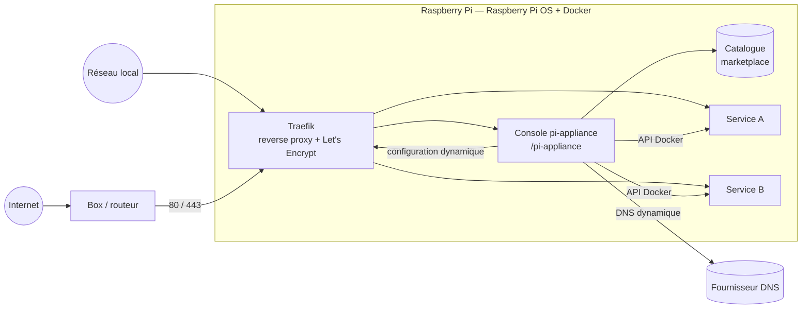

# Spécification de pi-appliance

> **Statut : cible.** Ce document décrit le produit visé. Presque rien n'est encore implémenté : l'état réel et l'avancement sont dans [TODO.md](TODO.md). Une section ne passe de « cible » à « réalisé » que lorsque le code correspondant existe.

## 1. Objet

pi-appliance transforme un Raspberry Pi en **appliance** : un boîtier personnel, posé à la maison, sur lequel on déploie des services. C'est un nœud de **Fog Computing** : les services tournent chez l'utilisateur, au plus près de ses données et de ses objets, et restent accessibles depuis internet.

On flashe une image système prête à l'emploi sur la carte SD, et le Pi fonctionne aussitôt, sans installation manuelle.

L'image repose sur trois couches :

| Couche | Contenu |
|--------|---------|
| Système | Image standard de Raspberry Pi OS (ex-Raspbian), Lite, 64 bits |
| Conteneurs | Docker Engine et Docker Compose |
| Produit | La couche pi-appliance : console d'administration, marketplace, reverse proxy Traefik, exposition sur internet |

### 1.1 Public visé

pi-appliance s'adresse au **grand public** : des personnes sans connaissances techniques, qui ne savent ni ce qu'est Docker ni ce qu'est un DNS. En découle, pour toute la suite :

- tout se fait depuis la console, dans un navigateur : jamais de ligne de commande, de connexion SSH ni de fichier de configuration à modifier ;
- chaque choix a une valeur par défaut raisonnable ; l'utilisateur peut tout accepter sans comprendre ;
- l'interface parle de « services », d'« adresse », de « sauvegarde », pas de conteneurs, de ports ni de certificats ; les termes techniques restent dans les écrans avancés ;
- une erreur dit ce qui ne va pas et quoi faire, en langage courant ;
- une étape qui sort de la console (réglage de la box, achat d'un domaine) est guidée pas à pas.

### 1.2 Licence

pi-appliance est un logiciel libre sous licence **GNU Affero General Public License version 3** (AGPL-3.0), fichier [`LICENSE`](../LICENSE). Toute personne qui modifie pi-appliance et le met à disposition d'autres utilisateurs, y compris à travers le réseau, doit publier ses modifications sous la même licence. Les applications de la marketplace gardent leur propre licence.

## 2. Vocabulaire

| Terme | Sens |
|-------|------|
| **Appliance** | Le Raspberry Pi équipé de l'image pi-appliance. |
| **Console** | L'interface web d'administration de l'appliance, servie sous `/pi-appliance`. |
| **Propriétaire** | La personne qui administre l'appliance (compte créé au premier démarrage). |
| **Utilisateur** | Un compte créé par le propriétaire pour accéder aux services. |
| **Service** | Une application installée depuis la marketplace : un ou plusieurs conteneurs Docker. |
| **Marketplace** | Le catalogue des applications installables. |
| **Manifeste** | La description d'une application de la marketplace (images, ports, volumes, sous-domaine, paramètres). |

## 3. Parcours type

1. J'achète un Raspberry Pi.
2. Je télécharge l'image pi-appliance et je la flashe sur une carte SD (Raspberry Pi Imager ou équivalent).
3. Je démarre le Pi branché sur ma box (Ethernet, ou Wi-Fi saisi dans Raspberry Pi Imager).
4. J'ouvre la console :
   - depuis un autre appareil du réseau local : `https://pi-appliance.local/pi-appliance` ;
   - depuis le Pi lui-même (écran et clavier branchés) : `https://localhost/pi-appliance`.
5. Je me connecte avec l'identifiant et le mot de passe initiaux, et je choisis aussitôt mon propre mot de passe.
6. Je donne mon nom de domaine (par exemple `maison.example.org`).
7. Je crée mes utilisateurs.
8. Dans la marketplace, je coche les services que je veux.
9. pi-appliance télécharge les images Docker, configure le reverse proxy Traefik et les certificats, et ouvre chaque service :
   - à la maison, sur le réseau local ;
   - sur internet, à l'adresse `https://<service>.<mon domaine>`.

## 4. Image système

- Construite à partir de l'image officielle Raspberry Pi OS Lite 64 bits, sans modification du système de base au-delà du nécessaire.
- Contient Docker, Docker Compose, la console pi-appliance et Traefik, démarrés au premier boot.
- Premier démarrage : extension de la partition, nom d'hôte `pi-appliance`, annonce mDNS (`pi-appliance.local`), génération des secrets propres au boîtier (certificat local auto-signé, clés de session). Aucun secret n'est commun à deux images.
- Cible matérielle : Raspberry Pi 4 et 5 (64 bits, 2 Go de mémoire au moins). Les modèles plus anciens ne sont pas visés.
- L'image est publiée en téléchargement avec sa somme de contrôle.

## 5. Console d'administration

Servie par l'appliance sous `/pi-appliance`, en HTTPS seulement.

### 5.1 Premier démarrage (assistant)

1. Connexion avec l'identifiant initial ; changement de mot de passe obligatoire.
2. Nom de domaine de l'appliance (facultatif : sans domaine, les services ne sont accessibles qu'à la maison).
3. Méthode d'exposition sur internet (section 7).
4. Création des utilisateurs.
5. Choix des premiers services dans la marketplace.

### 5.2 Fonctions courantes

- État de l'appliance : charge, mémoire, température, espace disque, adresse publique, état des certificats.
- Services installés : démarrer, arrêter, redémarrer, mettre à jour, désinstaller (avec ou sans ses données), journaux.
- Utilisateurs : créer, modifier, supprimer, réinitialiser un mot de passe.
- Domaine et exposition : modifier, tester l'accès depuis internet.
- Sauvegarde et restauration (section 9).

## 6. Marketplace

- Catalogue d'applications installables, chacune décrite par un **manifeste** versionné dans ce dépôt (format à définir, proche d'un fichier Docker Compose complété de métadonnées).
- Un manifeste donne : nom, description, icône, catégorie, images Docker (multi-architecture, `arm64` obligatoire), volumes de données, ports internes, sous-domaine proposé, paramètres demandés à l'installation, besoins minimaux (mémoire, disque).
- Installer un service : télécharger les images, créer les volumes, générer la configuration Traefik (routeur, certificat), démarrer les conteneurs, afficher l'adresse du service.
- Applications envisagées (reprises des prototypes du dépôt) : Nextcloud, Samba (partage de fichiers, réseau local seulement), serveur web Apache/PHP, Motion (vidéosurveillance), timelapse.

## 7. Exposition sur internet

Objectif : chaque service est joignable à `https://<service>.<domaine>`, depuis la maison comme depuis internet, avec un certificat valide.

- **Reverse proxy** : Traefik, seul point d'entrée sur les ports 80 et 443, routage par nom d'hôte vers les conteneurs.
- **Certificats** : Let's Encrypt, obtenus et renouvelés automatiquement par Traefik.
- **DNS** : le domaine (ou un sous-domaine) pointe vers l'adresse publique de la box. L'adresse publique changeante est suivie par DNS dynamique (DynHost chez OVH, prototype dans `linux-tool/dynHost/`).
- **Box** : redirection des ports 80 et 443 vers le Pi. La console indique la marche à suivre et tente UPnP si la box le permet.
- **Sans IP publique joignable** (CGNAT, box verrouillée) : tunnel sortant vers un relais (prototype autossh dans `all-pi/autossh.sh`).
- **À la maison** : le même nom résout vers le Pi (NAT loopback de la box ou DNS local), sinon accès par `pi-appliance.local`.

## 8. Sécurité

- HTTPS partout ; HTTP redirigé vers HTTPS.
- Aucun mot de passe par défaut ne survit au premier démarrage.
- La console n'est pas exposée sur internet par défaut ; le propriétaire peut l'ouvrir explicitement.
- Mots de passe stockés hachés ; limitation des tentatives de connexion.
- Chaque service tourne dans ses conteneurs, avec ses propres volumes ; rien n'est monté du système hôte sans que le manifeste le déclare.
- Mises à jour de sécurité de Raspberry Pi OS appliquées automatiquement (`unattended-upgrades`).
- Aucun secret (mot de passe Wi-Fi, clé SSH, jeton DNS) n'est versionné dans ce dépôt.

## 9. Sauvegarde et mises à jour

- Sauvegarde de la configuration de l'appliance et des volumes des services vers un disque USB ou un stockage distant (prototype : `all-pi/bkp.sh`, `linux-tool/bkp.sh`).
- Restauration sur une nouvelle carte SD à partir d'une sauvegarde.
- Mise à jour de la couche pi-appliance et des services depuis la console, sans reflasher.

## 10. Architecture

## 11. Exigences non fonctionnelles

- Fonctionne sur carte SD : limiter les écritures (journaux en mémoire ou rotation stricte).
- Démarrage de la console en moins de deux minutes après la mise sous tension.
- Interface utilisable sur téléphone.
- Interface en français d'abord ; anglais ensuite.

## 12. Arborescence du dépôt

| Chemin | Contenu |
|--------|---------|
| `README.md` | Présentation du projet |
| `LICENSE` | Texte de la licence AGPL-3.0 |
| `CLAUDE.md` | Instructions pour les agents et paramètres des skills |
| `.claude/skills/` | Sous-module : skills partagés [gmoulard/claude_skills](https://github.com/gmoulard/claude_skills) |
| `docs/` | Spécification, TODO, notes |
| `all-pi/` | Prototype : configuration commune des Pi (alias, crontab, autossh, sauvegarde) |
| `linux-tool/` | Prototype : outils système (DNS dynamique OVH, sauvegarde, montage Swift) |
| `docker-apache/`, `docker-nextcloud/`, `docker-samba/` | Prototypes de services Docker, futures entrées de la marketplace |
| `pi-motion/`, `pi-timelaps/` | Prototypes caméra : vidéosurveillance et timelapse |
| `RaspController/` | Prototype : GPIO et capteur DHT |
| `pypy/` | Divers |
| `CNAME` | Domaine du site GitHub Pages (`www.pi-appliance.com`) |

## 13. Hors périmètre

- Grappe de plusieurs Pi (orchestration Kubernetes, k3s) : pas dans la première version.
- Hébergement d'un service pour des tiers à grande échelle.

## 14. Questions ouvertes

- Langage et framework de la console (Python/FastAPI, Go, Node…).
- Format exact des manifestes de la marketplace, et catalogue local ou dépôt distant.
- Relais pour les accès sans IP publique : serveur fourni par le projet, ou à la charge de l'utilisateur.
- Comptes utilisateurs : partagés entre les services (SSO, par exemple Authelia ou Authentik), ou propres à chaque service.
- Fournisseurs DNS gérés automatiquement au-delà d'OVH.
- Domaine : le grand public n'en possède généralement pas. Faut-il fournir un sous-domaine (par exemple `<nom>.pi-appliance.com`), le domaine personnel devenant une option ?
